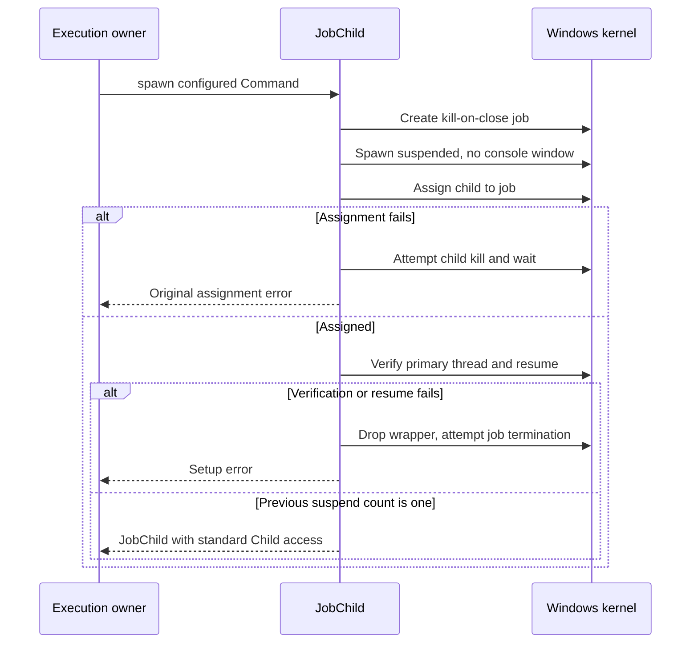
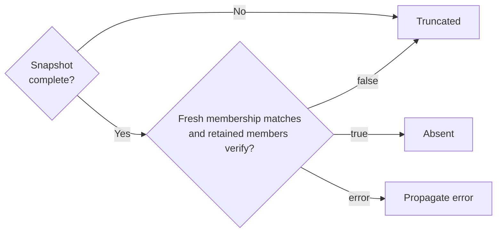

# Identify, contain, and observe Windows processes

This explanation helps maintainers preserve exact process identity, launch
ordering, and conservative observation results. It covers internal Windows
primitives; the native runtime owns session lifecycle and user-visible results.
See [the ownership map](ownership.md) for the owning callers and
[development checks](../development/contributing.md) for native test prerequisites.

| Maintainer question | Section |
| --- | --- |
| Does this PID still identify the same process? | [Retained process identity](#identify-the-exact-process) |
| When may a child run, and who retires its descendants? | [Contained launch](#launch-a-contained-one-shot-process) |
| Is my job membership sample complete? | [Job observation](#observe-a-job-without-parent-pid-inference) |
| Can I report that no listener exists? | [TCP evidence](#interpret-tcp-listener-evidence) |

## Identify the exact process

[process.rs](../../src/process.rs) opens a `ProcessHandle` with limited query and
synchronize rights, not termination rights. PID zero is `InvalidInput`; other
open/query failures are OS errors. It records `ProcessIdentity { pid, created }`,
where `created` is the combined Windows creation `FILETIME` in 100-nanosecond
units. Treat it as an identity component rather than an application timestamp
or Linux start-tick value. A PID alone does not identify a past process.

The retained handle pins the process object, not its life. Opening it does not
prove that the process is still running:

`identity()` returns the identity captured at open without a new liveness check.
`is_alive()` performs a zero-time wait on the retained handle:

| Wait result | Meaning |
| --- | --- |
| Signaled | Process has exited. |
| Timeout | Process was alive at this observation. |
| Other | Return an error. |

`executable_path()` queries the same retained object with a 32,768-code-unit
buffer. It returns a pathname, which does not pin executable bytes or establish
their content.

`is_current_user()` reopens the recorded PID to compare its process-token
account with this process's account. Unlike the handle-based queries above,
this is not an atomic retained-identity/liveness check. Keep the process chain
and recheck it when collecting security evidence.

### Check ancestry without trusting a creator PID

`parent` uses a Toolhelp process snapshot only after checking that the child is
alive. It scans at most 65,536 entries, finds the numeric creator PID, and opens
that parent. A zero parent PID returns `None`; otherwise it rejects a newer
parent creation time, self-parenting, an exited parent, or an exited child.
Missing/inaccessible parents and snapshot errors remain errors, not `None`.
This avoids treating a reused creator PID as ancestry. The result is still a
sample, not a promise that either process remains alive after return.

Security-sensitive callers retain the process chain
and check liveness/creation identity around its use. The
[agent ancestry validator](../../../undercurrent-runtime/src/process/hosted.rs)
also pins and compares the peer's executable file identity with the expected
bridge, bounds its ancestry walk, rejects cycles, and rechecks chain liveness.
Do not substitute a parent-PID walk for authoritative Job Object membership.

### Select OS paths

`command_interpreter` queries `GetSystemDirectoryW` and appends `cmd.exe` without
consulting `PATH` or `COMSPEC`. `windows_directory` queries
`GetWindowsDirectoryW`, used by the execution supervisor to supply missing
`SystemRoot`. Both use 32,768 UTF-16 units and reject zero or oversized results.
They return paths; executable pinning and launch policy remain with the caller.

## Launch a contained one-shot process

[job.rs](../../src/job.rs) wraps `std::process::Child` for piped one-shot supervisors.
`JobChild::spawn` creates an unnamed, noninheritable Job Object with
`JOB_OBJECT_LIMIT_KILL_ON_JOB_CLOSE`, replaces the command's creation flags with
`CREATE_SUSPENDED | CREATE_NO_WINDOW`, and spawns it. It must assign the suspended
process to the job before allowing user code to run, so setup cannot leave an
uncontained running child that escapes early cleanup.

The standard `Child` does not retain the primary-thread handle. The wrapper
therefore scans a global Toolhelp thread snapshot (at most 1,000,000 entries),
requires exactly one thread owned by the new PID, opens that thread with query
and resume rights, and rechecks both its owning PID and the retained root's
liveness. `ResumeThread` must report a previous suspend count of exactly one.
Enumeration, assignment, or resume errors fail the spawn.

This sequence shows the assignment barrier and cleanup when setup fails.
Thread verification includes the bounded scan and liveness checks above:

*Assignment precedes resume; success establishes an OS launch outcome.* If job
creation or suspended spawn fails, the error returns before assignment. Failed
assignment ignores kill/wait cleanup errors and returns the original error.
After assignment, setup failure uses the wrapper's drop path. There is no
persistent operation commit here.

### Termination and handle lifetime

`JobChild` dereferences to `std::process::Child` for waiting and stdio access.
Control operations have different lifetime effects:

| Operation | Effect and limit |
| --- | --- |
| `JobChild::kill()` | Requests termination of the entire job. |
| `control()` and `JobControl::terminate()` | Clones share the retained job handle through `Arc`. Termination uses that exact handle and exit code 1; OS errors propagate. |
| Drop `JobChild` | Explicitly attempts whole-job termination even if control clones remain. Ignores termination errors and does not wait. |
| Drop a `JobControl` clone | Releases one reference. Windows kill-on-close applies when the final retained job handle closes. |
| Wait on the root `Child` | Reports root exit; descendants may remain alive and retain output handles. |

Both termination methods return without waiting for exit or output EOF.
They have no internal deadline and never reopen a process by PID. Containment applies to job members;
processes created by an external broker are not thereby proven to be members.

### Runtime cleanup and application outcomes

The [Windows execution supervisor](../../../undercurrent-runtime/src/process/execute_host.rs)
uses an outer job for the supervisor and an inner `JobChild` for its workload.
After workload spawn it records the start identity and sends a supervisor
status marker, then relays stdout/stderr. It waits for the root, terminates the
remaining workload job, and only then joins output relays so descendants cannot
indefinitely retain their output handles. Runtime cancellation/deadlines use
the stored `JobControl`; the platform crate has no execution deadline policy.
Runtime journals and status messages determine application outcomes. A host
crash can require an unknown outcome even though job cleanup kills the tree;
[Windows execution tests](../../../undercurrent-runtime/src/process/windows_execution_tests.rs)
exercise exactly that distinction.

## Observe a job without parent-PID inference

[job_observation.rs](../../src/job_observation.rs) owns read-only membership
observation. `JobProcessObserver::from_owned_handle` consumes a job handle that
must grant `JOB_OBJECT_QUERY`; construction itself performs no validation.
Invalid/non-job handles fail later kernel queries. The runtime obtains a
cloned observer handle from the managed PTY's killer in
[managed.rs](../../../undercurrent-runtime/src/process/managed.rs); it does not
discover jobs from a PID or create a new containment policy.

`contains` brackets `IsProcessInJob` with liveness checks on the retained
process. `snapshot` collects at most 128 members:

1. Query the job's current PID list.
2. Open and verify each returned process against the retained job.
3. Query membership again, then recheck the retained members.

The PIDs are sorted; zero, out-of-range, duplicate, or inconsistent counts are
`InvalidData`. A capacity `ERROR_MORE_DATA` yields an empty incomplete membership
sample, not a fabricated complete prefix. Other query errors propagate.

An inaccessible or exited member makes the snapshot incomplete, as does an
observed membership change. Per-member open/containment failures during snapshot
collection mark incompleteness rather than discarding all usable retained
members. `processes()` exposes those verified handles; `complete()` says only
that this collection passed its bounded checks. It is not a lifetime guarantee.
`is_current` rejects an already incomplete snapshot, compares a fresh membership
set with its retained PIDs, and checks each process again. Query failures can
still be errors. Churn between observations is not turned into an atomic view.

## Interpret TCP listener evidence

`TcpListenerObservation` has three variants: `Present`, `Absent`, and
`Truncated`. Native query failures travel separately as `io::Error`. A positive
fact needs a verified match; a negative fact needs complete bounded coverage.

### Match rows to retained process identities

[listeners.rs](../../src/listeners.rs) asks `GetExtendedTcpTable` for IPv4 and IPv6
owner-module listener rows in the host network namespace. A matching PID alone
is insufficient: the row must be `LISTEN`, have a nonzero creation timestamp,
and have been created no earlier than the retained process. The timestamp check
avoids attributing a stale row to a later process reusing that PID. A matching
row with a zero timestamp marks that family incomplete while inspection continues
within the row limit. A verified listener in that inspected prefix establishes
`Present` regardless of its order relative to incomplete rows. Without a positive,
incomplete identity evidence yields `Truncated`, never `Absent`. Unrelated and
non-listening rows provide no ownership evidence.

| Bound | Behavior when exceeded |
| --- | --- |
| 128 process handles per collection | Returns `Truncated`; an empty list returns `Absent` internally. |
| 4,096 initial table bytes; at most 1 MiB | Buffer growth that needs more than the bound returns `Truncated`. Storage is aligned for native rows. |
| Three query attempts per address family | Repeated concurrent growth returns `Truncated`. |
| 8,192 inspected rows per family | A match in the inspected rows can prove presence; otherwise an oversized table is `Truncated`. |
| Valid native table sizes and row counts | Invalid size/layout is `InvalidData`, not truncation or absence. |

`ProcessHandle::tcp_listener` and the tree collector check retained process
liveness before and after table collection. Exit produces `NotFound` rather
than evidence about a replacement PID. The two families are sampled separately,
not in one atomic kernel snapshot.

### Combine address families, then check job membership

After retained-process liveness checks, family results combine in this priority
order. An earlier row wins:

| Condition | Result |
| --- | --- |
| Either family is `Present` | `Present`, even if the other family failed or was truncated. |
| No match, and either family failed | Propagate the error. |
| No match or error, and either family is `Truncated` | `Truncated`. |
| Both families are complete negatives | Tentative `Absent`. |

For a single-process query, the last row returns `Absent`. A job-wide
`tcp_listener(root)` also requires root membership before and after collection,
and rechecks every retained member before returning a result. Exited/nonmember
roots or retained members produce `NotFound`; other membership-query errors
propagate.

Only a tentative `Absent` triggers the final membership-set check below. This
explains why an incomplete snapshot cannot prove that the job has no listener:

*Job-wide absence requires a current complete membership sample. A positive
match can survive unrelated membership churn when retained processes still
pass their liveness and membership checks.* Neither path makes the samples
atomic or promises future membership.

### Keep observation separate from readiness

The [runtime mapping](../../../undercurrent-runtime/src/process/mod.rs) adds its own
`Unavailable` representation and checks the root creation identity. It reports
managed-root evidence first and attempts managed-tree evidence when needed.
ConPTY provides no POSIX foreground process group, so these host TCP facts do
not identify foreground ownership. A listening socket also does not prove
service readiness, successful request handling, or task completion. These APIs
return neither ports nor addresses and observe no UDP sockets.

## Tests and change guidance

Use [test coverage and limits](../development/test-coverage.md) for identity,
launch, exact membership, TCP layout, truncation, and real-socket checks. The
reference distinguishes deterministic parsing checks from native observations.

When adding a fact, retain its process objects through collection, state its
scope and bounds, and decide separately what proves presence and what proves
absence. Do not turn query failures into negatives. Add deterministic layout,
growth, and combination tests beside the code, then a native ownership test.
When changing launch/cleanup order, also use the runtime supervisor crash,
cancellation, deadline, and output tests listed in
[the verification guide](../development/contributing.md#choose-checks-for-a-change). Changes to
application recovery or readiness require their owning contracts, not just an
adapter test.

[Crate documentation](../README.md)
