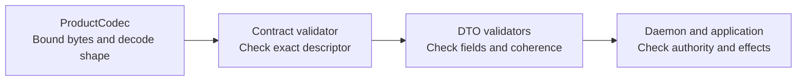

# Locate a protocol contract and its checks

Use this source map when a message, validator, or digest must change. The crate
owns pure product values and codecs. It exports supported types from its root;
private module paths keep implementation organization out of consumer imports.

## Validation ownership

Follow the boundary that can establish the property you need:

*These are separate checks, not calls automatically chained by the codec.* A
successful decode can still fail contract or semantic validation. The
[encoding reference](../../../../docs/reference/protocol/encoding.md#bounds-and-validation-layers)
owns the precise checks and exceptions, including direct repair/status contracts.

## Source map

Private Rust modules re-export their supported types at the crate root through
[lib.rs](../../src/lib.rs); absence of public module paths is intentional. A `pub`
implementation seam such as hidden multipart terminal encoding does not license
external consumers to import the daemon, runtime, wire, or application crates.

| Module and contract | Evidence |
| --- | --- |
| [lib.rs](../../src/lib.rs) Export boundary and shared `Classification`; [crate orientation](../../README.md). | Architecture consumer policy and [consumer package](../../../../tests/architecture/consumer/Cargo.toml). |
| [dto.rs](../../src/dto.rs) Finite and stream envelopes, launch/query/input/output/profile/work/diagnostic DTOs; [operations](../../../../docs/reference/protocol/operations.md), [streams](../../../../docs/reference/protocol/streams.md). | [Protocol contracts](../../tests/protocol_contract.rs), [dispatch bindings](../../tests/dispatch_binding.rs), [revision preconditions](../../tests/revision_preconditions.rs). |
| [registry.rs](../../src/registry.rs) Operations, streams, events, errors, optional capabilities and dispositions; [operations](../../../../docs/reference/protocol/operations.md), [recovery](../../../../docs/reference/protocol/recovery.md). | Fixed registry fixtures, serialization parity and unknown-name rejection in [contract tests](../../tests/refactoring_contract.rs). |
| [contract.rs](../../src/contract.rs) Schema/version constants, descriptor, attempt/outcome, process truth, secret references and execution output; [encoding](../../../../docs/reference/protocol/encoding.md), [recovery](../../../../docs/reference/protocol/recovery.md), [streams](../../../../docs/reference/protocol/streams.md). | [Contract metadata and compatibility tests](../../tests/refactoring_contract.rs). |
| [compatibility.rs](../../src/compatibility.rs) Exact current contract and additive security-name validation; [encoding](../../../../docs/reference/protocol/encoding.md). | Current/retired version, repair metadata, security-field tests in [refactoring contracts](../../tests/refactoring_contract.rs). |
| [codec.rs](../../src/codec.rs) Bounded JSON encode/decode classes; [encoding](../../../../docs/reference/protocol/encoding.md). | [Payload bounds and malformed input tests](../../tests/protocol_contract.rs). |
| [error.rs](../../src/error.rs) Redacted codec failure accessors and source chain; [encoding](../../../../docs/reference/protocol/encoding.md#codec-errors-and-safe-diagnostics). | Codec/terminal redaction tests in [protocol contracts](../../tests/protocol_contract.rs). |
| [canonical.rs](../../src/canonical.rs) Semantic request fingerprint with mutation removed; [encoding](../../../../docs/reference/protocol/encoding.md#semantic-fingerprints-and-output-digests). | [Fingerprint tests](../../tests/refactoring_contract.rs), [revision tests](../../tests/revision_preconditions.rs). |
| [execution_output_digest.rs](../../src/execution_output_digest.rs) Exact canonical lowercase digest and verification; [streams](../../../../docs/reference/protocol/streams.md). | Inline golden digest/uppercase/prefix/tamper tests in the source. |
| [auth.rs](../../src/auth.rs) Bounded credential-free context references; [encoding](../../../../docs/reference/protocol/encoding.md#identity-environment-and-privacy). | [Authenticated-context tests](../../tests/refactoring_contract.rs). |
| [observability.rs](../../src/observability.rs) Outward stable-string status mapping and safe name grammar; [encoding](../../../../docs/reference/protocol/encoding.md#codec-errors-and-safe-diagnostics). | Source match/default rules; these helpers alone do not prove downstream telemetry redaction. |
| [terminal.rs](../../src/terminal.rs) UCTO binary output/screen items, geometry and length checks; [streams](../../../../docs/reference/protocol/streams.md#binary-terminal-layout). | [Binary and multipart tests](../../tests/protocol_contract.rs). |
| [repair_attempt.rs](../../src/repair_attempt.rs) Exact repair input and count-consistent terminal result; [recovery](../../../../docs/reference/protocol/recovery.md#repair-an-unknown-attempt). | Inline fixture tests and [application repair tests](../../../undercurrent-application/tests/repair_attempt.rs). |
| [runtime_attempt_status.rs](../../src/runtime_attempt_status.rs) Attached read-only status and coherent discriminated snapshots; [recovery](../../../../docs/reference/protocol/recovery.md#read-an-attached-runtime-attempt). | Inline status fixture/validation tests and [store tests](../../../undercurrent-store-sqlite/tests/runtime_attempt_status.rs). |
| [runtime_cancellation.rs](../../src/runtime_cancellation.rs) Exact control/status, two digests, pinned binding and state validation; [cancellation](../../../../docs/reference/protocol/cancellation.md). | Inline strict grammar/golden tests and [durable cancellation tests](../../../undercurrent-store-sqlite/tests/runtime_cancellation.rs). |
| [agent.rs](../../src/agent.rs) Caller binding, public events/replies, private bridge shapes and canonicalization; [agent events](../../../../docs/reference/protocol/agent-events.md). | [Agent stream round trip](../../tests/protocol_contract.rs), [durable agent queue tests](../../../undercurrent-store-sqlite/tests/agent_channel.rs). |

## Design constraints and tradeoffs

These are explanations of implemented constraints, not newly proposed decisions.

- Separate product DTOs from domain aggregates so public serialization does not
  import application/runtime state or weaken domain validation.
- Reject unsupported product descriptors exactly while preserving only the
  explicit mutation extension map; this prevents version-looking input from
  silently controlling security or cancellation semantics.
- Separate binary terminal data from JSON control items to avoid JSON byte-array
  overhead on live output and preserve arbitrary bytes. Finite pages remain
  JSON and include explicit integrity metadata.
- Separate mutation acceptance, process effect, durable settlement, and response
  delivery so a failed transport is never silently converted into known absence.
- Separate lifecycle, foreground evidence, health, and external work. Runtime
  observations cannot declare another product's semantic success.
- Retain canonical identity and bounded evidence rather than promising indefinite
  replay. Digests detect changes; fences constrain ownership; neither is a
  substitute for authorization.

Protocol codecs are immutable and do no IO or synchronization. They do not
serialize concurrent requests, order process effects, retain output, implement
backpressure, or enforce cancellation deadlines. Those guarantees come from
session mutation leases, durable repositories, runtime adapters, multiplexing,
and SDK recovery. Their outcomes are represented here without claiming stronger
atomicity or lifetime guarantees.

[Protocol documentation](../README.md) · [Extend a contract](../development/extend-contract.md)
