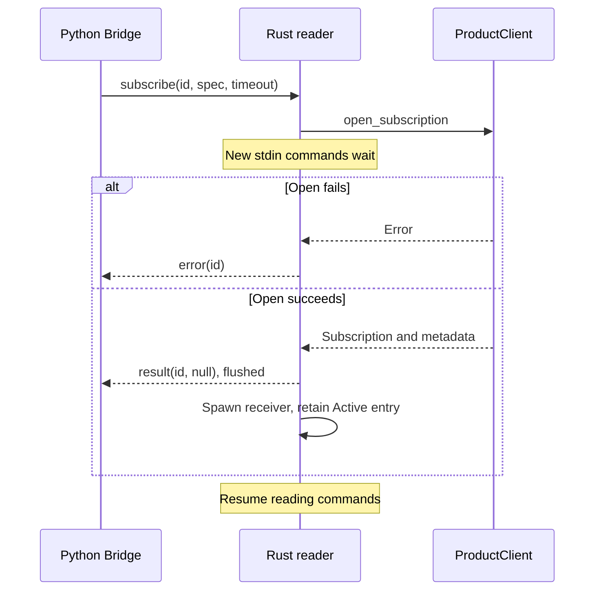
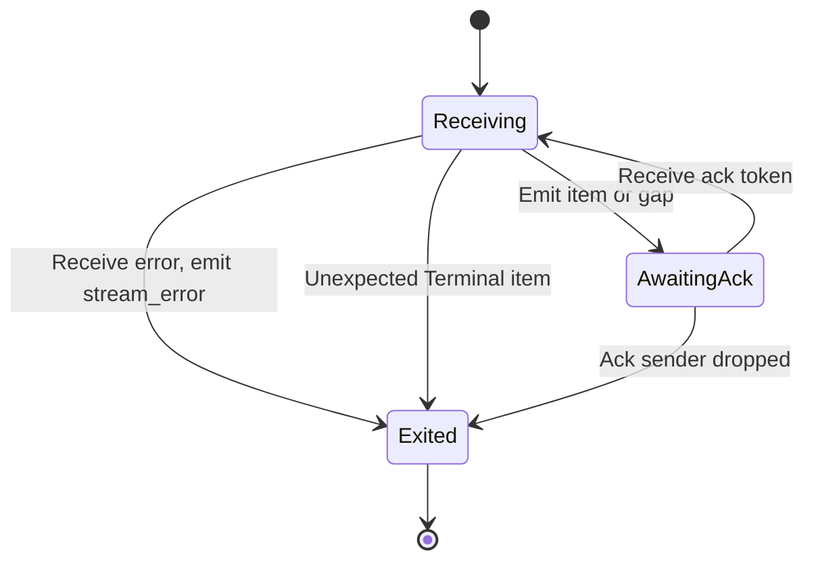

# Trace a Python operation through the bridge

This explanation helps maintainers locate ownership, ordering, and failure
boundaries before changing the bridge. It covers the current Python `0.1.0-beta`
package and Rust bridge at the same revision. Read the
[crate overview](../../README.md) first; use the [stdio reference](../reference/stdio-protocol.md)
for exact envelope fields rather than treating these diagrams as a wire schema.

## Language and ownership boundaries

Python [`Client`](../../../../python/src/undercurrent/client.py) presents awaitable
operations and async iterators. Its private
[`Bridge`](../../../../python/src/undercurrent/_transport.py) owns a subprocess,
asyncio locks, pending futures, and per-stream queues. The Rust
[`ProductClient`](../../../undercurrent-sdk/src/product.rs) is blocking and cheaply
clonable. All bridge workers share one resilient SDK client, which maintains one
current physical connection and replaces it during recovery. Separate Python
`Client` instances create separate subprocesses and SDK clients; there is no
process-wide connection pool.

For process placement, use [project architecture](../../../../docs/architecture/README.md).
For the bridge's direct SDK/protocol dependencies, use the
[workspace map](../../../../docs/architecture/dependencies.md#manifest-map) and
[manifest](../../Cargo.toml). Python-side locks, futures, and subprocess ownership
are documented in the [Python implementation guide](../../../../python/docs/README.md).

The SDK owns authenticated local IPC and negotiation. The daemon owns
policy/authorization, session mutations, durable records, runtime effects, and
retained output. This executable is distinct from the daemon's
[private agent gateway](../../../undercurrent-daemon/src/agent_bridge_gateway.rs)
and [session-host entry point](../../../undercurrent-daemon/src/session_host_main.rs).
It neither carries that private IPC nor bypasses product authorization.

| Concern | Owning boundary | Bridge's part |
| --- | --- | --- |
| Python argument validation and convenience methods | Python `Client` | Accept typed product DTOs, including requests without a Python convenience method |
| Parent subprocess and async lifecycle | Python `Bridge` | Read commands and emit correlated lines |
| Contract versions and DTO fields | Product protocol | Fill current metadata for five standalone mutations |
| Physical connection, authentication, request correlation, stream recovery | Rust SDK | Configure one standard client and share its clones |
| Durable state, idempotency policy, authorization, process effects | Daemon/application/runtime/store | Forward successes or projected errors; no local commit log |
| Application acceptance and task completion | The managed application and its caller | No inference from input receipts, readiness, or observed exit |

## Code map

Command handling is in [`src/main.rs`](../../src/main.rs); the shared envelope
writer and terminal-output guard are in [`src/output.rs`](../../src/output.rs).
The package has no library target.

| Entry point | Responsibility and invariant |
| --- | --- |
| `maximum_line_bytes`, `Command`, `default_timeout` | Bound input before unbounded line allocation; distinguish envelope parse failure from a valid command with invalid timeout |
| `Output`, `emit` | One mutex spans serialization, newline, and flush; fatal marks output terminal and suppresses later workers; stdout failure exits immediately |
| `error_value` | Project typed SDK categories and available product evidence without returning request bodies |
| `Active`, `detach` | Own subscription, one-slot acknowledgment sender, and thread handle; wake both possible wait sites before joining |
| `prepare` | Add standalone environment binding and replace selected mutation metadata while preserving the idempotency key |
| `run` startup | Resolve home, install standard client and deterministic jitter, emit ready only after connection succeeds |
| `run` reader and `request` arm | Validate envelope and request, admit bounded worker, share client, correlate completion by parent ID |
| `run` `subscribe` arm | Restrict stream kinds, bound entries, activate on reader, emit acknowledgment of activation before spawning receiver |
| `run` stream worker | Receive SDK items, project JSON/gap items, wait for parent acknowledgment; terminal failure exits the worker |
| `run` `ack` / `unsubscribe` arms | Release stream flow control or explicitly remove it; do not cancel a finite request |
| `run` EOF / `main` | Separate normal drain/close/join from fatal errors and process exit |

This map locates responsibilities; exact serialized definitions remain in the
[stdio reference](../reference/stdio-protocol.md), not duplicated as a symbol inventory.

## Finite requests and concurrency

The reader parses commands serially. Each admitted finite request gets an OS
thread, a `ProductClient` clone, a stdout handle, and the shared atomic count.
Only the reader increments the count; workers decrement after emitting their
result. Finished handles are removed when another request is admitted. At normal
EOF, still-retained request handles are joined after the client is closed.
There is no worker-panic recovery: a panic can omit both a correlated response
and the normal count decrement. This is a failure mode, not an admission guarantee.

Finite completion order can differ from input order. The stdout mutex guarantees
whole lines, not FIFO execution. For dependent operations, Python callers must
`await` one result before issuing the next. A daemon session mutation lease can
serialize effects for an exact session, but it does not establish the order in
which concurrently spawned request threads reach the daemon.

Subscription activation and detach run on the reader thread. A slow open blocks
new requests, acknowledgments, and unsubscriptions from being read, although
already-spawned workers and SDK recovery continue. There is no reader command
queue deadline. A blocked stdout write can stall every emitter and, when the
reader emits, command consumption too. The numeric bounds and timeout phases
are listed in [limits and timing](../reference/stdio-protocol.md#limits-and-timing).

## Session creation: durable success before response delivery

The bridge's `prepare` fills the standalone environment binding and current
mutation metadata, then an admitted worker calls the shared Rust SDK. Python
argument/default construction belongs to [Python operations](../../../../docs/sdk/python/operations.md#start-and-identify-a-process).
The bridge does not create a caller-fenced dispatch attempt.

The shared [start walkthrough](../../../../docs/architecture/flows.md#start-a-session)
owns activation commits and response loss. Within this executable, worker
admission, SDK return, and successful stdout emission are separate events.
An emitted result is not proof that Python processed it; use the bridge
[recovery guide](recovery.md#reconcile-a-mutation-before-retrying) after uncertainty.

## Input and output: separate effects from observations

For input, `prepare` preserves semantic delivery identity, revision, and ordered
input items while normalizing mutation metadata. The application
[input-delivery contract](../../../undercurrent-application/docs/internals/sessions/terminal-io.md#input-ordering-and-partial-success)
owns reservation, write, settlement, and retention through daemon restart.
Stdio correlation IDs and stream ACKs do not provide mutation deduplication.

Output is a finite product request; this bridge exposes no binary terminal-stream
subscription. It forwards the returned DTO without owning retention or verifying
the payload digest. Python performs that check and creates `OutputPage` or raises
`OutputGap`. The [Python output guide](../../../../docs/sdk/python/streams.md#read-retained-output)
owns pagination and the maintained example. The [shared output walkthrough](../../../../docs/architecture/flows.md#consume-terminal-bytes)
locates the producer, store, and public read boundary.

## Stream delivery and backpressure

### Activation: why a slow open stalls the reader

The reader must finish opening a stream before it can read the next command.
This sequence shows the activation reply that permits Python to enter its iterator.

*Activation precedes item emission because the receiver starts after the reply
is flushed. Stream-open metadata is discarded. Already running request and
stream workers can continue while the reader is opening another stream.*

### Delivery: two waits must be released on detach

The [Python delivery sequence](../../../../docs/sdk/python/streams.md#backpressure-and-connection-recovery)
shows the parent queue and acknowledgment before yielding to user code. Locally,
the stream worker alternates between an SDK receive and a wait for that
acknowledgment token:

*Unsubscribe removes the `Active` entry, cancels SDK receive, drops the ack
sender, then joins the worker. Worker exit alone retains the entry and its
capacity slot. The diagram assumes writable stdout; a write failure terminates
the entire process as described in [shutdown](recovery.md#close-and-cancellation-are-different-actions).*

The worker uses cancellation-aware blocking `recv`; idle streams do not wake
periodically. Detach separately cancels the SDK receive (including recovery
waits) and drops the Python ACK sender before joining. Both wakeups are needed;
neither ACK backpressure nor an idle/recovering transport requires polling.

Each stream has its own worker and acknowledgment channel. Python queues its
ack before yielding and does not wait for Rust to read it; this token cannot be
used as a durable consumer checkpoint. A worker can emit `stream_error` during
cancellation. Python removes its queue before sending unsubscribe, so late
messages for that ID are ignored. Callers must close the iterator even after an
error so cleanup can release the entry.

The SDK retains resume state and reconnects streams. The bridge projects gaps
and drops transport sequence metadata; Python `watch` performs an authoritative
inspect on a gap and flags replacement snapshots as resynchronized. Python
`events` yields raw event and gap envelopes. Slow consumption can still lead to
upstream retention gaps: bounded queues are a memory constraint, not a promise
of lossless history. [Recovery](recovery.md) explains the caller's next steps.

[Crate documentation](../README.md)
