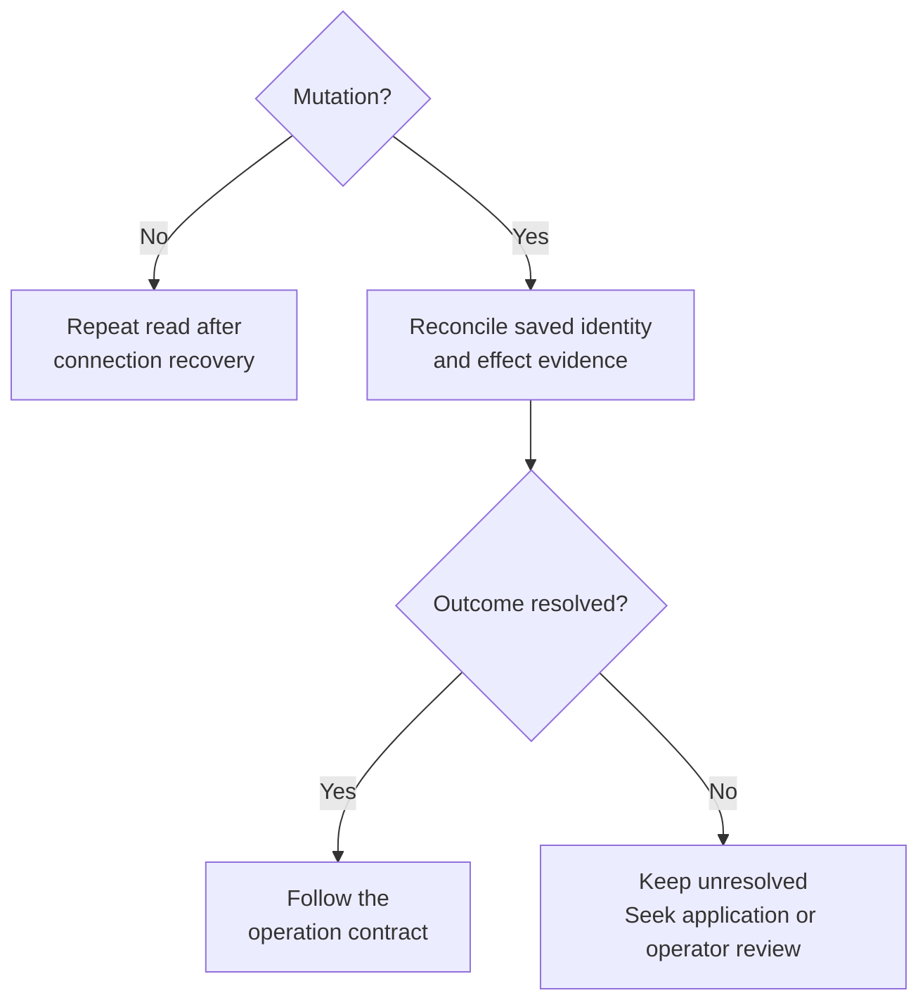
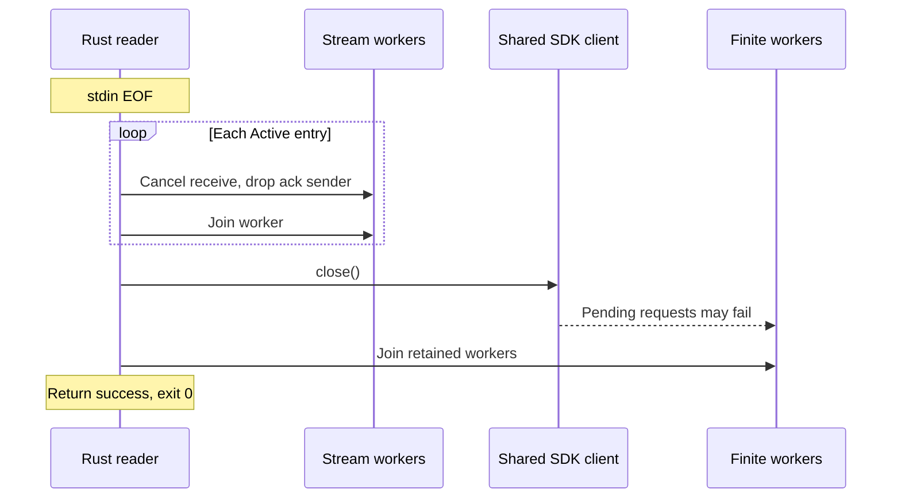

# Diagnose failures and reconcile uncertain effects

Use this guide when a Python operation times out, a stream stops, or the bridge
exits. It applies to the matching Python and bridge `0.1.0-beta` packages and an
external daemon. Save session IDs and mutation identities before acting; a new
connection does not tell you whether an earlier operation took effect.

[Crate entry point](../../README.md) · [Setup and inspection](../development/contributing.md) ·
[Error fields](../reference/stdio-protocol.md#error-projection)

## Choose the next action from the failure boundary

Start with the symptom, then preserve the evidence needed for recovery.

| Symptom | Next step |
| --- | --- |
| No initial `ready`, or a fatal input error | [Check startup and framing](#fix-startup-and-framing-failures) |
| Explicit gap, invalid output, or `stream_error` | [Recover observation continuity](#recover-observation-continuity) |
| Typed rejection | Inspect [category, disposition, and certainty](../reference/stdio-protocol.md#error-projection), then use the decision below |
| Timeout, cancellation, or disconnection after sending work | Use the decision below; a lost response can hide completed effects |

This decision separates restoring a connection from deciding whether an operation
may be repeated.

*A missing response does not establish absent effects. Follow the mutation steps
below before choosing a retry, even if the SDK has already reconnected.*

## Fix startup and framing failures

1. Check that `Client(bridge=...)`, `UNDERCURRENT_PYTHON_BRIDGE`, or PATH selects
   the expected executable. Python resolves it with `shutil.which`; a wheel does
   not contain the Rust binary. Use the [setup commands](../development/contributing.md#prepare-the-executable-and-python-import).
2. Match the client's runtime home to the running daemon. The bridge targets
   `<home>/run/control.sock`; it does not discover a daemon elsewhere or launch
   one. When invoking the bridge directly, use an absolute normalized home with
   no `..` components. On Unix the socket path also has a platform-specific
   length limit in [`LocalEndpoint`](../../../undercurrent-transport-local/src/endpoint.rs).
3. A startup `fatal` can describe endpoint validation, OS identity verification,
   handshake, capability, or connection-recovery failure. Restore the intended
   daemon/installation and use matching revisions; do not bypass peer checks by
   loosening endpoint protections. The [SDK local adapter](../../../undercurrent-sdk/src/local.rs)
   is the debugging entry point for connection stages.
4. For a fatal input error, repair the caller's framing using the
   [envelope reference](../reference/stdio-protocol.md#command-envelope). Invalid JSON,
   malformed required fields, overlong input, and read errors leave the command
   loop. An unknown operation is fatal after timeout validation succeeds. Product
   payload validation errors inside a valid envelope usually return an
   ID-correlated error and leave it alive.
5. Close the failed client and create a new `Client`. Python latches a reader
   failure in `_failure`; failure while waiting for the initial ready message
   calls `close`, and closed clients cannot be reopened. It never respawns a failed bridge transparently.

Stdout must contain protocol only. Diagnostic `println!` output can corrupt the
Python reader and fail all pending calls. Python currently discards bridge
stderr, so an uncaught Rust panic may present only as disconnection. For local
investigation, run the matching executable interactively in an already prepared
runtime home to retain stderr, or use existing daemon diagnostics. Avoid logging
whole command bodies or terminal output to diagnose correlation problems.

## Reconcile a mutation before retrying

Neither the bridge nor `ResilientClient` automatically replays failed finite
requests. The SDK may restore a physical connection while a finite operation
still fails; Python may time out or cancel its future while the Rust worker is
still running. A result that arrives after Python removes that future is ignored.

| Identity or evidence | Scope and recovery use |
| --- | --- |
| Stdio `id` | Correlates a parent call or subscription only; supplies no daemon deduplication |
| SDK `python-<UUIDv7>` identity | Fresh per bridge process; retained by the same resilient client through physical reconnection |
| Mutation `idempotency_key` | The bridge preserves it only through normalization; the daemon's generic cache scopes it by client identity and exact encoded payload, with bounded capacity and expiry |
| Terminal `delivery_id` | Session-scoped reservation comparing exact input and observation policy. Current daemon storage is bounded and in memory; it does not guarantee replay across daemon replacement |
| Session ID | Stable lookup target for inspect, stop, input, and output; a `Session` object is a snapshot, not a process owner |
| Effect certainty and disposition | Preserve when supplied; null or absent does not mean `known_absent` |

The generic [dispatcher cache](../../../undercurrent-daemon/src/dispatch.rs) is not a
cross-bridge durable retry guarantee. Restarting the bridge generates a different
client identity; reusing an old start key in a new client does not establish the
same cache scope. Even within one scope, payload changes conflict and pending
reservations are not completed results. Python's default start name and key are
newly generated each call, and `stop` creates a new key every call. Repeating a
convenience method is not automatically an exact retry.

### Reconcile the affected operation

1. Retain the operation's identity, exact arguments, and any disposition or
   effect certainty from the error. A timeout or absent certainty cannot prove
   that nothing happened.
2. Restore observation access. If the bridge failed, close the client and create
   a fresh one; the new SDK client identity changes the generic cache scope.
3. Resolve the operation using its owning contract:

   | Operation | Evidence to seek before acting again |
   | --- | --- |
   | Lost start result | Query by the intended name/labels, verify the launch, save the session ID, and inspect its lifecycle. Keep the outcome unresolved if this does not identify what happened |
   | Lost stop result | Inspect the exact session. Process absence or a terminal observation does not establish application success |
   | Lost input result | Retain the exact `delivery_id`, input, and observation policy. Follow the [input reservation and settlement contract](../../../undercurrent-application/docs/internals/sessions/terminal-io.md#input-ordering-and-partial-success); seek an application acknowledgment tied to the intended delivery |
   | Other raw mutation | Consult that product operation's effect and reconciliation contract before issuing another request |

4. Retry only when the operation's contract and retained evidence permit it.
   Do not create another process solely because a start future failed, or change
   a delivery ID to bypass an indeterminate input result.

The input service reserves before IO. While a matching record is retained,
a delivered result can be replayed without IO, changed semantic payloads conflict,
and indeterminate reservations suppress another write. Current revision and
lifecycle checks still apply before lookup. The intended persisted reservation
port is currently backed by [`BoundedInputDeliveryStore`](../../../undercurrent-runtime/src/deliveries.rs)
in [daemon composition](../../../undercurrent-daemon/src/composition.rs).
This implementation limit prevents a permanent or cross-daemon exactly-once
promise. A delivery receipt or available composer cannot prove application
acceptance.

Raw attempt-aware product operations and runtime cancellation have separate
durable identities and reconciliation APIs in the [public Rust SDK](../../../undercurrent-sdk/src/product.rs).
This bridge has no `cancel_request` command or Python convenience method for
runtime-attempt cancellation. Its [metadata normalization](../reference/stdio-protocol.md#mutation-normalization)
discards supplied attempt context on start/input/stop/resize/rename, so do not use those
paths to preserve external attempt fences.

## Recover observation continuity

When the daemon connection drops but the bridge remains alive, the Rust
[recovery supervisor](../../../undercurrent-sdk/src/resilient.rs) attempts bounded
reconnection and subscription resume using the standard profile. Python keeps
the same stream ID in its own queue map. This is restoration of a logical stream,
not replay of a pending mutation. Resume can report a gap, fail one stream, or
exhaust the shared recovery budget.

| Observation failure | Caller action |
| --- | --- |
| `watch` gap or replacement snapshot | Python marks `SessionUpdate.resynchronized=True`; a gap triggers `inspect` and snapshots replace local assumptions. Treat previous continuity as broken |
| `events` gap | The iterator exposes a gap envelope; use fresh state to reconcile current truth and a saved durable event sequence for any explicit new replay request. The bridge gap has no missing-range metadata |
| `OutputGap(available_from)` | Decide whether losing earlier bytes is acceptable. If so, make an explicit read at `available_from`; otherwise report incomplete output |
| Partial output page | Use the [Python page continuation rule](../../../../docs/sdk/python/streams.md#read-retained-output); `next_offset` is the available end, which can be beyond the returned page |
| Output digest mismatch | Treat the page as invalid; preserve the failure and investigate matching binaries/transport before using its bytes |
| `stream_error` | Close the iterator so unsubscribe frees its entry; repair the cause before opening a new stream |
| Bridge EOF/invalid response | Python fails pending futures, discards queued observations, and enqueues failure for each stream; close and create a fresh client |

Python `wait_for_stability` combines watch updates, a fresh inspect before a dwell
return, and durable event-time observations to catch transient states coalesced
out of watch updates. Gaps and resynchronization restart the dwell. The bridge
supplies transport, not stability inference. The
[Python guide](../../../../docs/sdk/python/state.md) owns predicates and
limitations; [wait tests](../../../../python/tests/test_wait.py) check disconnected
reads, gaps, coalesced transitions, cancellation, and revision floors. An overall
wait timeout does not establish that an input failed or that a process stopped.

## Close and cancellation are different actions

### Normal EOF and exceptional exits

This sequence shows normal stdin EOF cleanup, including why sending EOF right
after a request can lose its result. The participants are bridge resources,
not managed sessions.

*Normal EOF detaches streams before closing the shared client. Closing it can
fail requests still waiting; keep stdin open until the correlated result arrives.
A worker blocked writing stdout can delay joining.*

Other termination paths bypass this explicit drain sequence:

| Trigger | Visible outcome |
| --- | --- |
| Startup or reader returns an error | `main` emits terminal `fatal` through the shared output owner, finishing any active frame and suppressing later worker frames, then exits 1 if stdout remains writable. See [framing](../reference/stdio-protocol.md#framing-and-startup). |
| Any stdout serialization/write/flush failure, including while emitting `fatal` | Immediate exit 0, without explicit drain |
| Panic | Outside the ordinary error model; `main` does not convert it to a `fatal` envelope |

An exit code of zero therefore does not establish completion of pending work.
Connection setup must succeed before `ready` is emitted and the reader accepts
commands; see [startup](../reference/stdio-protocol.md#framing-and-startup).

### Choose the action with the intended scope

| Action | What it actually cancels or closes |
| --- | --- |
| Cancel a Python request task | Removes/cancels its pending future; sends no bridge cancellation command. If sent, the Rust call may continue |
| Rust finite wait expires | SDK `ClientPendingRequest::wait` attempts to enqueue cancellation on that connection, then returns its timeout/failure; it does not wait for proof of absent effects |
| Close `watch`/`events`, including cancellation of a wait | Python attempts unsubscribe in iterator cleanup; the bridge cancels the logical subscription and releases its worker without stopping managed sessions. Peers normally continue, subject to [shared-connection close pressure](../../../../docs/sdk/rust/streams-and-recovery.md#close-pressure-can-affect-peers). |
| `Client.close()` | Closes bridge stdin, waits up to two seconds, then kills a lingering bridge; never calls product stop or daemon shutdown |
| Call `Client.stop(session)` | Explicit product mutation targeting the managed session, with its own result and uncertainty |
| Runtime-attempt cancellation | Distinct product operation with a durable cancellation ledger; not implied by request or subscription cancellation |

Python's close timeout is the final parent-side bound if a worker or stdout
prevents the normal drain from finishing.

Use `async with Client(...)` for connection lifetime and `contextlib.aclosing`
when breaking early from an async iterator, as shown in the
[Python subscription example](../../../../docs/sdk/python/streams.md).
Closing a connection leaves managed processes and persistent session state
intact. To clean up a session you created, explicitly stop and verify that exact
session through the supported client/CLI; this guide's read-only inspection
example creates none.

[Crate documentation](../README.md)
