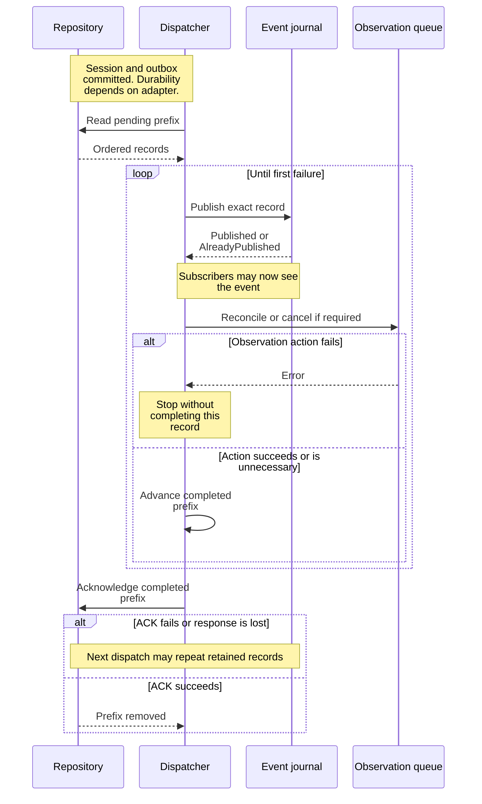

# Follow a committed change into event replay

This explanation helps maintainers change the runtime's session repository
adapter and event journal without confusing a transaction, publication, and
subscription delivery. Scope: private adapters in `undercurrent-runtime` 0.1.0-beta.
The [application outbox types](../../../../undercurrent-application/src/outbox.rs) own
record identity and cursor contracts; the
[dispatcher](../../../../undercurrent-application/src/outbox_dispatch.rs) owns ordered
publication and observation activation.

## Transactional does not mean persistent

[`InMemorySessionRepository`](../../../src/repository.rs) is a bounded adapter used by
tests and embedded compositions. One mutex protects sessions, the name index,
pending outbox records, and sequence state. Its transactions are atomic to
concurrent callers in this process. They are not durable across a crash. The
daemon uses the [SQLite adapter](../../../../undercurrent-store-sqlite/README.md) for
durable state; runtime does not own its database transactions.

Insert checks event identity and revision, unique ID and name, session capacity,
and outbox capacity. Commit compares the expected revision and checks name
conflicts. It requires events for the same session ending at the aggregate's
revision. Delete compares the expected revision and appends the removal event
before removing the session and name index entry. It retains a pre-delete
snapshot in the outbox. These checks do not replace domain transition validation.

Outbox sequence advancement is checked for the entire append before mutating
state. A capacity or sequence-exhaustion failure leaves session and outbox
unchanged. Records include the session snapshot supplied to that transaction.
`read_pending(limit)` returns an oldest-first prefix. `acknowledge_through`
removes a known pending prefix; an already acknowledged cursor returns
`AlreadyAcknowledged`, and an unknown cursor returns `UnknownSequence` without
draining records. Recovery reads use exclusive session-ID cursors and bounded
pages; pages are individually consistent, not a transaction spanning the scan.

## Publication precedes observation activation

This sequence shows where externally visible events can precede later work.
The repository commit is durable only when backed by a durable adapter.

*Seeing an event does not prove that its observation plan was activated or its
outbox record was acknowledged.*

The dispatcher processes contiguous sequences, stops on a record failure, and
tries to acknowledge only the successfully processed prefix. It loads current
session state for events that invalidate observation plans, rejects a loaded
revision older than the event, and cancels observations for removed or absent
sessions. The [observation queue](scheduling.md#schedule-observations-without-reviving-stale-work)
retains revisions so repeated activation cannot postpone work or revive an old
plan. Exact publication retries are safe only while their journal records remain.
Configure retained event capacity at least as large as the dispatch batch;
`BoundedSessionEventJournal::new` checks nonzero limits but cannot enforce this
cross-component relationship itself.

## Understand journal identity and eviction

[`BoundedSessionEventJournal`](../../../src/events.rs) retains bounded records in global
sequence order with indexes by session and event kind. Its first accepted
sequence can be any valid value, allowing a new journal to begin at the oldest
pending repository record. Later new sequences must be contiguous.

| Publication | Result |
| --- | --- |
| Retained sequence with exactly identical record, including snapshot | `AlreadyPublished`. |
| Retained sequence with different content | `Conflict`. |
| Sequence at or below the accepted head, already evicted | `ReplayUnavailable`; identity can no longer be checked. |
| New sequence skipping the next position | `InvalidData`. |
| Next contiguous record | `Published`; evict oldest if needed and wake matching subscriptions. |

This is a process-local replay cache, not the durable event history. A daemon
restart does not recreate acknowledged events from this journal. Do not promise
unlimited reconnect history or use replay exhaustion as permission to execute
the original mutation again.

## Choose a start position and use the returned checkpoint

| Start | Records and checkpoint |
| --- | --- |
| `Earliest` | Ascending matching retained records, limited to a page. |
| `Resume { after }` | Matching records strictly after the global sequence; an explicit global retention gap when intervening positions were evicted. |
| `Tail` | Latest matching page returned in ascending order; checkpoint at the global head and no earlier continuation. |
| `Live` | Empty initial batch at the current global head. |

When an ascending page has more matching records, its checkpoint is the last
returned sequence. When exhausted, the checkpoint advances to the global head,
even if the filter matched no records. This prevents repeated scanning of
unrelated events. Use `batch.checkpoint()` rather than inventing a cursor from
the last displayed event. A resume cursor ahead of a nonempty journal is
`InvalidData`; an empty journal preserves an opaque supplied resume cursor.

For example, if the global head is 120 and an exhausted filtered page contains
only event 117, resume after **120**, the returned checkpoint. Resuming after 117
would rescan unrelated events 118–120. These numbers are illustrative.

Retention gaps describe missing **global** positions, not proof that matching
events were lost. `Earliest`, `Tail`, and `Live` do not report a resume gap. If a
consumer needs complete current state after a gap, reconcile through the
application's session query path and continue from an appropriate journal
checkpoint; that query and the replay cache are separate consistency boundaries.

### Filtered reads and work bounds

Filtered reads choose session or kind indexes, using the smaller candidate set
when both dimensions are specified, then apply the full filter. They expose
index entries examined. Output page size is bounded, but sparse intersections
can examine more candidates than returned records; do not claim universal
`O(page size)` query cost.

## Own subscriptions and their cancellation explicitly

Opening a subscription takes the initial snapshot and registers live interest
under the same journal lock. No publication can land between those two steps.
The subscription stores a filter, checkpoint, one dirty bit, and optional outer
wake; it has no per-subscriber payload queue. Initial `has_more` makes retained
pages immediately available without requiring another publication.

Publication marks only matching subscriptions dirty. Outer callbacks run after
the journal lock is released, only on clean-to-dirty transitions. A callback is
a hint to drain, not one callback per event. A slow receiver rereads bounded
retention and can receive a gap. `receive_timeout` blocks the calling thread;
`try_receive` returns `None` when clean. Serialize drains for each logical
subscription: the implementation does not promise independent cursors for
concurrent reads on one handle.

### Close subscriptions during shutdown

`close` is idempotent, removes this subscription, and wakes blocked receivers;
`Drop` closes it. It does not stop a session or undo a mutation. Subscription
errors distinguish capacity, identity exhaustion, invalid derived request,
read failure, closure, and timeout. The application-port mapping turns closure
into `Interrupted`, timeout into `Timeout`, and capacity into `CapacityExceeded`.
The subscription holds only a weak journal reference. Losing the journal makes
a later read fail; dropping the journal is not an explicit close-and-wake of
every currently blocked receiver, so receivers should retain bounded waits and
owners should close handles during shutdown.

## Debug and verify changes

Inspect `pressure()` for oldest retained sequence, accepted head, eviction count,
subscription count, and dirty subscriptions. Compare these with the consumer's
checkpoint and the dispatch report's failed stage and completed prefix. An
outbox acknowledgement failure and a subscriber timeout have different recovery
paths; neither proves the associated process action failed.

The relevant executable evidence is:

- [Repository and dispatch tests](../../../tests/runtime_contract.rs): full-outbox
  rollback, idempotent acknowledgement, bounded recovery paging, and publication
  followed by observation activation.
- [Journal tests](../../../tests/event_journal.rs): strict content identity, sequence
  gaps, eviction, payload-safe errors, and a fresh journal beginning at sequence 900.
- [Feed tests](../../../tests/event_feed.rs): selective index cost, start positions,
  checkpoint advancement, global gaps, coalesced wakes, complete replay draining,
  and 300 independent subscriptions with cleanup.

Extend both publication and feed tests when changing sequence or retention
rules. Changing only the journal cannot extend durable retention or public wire
compatibility; those belong to the store and protocol owners. Return to the
[crate guide](../../../README.md) for the remaining runtime boundaries.

[Crate documentation](../../README.md)
