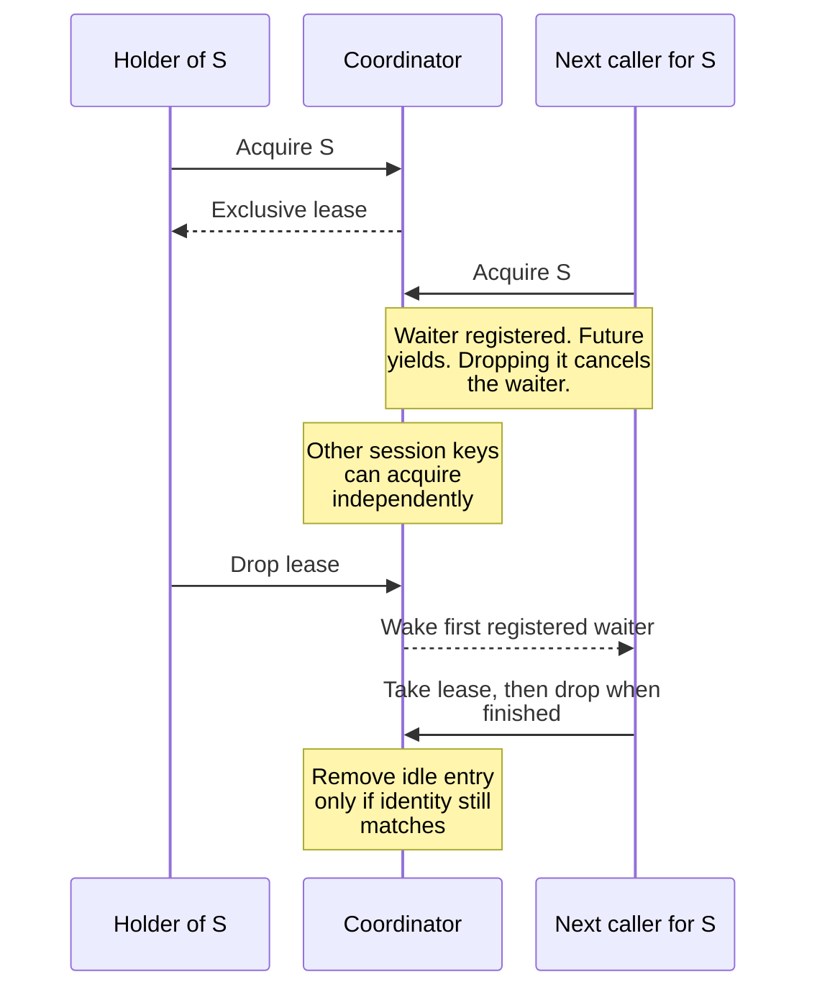

# Coordinate bounded runtime work

This explanation is for maintainers changing same-session serialization,
observation scheduling, restart scheduling, or runtime diagnostics. These are
private application-port adapters in `undercurrent-runtime` 0.1.0-beta. They retain
process-local state; restarting the daemon does not preserve their maps or queues.
The [daemon composition](../../../../undercurrent-daemon/src/composition.rs) selects
their limits and connects them to application services.

## Keep mutation ownership separate from process ownership

[`KeyedSessionMutationCoordinator`](../../../src/coordinator.rs) grants one exclusive
lease per session ID. Different sessions can proceed independently. A held or
contended key consumes an active-session slot; each key has a separate waiter
bound. Admission beyond either bound returns `CapacityExceeded` for
`AcquireSessionMutation` before issuing a lease.

Waiters acquire in registration order. Dropping the lease clears `held`, wakes
the first waiter, and removes an idle registry entry only if it is still the
same entry. That identity check prevents an old lease from deleting a replacement
entry. Lock ordering and releasing the entry lock before acquiring the registry
lock in `Drop` matter when changing this code.

Contended `acquire` yields its `PortFuture`. Dropping the future removes its
registered waiter, releases waiter capacity, and wakes a successor when the
entry is free. A lease still has no internal deadline: cancelling a waiter does
not release another caller's lease or cancel its process effects.

The purpose of this diagram is to show ownership transfer, rather than a session
lifecycle transition.

*A lease serializes application work on one session. It neither owns an OS
process nor commits a repository transaction.*

### Inspect lease contention

`pressure()` samples the bounded registry. `diagnostic_page(after, limit)` orders
rows by session ID with an exclusive cursor and one look-ahead row. Its row work
is at most `limit + 1`, but its aggregate pressure scan still visits all active
entries. Invalid page sizes produce `SessionMutationPageError`. The coordinator
records waiter depth, acquisition duration, and overload rejections through
typed metrics without command payloads or session labels on those metrics.

### Bind and unbind exact process incarnations

[`InMemoryProcessDirectory`](../../../src/directory.rs) has a different job: it binds a
session to a `ProcessInstance`, including its incarnation ID and start time.
Any second binding conflicts, even an identical one. `unbind_if` distinguishes
missing, mismatched, and removed bindings. Always use the exact incarnation:
an exit or cleanup operation from a predecessor must not remove a new process.
The directory itself does not probe, signal, reap, or persist processes.

## Schedule observations without reviving stale work

[`BoundedObservationQueue`](../../../src/observations.rs) keeps one pending job per
`(SessionId, ObservationJobKind)`. The application owns the
[`SessionObservationPlan` and port contracts](../../../../undercurrent-application/src/ports.rs).
The queue maintains a deadline index ordered by `(not_before, kind, session_id)`
and a latest-plan revision per session, including inactive plans.

| Incoming work | Result and reason |
| --- | --- |
| Older revision than the retained plan or job | `StaleIgnored`; delayed work must not reactivate a stopped or superseded plan. |
| Same revision, same deadline | `Unchanged`. |
| Same revision, later deadline | `EarlierDeadlineRetained`; a repeated activation must not keep postponing observation. |
| Same revision, earlier deadline | `Replaced`; an output wake can advance work. |
| Newer revision | Replace the job, allowing the new plan's deadline. |
| New distinct job or plan exceeds its bound | `CapacityExceeded`; retain the previous state. |

`reconcile_session_observations` checks projected capacity before changing any
jobs, removes omitted kinds, applies provided deadlines, and records the revision
under one mutex. Both distinct jobs and distinct retained plans are bounded by
the configured maximum. Claiming a due job removes it from the job and deadline
indexes, but retains the plan revision. Consequently, `jobs == 0` does not imply
`planned_sessions == 0` or free plan capacity.

### Wake, claim, and cancel observations

Only a reconciled plan with foreground enabled joins the `foreground_active`
set. `wake_foreground` uses that plan's current revision and may recreate a
claimed foreground job or pull its deadline forward. It cannot revive an
inactive plan. Directly scheduling a job does not activate this wake mechanism.
`cancel_session_observations` removes both kinds, the revision, and wake
eligibility. Application ordering must prevent obsolete producers from creating
work after complete cancellation; the queue is not a durable tombstone store.

Claims return at most the requested number of jobs whose deadline is at or
before `now`. A zero port-level claim limit is `InvalidData`. Claiming transfers
work out of this queue; it is not proof that an observation ran or was committed.
The application must decide how to reconcile failed or superseded observations.

## Keep restart identity exact

[`BoundedRestartQueue`](../../../src/restarts.rs) orders and deduplicates the complete
key `(not_before, session_id, expected_revision, attempt)`. Scheduling an exact
duplicate succeeds without using capacity. Changing any key field creates a
different job, so this is not a one-job-per-session queue and does not by itself
discard stale revisions. Application services validate jobs against current
state before executing them.

Due claims remove jobs and their session index entries. Cancellation is local
to one session and immediately releases capacity. The inherent `claim_due`
returns an empty batch for zero; the `DueRestartSource` port rejects zero with
`InvalidData`. Neither method starts a process. Pending work is volatile and
needs application recovery after a daemon restart.

## Preserve uncertainty in semantic input deliveries

[`BoundedInputDeliveryStore`](../../../src/deliveries.rs) records the complete semantic
input sequence and observation policy under `(session_id, delivery_id)`. This is
an in-memory adapter for explicitly process-local compositions. The daemon now uses
the [SQLite delivery store](../../../../undercurrent-store-sqlite/docs/reference/storage-format.md#semantic-input-delivery-retention);
process-host receipts remain a separate mechanism.

| Reservation state for the same key | Result |
| --- | --- |
| Different input or observation policy | `PayloadConflict`. |
| Same payload, settled delivered | `AlreadyDelivered` with its original timestamp. |
| Same payload, unsettled or settled indeterminate | `Indeterminate`; do not deliver again automatically. |
| New key within capacity | `Reserved`; the caller owns the next step. |
| New key at capacity | `CapacityExceeded`; no old ambiguous record is evicted. |

Settlement requires an existing reservation. Repeating the same disposition
succeeds; changing an already settled disposition conflicts. Explicit `remove`
and `remove_session` release capacity. There is no built-in TTL: a caller that
removes a record also removes this adapter's protection against re-delivery.
This store does not survive process restart and cannot establish exactly-once
terminal effects across a crash.

## Observe pressure without blocking producers

[`BoundedTelemetryRecorder`](../../../src/telemetry.rs) has separate diagnostic and
raw-metric limits. Producers use `try_lock`: contention drops the new sample and
increments the corresponding loss counter. Full queues evict the oldest record;
non-finite metric values are rejected. Inspection methods take the ordinary
mutex, so a long inspection can cause producer loss. This is intentional:
observability must not delay supervised work.

Metric aggregates are keyed only by typed metric name and optional typed
application operation. They retain count, finite saturating total, minimum,
maximum, and latest value independently of raw-record eviction. Session-specific
observations share the same raw metric bound; their session IDs do not become
aggregate dimensions. Contended or non-finite samples never enter aggregates.
Counters and snapshots describe this recorder's lifetime, not a durable audit.

### Wall time and session IDs

[`SystemClock`](../../../src/clock.rs) returns signed Unix epoch milliseconds, saturating
conversion at the integer bounds. It is wall time, not a monotonic elapsed-time
source. `MonotonicSessionIdSource` combines a caller-selected epoch prefix with
an atomic increasing counter. The prefix must distinguish allocator epochs;
reusing it after restart can reuse IDs. Construction validates the first ID,
each allocation validates the final ID, and counter exhaustion returns
`CapacityExceeded`.

## Investigate or extend these adapters

Start with `PortError.kind()`, `operation()`, and session context, then the adapter's
pressure view. [`error.rs`](../../../src/error.rs) provides stable invalid-limit names
and payload-safe dependency wrappers; the authoritative error categories live
in the [application ports](../../../../undercurrent-application/src/ports.rs). A typed
capacity rejection does not mean a previously accepted mutation was rolled back.

When adding a queue, define the deduplication key, admission and eviction policy,
claim ownership, stale-revision handling, and cancellation semantics before
selecting a container. Keep telemetry emission out of contended critical paths.
Do not turn a volatile map into a persistence contract through comments alone.

[`runtime_contract.rs`](../../../tests/runtime_contract.rs) exercises same-session
blocking, FIFO registration order, independent keys, capacity rejection, 300-key
diagnostic paging, exact process unbinding, input identity, restart cancellation,
revision-aware observations, atomic plan capacity failure, and inactive wake
suppression. [`telemetry.rs` tests](../../../src/telemetry.rs) hold the inspection lock
to prove producers drop instead of wait and check aggregate survival after raw
eviction. Use these cases as extension points, including the applicable
application callers, rather than testing only a new method in isolation.

Continue with [event replay and repository boundaries](events.md), or return to
the [crate guide](../../../README.md).

[Crate documentation](../../README.md)
