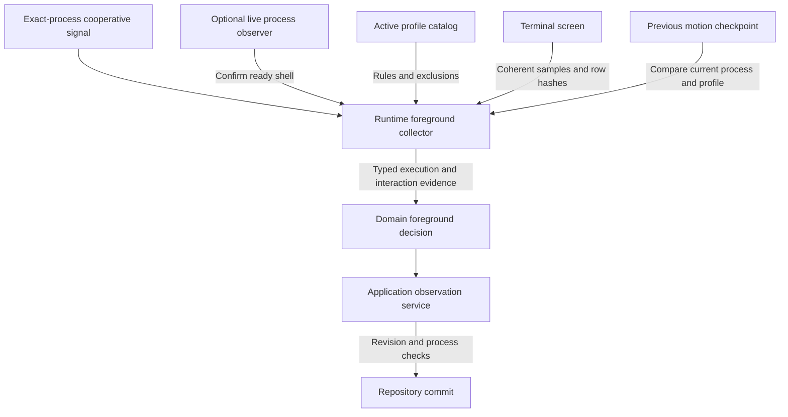

# Interpret foreground evidence and health checks

Maintainers use this explanation to change observation adapters without turning
heuristics into execution guarantees. Scope: `undercurrent-runtime` 0.1.0-beta, with
screen extraction described in [terminal capture](terminal.md). Domain
[foreground decisions](../../../undercurrent-domain/src/foreground_decision.rs) and
[health evaluation](../../../undercurrent-domain/src/health.rs) own how observations
are resolved. Runtime supplies evidence, not business-level success.

## Separate evidence collection from the decision

The following data-flow diagram shows the inputs to one foreground collection.

*Claims retain source, priority, disposition, confidence, and observation time.
The runtime does not collapse “ready,” “quiet,” and “succeeded” into one state.*

[`TerminalForegroundEvidenceCollector`](../../src/foreground.rs) resolves the
requested active profile, extracts its distinct prompt regions and motion
fingerprint under one parser lock, evaluates profile rules, and compares the
motion checkpoint. Missing named profiles and invalid rule evaluation become
`InvalidData`; there is no silent fallback for a missing explicitly requested
profile. The collector ignores its `_current` observation argument; retained
motion state and the supplied process/profile identify its local baseline.

| Source and claim | When it applies |
| --- | --- |
| `cooperative_shell`: certain execution and interaction claims | Exact process signal; unavailable evidence when none can be used. |
| `profile_prompt`: terminal-priority rules or inference-priority baseline | Select current-screen rules; use baseline interaction only when no interaction rule matched. |
| `terminal_motion`: active execution at terminal-history priority | Watched visible state and output both advance. |
| `server_silence`: quiescent execution inference | Server profile, previous compatible baseline, no current motion, and output from this process. |

The source registry in [`foreground.rs`](../../src/foreground.rs) owns these names.
Profile prompt rules can supply both execution and interaction claims, so the
`prompt_matches` counter increments per selected rule. `cycles` increments once
per successfully completed collection.
This distinction matters when interpreting pressure diagnostics.

### Reset motion baselines deliberately

Motion state is a bounded LRU map. A different process ID, profile name, or
output-exclusion setting resets the baseline. The first sample, a reset, or a
post-eviction sample establishes a baseline without claiming motion or quiet
server state. Reloading a definition under the same name does not itself reset
the baseline if exclusions are unchanged. A quiet server inference has no
independent silence timer here: elapsed time comes from observation scheduling
and the domain's freshness rules.

## Accept cooperative signals without retaining their private payload

The shared contract is [domain cooperative state](../../../undercurrent-domain/src/cooperative.rs).
[`cooperative.rs`](../../src/cooperative.rs) recognizes the exact private OSC prefix
`ESC ] 9091 ;`, terminated by BEL or `ESC \\`, across arbitrary read boundaries.
It accepts one `uc=ready` or `uc=running` field; `uc=done` is also interpreted as
ready by the filter. Missing, duplicate, or unknown `uc` values are malformed.
Other fields are ignored for state selection and the entire private record is
removed from visible output. Unrelated OSC and escape sequences pass through.

Private payloads are bounded to 4,096 bytes. Oversized records are discarded
through their terminator rather than leaking a suffix. Finishing an incomplete
private payload increments malformed count and drops it; an incomplete prefix
that has not yet become a private record is returned as visible bytes. A split
escape before a terminator is handled without counting the terminator as payload.
The tests compare every split point against the earlier parser semantics.

`CooperativeSignalStore` retains one payload-free state per session with the
exact process ID and observed timestamp. At capacity it evicts the oldest
observation, breaking ties by session ID. Lookup and removal require the process
ID to match. Signals are process output observations, not authenticated evidence
of application success; the parser does not prove which child wrote an OSC.

### Confirm cached readiness

Reading a cached signal never makes it fresh. Without a foreground-process
observer, evidence retains the signal's original timestamp. With an observer,
a cached **ready** signal is accepted only when the live observation confirms
ready for the same process, has a timestamp at least as recent, and the cached
signal has not changed during the check. Successful confirmation supplies its
new observation time without rewriting the original signal. Takeover, observer
failure, or conflicting state withdraws that ready evidence. Running signals
retain their original timestamps. See the tests for an idle shell reconfirmed
after an hour and readiness withdrawn when monitoring fails.

## Respect the limits of OS foreground observation

The process observer supplies program identity, arguments, environment **names**,
root working directory, listener evidence, and completeness separately. A missing
or truncated observation is not an empty complete process group. Arguments and
paths remain private matching inputs even though environment values are omitted.
The OS start-time token is opaque: Linux uses start ticks, macOS microseconds,
and Windows process creation time; these are not interchangeable timestamps.

| Adapter and identity policy | Observation bounds |
| --- | --- |
| [Linux](../../src/process/linux_observation.rs): shared `/proc` group/listener snapshot cached for at most 100 ms; member start identity checked before extracting program data. | 131,072 scanned PIDs, 32 group members, 16 KiB command, 64 arguments, 64 KiB environment, 64 environment names, 512 FDs per member, 16 MiB per TCP table. |
| [macOS](../../src/process/macos_observation.rs): live kernel membership before and after collection; root, user, foreground group, and member identities rechecked. Only command facts use a 100 ms, 128-member cache. Ready-shell confirmation bypasses that cache. | Platform group enumeration retains 32 members; 16 KiB command, 64 arguments, 64 KiB environment, 64 names, 4 KiB paths. |
| [Windows branch](../../src/process/mod.rs): validates the live root creation identity and obtains native root/job listener evidence. ConPTY supplies no POSIX foreground process group. | Bounds for job and TCP observations belong to the [Windows adapter](../../../undercurrent-platform-windows/src/job_observation.rs). |

### Linux and macOS completeness differences

Linux prefers invocation `argv[0]` over the resolved executable image and then
`comm`, preserving tool names exposed through versioned launchers. Its NUL split
omits empty arguments; Darwin parses exactly `argc` and preserves them. Extra
environment names can leave useful program evidence with an explicit incomplete
name projection. Oversized or unreadable required process buffers can instead
make the member unavailable. Profile matching must honor both group completeness
and member environment completeness.

Linux listener detection joins LISTEN socket inodes from `/proc/net/tcp` and
`tcp6` to group member descriptors. Missing tables yield unavailable; exhausted
FD/group limits yield truncated unless a listener was already found. Collection
is not an atomic kernel census: cached membership, disappearing processes, and
skipped stat reads can leave a best-effort view. In particular, skipped unreadable
stat entries do not all clear the snapshot's complete flag. Do not use that flag
as a security authorization or a proof that no process exists.

Darwin re-enumerates the group and rechecks the PTY foreground group and root
identity; a change makes the whole observation unavailable. Partial member facts
produce truncated completeness and unavailable listener ownership. Ready requires
one complete, exact root member with shell basename `zsh`, `bash`, `fish`, or
`sh`. Linux's ready check requires the sole exact root PID/start in a complete
group but does not perform this shell-basename guard. These implementations have
different race and evidence limits; keep their tests platform-specific.

### Windows listener evidence

On Windows, group members/completeness and group listener evidence remain
unavailable; managed-root and managed-job listener fields are distinct. A listener
owned by a supervised job is not a discovered terminal foreground group. Existing
cooperative state is retained as its own evidence. The
[macOS fake-source tests](../../src/process/macos_observation.rs) exercise PID reuse,
exec in the root PID, membership change, permission failure, cache aging, and
listener ownership; [Linux tests](../../src/process/linux_observation.rs) cover stat
parsing, invocation preference, inode matching, and bounded environment names.

## Reload profiles atomically, with bounded pattern work

[`InMemoryDetectionProfileCatalog`](../../src/profiles.rs) merges builtins and user
definitions by name. Duplicates within either source are errors; one user profile
may override the builtin of the same name. Capacity is checked after resolution.
Every resulting definition is linted before acquiring the catalog write lock.
Blocking lint errors preserve the previous catalog and generation; nonblocking
warnings are returned on success. A checked generation increment and map swap
activate the complete replacement under one lock. Already cloned `Arc` entries
remain usable by in-flight readers, so separate reads can span generations.

`list` and `all` return the whole name-ordered catalog or `CapacityExceeded` when
the caller's bound is too small; they do not silently truncate. File loading,
watching, builtin selection, and reconciling affected sessions belong to the
[daemon reload coordinator](../../../undercurrent-daemon/src/profile_files.rs), not
this in-memory catalog.

### Bound regex retention and matching

[`RegexPatternEngine`](../../src/patterns.rs) bounds cached expressions, approximate
compiled size, DFA size, and match-input bytes. Input over its bound returns
`ResourceLimit` without matching. Regex syntax errors become `InvalidSyntax`
without embedding expressions or terminal text in errors. Compilation occurs
outside the mutex; concurrent misses may compile twice, but admission rechecks
the key and retains one entry. At capacity a miss evicts the least recently used
compiled expression. This bounds retention, not the number of simultaneous
compilations across caller threads. Catalog replacement does not roll back
incidental pattern-cache changes from linting an ultimately rejected catalog.

## Execute health work away from application workers

[`NativeHealthCheckExecutor`](../../src/health_checks.rs) starts a fixed pool with a
bounded waiting queue. Limits include workers, queued requests, per-rule I/O
timeout, text/cell/pattern/detail bounds, and worker stack size. All required
bounds must be nonzero; details need at least 32 bytes and stacks at least 64 KiB.
Partially started pools close and join their workers before construction fails.

`run` submits synchronously before returning its future. Full queues reject with
`CapacityExceeded`; closed queues return `Unavailable`. A dropped response
future sets a cancellation flag even if it was never polled. Workers check
cancellation before and after each rule. They extract one coherent screen sample
only if needed, then execute the configured rules sequentially and preserve rule
index ordering in the results.

| Rule | Implemented behavior |
| --- | --- |
| TCP port | Connect to IPv4 loopback with the configured timeout; connection refusal or timeout is an ordinary negative health result. |
| HTTP endpoint | GET with no environment proxy, global request timeout, at most three redirects, and no response-body read; only status 200 passes. |
| Output contains / rejects | Regex over the sampled current visible screen; presence passes contains and fails rejects. This does not search evicted or off-screen logs. |
| Red-cell threshold | Pass when indexed red foreground count is strictly below the configured minimum. |
| Command | Direct program plus arguments with null standard streams; success is exit status zero. No implicit shell, session working directory, or session environment is installed. |

### Command probes and descendant cleanup

The command inherits the executor process's ordinary command environment and
working directory. A caller wanting shell syntax must explicitly configure a
shell. It is a health probe, separate from a durable supervised session-command
attempt. On Unix it gets a new process group; timeout/cancellation attempts a
group kill and waits for the direct child, falling back to killing that child.
Other targets kill and wait for the direct child only. There is no guarantee
that detached descendants are gone. Command polling uses intervals up to 10 ms.

### Cancellation and shutdown limits

Network calls cannot be interrupted mid-call by this cancellation flag; shutdown
can wait for their configured timeout and remaining cleanup. There is no
whole-request deadline including queue time or all rules. Dropping the last
executor owner sets shutdown, drains queued work with `Cancelled`, closes the
channel, and joins workers. A vanished reply channel becomes `Interrupted`.

### Negative results versus executor failures

Expected negative outcomes (connection unavailable, non-200 HTTP, absent pattern,
nonzero command exit, command timeout) are result records, not executor failures.
Malformed rules, invalid URI forms, bad regex, unavailable screens, and capacity
failures are typed errors and abort the batch. Earlier rules may already have
performed effects and incremented counters even when no full result vector is
returned. Safe detail strings come from `NativeHealthCheckDetail::ALL`; raw
endpoint, command output, and sample text are excluded.

### Reject stale health results in the application

The executor intentionally does not inspect its `_process` parameter. Screen
state is session-keyed, TCP/HTTP probe configured endpoints, and commands are
independent probes. The [application health observation service](../../../undercurrent-application/src/observation.rs)
samples revision and process binding, releases the mutation lease during I/O,
then reacquires it and rejects stale results before committing. Preserve that
guard when adding callers; do not treat the runtime executor alone as an
exact-incarnation health contract. Discarding stale results does not undo probe
side effects, so probes should be designed accordingly.

## Diagnose evidence and extend coverage

| Symptom | Inspect first | Meaning to preserve |
| --- | --- | --- |
| No foreground evidence | Capture mode, named profile, sample bounds | Opaque capture cannot supply screen samples; a missing named profile is an error. |
| Ready shell becomes unavailable | Exact cooperative signal and live confirmation | Reading cached state does not refresh it. |
| No motion or quiet-server claim | Process/profile baseline and eviction | The first compatible sample establishes a baseline. |
| Health rule fails | Rule result and safe detail | A negative result can be an expected observation. |
| Health batch errors | `PortError`, queue pressure, rule validity, screen availability | Earlier probes may already have run. |

Inspect metadata and counters instead of logging private samples or patterns.

Use [foreground evidence tests](../../tests/foreground_evidence.rs) for priority,
baseline reset, exclusion rows, cooperative freshness, and quiet-server limits;
[profile catalog tests](../../tests/profile_catalog.rs) for atomic failed reloads and
override capacity; [health tests](../../tests/health_checks.rs) for local listeners,
exact HTTP status, screen consistency, cancellation, command timeout, and full
queues. Pattern unit tests cover LRU eviction, concurrent compilation, and
redaction. The [screen tests](../../tests/terminal_screen.rs) pin region semantics
that can otherwise look surprising in profile rules.

Add a new evidence source to its registry and source validation, define its
priority and freshness in the domain, then test interaction with existing sources.
Add health kinds to the domain contract and runtime execution together; update
typed safe details and cancellation tests. Runtime should not invent a second
profile schema or a separate foreground decision policy. Return to the
[crate guide](../../README.md) for the full maintainer path.

[Crate documentation](../README.md)
