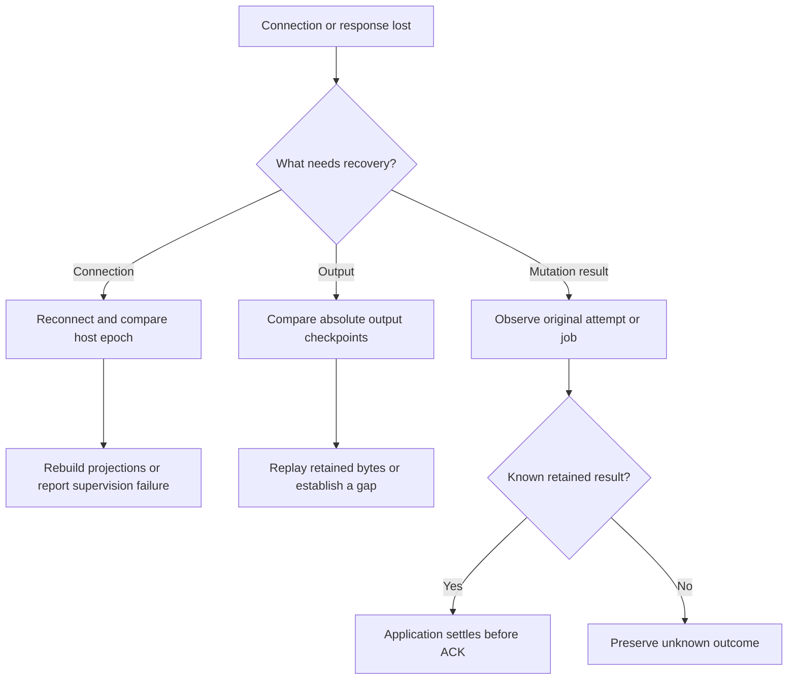
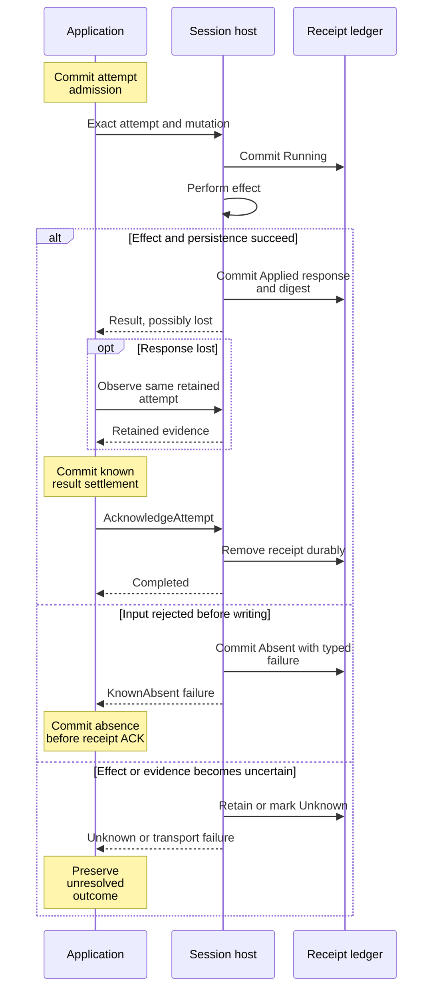

# Reconcile host disconnection and uncertain effects

Use this maintainer guide to decide which evidence to inspect after a lost
response, missing terminal output, or host restart. It assumes the private
[session-host ownership model](session-host.md). Application authorization,
session lifecycle, and durable attempt settlement remain outside this crate.
User-facing recovery commands belong to the CLI and SDK documentation; do not
repair an application by manually editing private host journals.

## Identify what was lost

Start by locating the lost evidence. More than one branch may apply to the same
failure; successful reconnection alone does not complete the other branches.

1. For a broken channel, inspect [connection and epoch handling](#reconnect-without-resending-pending-mutations).
2. For missing bytes or a delayed exit, compare [absolute output checkpoints](#recover-output-using-absolute-checkpoints).
3. For a missing mutation response, retain the original identity and inspect
   [attempt receipts](#interpret-mutation-receipts) or the [execution job](../processes/execution.md#recover-a-retained-job).
   Keep unknown effects unresolved until the application can reconcile them.

*Takeaway: reconnecting a stream, restoring a screen, and reconciling a mutation
answer different questions. None alone authorizes repeating an uncertain effect.*

## Reconnect without resending pending mutations

On reader failure, the client removes its writer and fails pending requests
with `Unavailable`. It tries the existing token with exponential connection
backoff, capped by configured retry maximum and connection deadline. If ordinary
reconnection exhausts that phase, it may launch a host and try again. During
retirement it only reconnects to an existing host. Each phase has its own
deadline; socket operations and scheduling can extend elapsed time beyond a
simple sum of backoff delays.

The client does not resend pending commands. A new authenticated connection
replaces the host's previous output connection. With the same epoch, local
terminal entries request a screen checkpoint followed by replay; opaque entries
replay from their local next offset. With a changed epoch, armed entries produce
`SupervisionFailed`; unarmed entries are not automatically published as exits.
Application startup reconciliation can also observe exact persisted process
identities and rebuild bindings. See the owning
[startup reconciliation service](../../../../undercurrent-application/src/commands/startup_reconciliation.rs).

### Host epoch is a composition input

Epoch comparison is only as good as configuration. `launch_host` uses the
configured native epoch even when launching a replacement; the adapter does not
generate a new epoch in that function. Treat epoch as a composition-owned
identity input, not an independently verified guarantee that every host restart
changes it. Exact process IDs, root creation identities, and observed host state
remain necessary evidence.
The [daemon composition](../../../../undercurrent-daemon/src/composition.rs) generates
a fresh server epoch when composing a new daemon and passes it into native
configuration; replacement-host launch within the same adapter reuses that
configuration.

### When automatic reconnection stops

There is no perpetual reconnect loop after `reconnect` itself returns an error:
the reader thread exits. A live socket with no reply also has no general
per-request receive deadline after authentication. Diagnose those cases at
`HostClient::read_loop` and `request_inner`, rather than assuming an SDK deadline
automatically cancels host work.

## Recover output using absolute checkpoints

Host PTY retention and daemon retention are separate bounded in-memory stores.
Each output frame names an exact process and absolute session offset. The
daemon buffers out-of-order frames, drops already-consumed ranges, trims a
partially overlapping prefix, and drains contiguous offsets. Its pending buffer
is bounded; farthest offsets are evicted first. An observed gap schedules replay
once for the entry's active recovery state. Replay worker failures are currently
discarded, so a failed background recovery is not a guarantee of a later retry.

Replay returns control metadata after the host has queued that process's data
frames. `delivered_to` reports successfully queued bytes, while `next_offset`
describes the retained stream head. The host may queue less than requested when
outbound capacity fills. The daemon continues while progress is possible and
returns `CapacityExceeded` when `has_more` requires progress but the delivered
offset did not advance. Wire ordering and daemon output-dispatch completion are
different; the client uses an explicit output-event barrier for exit handling.

| Condition | Recovery |
| --- | --- |
| Requested offset is retained | Replay contiguous bytes, suppress duplicates, and continue from delivered offset |
| Terminal capture has lost requested history | Request host screen snapshot, establish the gap at its checkpoint, restore local screen when offsets agree, then replay subsequent output |
| Opaque capture has lost requested history | Establish retention gap and resume at available raw offset; no screen snapshot exists |
| Snapshot arrives behind already-processed local output | Keep the newer local offset; do not restore the older screen over it |
| Host process incarnation is replaced | Carry the logical session's current offset into the new host buffer |

A restored screen is a terminal-state reconstruction, not recovered historical
bytes. It cannot fill missing raw logs. Host loss loses host-resident history
and screen state; the receipt journal does not store either.

### Withhold exit publication until output catches up

The host's exit event includes an output checkpoint. The daemon drains earlier
output events and, if necessary, replays to that checkpoint before publishing
the exit. If replay fails or the offset remains behind, it withholds that exit
publication on this path. `next_exit` retires the host entry before returning
the observation; application durable exit handling happens after that runtime
boundary. Exact terminal-exit evidence described below is therefore useful after
live entry retirement.

## Interpret mutation receipts

[attempt_receipts.rs](../../../src/process/attempt_receipts.rs) owns the private
`0.1.0-beta` receipt ledger. [host.rs](../../../src/process/host.rs) orders its writes
around effects, and [attempt_observer.rs](../../../src/process/attempt_observer.rs)
translates retained proof for application reconciliation.

The following sequence describes a normal attempted process mutation. One-shot
execution uses its [separate job journal](../processes/execution.md).

*Takeaway: receipt removal follows application settlement. A crash between the
effect and its applied receipt cannot be repaired by assuming the effect absent.*

### Identity and fencing

A receipt binds attempt ID, optional session, kind, fencing token, payload
digest, acceptance time, and fencing scope. Stop/force-stop additionally bind
the exact target process independently. The host compares retained fences
within `dispatch:<cell>`, `session:<id>`, or `host` scope; old records with no
scope are conservatively treated as session-wide. A changed context or stale
retained fence conflicts. The host does not recompute an application's payload
digest from arbitrary mutation fields; admission and digest construction remain
the trusted caller's responsibility.

### Receipt states and retry limits

| Retained state | Meaning | Same-attempt request |
| --- | --- | --- |
| `Running` | Committed before invoking the mutation; the outcome is not established. | Returns unknown without executing again. |
| `Absent` | Exact input was rejected before writing; the original typed failure is durable. | Replays KnownAbsent and the failure without executing. |
| `Applied` | Successful effect followed by a committed replayable response and result digest. | Can replay the retained response. |
| `Unknown` | Effect or evidence could not be established; generic effect failures conservatively enter this state. | Returns unknown without executing again. |

Input absence requires explicit native proof and a committed Absent receipt;
an IO error after queue admission alone is insufficient. The response preserves
the typed failure separately from certainty. Generic pre-effect `InvalidData`,
`Conflict`, and `CapacityExceeded` request refusals can also prove KnownAbsent.
Inspect both error kind and attempt certainty.

The ledger has no automatic eviction. At capacity, new admission fails. ACK
removes evidence and its retained fence; it is repeatable for an already-absent
record, but absence afterward means `Unknown` when observing an effect. It does
not mean that effect never happened. The application attempt store owns the
longer-lived admission fence and settled result.

On host restart, persisted `Running` and even previously `Applied` spawn
receipts become `Unknown`, because that process incarnation cannot be replayed
as a living spawn on a new host. Other applied receipts remain replayable.
The private `ProbeAttempt` can distinguish absent from unknown for spawn
credential admission; general effect observation deliberately does not turn
missing evidence into `KnownAbsent`.

### Persistence failures

Persistence writes a private temporary file, synchronizes, replaces the ledger,
and synchronizes the directory. A failure after replacement can leave disk
changed despite an in-memory rollback. [host_files.rs](../../../src/process/host_files.rs)
uses Unix directory `fsync`; Windows uses private handles and write-through
replacement, while its directory synchronization validates/pins rather than
providing an equivalent directory flush. Recovered evidence is always validated.

## Repair only from exact terminal evidence

[terminal_exits.rs](../../../src/process/terminal_exits.rs) stores a separate bounded
`0.1.0-beta` ledger of confirmed numeric exits for exact `(session, process)` pairs.
Supervision failure is not such proof. The host attempts to persist an exit
before forwarding it; if persistence fails, it can still forward the live exit,
so a received exit is not proof that a repair record exists on disk.

An unknown stop/force-stop can be restored to applied only when its receipt
retains the exact process binding and that exit ledger proves the incarnation
terminated. Legacy receipts without the binding stay unknown. Another process
in the same logical session does not qualify. The reconstructed termination
proves the process is gone; it does not prove which signal caused its exit.
Entries evict by oldest observation time at capacity, so missing evidence never
proves a live process or an absent effect.

The repair observer rejects unknown evidence. For known evidence it builds a
versioned `undercurrent-receipt:v0.1.0-beta:` reference from attempt identity, fence,
kind, payload, certainty, and result digest. Acknowledgement reobserves and
checks evidence as appropriate after the application repair service commits.
This runtime observer supplies evidence; the
[repair application service](../../../../undercurrent-application/src/repair_attempt.rs)
owns authorization and durable reconciliation.

## Respect shutdown's two phases

Attempted shutdown records an applied **preparation** while the host and its
workloads remain alive. The
[shutdown application service](../../../../undercurrent-application/src/shutdown_process_host.rs)
commits its settlement before the destructive normal ACK. That ACK removes the
receipt and retires the host, its owned workloads, and private storage. A lost
ACK response is reconciled by waiting for retirement artifacts to disappear;
the client suppresses replacement-host launch during this wait.

### Cancellation uses a separate acknowledgement

Uncommitted/unknown shutdown recovery may instead persist a cancellation
tombstone yielding `KnownAbsent`. Its separate
`AcknowledgeShutdownCancellation` removes only the tombstone. It must never be
substituted with a normal shutdown ACK, which would retire the currently
connected host. Cancellation evidence survives restart until that special ACK,
so a replacement host and its new workloads remain alive during reconciliation.

## Verify a repair or recovery change

The [Linux real-host tests](../../../src/process/host_receipt_tests.rs) exercise crashes
before and after effects, deliberate response/ACK loss for all generic mutation
kinds, real SQLite post-commit acknowledgement, one-use secret replay without
persisted material, exact stop repair after restart, wrong-incarnation rejection,
replacement-process preservation, shutdown tree retirement, and cancellation
that leaves replacement workloads alive. Test fixture retry loops deliberately
exercise private receipt behavior; they are not general user retry guidance.

Use the [host](../../../src/process/host.rs) queue tests for output barriers and the
[hosted](../../../src/process/hosted.rs) assembler tests for offsets. When adding
recovery behavior, test transport loss, retained proof, proof loss, and ACK loss
separately. Never infer application success solely from an OS exit, a screen
snapshot, or a successful reconnect.

[Crate documentation](../../README.md)

For uncertain standalone input, `ObserveInputRetirement` requires the exact
Unknown receipt, no Running receipt for the session, no live session process,
and a retained confirmed exit. This proves quiescence without changing certainty.
The daemon must also verify terminal durable state under the session lease and
commit an audit before releasing the receipt. See
[input retirement](../../../../undercurrent-daemon/docs/internals/requests/effects-and-recovery.md#retire-uncertain-input-after-verified-exit).
