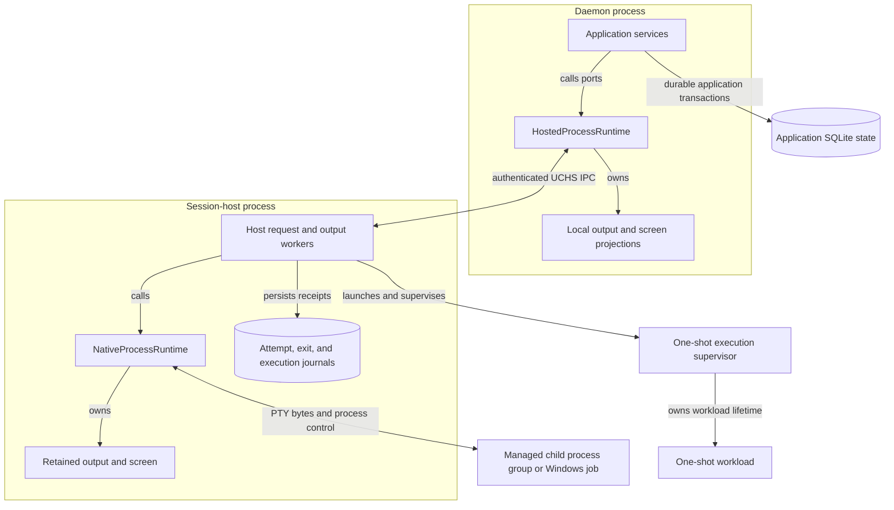

# Understand the daemon-independent session host

Use this explanation to locate ownership when a daemon disconnects, a session
keeps running, or terminal output needs replay. It covers the private runtime
adapters in package 0.1.0-beta. The private UCHS channel is distinct from the public
client transport and from local agent-bridge admission.

## Locate processes and state

This diagram shows runtime ownership and communication. Crate dependencies are
a separate question; a Rust crate can contribute code to more than one process.

*Takeaway: daemon reconnection can recover projections from a surviving host.
The host's private journals do not replace application persistence, and its
in-memory terminal history does not survive host loss.*

[Daemon composition](../../../../undercurrent-daemon/src/composition.rs) wires the
hosted adapter to application services. [hosted.rs](../../../src/process/hosted.rs)
owns the daemon client and local projections;
[host.rs](../../../src/process/host.rs) owns the server and native runtime.
[Native ownership](../processes/native-processes.md), [execution jobs](../processes/execution.md), and
[mutation recovery](recovery.md) explain their distinct lifetimes.

## Establish the private channel

`HostedProcessRuntimeConfig` requires absolute socket and executable paths,
nonzero connection/I/O/retry durations, and
`retry_initial <= retry_maximum <= connect_timeout`. A separate absolute
`journal_base` keeps durable records independent of transient socket storage.
These are adapter configuration relationships, not user-facing defaults.

Startup creates local stores, connects using the existing owner-only auth file,
or launches the configured host executable with a fresh 32-byte random token
encoded as hexadecimal. Bootstrap arrives through inherited stdin; stdout and
stderr are null. The launcher retains a waiter thread to reap the host process.
Bootstrap reading is capped at 64 KiB; it contains credentials and must never
be sent to a log. The constructor accepts bounded hexadecimal tokens, but the
normal launcher generates them randomly.

The host prepares private directories, binds its Unix socket or Windows named
pipe, opens journals, writes the auth file, starts the native runtime, and
accepts connections. On Unix, an already-connectable socket prevents duplicate
ownership; an unconnectable existing path is removed before bind. Windows
listener ownership is delegated to the platform pipe implementation. Unix
directories use mode 0700 and socket/files mode 0600; Windows uses private
platform file and pipe operations. Startup errors identify a `ProcessHostStage`.

An ordinary connection must send `Authenticate` first. A semantic-first request
or wrong token closes the connection without activating subsequent commands.
The specialized shell-capture first request additionally verifies the real
peer process. The [private protocol reference](../../reference/host-protocol.md) owns wire
framing and compatibility details.

### Replace the output connection

The newest authenticated daemon connection replaces and closes the previous
output connection. There is one current output destination, with explicit
interest in exact `(session, process)` pairs. This is not a multi-client
subscription server; public client fan-out belongs above this adapter.

## Follow requests and bound resources

The daemon client serializes blocking socket writes under a mutex and correlates
responses by increasing request IDs. Its port futures can therefore block while
writing. After authentication the stream's read timeout is cleared. The write
timeout remains configured; there is no per-request reply deadline in
`request_inner`, and the pending-request map has no explicit admission bound.
Bounded event channels do not imply every connection resource is bounded.

Each authenticated connection gets `spawn_workers` request workers and a queue
of `max(2 * max_processes, spawn_queue_capacity, 1)` requests. Saturation yields
a typed `CapacityExceeded` response when it can be enqueued. Workers may execute
independent requests concurrently; request IDs provide correlation, not a global
execution order. The listener starts a thread for each accepted connection
without a global connection count bound, including before authentication.

| Resource | Current bound or behavior |
| --- | --- |
| Host control-response queue | `max(4 * max_processes, 16)` frames |
| Host queued output | Encoded-byte accounting against `global_bytes`, plus one selected frame in a blocking write |
| Output coalescing | Same exact process, contiguous offsets, below append/codec bounds, before the original 1 ms enqueue-time deadline |
| Cooperative events | Latest queued event per exact process; intermediate events can be replaced |
| Daemon control events | `max(2 * max_processes, 1)` |
| Daemon output events | `max(ceil(global_bytes / output_read_bytes), max_processes)` frames |
| Per-process pending output | Per-session retained-byte limit; farthest pending offsets are evicted first |
| Host attempt/exit receipt capacity | `max(8 * max_processes + spawn_queue_capacity, 1)` |
| Execution jobs | `max_processes`, counting retained terminal results |

### Output priority and barriers

The host keeps draining PTY output into its own retention even without an
interested daemon. A full outbound queue can drop live delivery; replay is the
recovery mechanism. Control frames normally have priority, followed by
cooperative state, then output. A replay response waits for that process's
queued output, exit forwarding uses a process-output barrier, and retirement
waits for all already-accepted queued output. These are specific barriers, not
a total order across all effects. A selected blocking output write cannot be
preempted, and the 1 ms aggregation deadline is not a delivery-latency bound.

## Distinguish ordinary and attempted spawn

### Ordinary spawn transfers ownership by adoption

An ordinary spawn has a random cancellation token and an acceptance guard.
The host tracks `Spawning`, unadopted `Spawned`, adopted `Spawned`, or `Cancelled`
state. The daemon installs its exact local entry, recovers output, sends
`AdoptSpawn`, and then disarms its guard. Dropping an unaccepted guard queues
`CancelSpawn`; if the cancellation queue is full, it closes the channel so
connection cleanup can cancel unadopted spawns. The cancellation worker retries
until success or client closure. This compensates process ownership, not child
effects that already happened.

### Attempted spawn retains evidence

An attempted spawn uses a durable attempt receipt and a token derived from the
attempt ID. The host adopts the process before recording the applied receipt,
so a lost response does not cancel a receipted process merely because the
connection closes. The daemon probes the attempt before resolving a one-use
secret: `Applied` replays the response, `Unknown` stops, and `Absent` permits
new credential resolution and admission. Post-spawn local installation/replay
failures carry `KnownApplied`; they do not prove the process absent.

Both paths carry the daemon's current absolute session output checkpoint into
the new host buffer. A replacement process continues the logical session's
offset space. Resetting to zero would make new output appear already consumed
and can invent a retention gap.

## Keep shutdown and disconnection separate

| Trigger | Adopted PTY processes | Execution jobs | Journals |
| --- | --- | --- | --- |
| Daemon `begin_shutdown` / connection close | Remain host-owned | Host can remain alive, subject to idle exit below | Retained |
| Current connection closes with zero occupied native slots | None occupy native slots | Cancelled by host cleanup, even if jobs were running | Preserved |
| Explicit host retirement | Forced during cleanup | Cancelled | Execution and attempt/exit directories: removal attempted |

`begin_shutdown` closes daemon admission, preparation workers, exit channel,
and client connection. The host cleans up unadopted connection spawns. Its
idle-exit condition counts native occupied-process slots; it does not
independently check whether execution jobs remain running.

Explicit host retirement drains accepted queued output before its retirement
response, requests shutdown even if writing that response fails, cancels
execution jobs, begins native shutdown, force-signals owned processes, and
removes endpoint/auth files. File removal is best effort at the host. The
daemon's retirement wait checks artifact absence, so leftovers can produce a timeout instead of reported
retirement. Artifact absence is not itself a new application-level result.

Attempt-aware retirement adds the [settlement-before-ACK rule](recovery.md).
During that ACK the client reconnects only to an existing host; it must not
launch a replacement just to acknowledge destruction of the previous host.

## Verify shell and agent peers

[Shell capture](../../../src/process/shell_environment.rs) retains the latest bounded
export snapshot for an exact root process. The helper filters its private
control variables, `_`, and capture PID from exports. An authenticated invalid
or oversized capture **received by the host** clears that process's retained
snapshot. The helper sends an invalid sentinel for invalid names, count/byte overflow,
Windows value conversion failure, or working-directory conversion failure.
The host verifies the exact live process before clearing only its snapshot and
returns `ShellEnvironmentInvalidated`; the helper reports capture failure with
confirmed invalidation. A partial capture is never published with a fresh time.
Authentication or transport failure cannot confirm clearing: the old snapshot
and its original timestamp may remain. Helpers communicating with older hosts
can receive an unconfirmed error even if that host cleared the invalid sentinel.
Native Windows conversion and pipe behavior still require Windows validation.

### Resolve an agent bridge peer

`resolve_agent_peer` is a different boundary. It accepts a real local peer PID
and an expected bridge executable, traverses up to 64 ancestors, checks an exact
managed root incarnation, then verifies that the local entry is still current.
Unix rereads the peer, root, ancestry and executable path; Darwin additionally
checks UID in its identity adapter. Windows retains process objects and pinned
image identities while validating live same-user ancestry. The caller must
obtain the peer identity from authenticated local transport; user/model-supplied
session coordinates cannot substitute for this verification. The returned
optional attempt binding is carried from the hosted entry.

## Investigate changes

Host unit tests cover framing queues, allocation accounting, coalescing
boundaries, control priority, and output-before-retirement. Hosted tests cover
assembler ordering and duplicate suppression, configuration redaction, tokens,
and real bridge ancestry. Linux
[real-host receipt tests](../../../src/process/host_receipt_tests.rs) cover private
permissions, unauthorized peers, crashes, response loss, SQLite settlement,
secret replay, exact exit repair, and shutdown cancellation. Windows host and
ancestry cases are target-gated in the owning files.

Continue with [output and mutation recovery](recovery.md) or
[the private wire reference](../../reference/host-protocol.md).

[Crate documentation](../../README.md)
