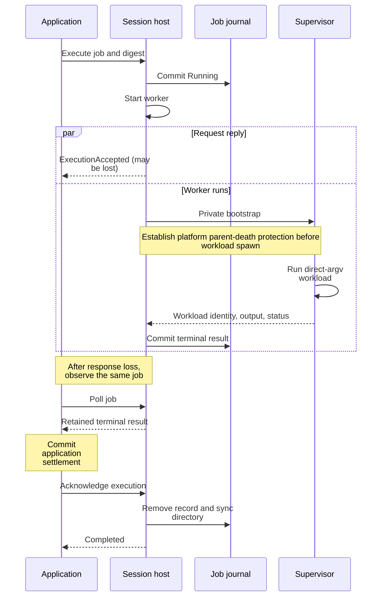

# Trace a command executed in a session's context

Use this explanation to investigate a one-shot command's admission, output,
cancellation, or recovery. This is the private runtime implementation in package
0.1.0-beta, implemented for Linux, macOS, and Windows. It runs a separate workload
with captured stdout/stderr. It does not inject the command into the session's
PTY or interpret its arguments as shell syntax.

[HostedSessionCommandExecutor](../../../src/process/session_command.rs) implements the
application port; [HostExecutionRegistry](../../../src/process/execute_host.rs) owns
host-side jobs and their journal. The application chooses the execution context
and attempt identity before calling this adapter. A live environment selection
requires a captured shell snapshot for the exact process incarnation.

## Separate acceptance, execution, and settlement

The diagram shows the durable boundaries and a response-loss case. The
application's settlement and acknowledgement are separate from host execution.

*Takeaway: an accepted job is not a completed command. A retained result supports
observation after response loss; acknowledgement deliberately ends that retention.*

### Admission and retained capacity

The registry validates the job identity, command bytes, environment names and
sizes, absolute working directory, and output budget. Job IDs are bounded to
128 bytes and an ASCII filename-safe alphabet. Running and terminal jobs both
consume capacity; there is no automatic terminal-result eviction. A full
registry rejects new admissions until application settlement allows an ACK.

### Replay the same identity

The host first checks an existing job by ID, session, and payload digest. A
matching replay returns `ExecutionAccepted` without rereading the current shell
environment or launching again. The registry's direct `start` path additionally
compares the complete stored specification. Reusing an identity with different
meaning returns `Conflict`. These guarantees last only while the job record
exists; callers must not reuse an acknowledged job ID as an arbitrary retry key.

## Understand environment and process ownership

The supervisor clears its environment before applying the selected values.
With live shell exports, those exports replace the launch environment; a
variable removed from the live shell does not leak back from the launch values.
An explicit working directory sets both the actual directory and `PWD`.
Windows supplies `SystemRoot` only when no case-insensitive explicit value is
present, because loader and batch execution require it.

### What the journal retains

Live exports travel through authenticated host IPC and the supervisor's private
stdin pipe. `HostExecutionSpec.live_environment` is skipped during journal
serialization and redacted in debug output. Ordinary requested environment
entries and the command specification **are** journaled. Do not treat that
journal as a payload-free log. Unix live values may contain non-UTF-8 bytes;
the Windows supervisor requires UTF-8 values.

### Supervisor ownership by platform

Each accepted job has an execution worker, a supervisor process, and output
reader/relay threads. The workload has null stdin and separate stdout/stderr
pipes. The private self-exec marker belongs only to `uc-session-host`; it is not
a user CLI command. Bootstrap length is capped at 16 MiB. The readiness prefix
is bounded and includes the workload PID and creation identity before the host
uses that identity for fallback cleanup.

| Platform and ownership mechanism | Parent death and cancellation boundary |
| --- | --- |
| Linux: supervisor installs `PDEATHSIG`, then rechecks parent PID before spawn; workload starts its own process group | The running loop handles parent death and cancellation; root exit retires the owned group before bounded output drain. |
| macOS: supervisor registers kernel `NOTE_EXIT`, rechecks parent PID, and watches parent exit | Registration/query failure fails closed. PID polling does not replace the kernel watch. |
| Windows: host starts supervisor in a kill-on-close job before resuming its primary thread; workload uses job ownership | Parent death closes job ownership. After root exit, workload descendants are retired before relay EOF is awaited. |

The Unix cleanup boundary is the workload process group, not every process a
program could ever create after escaping that group. Fallback group signalling
checks the recorded workload creation identity to avoid signalling a reused PID.

## Distinguish cancellation from dropping a future

The command adapter rejects an already-cancelled request, elapsed deadline,
wrong target, or invalid output budget before sending it, with `KnownAbsent`
effect certainty. Once it sends `Execute`, a failed request is conservatively
`Unknown`; a transport error alone does not establish whether a workload ran.

After acceptance, the adapter polls with a 25 ms requested wait. On its
cancellation token or deadline it sends `CancelExecution` once, best effort,
then keeps polling for a terminal result. Dropping the execution future has no
cancel-on-drop guard in this adapter. Subscription cancellation and request
abandonment therefore must not be documented as workload cancellation.

On Unix, ordinary root exit ends the owned workload, matching Windows job
retirement. The supervisor observes exit without reaping, signals the remaining
process group, and retains the root PID until signalling is finished. It then
drains buffered output for up to one second while still checking parent death
and cancellation. Finite buffered output and the original root exit status are
preserved when both pipes reach EOF; descendants do not get an independent
post-root lifetime.

An escaped process is outside process-group ownership, even if it keeps a pipe
open. Nonblocking relays stop after the drain grace; incomplete drain becomes
`ExecutionFailed` with `effect_started=true`, not a successful root result.
Cancellation and caller deadlines remain active during this grace and retain
their own terminal classifications. The one-second grace is a bounded cleanup
policy, not a promise about application output latency or an RSS bound.

Private supervisor stdout uses bounded length-prefixed data plus a completion
marker written only after both output relays finish successfully. Child bytes
cannot imitate that marker. A missing marker prevents supervision or relay
failure from being mistaken for an ordinary nonzero workload exit. Host and
supervisor must come from the same installation; the private prefix carries release `0.1.0-beta`.
No public wire or execution-journal version changes.

### Polling and deadline limits

The host clamps an individual poll wait to 100 ms. The worker checks cancellation
and the absolute wall-clock deadline before supervisor setup, and checks them
in its running loop at roughly 5 ms intervals. This is not a hard upper bound
on completion latency: bootstrap writes, readiness reads, process waits, and
output-reader joins are blocking operations. `cancel_all_and_wait` uses its
configured wait followed by exact-job fallback cleanup and an additional
250 ms observation window; the method does not return proof that every job
settled.

## Interpret output and results

Stdout and stderr share one atomic retained-byte budget. Each reader counts
source bytes even after retention fills and continues draining while termination
is requested. The allocation between the streams depends on read scheduling;
there is no combined stdout/stderr ordering. Binary bytes remain unchanged.
Source counts describe bytes actually read, not bytes the process might have
produced after termination.

Exceeding the budget requests workload termination and normally yields
`OutputLimitExceeded`. The worker checks cancellation, deadline, then overflow
in that order. A race with process exit can affect the selected terminal kind;
do not infer a total ordering between independent causes. Capture/read failure
or failed terminal persistence becomes `ExecutionFailed` with
`effect_started: true`, even when a workload exit was observed.

| Host observation | Adapter effect certainty and result |
| --- | --- |
| Running, missing observation, or polling failure | `Unknown` |
| Failed with `effect_started: false` | `KnownAbsent` |
| Failed with `effect_started: true` | `Unknown` |
| Terminal `Completed` | `KnownApplied`, result digest, optional exit code and output |
| Terminal `Cancelled`, `DeadlineExceeded`, or `OutputLimitExceeded` | Error result with `KnownApplied` and digest; the workload may already have produced effects |

A numeric nonzero exit is still a completed execution. A signal-terminated Unix
workload can have no numeric exit code. Neither readiness nor an exit status
alone implies success of the command's application-level purpose.

### Store output without losing effect certainty

The daemon adapter returns small output inline and stores larger output as an
immutable content reference using its output port. Its result digest includes
binary output, source counts, terminal status, and session identity. Failure to
store output after a known terminal result preserves `KnownApplied` and the
digest; it does not make the workload absent.

## Recover a retained job

The owner-only journal uses `0.1.0-beta` records named `job-<id>.json`. Each update
writes an exclusive temporary file, synchronizes it, replaces the record, and
synchronizes the directory using [platform file operations](../../../src/process/host_files.rs).
Windows replacement and directory synchronization have different power-loss
semantics from Unix directory `fsync`; always revalidate recovered records.

Recovery rejects incompatible versions, unknown filenames, nonregular records,
oversized specifications/results, inconsistent output counts, and configured
capacity violations. Temporary files are discarded. A recovered `Running`
record is rewritten to `Failed(Unavailable, effect_started: true)`: host loss
does not prove the workload never started. Terminal records replay unchanged.
Live exports are absent from recovered specifications, and jobs are not
automatically re-executed.

### Release a settled job

ACK refuses a running job. For a terminal job it removes the durable record
before removing the in-memory entry; an absent record is an idempotent success.
The command adapter retries an ACK once for `Unavailable`, `Timeout`, or
`Interrupted`. This narrow cleanup retry does not authorize retrying the
command itself. A post-replacement or post-removal filesystem error can leave
disk and memory observations temporarily different; preserve uncertainty.

## Verify changes at the right boundary

Inline [execution-host tests](../../../src/process/execute_host.rs) exercise literal
argv, binary output, shared budget overflow, semantic idempotency, retained
capacity, replay after restart, corrupt/future journals, cancellation, parent
death, and setup races. They use isolated job journals and private subprocess
test entry points. The [Windows tests](../../../src/process/windows_execution_tests.rs)
verify batch shims, host-death descendant cleanup, deadline/cancellation, and
durable result replay on Windows.

When extending execution, change the application contract first when its
meaning changes, then the host command/specification, journal compatibility,
supervisor bootstrap, result digest, and adapter translation together. Test a
lost execute response and a lost ACK independently. Use
[attempt receipts](../../../src/process/attempt_receipts.rs) and
[attempt observation](../../../src/process/attempt_observer.rs) for the surrounding
application settlement boundary; one-shot jobs retain their separate journal.

[Crate documentation](../../README.md)
