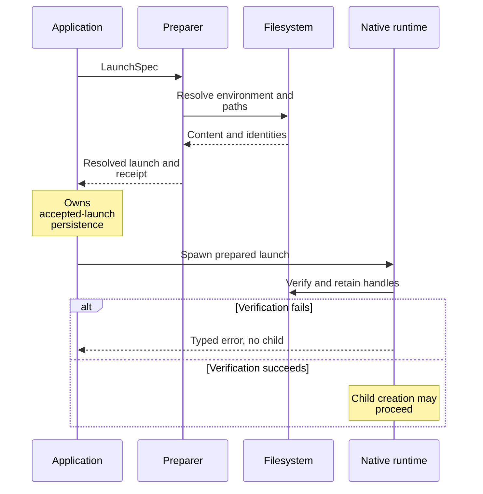

# Understand launch preparation and verification

Use this explanation when changing executable resolution, environment loading,
or working-directory handling. These are private runtime adapters in package
0.1.0-beta; their `pub` visibility does not make them a supported SDK. Start with the
[crate overview](../../../README.md) and the domain's
[execution types](../../../../undercurrent-domain/src/execution.rs).

Preparation selects a launch and records its evidence. Verification checks that
evidence immediately before creating a process and retains platform handles for
the process lifetime. Neither phase establishes application-level session
success. The [native process lifecycle](native-processes.md) describes the
subsequent PTY creation, child launch, output capture, and acceptance boundary.

## Follow the preparation boundary

The diagram separates selection from the later side effect. Application
persistence is outside the preparer's responsibility.

*Takeaway: a preparation receipt precedes a process side effect; it is neither
a process receipt nor a substitute for spawn-time verification.*

[Preparation adapters](../../../src/process/preparation.rs) implement the application
port. The validation and receipt algorithms belong to
[preflight](../../../src/process/preflight.rs) and
[Windows preflight](../../../src/process/windows_preflight.rs). Keep those algorithms
together when changing receipt inputs. A mode change cannot reinterpret an
existing receipt.

## Choose the correct executable guarantee

| Property | Native launch | Sealed launch |
| --- | --- | --- |
| Implemented preparation | Linux, macOS, Windows | Linux only |
| Selection | Resolve once, retain the accepted path in the launch | Resolve an object, hash its content, retain object identity in the launch |
| Later installed update | Allowed at the accepted path after safety validation; no new `PATH` search | Reject changed identity or content before staging |
| Executed bytes | Native path execution; Unix does not promise immutable bytes between validation and execution | Copy into a sealed memory file, verify seals, then rehash the sealed bytes; execute through a retained parent-host descriptor |
| Caller-supplied expected digest | Rejected | Must match selected content |
| Scripts | Native Unix shebang scripts; Windows batch handling below | Shebang scripts rejected |
| Missing legacy executable identity | Rejected at verification | Rejected at verification |

Both modes reject nonregular and oversized executable files (512 MiB maximum).
Unix also requires execute permission, rejects setuid/setgid bits, and on Linux
rejects file capabilities when present. Unsupported capability inspection is
handled separately from an actual capability-bearing file. These checks do not
make a native launch an immutable executable guarantee.

### Native updates and sealed bytes

On Unix, native selection preserves the invocation path, including a symlink
such as `/bin/sh`. Preparation inspects and hashes an opened object after
canonicalization. Verification reopens and validates the saved native path but
does not compare its new content with the originally observed digest. This is
why an installed native update can run after a restart.

Linux sealed verification checks the recorded object identity and digest,
copies at most the executable bound into a `memfd`, installs write-preventing
seals, and hashes again after sealing. The retained descriptor is reopened
read-only and referenced through `/proc/<host-pid>/fd/<fd>`. This requires the
kernel facilities and process-descriptor filesystem; it is not a portable
fallback to path execution. Weak caches share still-live immutable executables
and directory handles; they do not skip verification or keep dead handles alive.

## Resolve paths without changing their meaning

An absolute program path is used directly. A bare name searches only absolute
entries in `PATH`; the supplied environment takes precedence over the runtime's
inherited `PATH`. A relative path with directory components needs a prepared
working directory. `tool://name/version` validates both components and searches
for `name`; this adapter does **not** resolve or install the requested version.
Other URI schemes are rejected.

### Windows executable and batch resolution

Windows searches a name without an extension using `.exe`, `.com`, `.cmd`,
`.bat`, then the original spelling. Its `PATH` lookup is case-insensitive.
Nonbatch files must have an `MZ` header. Batch execution retains the script and
the selected command interpreter. Before dropping a verbatim path prefix for
`cmd`, it proves that the ordinary spelling identifies the same file; ambiguous
trailing-dot or trailing-space aliases are rejected. The platform and vendored
PTY adapters own the command-line escaping and pinned ancestor guarantees.

### Bound working directories to their root

A working directory requires an `ExecutionEnvironmentBinding`. No explicit
directory with a binding means the binding root. Parent traversal and paths
outside the root are rejected. Preparation records separate root and selected
directory identities; verification compares both. A missing identity is an error,
not permission to fall back to an unverified path.

Linux opens beneath the root with `openat2` restrictions against escape and
magic links; the selected final component cannot be a symlink. macOS walks each
component through retained descriptors, rejecting symlinks. Linux starts through
the retained directory's `/proc` reference; macOS passes a retained directory
handle to the vendored PTY adapter. Windows retains `PinnedPath` objects for the
root, directory, executable, and any batch interpreter. Consult the
[Windows platform crate](../../../../undercurrent-platform-windows/src/lib.rs) when
changing Windows file or ancestor identity behavior.

## Keep configuration, inherited environment, and secrets distinct

[Environment loading](../../../src/process/environment.rs) resolves the optional
environment file during preparation. Files require absolute paths and are read
at most `environment_file_bytes + 1` to detect overflow before parsing. File
values are merged first; explicit variables override them, with capacity checked
after each insertion. Windows keys are ASCII-uppercased before overlay. Dotenv
substitution uses `dotenvy` and ambient environment, so expansion is not limited
to the explicit map.

The resolved launch removes the file reference. Later verification rejects a
supposedly prepared launch that still needs file loading. Entry and byte limits
apply to resolved values; path and command limits are validated separately.
The merged-map budget does not count every variable inherited by the child.

Spawn resolves secret references separately and applies their values to the
child environment. Runtime-owned session and shell-capture settings are applied
at spawn. This does not mean preparation snapshots every variable the native
process builder can inherit. See spawn resource ownership in
[native process creation](native-processes.md).

The [private host codec](../../../src/process_host_protocol.rs) transports resolved
launch evidence and secret references separately from resolved secret bytes.
Launch debug output reports counts and presence flags. Secret containers erase
their retained byte vectors on drop; this is not a claim that all temporary or
OS-owned copies are erased.

## Investigate a rejected launch

| Failure area | Check | Recovery at the owning layer |
| --- | --- | --- |
| Unsupported platform or sealed mode | Selected mode and target-specific preflight | Choose an implemented mode through the application's launch contract |
| Secure path resolution unavailable | Linux `openat2` support | Supply a supported runtime environment; do not weaken directory checks |
| Immutable executable or `/proc` descriptor unavailable | Kernel memory-file sealing and descriptor access | Restore prerequisites before sealed launch |
| Missing or stale receipt/identity | Persisted prepared launch and actual executable/root/directory | Reprepare through application validation; do not edit digest fields manually |
| Directory outside binding | Binding root and requested relative path | Correct the binding or directory request |
| Environment rejection | File parsing, resolved sizes, and remaining file reference | Fix configuration before preparation; avoid logging secret values |

`LaunchPreparationError::kind` is authoritative for application error mapping:
unsupported facilities map to `Unsupported`, unavailable immutable execution
facilities to `Unavailable`, and most malformed/stale evidence to `InvalidData`.
Read the exact mapping before changing a public-facing error translation.

## Verify a change

The inline preflight tests cover identity receipts, same-inode mutation, path
replacement, immutable execution, cached handles, directory escape, native
script updates, privileged updates, and mode reinterpretation. The macOS tests
exercise retained working directories across rename. Windows command tests in
[windows_execution_tests.rs](../../../src/process/windows_execution_tests.rs) cover
batch paths with spaces, output/status replay, cancellation, deadlines, and
host-crash descendant cleanup. Tests under a target-specific `cfg` need that
target; compiling on Linux does not verify Windows or Darwin behavior.

Continue with [native process ownership](native-processes.md),
[terminal retention](../terminal.md), and [foreground evidence](../evidence.md).

[Crate documentation](../../README.md)
