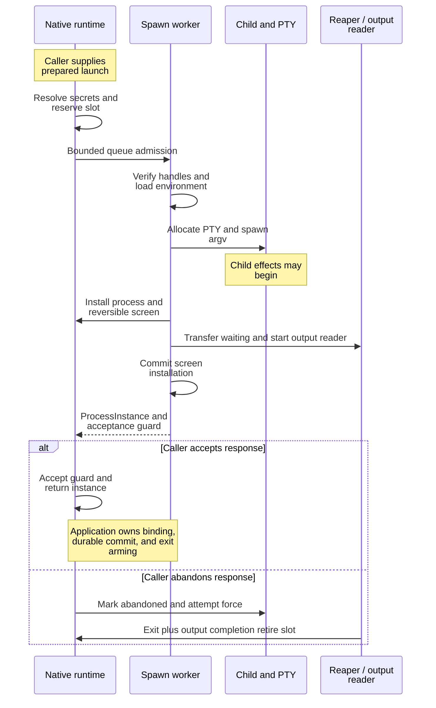
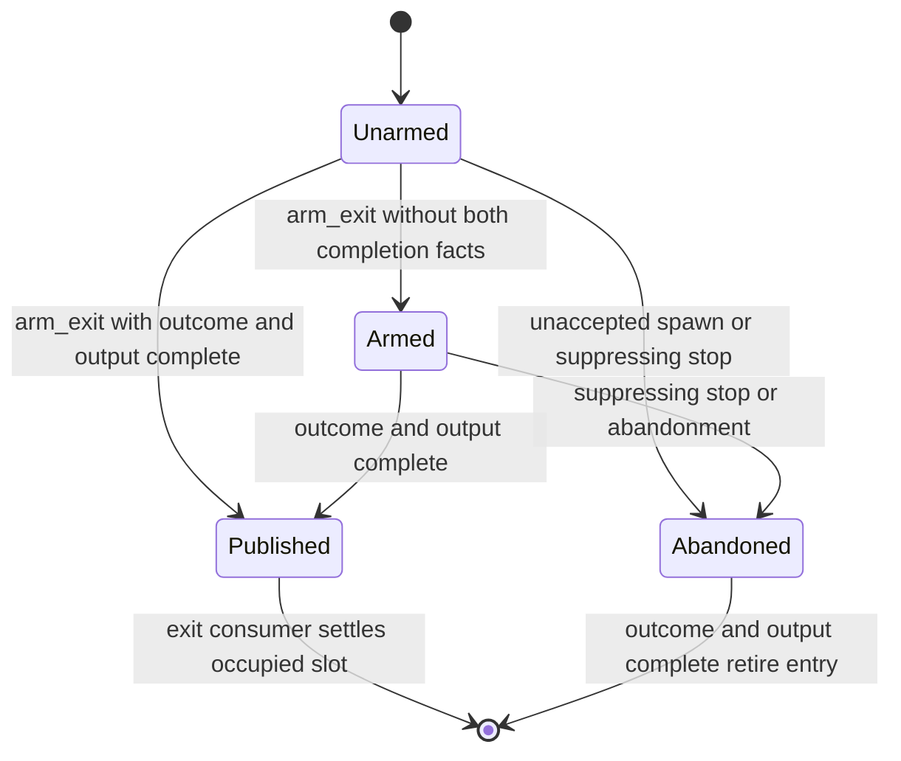

# Trace a native process from admission to exit

This explanation is for maintainers changing the local PTY machinery in
`undercurrent-runtime` 0.1.0-beta. `NativeProcessRuntime` owns child processes in its
own OS process. The daemon normally reaches this machinery through the separate
private session host; local runtime handles alone do not provide daemon-crash
survival. The inward [application process ports](../../../../undercurrent-application/src/ports.rs)
own the contracts consumed by lifecycle services.

## Resource ownership and bounds

[`process/mod.rs`](../../../src/process/mod.rs) constructs the output, screen, and
cooperative stores, fixed preparation and spawn pools, and child reaper. Starting
the runtime creates worker threads but no children. Clones share a `RuntimeOwner`;
dropping its final handle closes workers and force-terminates remaining children.
Output and screen store handles can outlive that owner as retained observations.

`NativeProcessRuntimeConfig` validates every nonzero bound, worker count no larger
than process capacity, stack size at least 64 KiB, output session capacity covering
process capacity, and PTY read size fitting one output append. Forced termination
needs a nonzero confirmation timeout. The epoch must form a valid process ID even
with maximum PID and sequence widths. Actual IDs combine epoch, PID, and a checked
monotonic sequence; a PID alone is not an incarnation identity.

There are `spawn_workers` in **each** of the preparation and spawn pools, each
with its own queue bound. A live child also gets an output-reader thread and a
lazy input-writer thread once needed. Unix uses a shared reaper plus SIGCHLD
forwarder; non-Unix targets use per-child waiting threads. Stop requests start
blocking workers and serialize through a per-process gate. Do not describe this
as a single fixed thread budget: admission limits and the application coordinator
must constrain higher-level callers as well.

## Follow a successful spawn and its cancellation points

The sequence shows local spawn ownership transfer. Application durable commits
are outside this sequence; obtaining a process handle is not a session commit.

*Compensation terminates an unaccepted child; it cannot undo effects that child
already performed before termination.*

[`PreparationPool`](../../../src/process/preparation.rs) moves filesystem preparation
and hashing off the caller's executor. Admission uses `try_send`; a full queue
returns `CapacityExceeded`, a closed queue `Unavailable`. Workers skip requests
whose reply receiver closed before work began. Shutdown cancels queued requests
and joins in-flight preparation; filesystem work already started has no separate
cancellation deadline.

The runtime reserves a process slot and the session key before submitting to
[`SpawnPool`](../../../src/process/spawn.rs). Duplicate reservations or live entries
conflict. Queue rejection and failed spawning release reservations. Dropped
queued responses are skipped; an unaccepted successful response owns a
`SpawnAcceptanceGuard` whose drop abandons and forces the child. Native `spawn`
does not itself run `prepare_launch`: callers must pass prepared launch identity,
as the native tests' `spawn` helper does.

The spawn worker verifies prepared launch handles, loads environment, opens the
PTY, takes reader/writer handles, and invokes the program with literal arguments.
It does not add shell evaluation. It captures the OS process identity, allocates
the runtime incarnation ID, and installs the process and screen. An
`UnregisteredChild` guard kills and waits if failure occurs before child ownership
reaches the reaper. Later failure marks the installed process abandoned and
coordinates output/exit completion. Preserve these guards when introducing any
new fallible step after process creation.

Environment-file parsing and overlay rules are described under
[launch environment and secrets](launch.md#keep-configuration-inherited-environment-and-secrets-distinct).
Spawn resolves the ephemeral secret overlay and injects runtime-owned session
and shell-capture settings before creating the child.

## Publish an exit only after ownership and output are ready

[`ManagedProcess`](../../../src/process/managed.rs) retains two independent facts: a
child outcome and output-reader completion. Its exit-publication flag starts
unarmed so a fast child cannot publish an event before application activation.
This state diagram shows the publication flag and its guards, not domain session
lifecycle states.

*An observed child exit alone neither publishes the event nor frees the slot.
An exit already published remains owned by the exit consumer during ordinary
termination; the unaccepted-spawn path cannot be armed by its caller.*

Arming is idempotent for an armed or already-published exact incarnation. A
different incarnation conflicts, and an abandoned entry cannot be armed.
Published exits leave the live map but remain in `published_exits` and occupy
capacity until `next_exit` receives and settles them. This keeps the exit channel,
whose capacity equals `max_processes`, bounded without silently losing outcomes.
Settling the local queue is not a durable application commit.

### Child waiting and output completion

[`reaper.rs`](../../../src/process/reaper.rs) owns child waiting. On Unix, SIGCHLD wakes
an inspection of registered children, with an immediate check at registration
to catch fast exits. Successful numeric exits become `ProcessOutcome::Exited`;
signalled exits or waiting errors become `SupervisionFailed`, so absence of a
numeric code is not invented as a successful exit. Non-Unix registration starts
a per-child waiter. Reaper shutdown settles the children it still owns.

Waiter creation retains child ownership in a shared handoff until the worker
starts. On thread-creation failure, registration force-signals and waits for the
retained child before releasing its handle. `child_settled` is true only after a
successful wait. A wait failure preserves the caller's force-cleanup path and
keeps the abandoned process slot occupied: spawn must not synthesize an exit
observation from an unsuccessful wait. The slot remains owned until a real
waiter reports an exit or the runtime is dropped. Failed registration closes
Windows PTY output even when settlement remains uncertain. The same flag rule
applies to closed registration and duplicate-registration errors.

Shared injectable-launch tests cover failure, unsuccessful waiting, and sole
ownership on success. The [native Windows failure fixture](../../../src/process/windows_reaper_tests.rs)
starts a real child and descendant, injects waiter creation failure, checks
native wait/drop and handle counts, and verifies both one-slot reuse after
settlement and refused reuse after an unsuccessful wait.

The output reader independently drains until EOF (or Unix PTY `EIO`), retries
interrupted reads, and marks output complete. Terminal mode removes cooperative
OSC records, records their exact-process state, retains the remaining bytes and
advances the screen, queues parser replies, emits byte/retention metrics, then
notifies the output observer. Opaque mode preserves every byte and bypasses both
filter and parser. A retention/read error emits a typed diagnostic and attempts
to force a still-running child; it does not promise complete final output.

The reader removes the exact cooperative signal at output completion. On Windows
the exit path explicitly finishes ConPTY output so the reader can drain without
holding the runtime state lock. See [terminal checkpoint ordering](../terminal.md)
for the local capture boundary.

## Serialize input while keeping ambiguous writes visible

The input worker starts lazily with exclusive ownership of the PTY writer.
Admission reserves encoded byte capacity for waiting senders, queued requests,
and the active write. Sequence-channel admission may wait asynchronously; the
byte reservation bounds the amount waiting. Cancellation before ownership
transfer releases that reservation. Once queued, dropping the response future
does not retract the write: the worker completes it and attempts the reply.

The worker writes and flushes the whole delivery, retaining ownership across a
profile pause. A write error can follow partial delivery. It closes admission,
fails queued requests, and releases their byte reservations. The failed active
write remains uncertain, including a flush failure after all bytes were written.
A queued request explicitly discarded before writing, or a pre-queue rejection,
provides KnownAbsent proof to the host's durable attempt receipt. Losing a reply
after queue admission provides no such proof. Automatic terminal
query replies use nonblocking queue admission and are dropped under pressure to
avoid deadlocking a child that writes output without reading input. User-input
success and automatic reply admission are therefore different contracts.

### Close input after accepted writes

`close_input` closes new admission, waits for accepted writes to drain, writes
and flushes one conventional EOF byte (`0x04`), and permanently closes the writer.
A PTY has no portable input half-close: the application may interpret that byte
differently, especially outside canonical terminal mode. Repeated successful
closure is `AlreadyClosed`; failure is retained as `CloseFailed`. The close path
can block its caller's thread on writes and a condition variable without an
internal timeout. It is not equivalent to stopping the process.

### Resize and process truth

Resize validates the exact process, changes the PTY first, then updates capture
geometry. If the later screen step fails, the PTY side effect has already occurred;
do not present that error as an atomic rollback. Process truth reads the exact
in-memory identity and retained outcome, without probing an arbitrary PID. Once
an entry is retired, missing local truth is not durable proof of nonexecution.

## Stop, force, and shut down with distinct meanings

Graceful stop owns the per-process termination gate while sending the configured
signal and waiting `force_after`. Forced stop signals before taking that gate,
so it interrupts an existing graceful wait on the same retained incarnation.
The grace deadline includes root exit and PTY output completion. If descendants
keep the terminal open after the root exits, escalation forces the remaining
group before confirming completion. On macOS, terminal revocation can report EOF
while the group still contains descendants, so completion also checks that group
through the same deadline. Graceful-only timeout returns
`GracefulTimedOut` and retains ownership without forcing survivors. Windows has no POSIX graceful signal: an escalating policy can wait its
grace interval before native force, but a graceful-only request fails rather than
silently forcing. [`process/platform.rs`](../../../src/process/platform.rs) owns the
platform signaling and OS identity representations.

After force, exit confirmation and output drainage have separate waits using
the force-confirmation timeout; this is not
one deadline covering queueing, gate contention, signaling, exit, and drainage.
A `Timeout` after signaling leaves effects uncertain and may mean the child
exited while another holder kept the PTY open. Inspect exact process truth and
output/receipt evidence before another action. Dropping a stop future does not
cancel the already-started stop worker.

Ordinary explicit stop/force suppresses unsolicited exit publication so the
application can settle the requested termination without a duplicate exit event.
Graceful-only requests leave publication enabled. Outcomes distinguish graceful,
forced, and forced-after-timeout; numeric exit status is optional. These labels
describe supervision, not whether the child completed its business task.

### Native shutdown and final-owner drop

`begin_shutdown` closes new native spawn admission, closes preparation admission,
and closes the exit channel to wake waiters. Existing ownership remains until
the last handle is dropped. The composition root must close request admission
and join its exit consumer in the intended order before final drop. Final-owner
drop shuts down preparation and spawn pools, then forces remaining children;
in-flight filesystem calls and blocking cleanup may delay it. Hosted daemon
shutdown has a different ownership policy and must not be inferred from this
native destructor.

## Investigate and verify lifecycle changes

Use `pressure()` to distinguish reservations, active entries, unarmed fast exits,
published exits, input bytes, and pool queues. “No running child” is insufficient
to conclude a capacity leak: first check whether an exact exit remains unarmed
or unconsumed. Pressure is diagnostic, not a repository transaction.

The [native integration suite](../../../tests/native_process_runtime.rs) covers literal
argv, ephemeral secrets, cancellation before spawn acceptance, fast-exit arming,
exact truth, 300-process bounds, output replay, paced input exclusion, EOF after
accepted writes, resize, cooperative filtering, opaque capture, and both stop
policies. Use focused filters during development; the 300-process test consumes
substantial OS resources. Test creation of additional fallible resources before
and after reaper transfer, not only successful startup. The
[preparation-pool test](../../../src/process/preparation.rs) injects a blocked worker to
verify nonblocking overload rejection without filesystem timing assumptions.

Return to the [crate guide](../../../README.md) for the remaining host boundaries.

[Crate documentation](../../README.md)
