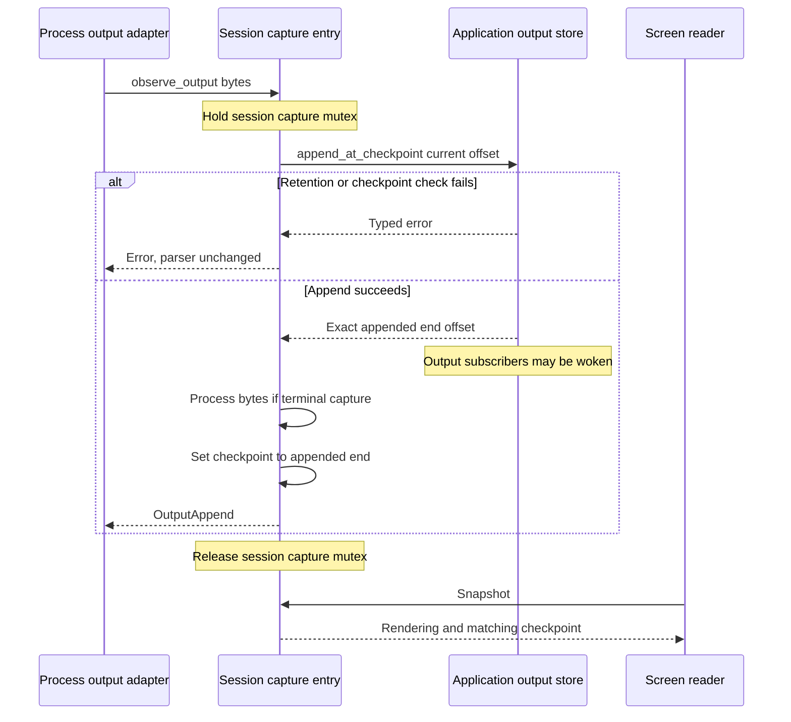

# Keep terminal bytes, screens, and input consistent

This explanation is for maintainers changing terminal capture or input encoding
in `undercurrent-runtime` 0.1.0-beta. The runtime owns the VT parser and concrete input
encoding; the [application output store](../../../undercurrent-application/src/terminal_output.rs)
owns bounded raw retention, byte offsets, replay gaps, and subscriptions. Neither
a screen nor a successful input write is an application-level command result.

## Capture modes and ownership

[`VtTerminalScreenStore`](../../src/terminal_screen.rs) maps session IDs to capture
entries. A terminal entry contains a `vt100` parser with bounded normal-screen
scrollback, the current process's starting output offset, and its current output
checkpoint.
An opaque entry contains only a checkpoint: arbitrary binary output never reaches
the parser. Both consume a session slot. Opaque capture supports raw retention
but screen reads, foreground samples, and health-screen samples return
`Unsupported`. A missing snapshot returns `None`; other operations on a missing
entry return `NotFound`.

The map uses a read/write lock; each entry has its own mutex. Independent sessions
can update different parsers concurrently. The caller still owns process
incarnation coordination: this store is keyed by session, not process ID.
Replacing an entry starts a blank parser at the caller-supplied current raw
offset, preserving session-relative offset continuity through a restart.

### Roll back failed screen installation

`prepare_session_with_capture_mode` immediately installs a replacement and returns
an undo guard. Dropping an uncommitted guard restores the old entry only if the
installed entry is still current. `commit` disarms rollback. This lets failed
spawns preserve the predecessor's screen, but installation is not an invisible
transaction: concurrent readers can see the prepared entry. Removing a screen
does not remove raw output, and resizing opaque capture is a no-op.

## Advance raw retention and the parser at one checkpoint

This diagram answers what happens when `observe_output` accepts a chunk; upstream
process reading and cooperative filtering are separate steps.

*A screen read cannot observe half of this transition. Raw-output consumers can
be woken before parser advancement, so this is not a transaction across every
consumer or a durable commit.*

Do not append behind the screen store's back: the next update detects a
checkpoint mismatch and returns `InvalidData`. Retention failure leaves the
parser and its offset unchanged. A parser snapshot has a configured rendered
byte limit; capacity errors are explicit rather than truncated screen content.
Snapshots restore input modes as well as cells: a late attachment must know the
child's mouse protocol, bracketed-paste mode, and application cursor mode even
when their enabling escapes were emitted only at startup. Diffs carry changes
to those modes too.

Normal-screen snapshots also seed the newest retained history pages that fit
the byte budget, before restoring the current viewport and input modes. The
live viewport is never truncated to make room for history. History pages are
rendered from parsed cells, so child clipboard escapes are not replayed. The
alternate screen has no scrollback: full-screen applications retain and scroll
their own transcripts. See [snapshot history](../../src/terminal_screen/history.rs).
The limit is checked after rendering, so it is not an allocation-free admission
check. Geometry constraints come from the domain terminal size and caller
configuration; the screen limits alone are not a total heap-byte budget.

### Deliver parser-generated replies

The vendored parser also generates bounded terminal query replies. `take_replies`
drains them for the process adapter to deliver. These are terminal protocol
responses, not user input receipts. The regression test verifies primary device
attributes, status, and cursor-position queries, rejects unsupported query forms,
and bounds a reply burst at 1,024 bytes. Preserve parse-position ordering when
changing reply handling.

## Restore or diff terminal state without replaying raw output

`restore_snapshot_at` rehydrates a parser from a bounded ANSI snapshot and uses
the supplied **local** output offset as its checkpoint. A remote snapshot's
offset does not automatically become the local raw offset. Restoration sets the
process-start checkpoint to that local offset, so later motion evidence requires
new output rather than treating restored state as output by a new process.

### Choose a diff or full repaint

The differ rehydrates temporary parsers from the supplied snapshots and leaves
the live parser untouched. It rejects a previous checkpoint newer than the
current one or a previous rendering over the limit. A geometry change, alternate
buffer change, or oversized diff returns a full current snapshot. Otherwise it
returns an ANSI diff from the previous output offset to the current snapshot.
Callers must supply a valid bounded current snapshot; `diff_now` does not repeat
the prior-content size check on current content.

A diff updates visible cells and input modes, not the bytes a process originally emitted.
A full snapshot cannot reconstruct evicted logs. The application output contract
distinguishes resuming at the first retained raw offset from requesting a screen
snapshot; opaque capture has no screen recovery option. Never hide a replay gap
by presenting a screen repaint as complete raw history.

## Extract bounded observations from one visible state

[`terminal_screen/profile.rs`](../../src/terminal_screen/profile.rs) deduplicates exact
regions in sorted order and reads them under the parser mutex. It returns private
text, the last selected line, a cursor-at-end flag, and one shared output offset.
Limits bound distinct samples, bytes per sample, and motion rows. Capacity failure
returns an error instead of partial samples. Debug views include counts and
offsets, not text.

| Region or anchor | Implemented selection |
| --- | --- |
| No region | Visible rows through the last nonblank row, removing trailing empty rows. |
| `BottomRows`, `Any` | Requested rows at the bottom of the visible screen. |
| `BottomRows`, `Last` | Last nonblank line within that bottom selection. |
| `Cursor` anchor | Cursor row, clipped through cursor column plus one; this can be outside the nominal bottom-row range. |
| `NearCursor` anchor | Rows within its distance around the cursor, bounded by the screen; also independent of the nominal bottom range. |
| `AboveCursor` or `BelowCursor` | Requested surrounding rows, excluding the cursor row, empty at the corresponding screen edge. |
| Optional column count | Clipping by Rust character count, not terminal display-cell width. |

### Motion and health samples

Motion fingerprints contain trimmed plain-text row hashes, dimensions, alternate
buffer state, output offset, and whether output advanced beyond this process's
start. Top/bottom exclusions remove ambient rows from the hashes, but the row
limit is checked against full screen height. Motion requires **both** an advancing
output offset and a changed fingerprint. A resize alone does not imply activity;
color-only or cursor-only changes and identical repaints are not text motion.
The noncryptographic hashes are a bounded heuristic, not a proof of program work.

[`terminal_screen/health.rs`](../../src/terminal_screen/health.rs) reads visible plain
text and red-cell count at one checkpoint. It bounds all screen cells and the
newline-joined text. Red means a nonempty cell with foreground palette index 1
or 9; RGB red and red backgrounds are not included. See
[evidence and health](evidence.md) for how these samples become observations.

## Encode one semantic delivery without changing its meaning

[`terminal_input.rs`](../../src/terminal_input.rs) converts a domain-validated
`InputSequence` into one bounded byte buffer in caller order. It reserves the
domain's conservative admitted byte bound and rejects concrete encoding beyond
that bound before appending the offending bytes. Allocation, formatting, bound,
and pacing errors report counts or metadata without the input payload.

| Input | Encoding responsibility |
| --- | --- |
| `Text` / `Bytes` | Exact UTF-8 bytes / exact supplied bytes. |
| `AutoText` | Raw or bracketed paste according to the selected profile's text mode. |
| `Paste` | Always bracketed with `ESC[200~` and `ESC[201~`. |
| Named keys | Canonical xterm sequences; Enter is carriage return and Backspace is DEL. |
| Modified navigation/function keys | Xterm modifier parameter `1 + shift + 2*alt + 4*control`. |
| Mouse | SGR mouse form using validated coordinates, button/motion code, and press/release terminator. |

The domain owns valid key ranges, mouse bounds, and input admission. This encoder
does not query terminal modes or prove the receiving application understands a
sequence. The exact mapping remains in the source and its unit tests.

### Pace a final typed Enter

A profile may add a pause before a final **typed Enter** when earlier items
encoded at least one byte. A raw trailing carriage return does not trigger it.
Host-decoded pacing must use an internal byte boundary and a nonzero whole-
millisecond delay. The process adapter must retain serialization over the write,
flush, pause, and final write. Here, an atomic delivery means avoiding interleaved
requests; an OS write can still partially succeed, and a pause cannot make it a
rollback-capable transaction. After an uncertain delivery use the operation's
receipt/reconciliation path, not an automatic second write.

## Change and verify the right layer

Change domain admission with any new input family, runtime encoding with its
byte representation, and host protocol encoding if the metadata crosses IPC.
For screen changes, preserve output checkpoint ordering, opaque bypass, undo
guards, alternate-buffer restoration, and sample redaction.

Relevant maintained examples and tests are in
[terminal screen integration tests](../../tests/terminal_screen.rs) and
[input encoding tests](../../src/terminal_input.rs). They cover rollback after failed
installation, output divergence, opaque bytes, snapshot fallback, sample bounds,
pacing, and mixed semantic input. The
[VT regression suite](../../tests/vt100_regressions.rs) compares full public state
against registry `vt100`, and the [VTE suite](../../tests/vte_regressions.rs) checks
fragmented and random byte corpora against the registry parser. Keep those
reference dependencies separate from vendored production dependencies.

The [terminal decoder benchmark](../../benches/terminal_decoder.rs) measures plain,
ANSI-heavy, UTF-8, and fragmented input with a single parser thread. It prints TSV
throughput measurements, not an end-to-end PTY latency or retention benchmark.
Return to the [crate guide](../../README.md) for process and verification entry points.

[Crate documentation](../README.md)
