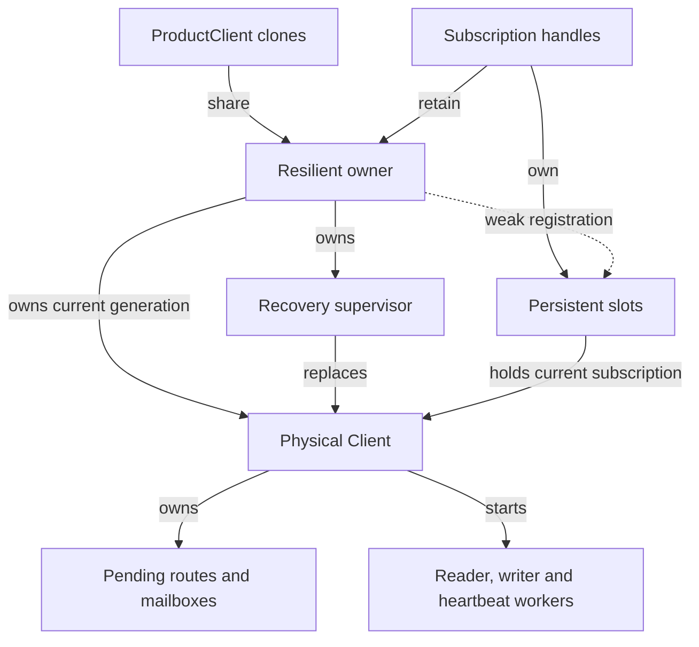
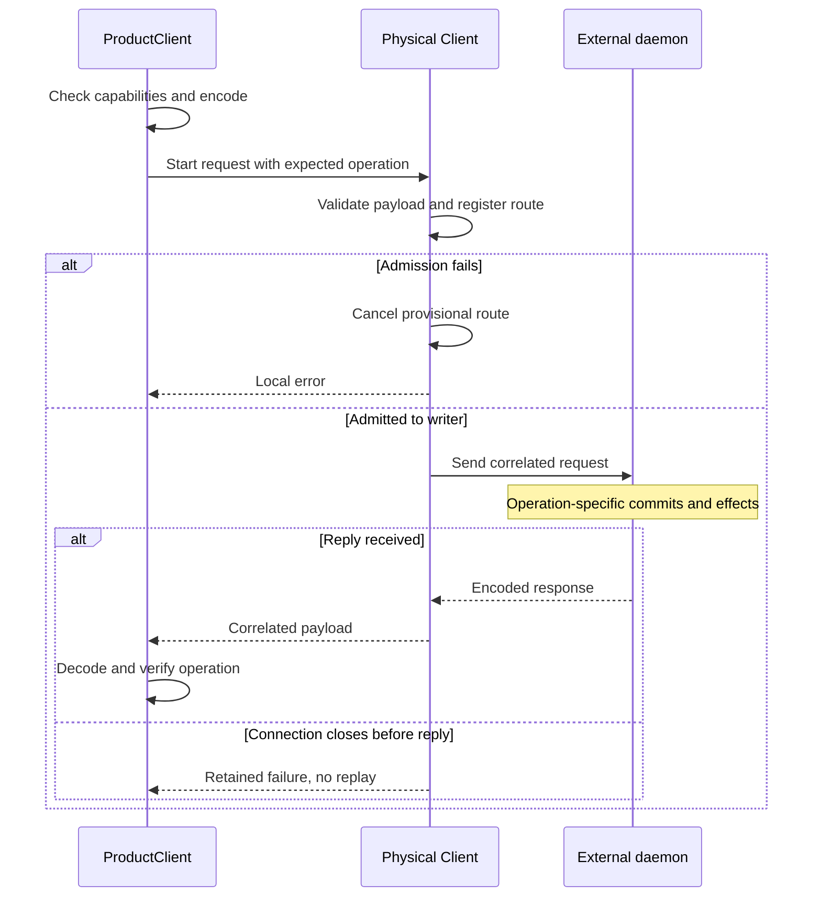

# Trace request admission and client ownership

Use this explanation to investigate concurrent calls, reply correlation, heartbeat
closure, or teardown in Rust SDK 0.1.0-beta. Start at [client.rs](../../src/client.rs),
with typed admission in [product.rs](../../src/product.rs) and local IO in
[local.rs](../../src/local.rs). Consumer lifetime rules are in
[deadlines and ownership](../../../../docs/sdk/rust/streams-and-recovery.md#deadlines-and-ownership).

## Runtime ownership and concurrency

This view shows ownership within the caller process. The external daemon owns
session state and effects; see the [system runtime view](../../../../docs/architecture/README.md). A normal subscription adds a mailbox and persistent slot, not a dedicated
SDK thread. Recovery temporarily creates a bounded number of resume workers.

*Clones and streams share one physical connection; local worker/runtime ownership
does not imply an embedded daemon.* `LocalClientConnector` starts one named
`undercurrent-sdk-local` thread with a current-thread Tokio runtime. `Client`
starts writer, reader, and heartbeat threads; `ResilientClient` adds one recovery
supervisor. The caller API remains synchronous despite Tokio inside the adapter.

### Serialize admission and correlate replies

The IO path has one writer and one reader. In [local.rs](../../src/local.rs),
the separate local worker transfers encoded outbound frames and decoded inbound
frames through bounded queues to an authenticated socket or pipe. In
[client.rs](../../src/client.rs), the heartbeat worker queues Ping through that
same writer.

The writer admission mutex synchronizes close with queue admission. It checks the
closed flag and bounded message count before `try_send`; the writer decrements
queued accounting before transport send. Queued commands are serialized, but
concurrent callers have no deterministic admission order and responses can arrive
out of order. Each physical connection allocates checked `r-N` request IDs.
Persistent `rs-N` stream IDs live outside physical generations to avoid reuse
across reconnect; raw `Client` streams use physical `s-N` IDs.

### Route incoming data and detect closure

The reader routes finite responses by ID and drops late/unknown responses with a
diagnostic. Unknown-stream delivery is ignored after independent removal. Other
stream-routing failures retain the cause and close the connection. A full
mailbox instead closes its logical route and queues one remote CloseStream,
reporting a typed stream overload. If that close cannot be queued, physical
teardown is still required. Credit updates after route removal are suppressed
under writer admission so they cannot follow the close on the wire. Heartbeat liveness is refreshed by responses, stream items, and
Pong; it is not proof of an application-level result. The heartbeat worker queues
Ping at the negotiated interval and closes a silent connection after its timeout
is observed at a check. A saturated writer may skip a Ping; there is no exact
hard real-time deadline guarantee.

The router/mailbox mechanics are owned by
[undercurrent-multiplex](../../../undercurrent-multiplex/src/router.rs).
`Subscription::recv_raw` serializes access to the physical stream, obtains an
item, records remaining bytes, and returns flow credit. See the
[delivery sequence](subscription-recovery.md#delivery-checkpoints-and-credit) for why this
checkpoint is not a durable application acknowledgment.

### Synchronize close notification

`wait_closed` checks the atomic closed flag under `close_wait`.
`fail_connection` acquires `writer_admission` and then `close_wait` to publish
closure. The waiter therefore either observes closure before sleeping or enters
the condition-variable wait before closure can be published. The notification
cannot fall between its last open check and waiter enrollment.

The waiting path never acquires `writer_admission`. Both locks are released
before router/transport teardown and telemetry callbacks; the existing close
notification follows local teardown. The
[close-race regressions](../../src/resilient/close_tests.rs) pause the real recovery
supervisor after its open check and verify both reconnection and final-owner
cleanup without an extra notification. This synchronization establishes a wakeup
when closure is published; it does not make explicit `close` join all workers or
acknowledge remote closure.

### Tear down a physical client

`fail_connection` closes the router and adapter, signals heartbeat/close waiters,
and resets physical gauges. Retained multiplex or transport failures enrich
pending-request errors; teardown does not wait for each caller's timeout. Close
commands are best effort; transport close is the decisive local teardown. Final
owner drop joins worker handles except the current thread, avoiding self-join.
Persistent slots use weak entries in the owner map to avoid retention cycles;
subscription handles strongly retain the owner. Generation and pointer checks
prevent an old receiver from detaching a newer physical subscription.

## Session creation

The shared [start walkthrough](../../../../docs/architecture/flows.md#start-a-session)
owns the daemon's commits, process effects, and compensation. The SDK's part is
request admission and result correlation:

1. `ProductClient::request_cancellable_inner` checks capabilities, encodes the
   request, and retains the expected operation.
2. `Client::start_request_with_trace_context` validates payload size and registers
   the response route before enqueueing. Admission failure cancels that route.
   Pending-count and duration guards follow the handle.
3. The writer queues owned UCMP bytes. A correlated response completes the pending
   handle, and the product layer validates operation identity before returning it.

There is no SDK disk transaction or automatic finite-mutation retry. SDK writer
acceptance does not establish daemon admission or completion. The
[request correlation/cancellation tests](../../tests/product_client.rs) verify this
local boundary; [consumer recovery](../../../../docs/sdk/rust/streams-and-recovery.md) explains what the
caller can infer when the response is missing.

This sequence isolates SDK admission from daemon effects.

*Route registration prevents a fast reply from outrunning its waiter. Once sent,
a missing response requires operation-specific reconciliation.*

[SDK maintainer documentation](../README.md)
