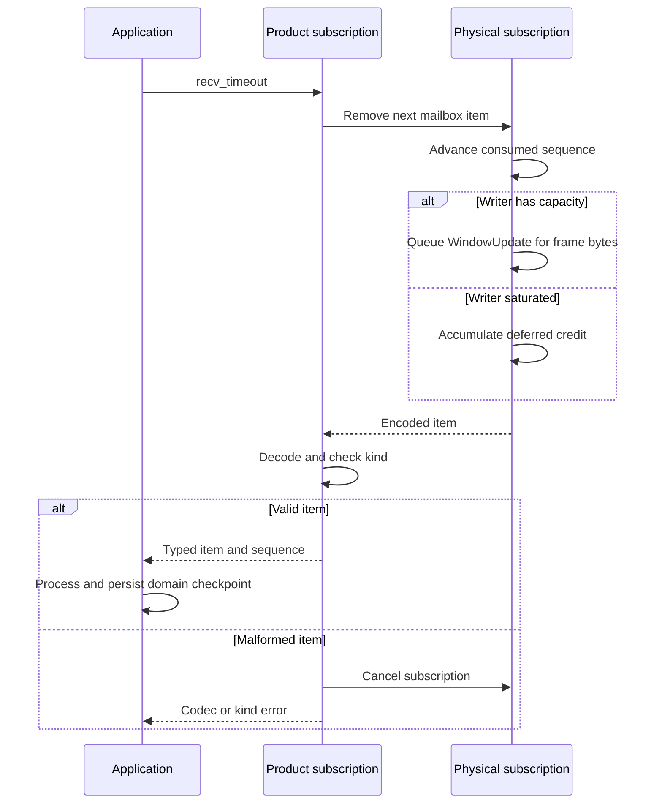
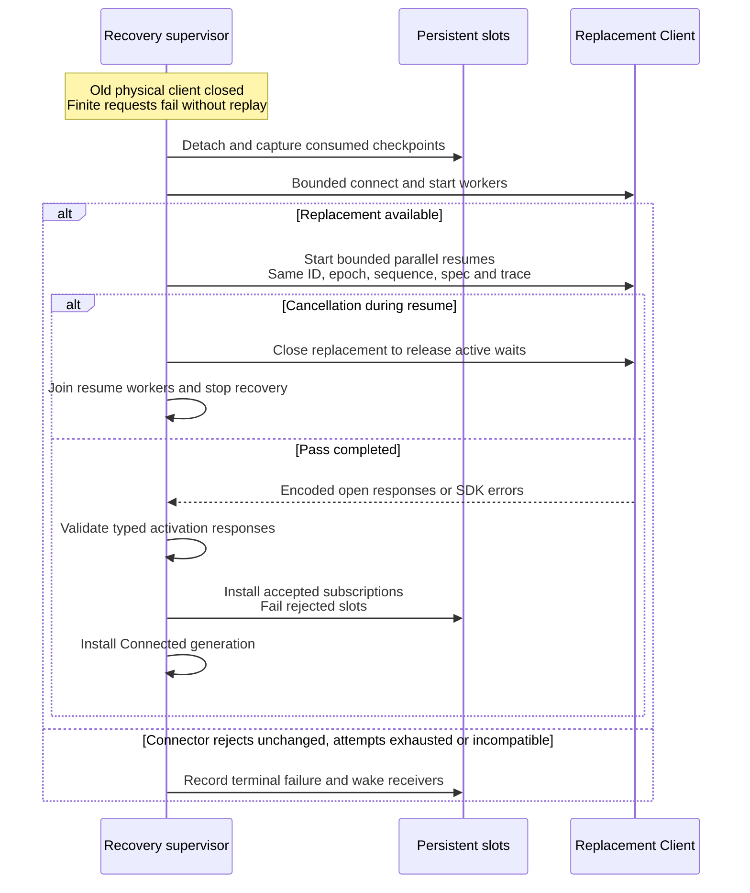

# Trace stream activation, credit, and replacement

Use this explanation to change stream routing or investigate a subscription that
closes, stalls, or crosses physical connections in Rust SDK 0.1.0-beta.
[client.rs](../../src/client.rs) owns physical subscriptions;
[resilient.rs](../../src/resilient.rs) owns persistent slots;
[product/subscription.rs](../../src/product/subscription.rs) owns typed decoding.
For caller actions, use [streams and recovery](../../../../docs/sdk/rust/streams-and-recovery.md).

## Terminal output

A typed open first encodes `ProductStreamSpec`. The physical client reserves a
stream route **before** its finite open request, allowing the reader to queue
items that arrive immediately after activation. Failure removes the provisional
route and queues best-effort cancellation/close. The product wrapper decodes the
initial activation metadata and cancels on rejection or kind mismatch.

The [shared terminal flow](../../../../docs/architecture/flows.md#consume-terminal-bytes)
traces production and finite reads, then links to the stream pump, scheduler,
and retention owners. The SDK
owns its receiving mailbox and consumed transport cursor. Source retention and
transport replay retention are independent of that mailbox.

`ProductSubscription::decode` handles UCTO binary data for terminal streams and
JSON for the other kinds. A source-retention gap and a physical-replay gap can
both reach the caller; a screen seed changes the appropriate recovery action to
requesting a new snapshot. The consumer must rebuild its view after a gap.
[Application terminal-output tests](../../../undercurrent-application/tests/terminal_output.rs)
and [terminal-screen tests](../../../undercurrent-application/tests/terminal_screen.rs)
exercise source behavior; the SDK [typed binary test](../../tests/product_client.rs)
checks exact decoding and malformed-stream isolation while a finite peer request
remains usable.

## Delivery checkpoints and credit

This sequence follows one received data item. Queuing into the mailbox has not
advanced the consumed cursor. `recv_raw` removes an item and returns credit
before the product layer decodes it.

*Transport credit and the consumed cursor precede application persistence.
The SDK cannot use either as a durable application acknowledgment.*

The daemon scheduler sends flow-controlled data to the SDK reader within stream
credit; the reader admits it to a bounded mailbox. Source retention, replay
retention, and application storage remain separate budgets. See
[pressure and resume limitations](../../../../docs/sdk/rust/streams-and-recovery.md#pressure-and-current-recovery-limitations)
for writer-owned credit retry and close-pressure exceptions.

## Recovery ordering

The [phase diagram](../../../../docs/sdk/rust/streams-and-recovery.md#what-automatic-reconnection-does)
describes public states. This sequence focuses on checkpoint capture and replacement
installation, including product activation validation.

*Accepted streams can be installed before the new Connected generation is
published. Product validators reject malformed, rejected, or wrong-kind
activation responses before installation.*

*Replacement restores observation handles, never ambiguous finite operations.*
Closing during recovery cancels connector/backoff and resume work, closing the
replacement to release active waits. Cancellation/removal of an individual handle prevents
a later resume result from reviving it. `Failed` retains a stable failure reason;
`last_recovery_error` on the encoded resilient layer preserves its source.

## Bounded attempts and manual recovery

The [recovery implementation](../../src/reconnect.rs) attempts the connector at most
`maximum_attempts` times per recovery pass, waiting only after failed attempts.
Backoff uses an integer multiplier in basis points, additive bounded jitter, and
a maximum-delay cap. Cancellation wakes backoff waits; the connector must honor
it during dial/handshake. A connector error classified `DoNotRetryUnchanged`
stops the pass immediately with `ClientRecoveryError::ConnectorRejected`, retaining
the exact attempt count and redacted source. Persistent clients enter
`Failed(ConnectorRejected)` rather than spending the remaining budget on an
unchanged rejection. Other connector failures retain bounded retry/backoff.
Correct a permanent rejection before starting another recovery pass.

Manual encoded clients can call `Subscription::checkpoint(payload)` and
`recover_client_connection`. Supply the exact original encoded specification,
stream ID, trace context, epoch, and consumed sequence. Duplicate IDs, too many
streams for the replacement agreement, or missing resume support reject the
pass. Resume workers are bounded by `maximum_parallel_resumes`; results are
returned in checkpoint input order even though operations execute concurrently.
This helper returns a replacement `Client`; it does not install a persistent
supervisor on the caller's behalf.

### Cancellation during resume

Recovery checks cancellation before starting the batch, before workers admit
another checkpoint, while collecting results, and before returning success.
The collector checks at intervals of at most 25 ms while waiting for results.
On cancellation it closes the replacement connection to release active response
waits, then joins resume workers and returns `Cancelled`. This also releases the
persistent supervisor when explicit close or final-owner drop cancels recovery.
Transport adapters must honor their close/wakeup contract; the polling interval
is not a hard total shutdown-time guarantee.

Some subscriptions may have opened before cancellation was observed; cancellation
closes that connection rather than rolling back remote history. No finite mutation
is replayed. The [client contract tests](../../tests/client_contract.rs) cover
cancellation during a batch larger than the worker bound, explicit persistent
close, and final-owner drop.

[SDK maintainer documentation](../README.md)
