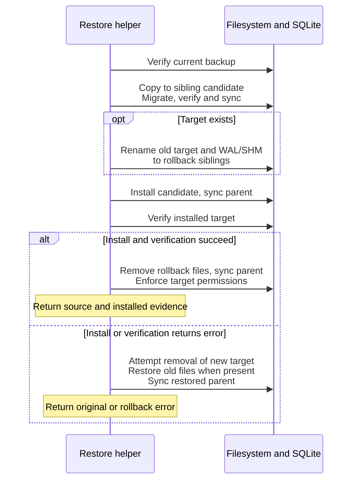

# Exercise, verify, and recover a SQLite repository

Use this maintainer guide to reproduce persistence behavior in isolation and
interpret maintenance failures. These Rust helpers are internal composition
tools, not a supported end-user database administration CLI. Product users
should begin with [the CLI guide](../../../undercurrent-cli/README.md).
The implementation owner is [maintenance.rs](../../src/sqlite/maintenance.rs).
[Back to the crate guide](../../README.md).

## Exercise a temporary repository

Prerequisites: the workspace checkout, its pinned Rust 1.95.0 toolchain,
a native C build toolchain for bundled SQLite, writable temporary storage, and
the locked Cargo dependencies available locally or through your normal Cargo
setup. This crate declares no optional features. There is no daemon setup:
the example constructs a domain launch specification but never executes it.

1. From the workspace root, run the maintained
   [repository_roundtrip example](../../examples/repository_roundtrip.rs):

   ```console
   cargo run --locked -p undercurrent-store-sqlite --example repository_roundtrip
   ```

2. Check that the command exits successfully and prints the four lines below.
   The final line confirms that explicit temporary-directory cleanup completed.

Expected example stdout, separate from Cargo's build messages:

```text
reopened: name=renamed, sessions=1, pending_events=2
verified backup: release=0.1.0-beta, identities=1
restored: sessions=1, pending_events=2, next_sequence=3
temporary repository removed
```

This is expected output, not a recorded test run. Assertions check each stage
before its corresponding success message. A Cargo toolchain or cache failure happens
before the example can establish its results; fix the build environment rather
than creating a production database for the demonstration. An I/O or invariant
failure exits with an error. Normal return and ordinary unwinding clean the
temporary directory; abrupt process termination can leave temporary files for
later inspection and removal. No real process needs to be stopped for this task.

### What the exercise checks

The example creates its own `tempfile` directory and uses explicit small limits.
It inserts a session and initial event, commits a rename at the expected revision,
closes/reopens, checks old and new event snapshots, creates a WAL-aware backup,
acknowledges the source events, closes the source, restores its backup over that
closed source, then reloads and verifies the restored state. It inspects the single current
schema identity, drops every repository handle, and explicitly removes the
temporary directory.

## Choose the maintenance operation

All maintenance entry points are synchronous and open independent connections.
They do not use repository queue limits, inherit its busy timeout, or accept a
cancellation/deadline parameter. Run them away from an async executor thread
whose responsiveness matters. Filesystem and SQLite errors retain an operation
stage and source.

| Function | What success establishes | Prerequisite or limit |
| --- | --- | --- |
| `verify_sqlite_database` | `integrity_check(1)` returned `ok`; current layout, selected provenance relationships and repository counts/checkpoint ordering passed | Read-only connection; no schema migration or complete payload audit |
| `sqlite_schema_evidence` | Verification passed and the exact release version/name/checksum identity match the executable | Requires the current layout, not merely `user_version = 1` |
| `backup_sqlite_database` | SQLite backup snapshot completed, destination synchronized and verification passed | Destination must not exist; source can be open and use WAL |
| `restore_sqlite_database` | Verified candidate installed and verified; reports whether target existed | Target must be closed by every owner; helper does not enforce exclusion |
| `restore_sqlite_database_with_options` | Same algorithm with deterministic fault injection | Intended for recovery tests, not a separate production recovery policy |

Use distinct, explicit source/destination paths in a dedicated owner-controlled
directory. Path checking rejects empty and lexically equal paths; it does not
canonicalize aliases, symlinks or hard links. A caller must establish that the
paths really identify different files. Maintenance requires a usable parent
directory and changes its permissions on Unix; do not place a backup directly
in a shared directory whose permissions should remain unchanged.

### Verification is scoped evidence

The verifier checks the exact release schema/ledger, policy and request-digest
provenance relationships, repair audit consistency, cancellation controls, agent
records, session/outbox physical counts against stored counts, nonzero next
sequence, and last acknowledgement below the next sequence. It returns schema
version, counts, and checkpoint values. That evidence contains no payloads and
does not assert application readiness.

It does not decode every session or unbound attempt, validate every outbox event
or snapshot, recompute agent JSON digests, or establish that a process exists.
The repository's open path additionally checks the maximum pending outbox
sequence against the next sequence and configured session/outbox capacities;
the maintenance verifier does not perform those same checks. The verifier's
individual reads have no enclosing snapshot transaction. For stable multi-table
evidence, verify a completed backup or a closed database, not a changing source.

Open also does not perform a full `integrity_check` or eagerly decode all session
payloads. Successful open, verification, and per-record decoding are complementary
checks with different coverage. Every database admission path requires the exact current release identity and
layout. No operation migrates an older database.

### Create a backup

1. Choose a distinct, unused destination in an owner-controlled directory.
   `DestinationExists` prevents overwriting an earlier backup. The source may
   remain open and use WAL.
2. Call `backup_sqlite_database(source_path, destination_path)` from the Rust
   maintenance owner. The [roundtrip example](../../examples/repository_roundtrip.rs)
   demonstrates the call and propagates errors with `?`.
3. Require a successful `SqliteBackupEvidence` result before using the backup.
   Keep the destination unchanged after verification so that evidence remains
   applicable. If the call fails, inspect its stage and any destination artifact
   before removing it or choosing another path.

#### What backup copies

The backup helper opens the source read-only and exclusively creates a new
destination file. The SQLite backup API copies committed database state,
including committed WAL pages, in 128-page steps with a 1 ms pause. It then
requests a destination WAL truncation checkpoint, closes it, restricts permissions,
synchronizes file/parent, and verifies the result.

A plain copy of the main database while WAL is active is not this operation.
Use the helper to include SQLite's committed state. The snapshot does not include
session-host journals, runtime output artifacts, process state, or resolved
secrets; database-only backup is not a complete running-system checkpoint.

Final verification failure attempts to remove the destination file;
earlier copy/checkpoint/permission/synchronization errors can leave an incomplete
destination. Inspect that artifact before choosing a new path or removing the
failed copy; a file's existence alone is not successful backup evidence.

### Restore a closed target

1. Close every repository clone and every other target connection, and exclude
   daemon/runtime owners through their operational lifecycle. The helper takes
   no daemon lock and cannot determine that the target is offline.
2. Select a verified, current-layout backup and a distinct target path. For an
   unsupported layout, preserve the source and use a separate current-release
   home. Do not edit the identity or schema version
   to bypass admission checks.
3. Call `restore_sqlite_database(backup_path, target_path)`. The
   [roundtrip example](../../examples/repository_roundtrip.rs) demonstrates this
   only for its own closed temporary repository. On error, preserve files and use
   [the failure cases below](#restore-errors-and-staging-files); an error does not
   prove that the original target is still installed.
4. On success, reopen with the intended configuration and load relevant sessions
   and attempts. Let application startup reconciliation compare them with runtime
   truth. Retain the backup until these checks and higher-level recovery pass.
   Database recovery alone cannot restore processes or output history. Before
   reissuing a stop, read [cancellation recovery](../internals/transactions/runtime-cancellation.md#restart-and-response-loss).

#### Restore staging and rollback

This sequence shows staging and recoverable returned errors. It is not a claim
that several file renames form one crash-atomic filesystem transaction.



*Retain the backup until the reopened target and higher-level recovery have been
checked. The file rollback path cannot undo an external process effect.*

Source verification precedes candidate creation and demands the current layout.
Candidate preparation validates the same exact current schema. Unsupported
backups are rejected without conversion.

#### Restore errors and staging files

The helper uses random `.restore-<nonce>` and `.rollback-<nonce>` sibling paths,
and moves the old `-wal`/`-shm` sidecars alongside an existing target. A returned
error during install/verification attempts rollback. Rollback I/O can itself
fail; cleanup and synchronization errors after installation can return an error
while the new target remains installed. Actual process death between renames
does not run the error handler, and open does not discover/repair staging files.
Keep target, backup, candidate, rollback files and matching sidecars intact for
diagnosis after such an interruption; do not treat an error as proof that the
original target is still present.

## Filesystem and platform behavior

The repository creates missing Unix parent directories with mode `0700`, leaves
existing parents unchanged, and prepares the main file with mode `0600` before
writable SQLite open. Maintenance explicitly restricts even an existing
destination parent to `0700` and destination/candidate files to `0600`.
Those permissions protect private aggregate and evidence payloads.

On Windows, synchronous SQLite work runs inside
`with_current_user_file_owner` from
[undercurrent-platform-windows](../../../undercurrent-platform-windows/src/lib.rs),
including the worker's lifetime so newly created sidecars use the ownership
scope. Unix chmod helpers are no-ops on other targets; Windows ownership must
not be described as POSIX modes. Windows file synchronization opens a writable
handle because `FlushFileBuffers` requires it. Directory synchronization is
implemented on Unix and is a no-op on non-Unix in this crate. Therefore do not
promise identical directory-rename durability across platforms.

The crate has Unix and Windows-specific tests, but its generic Rust compilation
alone does not qualify every filesystem or platform for production. Use the
repository's platform validation evidence before claiming support. No tools
or system SQLite installation are needed by the example beyond the build
prerequisites; `rusqlite` enables bundled SQLite and backup support.

## Interpret failures

Use the error surface and source chain to select the next check. A category
identifies where to investigate; it does not authorize repeating a mutation.
For a missing reply, follow the owning [attempt](../internals/transactions/attempts.md#durable-boundaries-around-external-io),
[cancellation](../internals/transactions/runtime-cancellation.md#restart-and-response-loss),
or [agent reply](../internals/transactions/agent-channel.md#recover-a-reply-after-response-loss)
flow with the original identity.

| Surface | Classification | What to inspect next |
| --- | --- | --- |
| Configuration | Empty path, zero limit/timeout, SQL-bound value too large | Explicit config construction; no I/O has occurred |
| Open | CreateDirectory, Open, Configure, Validate, Permissions, SpawnWorker | Error source chain; `Validate.kind()`; current layout and configured counts |
| Worker admission | Full queue → `CapacityExceeded`; closed worker → `Unavailable` | Queue pressure, repository lifetime; request was not admitted |
| Missing worker reply | `Interrupted` | Original durable identity and effect evidence; admitted work may have committed |
| SQL lock contention | Busy/locked → `Timeout` | Other connections and busy timeout, not transport reconnection |
| SQL filesystem access | CannotOpen/SystemIoFailure/ReadOnly → `Unavailable` | Paths, ownership, storage availability and stage |
| Record/schema errors | Codec/unsupported schema/invalid data and SQL constraint/type/schema-change → `InvalidData` | Supported format, source invariants and per-record decoding |
| Capacity | Encoded session too large or storage/sequence bound exceeded → `CapacityExceeded` | Exact named resource; pressure only reports session/outbox/queue counts |
| Other SQLite failures | `Other` | Concrete error source; SQLite corruption is not universally mapped to `InvalidData` |
| Injected fault | Repository `Unavailable`, or maintenance `InjectedCrash` | Test injector and exact boundary; not production process-death evidence |

Only insertion queue/worker rejection and insertion `DatabaseError::Capacity`
are explicitly marked `KnownAbsent` at the port boundary. Other errors retain
no such effect assertion even if a local transaction rolled back: a larger
application operation may already have done work. Do not infer whole-command
absence from an outbox-full error on a later commit.

For outbox pressure, investigate dispatch publication/observation/acknowledgement
failure rather than deleting rows manually. For an oversize existing aggregate,
raising a legitimate configured record bound may allow a load; corrupt or unknown
versions require source-backed recovery instead. For failed schema admission,
preserve the database and match it to a recognized release; arbitrary SQL repair
can destroy the evidence needed to resolve an uncertain process effect.

Continue with [the test and extension guide](contributing.md),
[schema rules](../reference/storage-format.md), or [attempt repair](../internals/transactions/attempts.md#scan-unresolved-work-and-repair-unknowns).

[Crate documentation](../README.md)
