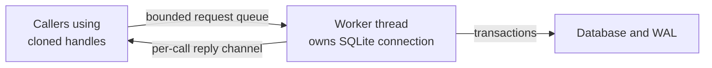

# Understand repository ownership and worker behavior

Use this explanation to locate a persistence change and reason about concurrency.
It describes the internal Rust persistence adapter, not a network API. The owning
sources are [the manifest](../../Cargo.toml), [worker and port implementations](../../src/sqlite/mod.rs),
and [architectural policy](../../../../tests/architecture/allowed-graph.json).
[Back to the crate guide](../../README.md).

## Runtime ownership

`SqliteSessionRepository` implements `SessionRepository`, `SessionOutbox`,
`SessionRecoverySource`, `OperationAttemptStore`, `OperationAttemptRepairRepository`,
`RuntimeAttemptStatusRepository`, `RuntimeCancellationRepository`, and
`AgentChannelRepository`. Their contracts belong to application, including
[session ports](../../../undercurrent-application/src/ports.rs),
[attempts](../../../undercurrent-application/src/attempts.rs),
[repair](../../../undercurrent-application/src/repair_attempt.rs),
[status](../../../undercurrent-application/src/runtime_attempt_status.rs),
[cancellation](../../../undercurrent-application/src/runtime_cancellation.rs), and
[agent channels](../../../undercurrent-application/src/agent_channel.rs).

This view follows ownership from a repository handle to its worker; the
[project architecture](../../../../docs/architecture/README.md#state-survives-different-failures)
owns the broader persistence and process map.

*Cloning shares a worker; opening another repository creates another connection.*
Once admitted, a request can commit after its caller drops the future. The
lifetime and queue rules below explain that local boundary.

[Daemon composition](../../../undercurrent-daemon/src/composition.rs) opens one
repository with telemetry and shares it with services. SQLite stores aggregates
and operation evidence. Runtime adapters own process handles, output, screens,
attempt receipts, and live projections; this crate neither owns a socket nor
resolves secrets. Retained secret environment entries are opaque references.
Ordinary configuration values can still be private and are stored in aggregate
JSON, so do not dump payloads into diagnostic logs.

## Compile-time dependencies

The [workspace dependency map](../../../../docs/architecture/dependencies.md#manifest-map)
locates the adapter beneath application ports and daemon composition.
[Cargo.toml](../../Cargo.toml) owns exact dependencies: `rusqlite` supplies the
bundled engine and backup support, `async-channel` the bounded worker queue,
Serde the record encoding, and `getrandom` restore-file suffixes. Windows file
ownership uses the platform adapter. `tempfile` is for tests/examples; there are
no optional crate features. Package, database schema, and serialized record
versions are [separate compatibility axes](../reference/storage-format.md#version-axes).

## Open, share, and close a repository

### Open synchronously

`SqliteRepositoryConfig::new` and `SqliteRepositoryLimits::new` validate values
without I/O. `open` is synchronous: it creates missing parent directories,
preflights an existing database read-only, prepares permissions, opens a connection,
configures it, creates the complete current schema when absent, and validates durable
metadata. It then moves the connection into a thread named
`undercurrent-sqlite-repository`. Startup waits for that thread's ownership-scope
initialization before returning the handle.

Connection settings are WAL journaling, `synchronous=FULL`, foreign keys enabled,
temporary tables in memory, and the configured SQLite busy timeout. `NO_MUTEX`
is safe here because the connection has one worker owner after initialization;
it is not shared directly with callers. Validation can scan retained
state during open; startup cost is not limited to one read batch.

### Share a worker or open another connection

Cloning a handle shares its `Arc<RepositoryWorker>`; it creates neither a new
thread nor a connection. Opening the same path again creates an independent
worker and connection. SQLite immediate write transactions serialize writers,
and revision/fence comparisons protect against stale updates across instances.
The adapter does not acquire the daemon's process-wide instance lock itself.

### Admit a request and await its reply

Port methods return application `PortFuture`s. The adapter clones owned request
data, and a polled future tries to enter the bounded queue with `try_send`.
A full queue fails immediately; admission does not wait for room. The worker
executes requests serially in queue order. Concurrent callers must not infer
ordering from when they constructed futures. Each call has a one-element reply
channel; waiting for that reply yields rather than performing SQLite I/O on the
async caller.

Once queued, an operation runs even if its caller drops the future. A discarded
reply is ignored by the worker. There is no SQLite interrupt, request timeout,
or queued-command cancellation API here. The busy timeout bounds SQLite lock
waiting, not total queue delay, execution time, startup, or shutdown. This
internal future-based port is also distinct from the public Rust SDK's blocking
interface and Python's asynchronous interface.

### Close every handle before offline maintenance

Dropping the last handle closes the queue and joins the worker. The worker drains
admitted requests before leaving its receive loop and closing the connection.
Consequently final drop can block; it has no shutdown deadline and does not
return join failures. Release every clone before offline restore. Maintenance
functions open their own connections and do not share this worker's queue.

## Bounds and pressure

The authoritative constructors and accessors are in
[sqlite/mod.rs](../../src/sqlite/mod.rs); production values come from
[daemon configuration](../../../undercurrent-daemon/src/config.rs), not defaults in
this crate.

| Setting | What it bounds | Important qualification |
| --- | --- | --- |
| `max_sessions` | Durable session rows | Open rejects an existing row count above it |
| `max_outbox_events` | Pending outbox rows | A full outbox rejects the entire session write, including a delete |
| `max_record_bytes` | Encoded session aggregate size | Also checks decoding; it is not an attempt or whole-database byte quota |
| `max_read_batch` | Outbox/recovery pages and attempt scan limits | Ordinary batch requests must be in `1..=maximum`; scans also bound exclusions |
| `command_queue_capacity` | Requests waiting for the worker | Excludes the executing command and does not bound each request's owned payload |
| `busy_timeout` | SQLite contention wait | Must be nonzero; not an application deadline |

All five numeric bounds must be nonzero. The first four must fit `i64`; queue
capacity has only the nonzero check. A recovery page fetches `limit + 1` rows,
so even a constructor-valid extreme limit can fail the later SQL range check.
Attempt, repair, cancellation, binding, and replied-event tables have no global
retention quota in this adapter. The agent channel has a separate
[unsettled-event bound](transactions/agent-channel.md#enqueue-poll-and-reply).

`pressure()` reads the singleton's session/outbox counters without decoding
aggregates. Those two values come from one SQL read; queue length is sampled
after the reply and is best effort. Pressure omits attempt counts, cancellation
counts, disk/WAL bytes, and response-wait time. It also needs queue admission,
so saturation can make the diagnostic read fail.

## Observability

With `open_with_telemetry`, open success/failure and recovery-page success/failure
emit `PersistenceRecoverySucceeded`/`PersistenceRecoveryFailed`. Insert, commit,
delete, and outbox acknowledgement emit
`PersistenceCheckpointSucceeded`/`PersistenceCheckpointFailed`. The worker
classifies `Result::is_ok()`, so a typed conflict or duplicate inside `Ok` counts
as a successful call; this metric does not prove a new write occurred. Queue
rejections never reach that observation code. Attempt, cancellation, and agent
operations use plain replies without these checkpoint metrics.

Telemetry is a synchronous, non-blocking port by contract, called before the
reply. The adapter does not catch a panicking or blocking telemetry implementation.
It supplies no payload diagnostics of its own. Use error kinds, operation names,
stage information, and pressure rather than logging raw records. See
[error interpretation](../development/maintenance.md#interpret-failures) and the
[telemetry assertions](../../tests/sqlite_repository.rs).

## Code map

| Owned source | Responsibility and next explanation |
| --- | --- |
| [lib.rs](../../src/lib.rs) | Private `sqlite` module and root re-exports; daemon composition surface |
| [sqlite/mod.rs](../../src/sqlite/mod.rs) | Config, open, permissions, worker lifetime, port delegation, pressure, telemetry; this page |
| [database.rs](../../src/sqlite/database.rs) | SQL schema and current identity, session/outbox transactions, attempts, status and repair; [transactions](transactions/sessions-and-outbox.md), [attempts](transactions/attempts.md), [format](../reference/storage-format.md) |
| [database/runtime_cancellation.rs](../../src/sqlite/database/runtime_cancellation.rs) | Durable control admission, markers, settlement and restart claims; [cancellation](transactions/runtime-cancellation.md) |
| [database/agent_channel.rs](../../src/sqlite/database/agent_channel.rs) | Binding resolution, event/reply deduplication, polling and validation; [agent channel](transactions/agent-channel.md) |
| [codec/mod.rs](../../src/sqlite/codec/mod.rs) | Version routing and compatibility tests; [codec pipeline](../reference/storage-format.md#session-codec) |
| [codec/current.rs](../../src/sqlite/codec/current.rs) | Size-checked 0.1.0-beta envelope and profile-binding policy |
| [codec/state.rs](../../src/sqlite/codec/state.rs) | Lifecycle revision and independent foreground observation/evidence axes |
| [codec/aggregate.rs](../../src/sqlite/codec/aggregate.rs) | Configuration, lifecycle, health, WorkContext, launch provenance, process and restart record conversion |
| [maintenance.rs](../../src/sqlite/maintenance.rs) | Snapshot backup, verification, restore staging and filesystem rollback; [maintenance](../development/maintenance.md) |
| [crash.rs](../../src/sqlite/crash.rs) | Deterministic fault hooks at transaction/restore boundaries; [test strategy](../development/contributing.md#choose-the-relevant-tests) |
| [sqlite/tests.rs](../../src/sqlite/tests.rs) | Durable compensation intent, crash rollback, terminal audit and readiness assertions |

The [maintainer guide](../development/contributing.md) maps integration tests to changes and
explains which checks cover which claims.

[Crate documentation](../README.md)
