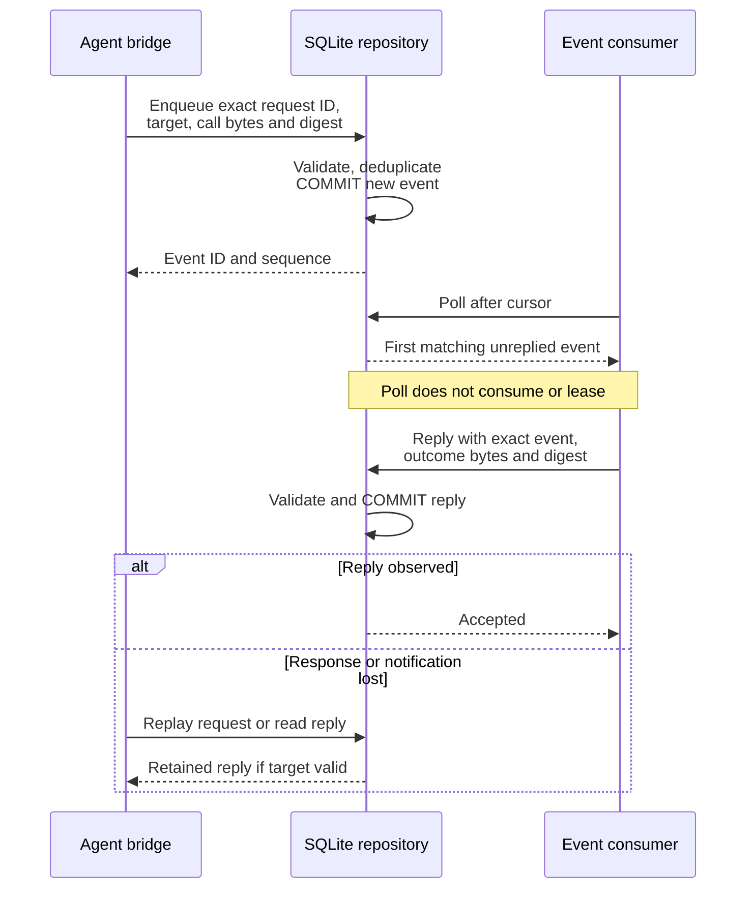

# Understand durable agent events and replies

Use this explanation to debug duplicate agent calls, stale bindings, or a pending
reply after reconnect. This is storage for the private agent bridge's evidence;
it is not a second public transport or a workflow-result interpreter.
[Back to the crate guide](../../../README.md).

The owning application contract is
[agent_channel.rs](../../../../undercurrent-application/src/agent_channel.rs).
The SQL operations are in
[database/agent_channel.rs](../../../src/sqlite/database/agent_channel.rs), with binding
serialization and schema definitions in [database.rs](../../../src/sqlite/database.rs).
The domain [agent binding model](../../../../undercurrent-domain/src/agent.rs) validates
retained `AgentRuntimeBinding` values, and the
[attempt model](../../../../undercurrent-domain/src/attempt.rs) checks their attachment.

## Binding and resolution

Accepting a dispatch attempt with an agent binding writes
`agent_runtime_bindings` in the same transaction as the attempt. The row retains
tenant/source product, actor/authority references, provider identity/generation,
attempt revision, recovery epoch, request digest, expected result schema bytes,
binding JSON, and expiry. Its fence comes from its parent attempt during decoding.
The store preserves result-schema evidence but does not evaluate the agent's
semantic result against that schema.

`resolve_agent_channel_target` filters session-bound attempts to the latest attempt
in each caller-cell scope before applying SQL `LIMIT 2`. Latest uses the same
fence-descending, attempt-ID-descending ordering as `current_fence`, across all
sessions in that cell. Retained historical rows therefore cannot hide a current
binding. Zero current candidates yields `NotFound`; one yields `Current` or
`BindingExpired`; two suffice to return `Ambiguous`. The deferred transaction
keeps selection and validation on one snapshot. The resolved target includes the
caller-supplied process instance and retained result schema. This lookup does not
authenticate that process or inspect its liveness. The
[repository regression](../../../tests/agent_channel.rs) exercises cross-cell
history, superseding attempts in another session, and reopen.

Before enqueue, poll, reply, or reply lookup, `validate_target` checks retained
attempt existence, dispatch/agent binding, current fence, supplied fence, attempt
revision, recovery epoch, digest, tenant/source, actor/authority references, and
provider identity/generation. Expiry is inclusive: `expires_at <= observed_at`
is expired. Validation is performed before duplicate lookup, so an otherwise
exact replay can become stale or expired.

The adapter's common target validator does not compare session/process identity
to a live session row. Enqueue requires a process ID; reply checks event-specific
session/process/sequence/call digest. Poll reconstructs those identities from
the event row, and reply lookup filters retained attempt/session identity.
Protected-peer authorization and process binding must therefore remain in the
upstream bridge/application boundary; the repository is not an authentication API.

## Enqueue, poll, and reply

| Operation and durable behavior | Duplicate/conflict boundary |
| --- | --- |
| **Enqueue.** Immediate transaction allocates next per-attempt sequence and inserts an unsettled event | `(attempt_id, request_id)` deduplicates only equal call bytes, digest and process identity; returns `DuplicatePending` or `DuplicateReplied`, otherwise `RequestConflict` |
| **Poll.** Deferred transaction returns the first unreplied event strictly after `after_sequence` | Read only; does not reserve, acknowledge, or consume the event |
| **Reply.** Immediate transaction binds outcome bytes/digest/time to one exact event | Exact prior bytes/digest return `Duplicate`; changed reply is `Conflict`; event identity mismatch is `StaleTarget` |
| **Read reply.** Deferred transaction returns retained reply for a valid target and matching attempt/session | `None` also covers invalid/stale/expired target, missing event, or pending reply |

### Payload and capacity limits

| Value | Admission rule |
| --- | --- |
| Call or reply bytes | 2 through 262,144 bytes of valid JSON |
| Supplied digest | SHA-256 of the exact supplied bytes |
| Request ID | Nonempty, at most 128 bytes, no control characters |

The API names the payloads `canonical_json`; the store checks JSON validity and
exact byte digests but does not canonicalize or compare against a canonical
re-encoding. Upstream must supply its required canonical representation.
Semantically equivalent JSON with different bytes is not an exact replay.

The application constant `MAX_UNSETTLED_AGENT_EVENTS_PER_ATTEMPT` is 32. Duplicate
classification occurs before this count check, so a full queue still allows an
exact replay. Replying frees unsettled capacity but retains the event row. There
is no pruning of replied rows or global agent-history bound in this adapter.

### Poll cursors do not acknowledge events

Sequence numbers start at 1 and are eight-byte unsigned BLOBs. The event ID is
`agent-event:<attempt_id>:<sequence>`. Poll returns `None { next_sequence }`
as one plus the maximum retained sequence, or one plus `after_sequence` if there
are no rows. Advancing a caller cursor does not imply that earlier events were
replied to; an unreplied event can be skipped by an overly advanced cursor.
Polling `u64::MAX` without a result can fail when the next value is unrepresentable.

### Recover a reply after response loss

This sequence shows how reply persistence supports reconnect without consuming
the request merely because a poll succeeded.

*Durable reply evidence survives repository reopen. It does not prove that a
bridge notification reached the remote caller, nor that the caller's workflow
completed.* Reconnection belongs to the bridge/transport; changing an ID creates
a different event and bypasses this record's deduplication identity.

## Validation and debugging limits

Startup and maintenance reconstruct every retained agent binding and check that
it can be attached to its attempt. They also scan events for valid IDs, nonzero
sequence, digest syntax, valid bounded JSON, and paired reply fields. The scan
collects retained rows before checking them; `max_read_batch` does not bound its
startup memory. It does not recompute stored JSON digests or re-run all admission
target checks. A successful maintenance verification is therefore not proof of
every semantic relationship or byte digest in historical agent evidence.

For a stale/expired result, inspect original attempt/fence/binding and the
observation timestamp; do not manufacture a later expiry or new recovery epoch
in SQL. For capacity, inspect pending replies for that attempt. For conflict,
compare the original request identity and exact canonical bytes at their owning
producer, without dumping private frames into logs.

[Agent channel tests](../../../tests/agent_channel.rs) prove pending/replied duplicates,
changed-call rejection, reply retention across reopen, polling without a supplied
process ID, fence and expiry rejection, digest validation and the unsettled bound.
They do not cover every malformed target/session combination or arbitrary
concurrent bridge behavior. Preserve that distinction when extending the
[test strategy](../../development/contributing.md).

[Crate documentation](../../README.md)
