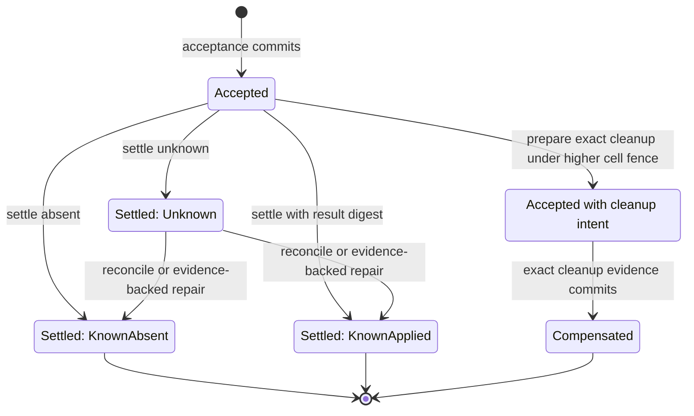
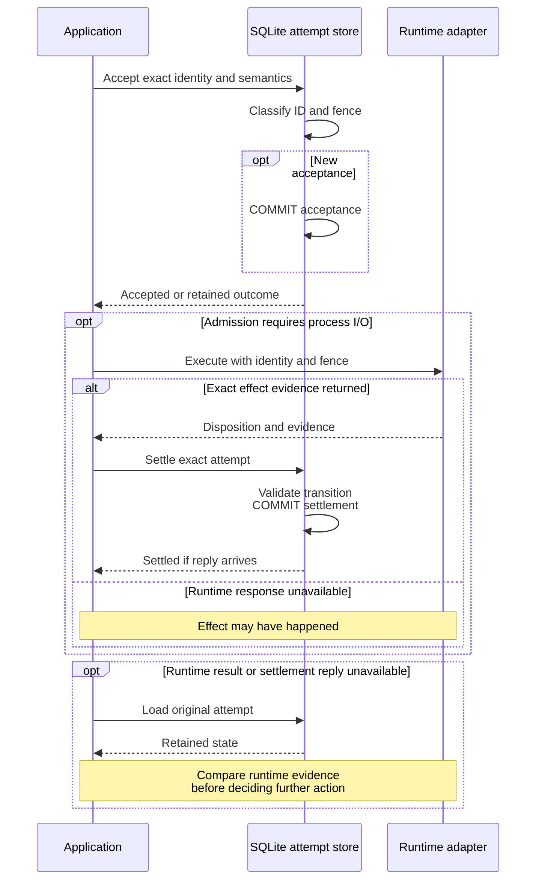

# Reconcile operation attempts without repeating unknown effects

Use this explanation to follow durable acceptance, process-effect evidence,
fencing, and repair. An attempt is a retained identity and semantic digest for
one process mutation. A fencing token is a monotonically ordered claim that
prevents an older mutation from overwriting a newer one. SQLite records these
claims; it does not perform or observe the process effect.
[Back to the crate guide](../../../README.md).

The owning contracts are [application attempts](../../../../undercurrent-application/src/attempts.rs),
[repair](../../../../undercurrent-application/src/repair_attempt.rs), and
[domain attempt transitions](../../../../undercurrent-domain/src/attempt.rs).
The SQL owner is [database.rs](../../../src/sqlite/database.rs), from `accept_attempt`
through `unresolved_attempts`, with row encoding and validation later in that file.

## Acceptance and fence scope

Acceptance is an immediate transaction before external I/O. It looks up the
attempt ID first. Matching retained semantics return `Duplicate`,
`AlreadySettled`, or `AlreadyCompensated`; changed semantics return
`PayloadConflict`. Domain semantic equality includes ID, target, mutation kind,
fence, payload digest, and the complete optional dispatch binding, but excludes
acceptance time. Existing-ID classification precedes the high-water fence check,
so an exact old identity can still replay its retained outcome.

For a new identity, `current_fence` selects the largest fence, with attempt ID as
the secondary sort key, in this scope:

| Attempt kind | Fence scope |
| --- | --- |
| With a runtime dispatch binding | Caller cell identity, across target sessions |
| Without a dispatch binding | Target session, excluding dispatch-bound attempts |
| Without dispatch binding or target session | The shared null-target scope, used for global mutations such as shutdown |

`accept` preserves a caller-supplied fence. A lower fence returns `StaleFence`;
the same fence owned by a different attempt returns `PayloadConflict`.
`accept_next` allocates 1 or the current fence plus one inside the transaction,
failing with capacity on exhaustion. Its new record is constructed with
`OperationAttempt::accepted`, without a dispatch binding. Production
[DurableProcessRuntime admission](../../../../undercurrent-application/src/durable_process.rs)
routes externally fenced dispatches through `supplied_attempt()` and `accept`;
maintainers must preserve that distinction instead of routing dispatch-bound
work through local fence allocation.

Only `Accepted` records can be newly inserted. New dispatch-bound records require
both a caller request digest and retained runtime policy. An optional agent binding
is inserted in the same acceptance transaction. The [current storage contract](../../reference/storage-format.md#current-schema-admission)
requires both values during admission and retained-state decoding.

## Attempt lifecycle

The diagram shows successful state changes. Guards in both the domain and SQL
adapter still apply; duplicate operations leave the state unchanged.

*Unknown is retained uncertainty, not permission to start the mutation again.
Prepared cleanup remains an accepted attempt until its evidence is terminalized.*

Settlement checks the current scope fence and the exact attempt fence. Lower
tokens normally return `StaleFence`; inconsistent higher tokens return a
conflict. Known-applied settlement requires a result digest; known-absent has
none. SQLite also requires unknown settlements to have no result digest.
`settle` and `reconcile` duplicate comparison includes the settlement timestamp,
so equal certainty/digest alone is not a universal duplicate guarantee.
Reconciliation can turn a settled unknown into known truth only with a timestamp
at least as new as the unknown settlement. An attempt with prepared compensation
cannot use ordinary settlement; it must complete through the compensation path.

An unbound session `Stop` or `ForceStop` may settle or reconcile `KnownApplied`
behind newer force attempts when it carries a result digest and **every** newer
same-scope attempt is `ForceStop`. Concurrent force can finish the original
stop while its receipt is still returning. This exception records that exact
completion; it never accepts or redrives an older effect. An intervening spawn,
input, or any other mutation retains the fence barrier, as do unknown results
and externally dispatched attempts. The exact attempt token must still match.

A narrow shutdown exception permits settlement/reconciliation/repair behind a
newer global high-water fence when the attempt is a targetless, unbound
`Shutdown`, certainty is `KnownAbsent`, and there is no result digest. The exact
attempt token still must match. This records cancellation of old preparation;
it cannot authorize an old shutdown effect against a newer host. See
`cancelled_shutdown_can_settle_behind_newer_fence_without_authorizing_old_effects`
in [durability tests](../../../tests/durability.rs).

## Durable boundaries around external I/O

[DurableProcessRuntime](../../../../undercurrent-application/src/durable_process.rs)
uses acceptance to bind runtime work, then records the observed disposition.
The details of runtime receipts and evidence live with the runtime adapter.

*Neither one SQLite transaction nor transport reconnection spans the process
effect.* A worker `Interrupted` error, dropped future, or daemon response loss
can leave a committed record. Use the original attempt identity and provenance
to read status; do not invent a fresh ID to bypass an uncertain outcome.

## Superseded dispatch compensation

Compensation records cleanup of a lower-fence dispatch; it is not a SQL rollback
of the process effect. `prepare_compensation` persists the exact process identity
(instance ID and start time), session revision, higher fence, cleanup digest,
and preparation time. First preparation requires an accepted dispatch-bound
attempt, its exact original token, and a supplied higher fence equal to the
current same-cell fence. This pins what may be cleaned up before destructive
runtime I/O begins.

Repeating the same prepared identity/fence/process/revision/digest is duplicate
even with another preparation timestamp. Once that intent is durable,
`compensate` requires matching cleanup evidence and a current fence at least as
high as the pinned superseding fence. A still newer dispatch need not erase the
already prepared cleanup. The lower attempt becomes `Compensated`; the higher
attempt and its result are unchanged. Compensation duplicates compare the
superseding fence and cleanup digest, retaining the first terminal timestamp.

[sqlite/tests.rs](../../../src/sqlite/tests.rs) tests rollback of preparation and
terminalization separately, reopen with the exact intent, rejection of a changed
cleanup digest or superseding token, and readiness clearing after compensation.
The store performs no process cleanup itself.

## Scan unresolved work and repair unknowns

### Choose the scan

Both scans select `Accepted` and `Settled(Unknown)` attempts:

| Method | Returned evidence | Order |
| --- | --- | --- |
| `pending_reconciliation` | Bounded complete attempt records | Acceptance time, then attempt ID |
| `unresolved_attempts` | Total count and bounded IDs in one deferred read transaction | Attempt ID |

Both use a connection-local temporary exclusion table keyed by exact
`(attempt_id, fencing_token)`, populated before filtering. Exclusions are removed
before SQL `LIMIT`, so a live prefix cannot conceal the next unresolved record.
An exclusion does not settle the attempt or remove durable evidence.

The requested limit is nonzero and no larger than `max_read_batch`; the exclusion
count must fit both that bound and the requested limit. Scans bound returned
records, not the total work of counting all unresolved rows. The temporary table
is replaced for every scan. Tests in [durability.rs](../../../tests/durability.rs)
exercise complete pages, exact exclusions, count/page coherence, stable order,
and overflow rejection.

### Commit repair and its audit together

`repair_unknown` is an immediate transaction that changes an unknown settlement
and inserts its audit row together. It records the fence, known certainty,
optional result digest, evidence reference, actor principal/tenant/authority,
and commit time. The store trusts the validated application commit; authorization
and observation of proof belong to
[RepairOperationAttemptService](../../../../undercurrent-application/src/repair_attempt.rs).
Do not substitute a manual SQL update for that service.

An exact audit replay is `Duplicate`; a changed certainty/result is
`PayloadConflict`; changed evidence or actor is `EvidenceConflict`. The replay
comparison does not require the new request's timestamp to equal the first
audit timestamp. Non-unknown rows without an existing audit return `NotUnknown`.
Open/maintenance validation verifies that every audit agrees with the retained
attempt's fence, state, digest, and settlement time. It does not independently
verify the external evidence reference.

## Read runtime attempt status

`get_runtime_attempt_status` uses one deferred transaction for an attempt and
its target session. It issues no persistent writes. A missing attempt returns
`NotFound`; a non-spawn attempt is `InconsistentState`. It checks dispatch binding,
retained request digest, retained policy, and the exact supplied digest before
looking up the session. Missing or mismatched provenance returns
`UnverifiableProvenance`; it must not disclose session presence as if the request
had been verified.

Even absent, unknown, or compensated status requires the target session to exist;
a deleted/missing target yields `InconsistentState`. Accepted and settled unknown
both present as `Unknown`, with their respective acceptance/settlement times.
Known-applied includes the retained result digest and current coherent session
snapshot. Known-absent and compensated have their recorded timestamps. The
session lifecycle is process state, not a declaration that the caller's workflow
succeeded. This lookup does not require the attempt to own the latest fence and
does not contact the runtime to refresh truth.

[Runtime status tests](../../../tests/runtime_attempt_status.rs) compare every stored
state before/after queries and across reopen, and prove that provenance checks
precede target-session lookup. Continue with
[runtime cancellation](runtime-cancellation.md) or
[agent channels](agent-channel.md), which bind additional durable records to
these attempts.

[Crate documentation](../../README.md)
