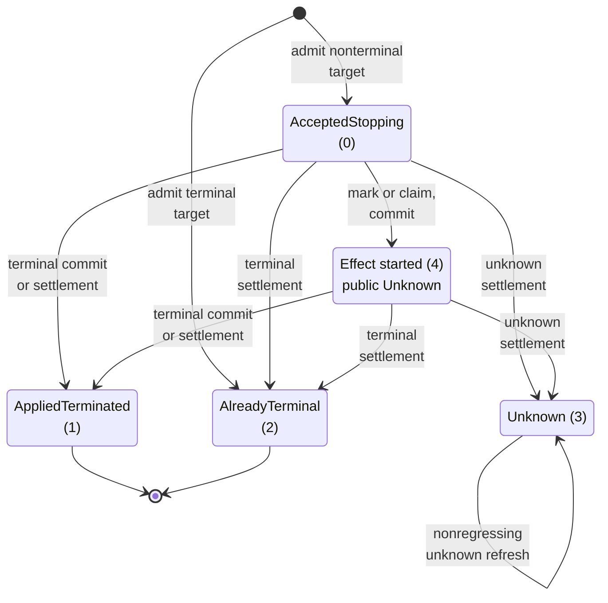
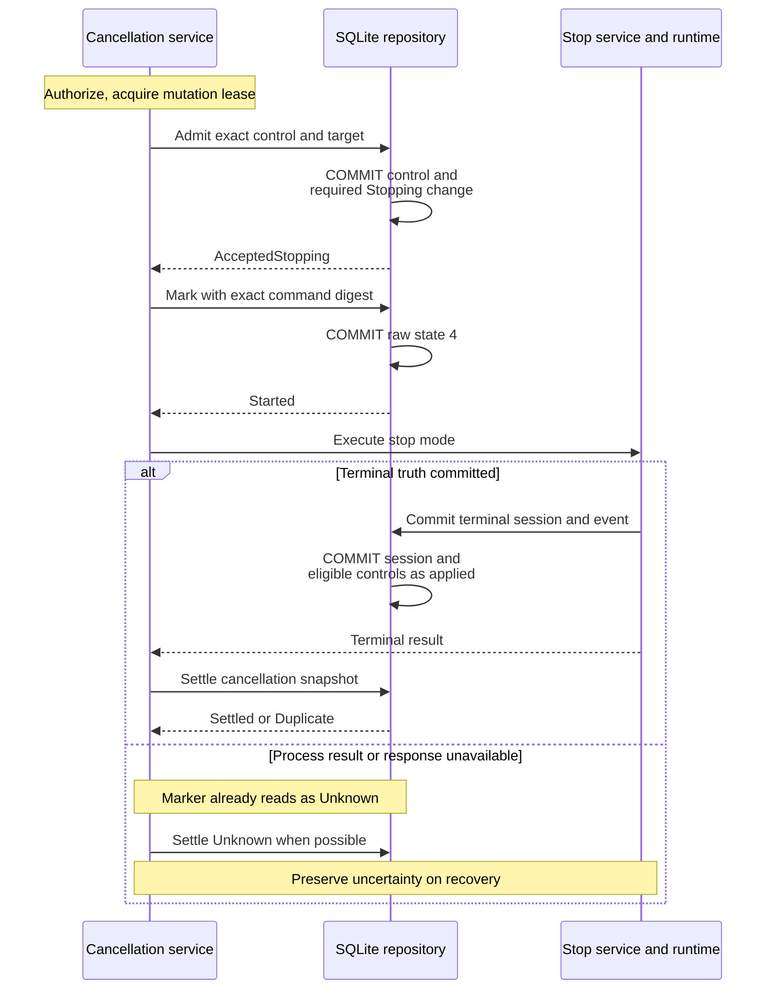

# Follow durable runtime cancellation through restart

Use this explanation to distinguish accepting a stop request from proving that
its process action completed. Runtime-attempt cancellation is a persisted control
operation. It is separate from dropping a request future or cancelling a stream
subscription. The owning contract and orchestration are in
[application/runtime_cancellation.rs](../../../../undercurrent-application/src/runtime_cancellation.rs);
the SQL owner is [database/runtime_cancellation.rs](../../../src/sqlite/database/runtime_cancellation.rs).
[Back to the crate guide](../../../README.md).

## Admit one exact control

An immediate transaction first looks up `control_id`. Equal target and control
values replay the retained result before checking the current deadline or session
revision. A changed binding under the same control ID is `IdentityConflict`.
For a new ID, an expired deadline is `DeadlineExpired`, and an already occupied
`(source_product, tenant_id, idempotency_key)` is `IdentityConflict`.

The target must be a known-applied spawn attempt with the exact session ID,
request digest, caller cell, and fence. It must still own the current cell fence.
The stored session's aggregate and lifecycle revisions must equal the requested
pins. Missing or stale state is `TargetMismatch`. The store retains expected
provider identity/generation and actor references; live provider selection and
authorization are application/daemon responsibilities, not proof derived from
SQLite's local process state.

For a terminal session, the transaction records `AlreadyTerminal` without a new
session event. Otherwise it transitions to `Stopping` at the later of the supplied
observation time and session update time. A real transition writes the aggregate,
event snapshot, outbox row, and counters in the same transaction as the new
control. A session already stopping can admit without another lifecycle event.
Outbox exhaustion on a needed transition rolls back the control too.

## Mark before process I/O

There are five internal state codes, but four public states. Raw state 4 is an
effect-start marker that deliberately reads as public `Unknown`.

*A marker means I/O may have begun. It preserves ambiguity even when a crash
happens before the actual process call.* Raw state 3 does not automatically
become applied when a later terminal session commit occurs; only raw 0 and 4
participate in that automatic settlement.

`mark_runtime_cancellation_effect_started` requires the exact command digest.
Only raw 0 changes to 4; other retained states return `Replay`. The marker time
is `max(observed_at, prior_observed_at + 1)`. If the prior timestamp cannot advance,
the operation fails before writing the marker or authorizing the effect.

The application orders admission, marker, and effect as follows:

*Control acceptance, marking, external stop I/O, and final settlement are distinct
boundaries. At-most-once effect admission is not guaranteed successful termination.*
The application also handles exact replay of raw accepted controls before marking;
the store does not run this orchestration on its worker.

## Settlement ordering

Settlement validates the proposed state and exact control digest/session binding.
Aggregate and lifecycle revisions must not regress. Lifecycle rank cannot go
backward; a changed lifecycle must advance the lifecycle revision. Terminal
states with the same session, lifecycle, and both revisions compare as duplicates
even if one is `AlreadyTerminal` and the other `AppliedTerminated`, or observation
time differs. A terminal result cannot be replaced with a later uncertain result.

For an in-flight raw-4 marker, an unknown proposal with old revisions, regressed
lifecycle, or a nonadvancing observation time is normalized to the existing
marker snapshot. This avoids a stale error path overwriting newer evidence.
For durable raw-3 unknown, an older observation with nonregressing state is a
duplicate; only unknown-to-unknown updates are allowed. Updates preserve the
maximum observation time. Other disallowed transitions return `Conflict`.

When ordinary `commit` writes a terminal session, it also settles raw 0/4 controls
for that session whose retained revisions do not exceed the new aggregate and
lifecycle revisions. This occurs in the same SQL transaction as the terminal
event. The guarantee prevents a completed stop from reopening as merely accepted
because a separate cancellation reply was lost.

## Restart and response loss

`claim_runtime_cancellation_recovery(session_id, observed_at)` decides in one
immediate transaction, in this order:

| Retained controls for the session | Result | Durable change before returning |
| --- | --- | --- |
| Any raw 3 or 4 | `PreserveUnknown` | None; no process instruction |
| Otherwise, any raw 0 | `Resume(mode)` | Mark **all** raw 0 controls as raw 4 with one strictly advanced common time, then commit |
| No raw 0, 3, or 4 | `None` | None |

For `Resume`, the strongest accepted mode wins: `Force` over `Graceful`.

Marking every accepted control before resumption ensures a second restart cannot
repeat the first recovery's uncertain process action. The application
[startup reconciler](../../../../undercurrent-application/src/commands/startup_reconciliation.rs)
observes process truth and handles the returned mode. Graceful recovery uses
`GracefulOnly` and persists no-escalation before IO. An independently retained
Force instruction can authorize force despite that flag; without it, a live
no-escalation stopping session remains preserved. Unknown controls are never
permission to repeat an effect.

### Look up an uncertain control

Status lookup binds control digest, target attempt/digest/session, provider
identity/generation, and source product/tenant. It returns `NotFound`,
`InconsistentBinding`, or the retained result. It does not authorize the actor,
refresh the process, or check all actor references against a new authentication
context; those checks are owned by the application service. After response loss,
use that service's status/exact-replay contract rather than a new control ID.

### Validate retained evidence

Open and maintenance validate predecessor linkage, revisions not below original
pins, raw discriminator rules, and every retained control through typed
constructors. Provider and tenant IDs require the current foundation-style
lowercase UUIDv7 forms. This is retained-evidence validation, not proof of live
host identity. See [storage compatibility](../../reference/storage-format.md) before changing it.

[Runtime cancellation integration tests](../../../tests/runtime_cancellation.rs)
exercise exact admission replay, pre-marker retries, non-lifecycle revision
advances, terminal commit races, marker restart behavior, monotonic snapshots,
invalid provider/tenant/control fields, and timestamp overflow. These tests
use simulated process ports and temporary databases. See the
[verification guide](../../development/contributing.md#choose-the-relevant-tests) for focused commands.

[Crate documentation](../../README.md)
