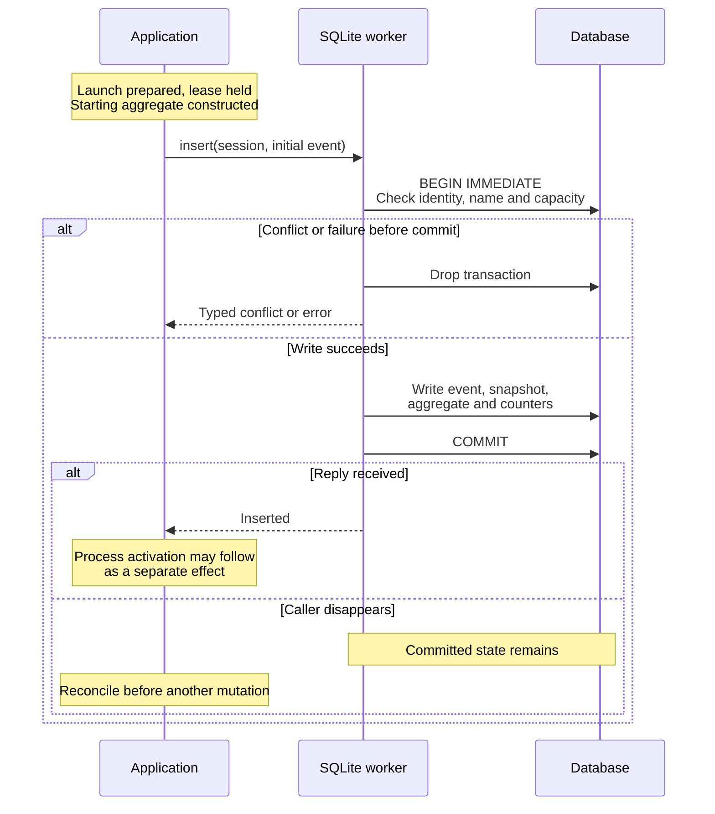
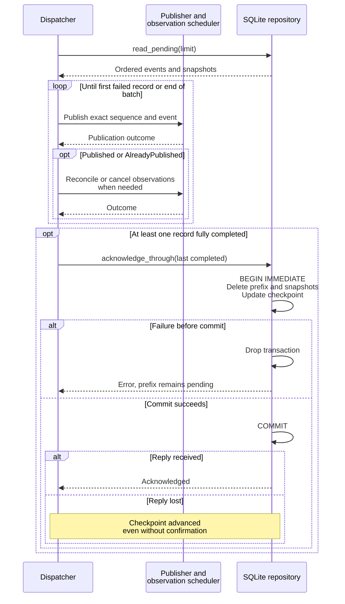

# Trace session transactions and outbox delivery

Use this explanation when changing a session mutation, debugging revision
conflicts, or investigating a missing event. The contract owners are
[SessionRepository and SessionOutbox](../../../../undercurrent-application/src/ports.rs)
and [outbox types](../../../../undercurrent-application/src/outbox.rs). The SQL
implementation is [database.rs](../../../src/sqlite/database.rs).
[Back to the crate guide](../../../README.md).

An aggregate is the complete domain `Session`, including configuration and
observations. An outbox record is a pending domain event with a repository-local
sequence, written in the same transaction as its aggregate change. It lets the
application publish the change after durable commit without losing the intent
to publish if the daemon stops between the two steps.

## Follow session creation

The representative normal path begins in
[StartSessionService](../../../../undercurrent-application/src/commands/start.rs).
Launch preparation precedes insertion. After acquiring a per-session application
mutation lease, the service constructs a `Starting` session and initial event.
The store commits them before the application activates a process. A durable
process decorator records attempts around runtime effects; activation and its
later session commits are separate from the initial insert.

This sequence emphasizes the first durable boundary and the response-loss case.

*Insert success proves persistence of the initial session and event. It does not
prove process activation or an application-level result.* Inspect
[attempt evidence](attempts.md) and current session state when the later steps
fail. Tests can exercise this repository without starting any process, as the
[roundtrip example](../../../examples/repository_roundtrip.rs) does.

## Session write rules

Insert and commit validate their events and encode the supplied aggregate before
opening a transaction. Delete validates the removal event first, then loads and
encodes the retained terminal aggregate inside its transaction. Writes use
`BEGIN IMMEDIATE` to take the writer reservation before checking indexed state
and counters. A transaction owns the full change; errors before commit drop it
and roll it back. SQLite commit errors and lost responses still require the
caller to reconcile the operation's outcome.

| Operation and preconditions | Atomic change |
| --- | --- |
| **Insert.** Event ID and revision match aggregate; unique ID and name; session/outbox capacity | One event, its aggregate snapshot, new session row, counters and next sequence |
| **Commit.** Session exists; stored revision equals `expected_revision`; new name is available; nonempty ordered event suffix; outbox capacity | Events and snapshots, aggregate replacement, counters; terminal session commits also settle eligible cancellation controls |
| **Delete.** Session exists at expected revision and is terminal; removal event has same ID and a greater revision; outbox capacity | Removal event and snapshot of the prior terminal aggregate, session deletion and counters |

Insert returns `Inserted`, `IdConflict`, or `NameConflict`. Commit returns
`Committed`, `NotFound`, `RevisionConflict`, or `NameConflict`; delete returns
`Deleted`, `NotFound`, or `RevisionConflict`. These typed results differ from a
`PortError`. The store validates event identity/revision relationships but does
not infer the domain operation from the event kind: maintainers must construct
events from domain changes, not fabricate a `SessionCreated` or `SessionRemoved`
label and assume that the store has validated its semantics.

Commit events must all target the same session. Their revisions strictly increase,
the first exceeds the expected prior revision, and the last equals the supplied
aggregate's revision. The SQL adapter does not require adjacent revisions to
differ by exactly one. Unique name checks and revision predicates occur in the
same transaction; this protects against independent repository instances as
well as competing clones. A stale caller should reload, reconsider its domain
mutation and authorization, and construct new events before attempting a new
commit. Reusing an old expected revision is not a conflict resolution strategy.

Each appended event gets a nonzero, increasing `u64` sequence. Sequences and
revisions are eight-byte big-endian BLOBs to preserve unsigned range and sort
order. Allocation must also produce a following sequence: exhaustion rejects
the transaction, including an append at `u64::MAX` that cannot advance metadata.
Session deletion does not delete attempts, cancellation controls, agent history,
or pending outbox evidence. There is deliberately no foreign key from outbox
or attempt target identity to the live session catalog.

## Snapshot meaning and retention

`session_event_snapshots` stores the aggregate bytes alongside each newly
appended event. The snapshot survives later session changes and deletion until
acknowledgement. Every event in one multi-event commit receives the same final
aggregate payload; it is not a reconstruction of each intermediate revision.
The removal event receives the terminal aggregate loaded before deletion, whose
revision is lower than the removal event revision. Consumers must distinguish
event revision from snapshot revision.

Migration 6 adds the snapshot table without manufacturing historical snapshots.
Existing pending events therefore decode with `snapshot: None`. New records
decode with snapshots through the current session codec. The daemon's
[event presentation](../../../../undercurrent-daemon/src/presentation/feed.rs) derives
optional observations from this snapshot, rather than loading later state to
pretend it was the event-time observation. The
[snapshot tests](../../../tests/sqlite_repository.rs) check both preservation across a
rename and the legacy `None` case.

`read_pending(limit)` returns the oldest pending prefix in sequence order,
bounded by `max_read_batch`. It does not acknowledge. Session reads use SQL
length guards before returning aggregate bytes; the snapshot read currently
loads its BLOB and then checks the codec byte limit. Do not extend the
pre-allocation guarantee from session reads to snapshot reads. The outbox read
does not open an explicit multi-statement read transaction; the single worker
prevents its own writes from interleaving, but another open connection can change
state. The normal composition uses one repository and one outbox dispatcher.

## Publication is outside the transaction

[OutboxDispatchService](../../../../undercurrent-application/src/outbox_dispatch.rs)
validates a bounded batch, publishes each record idempotently, then reconciles
or cancels its observation plan. Only the completed prefix is acknowledged.
For observation scheduling it loads current session state, which may be later
than the published event snapshot.

*Publication, observation activation, and database acknowledgement are separate
effects. The publisher's exact-event deduplication contract is necessary for
replay.* On a record failure the application attempts to acknowledge only the
earlier completed prefix, leaving later records for another cycle.

`acknowledge_through` first compares the saved checkpoint. A request at or below
it returns `AlreadyAcknowledged` with the latest checkpoint. Otherwise the
requested sequence must exist or the result is `UnknownSequence`. The transaction
deletes snapshots and all pending outbox rows at or below that sequence, subtracts
the actual deleted count, and saves `last_acknowledged`; it does not rewind
`next_outbox_sequence`. The store does not know whether the caller actually
published those rows. Do not use acknowledgement as an emergency space-clearing
operation: it deliberately destroys pending delivery evidence.

## Recovery pages and output boundaries

`read_batch(after, limit)` reads sessions ordered by stable ID with an exclusive
`id > after` keyset cursor. It fetches one extra row to determine whether to return
`next_after`; only the requested page is decoded. Each call is independent,
not a snapshot spanning the whole recovery scan. New writes between pages can
change the catalog. [Startup reconciliation](../../../../undercurrent-application/src/commands/startup_reconciliation.rs)
owns process truth checks, projection rebuilding, and lifecycle decisions. The
store only supplies durable state and the
[cancellation recovery claim](runtime-cancellation.md#restart-and-response-loss).

Terminal bytes never pass through these session/outbox transactions. Runtime
retains output and parses screens for output consumers; application observation
services can commit derived session state here. The shared
[output ownership diagram](../../../../../docs/architecture/observations-and-output.md#choose-a-data-product)
shows those separate paths.

Reopening SQLite cannot recover terminal bytes or fill a stream retention gap.
Follow [runtime output ownership](../../../../undercurrent-runtime/README.md),
[terminal output contracts](../../../../undercurrent-application/src/terminal_output.rs),
and [the retained event journal](../../../../undercurrent-runtime/src/events.rs).
The durable pending outbox is not an indefinite stream archive: acknowledged
rows disappear even if a client later disconnects. Reconnection and cursor
resumption belong to the stream owner and do not authorize retrying a mutation.

For verification, start with [repository integration tests](../../../tests/sqlite_repository.rs)
and [transaction crash boundaries](../../../tests/crash_boundaries.rs). For failures,
use the [maintenance failure guide](../../development/maintenance.md#interpret-failures).

[Crate documentation](../../README.md)
