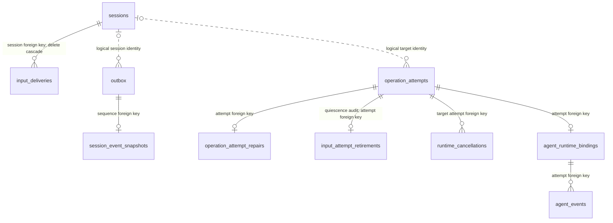
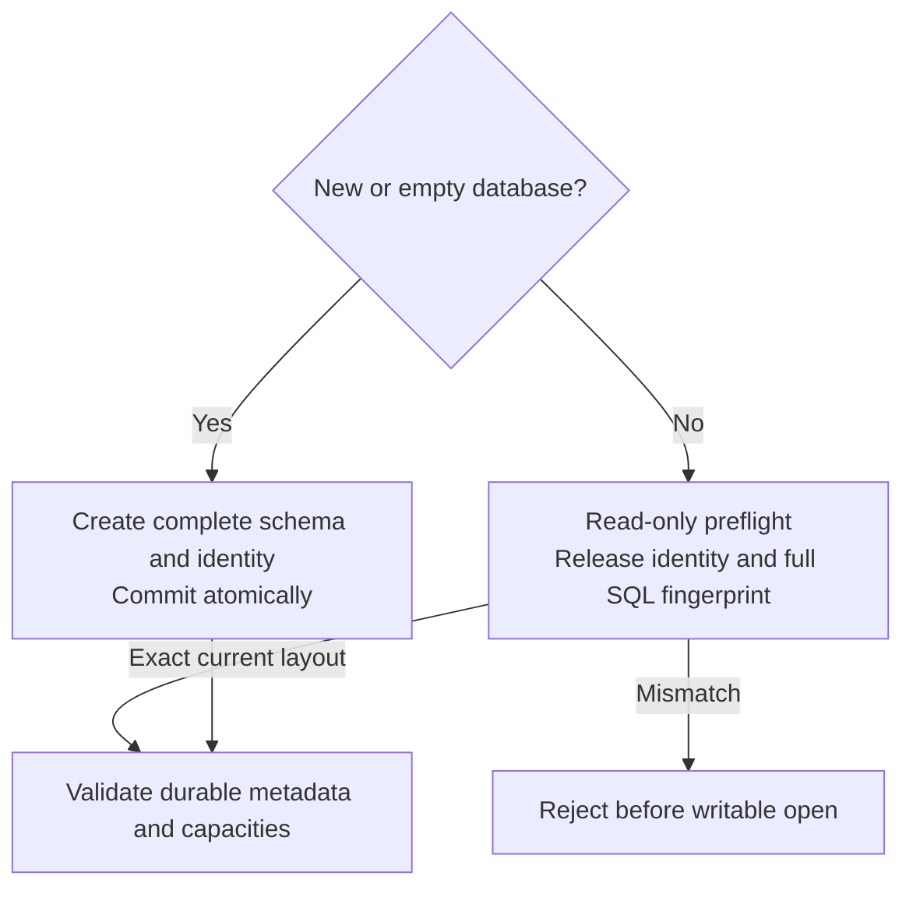

# Inspect storage format and compatibility rules

Use this reference when reviewing a schema or codec change. SQL definitions,
release identity/checksum, the current fingerprint, and persisted numeric tags are
owned by [database.rs](../../src/sqlite/database.rs) and its
[cancellation module](../../src/sqlite/database/runtime_cancellation.rs).
Session JSON is owned by [codec/current.rs](../../src/sqlite/codec/current.rs),
[codec/state.rs](../../src/sqlite/codec/state.rs), and
[codec/aggregate.rs](../../src/sqlite/codec/aggregate.rs). Those sources are the
authoritative format; this page explains their boundaries and validation.
[Back to the crate guide](../../README.md).

## Version axes

All release identities are `0.1.0-beta`. SQLite requires numeric encoding
markers, which are validated together with the release identity.

| Axis | Current value | Meaning |
| --- | --- | --- |
| Crate package | `0.1.0-beta`, `publish = false` | Workspace release identity |
| SQLite `PRAGMA user_version` | `1` | Numeric storage format marker |
| Schema identity | One `initial-complete-schema` entry with release `0.1.0-beta` | Exact complete layout and checksum |
| Session row and envelope | Row `record_version = 1`; JSON `schema_version = "0.1.0-beta"` | Sole supported aggregate encoding |
| Other SQL rows | `record_version = 1` | Numeric row encoding marker |
| Runtime policy JSON | `record_version = "0.1.0-beta"` | Retention-policy provenance required |

A database reporting `user_version = 1` is accepted only when its release
identity and actual SQL fingerprint also match. There are no migrations,
historical readers, or missing-provenance exemptions.

## Persisted entities

The following diagram shows logical identity links and the snapshot relationship;
it does not imply that every line is an SQL foreign key.

*Removing a session preserves attempts and outbox evidence but deletes its semantic input reservations. An
outbox row may have no snapshot.* The session-to-outbox line expresses identity
while a session is retained; an outbox row can outlive that session.

| Entity | Table, purpose and retention |
| --- | --- |
| Sessions | `sessions`: ID-keyed complete JSON aggregate with unique name, indexed revision, update time and record version; deleted only by a terminal revision-checked delete |
| Pending events | `outbox`: Sequence-keyed event kind, session identity/revision and timestamp; removed by prefix acknowledgement, not session deletion |
| Event snapshots | `session_event_snapshots`: Optional payload per outbox sequence; foreign key with delete cascade; explicit acknowledgement deletion also removes it |
| Semantic input | `input_deliveries`: Session/delivery key, typed digest and outcome; no expiry or eviction; removed with the session |
| Counters | `repository_state`: Singleton `1`: session/outbox counts, next sequence, optional last acknowledgement |
| Ledger | `schema_identity`: Exact release version/name/checksum and application time in Unix seconds |
| Attempts | `operation_attempts`: ID, optional target, mutation/fence/digests, dispatch policy/provenance, state, settlement and compensation intent; no pruning API |
| Input retirement audit | `input_attempt_retirements`: Exact attempt/fence and terminal session snapshot with host exit evidence; survives session deletion without changing Unknown certainty |
| Repair audit | `operation_attempt_repairs`: At most one evidence/actor audit per attempt, SQL foreign key; committed atomically with repair |
| Controls | `runtime_cancellations`: Control ID plus source/tenant/idempotency-key uniqueness, target attempt foreign key, exact pins and observed state; no pruning API |
| Agent bindings | `agent_runtime_bindings`: At most one binding per attempt, SQL foreign key; retained schema and opaque binding JSON |
| Agent events | `agent_events`: Event ID plus unique per-attempt sequence and request ID, binding foreign key; reply is nullable until committed and then retained |

Tables use SQLite `STRICT`. Revisions, sequences, fences, provider generations,
and other full-width unsigned counters use fixed eight-byte big-endian BLOBs;
lexicographic comparisons preserve their unsigned order. Row counts use signed
SQLite integers and checked conversions to platform sizes. Application timestamps
are signed millisecond values, except the ledger's explicit Unix-second field.

The `outbox_session_sequence`, target/dispatch-fence and unresolved-attempt indexes
support their respective reads. Cancellation indexes serve target and pending
control lookup; the agent unsettled index serves polling. These are part of the
fingerprinted schema, not optional performance decorations. The temporary
`operation_attempt_scan_exclusions` table is connection-local and outside the
persistent layout.

## Current schema admission

Fresh creation builds the complete current layout, records its single identity,
and sets `user_version` in one transaction. Existing databases must match the
current identity and layout during read-only preflight, before writable SQLite
open or configuration. Open, backup verification, and restore reject every
other release without upgrading it.

The fingerprint includes every non-internal table, index, trigger, and constraint.
It hashes length-framed components after whitespace normalization that preserves
SQL token boundaries and quoted contents. Identity alone cannot admit an altered
layout.

| Evidence | Preflight bound |
| --- | --- |
| Non-internal schema objects | At most 128 |
| One SQL definition | At most 262,144 bytes |
| Schema components plus length framing | At most 1,048,576 bytes, checked before canonical-buffer allocation |
| Schema identity count | Examine at most two rows; require exactly one |

Identity validation compares exact values in SQL without hydrating arbitrary
identity text. Schema size checks precede SQL hydration into Rust strings; they
do not bound SQLite's internal schema loading. The adversarial tests in
[durability.rs](../../tests/durability.rs) verify rejection of oversized evidence
and preservation of unsupported database bytes.

After admission, policy/request-digest provenance, repository counts,
checkpoints, and configured capacities must pass validation before the worker
starts. Dispatch-bound attempts require complete current provenance; readers do
not invent missing policy or derive caller digests from internal payload digests.
See [repository opening](../internals/ownership.md#open-synchronously).

## Session codec

### Encoding and decoding order

Encoding builds the 0.1.0-beta envelope from a typed `Session`, serializes JSON, then
checks `max_record_bytes`. **Encoding can allocate the result before detecting
an oversize value.**

The codec's decoding path is ordered:

1. Select the supported SQLite row version.
2. Check the byte bound before parsing JSON.
3. Read and validate the envelope header's version, then decode the full record.
4. Reconstruct domain values, restore profile-binding policy, and call
   `Session::rehydrate`.

It does not deserialize the domain structs directly.

For catalog reads, SQL returns payload bytes only when `length(payload)` fits the
configured limit. The row decoder also checks returned length and compares
payload ID/name/revision to the redundant SQL columns. It does not compare
`updated_at` to its SQL index column.

Opening a database does not eagerly decode
all session payloads: a later `load`, name lookup, recovery page, or outbox read
can still encounter invalid data.

### Retained fields and validation

| Codec owner | Retained content and validation |
| --- | --- |
| [current.rs](../../src/sqlite/codec/current.rs) | Envelope version, profile selection origin (`Explicit`/`LaunchCommand`) and binding mode (`Fixed`/`ForegroundAdaptive`); restores policy rather than persisting effective runtime profile state |
| [state.rs](../../src/sqlite/codec/state.rs) | Exact lifecycle revision, independent execution/interaction/constraint observations and bases, full assessed evidence and foreground decision; claim axis must match evidence axis; claim-free evidence must be unavailable with zero confidence |
| [aggregate.rs](../../src/sqlite/codec/aggregate.rs) | Session ID/name/lifecycle, health summary and per-check evidence, WorkContext and provenance, configuration, optional restoration directory, process identity/start time, update/revision, restart tracker/status |
| [aggregate.rs launch conversion](../../src/sqlite/codec/aggregate.rs) | Command and launch mode, executable digest/receipt/object identity, environment and secret references, paths/root identities, terminal size and capture mode, stop/restart/detection/auto-remove policy, health rules, labels/metadata |

Record structs generally deny unknown fields; enum variants and optional/default
members have their specific Serde rules. This is not a promise to accept every
historical JSON shape carrying the current release marker. Invalid domain grammar,
duplicate environment/label/metadata keys, duplicate health rules or work targets,
invalid duration nanoseconds, and platform-size overflow are rejected. Durations
store seconds and nanoseconds without rounding; nanoseconds must be below one
billion. Restoration directories use a 4,096-byte path bound.

When reconstructing commands, environment and health rules, the codec derives
constructor limits from stored counts and lengths under the outer record bound.
It rechecks grammar and invariants, not today's daemon admission limits. Secret
environment reconstruction rejects conflicts with ordinary environment entries
through the domain constructor. Resolved secret values are not a field in this
record; ordinary environment values, health detail and WorkContext may still be
private.

### Required fields and optional values

The current envelope, lifecycle revision, foreground axes, launch mode, output
capture mode, secret-reference list, and stop policy are required. Omission of a
required field fails decoding. Optional values such as executable resolution,
object identities, and restoration directory remain absent when no value was
recorded; absence does not supply launch provenance.

The [codec tests](../../src/sqlite/codec/mod.rs) cover row/envelope version
rejection, pre-parse size rejection, exact lifecycle revision, profile binding,
capture, launch provenance, and required-field rejection. There is one current
codec and no fallback for an older aggregate layout.

## Attempt policy and other row encodings

### Operation attempt rows

Attempt decoding reconstructs typed identities, mutation kind, digests and
optional dispatch binding, then replays valid domain preparation and terminal
transitions. Partial dispatch fields, partial cleanup intent, unknown record
versions, inconsistent state/digest/time combinations, or unsupported mutation
strings fail.

| Stored code | Attempt state |
| --- | --- |
| 0 | Accepted |
| 1 | Known absent |
| 2 | Known applied |
| 3 | Unknown |
| 4 | Compensated |

See [attempt lifecycle](../internals/transactions/attempts.md#attempt-lifecycle)
for valid transitions; the numeric order is not a progression.

### Runtime policy JSON

| Rule | Required representation |
| --- | --- |
| Size | At most 65,536 bytes |
| Fields | Unknown fields rejected; `memory_bytes` and `cpu_millis` explicitly present even when `null` |
| Bytes | Exact equality with the typed serialization on read |
| Release | `record_version = "0.1.0-beta"`; retention-policy provenance required |

Policy reconstruction validates limits, output-contract digest/classification,
telemetry/retention/callback references, and expiration at acceptance time.
The canonical-byte check is stricter than shape decoding alone, so do not claim
that every hand-written object is accepted. Retired callback identities
are rejected rather than silently rewritten. Debug formatting omits policy
references and the output schema digest.

### Cancellation and agent records

Cancellation uses a distinct 0-through-4 state encoding with raw 4 exposed as
unknown; its [state guide](../internals/transactions/runtime-cancellation.md#mark-before-process-io) is the
authoritative local explanation. Agent call/reply validation has different
canonicalization rules from runtime policy JSON; see
[agent payload rules](../internals/transactions/agent-channel.md#enqueue-poll-and-reply).

For a change, follow [the extension checklist](../development/contributing.md#extend-the-right-layer).
Do not alter SQL fingerprints or checksum evidence merely to make a changed
layout pass existing tests.

[Crate documentation](../README.md)

## Semantic input delivery retention

The policy adopted on 2026-10-05 stores a versioned SHA-256 fingerprint of typed
input and observation policy under `(session_id, delivery_id)`. Explicit tags and
lengths distinguish byte/text/key/mouse variants and item boundaries. Raw input
is not retained. Digests are private metadata, not encryption; low-entropy input
can still be guessed offline, so database and backup access remain restricted.

An immediate transaction commits disposition `0` (reserved, no timestamp) before
PTY IO. Settlement changes it once to `1` (delivered) or `2` (indeterminate), with
the observed millisecond timestamp. Identical settlement is idempotent; conflicting
settlement fails. Reopening an unsettled record yields indeterminate, never a
fresh reservation. Changed payload or observation policy returns a conflict.

All states are retained for the session lifetime without TTL, eviction, or an
individual-record deletion API. Terminal revision-checked session deletion
cascades removal in the same transaction. The configured daemon
`input_delivery_records` limit bounds total records; lowering it retains old
records and blocks new IDs, while replay and settlement continue. These rows are
included in normal WAL-safe backups and restore. Restoring an older backup can
lose newer evidence and does not authorize retrying effects after that backup.

This table is part of the complete initial schema. Other release layouts are
rejected; no input evidence is imported from earlier installations.

## Input retirement audit

The initial schema includes `input_attempt_retirements`. Retirement
requires a standalone WriteInput attempt settled Unknown, its exact fence, and
a terminal session at the expected revision with no process ownership. The daemon
supplies trusted host quiescence/exit evidence under the session lease. The table
retains the session snapshot, process ID, exit time, retirement time, and an
acknowledgement flag. It has an attempt foreign key and no session foreign key,
so cleanup preserves evidence. Open and backup verification validate this audit
against the unchanged attempt and retained terminal snapshot.

Admission scans exclude audited attempts. Replay, reconciliation, and manual
certainty repair cannot repurpose them. Session deletion checks for any remaining
unresolved target attempts in its transaction. Receipt acknowledgement is a
repeatable post-commit step, retained independently of session existence.
Daemon and session-host binaries must match the current release. Preserve a
verified backup for recovery with the same build. See the
[daemon's retirement contract](../../../undercurrent-daemon/docs/internals/requests/effects-and-recovery.md#retire-uncertain-input-after-verified-exit).
