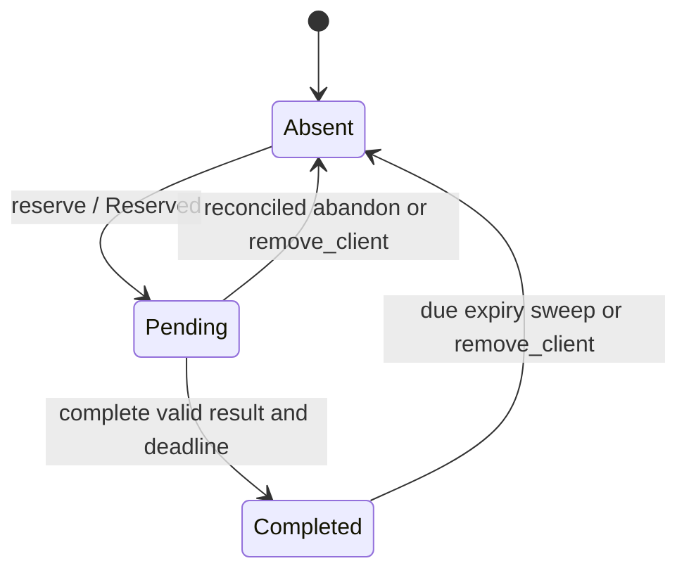

# Retain exact mutation results and reconcile response loss

Use this explanation when changing mutation admission or diagnosing repeated
requests. The internal `BoundedRequestIdempotencyStore` retains opaque request
and result bytes; it does not execute operations, authorize callers, persist to
disk, or make a mutation exactly-once across crashes. Its authoritative
implementation is [idempotency.rs](../../src/engine/idempotency.rs).
For a runnable starting point, use the [daemon-free example](#run-a-daemon-free-retention-example).

## Identity and bounded retention

A scope is `(ClientId, IdempotencyKey)`. It is independent of the physical
connection's `RequestId` ledger, so a replacement connection can use a new request
ID and still address the same retained mutation. Client IDs isolate cache entries;
they do not replace verified transport identity or product authorization.

`reserve` compares the entire nonempty request byte string exactly, not a parsed
operation, normalized JSON, hash, trace ID or connection ID. Same-key retries of
retained entries do not allocate another record.

| `reserve` result | Caller meaning |
| --- | --- |
| `Reserved` | A new pending entry was created; this caller owns first execution. |
| `Pending` | Exact bytes match ongoing work or unresolved effects; do not execute again. |
| `Completed { response }` | Exact bytes match a retained canonical result; it can be returned without execution. |
| `PayloadConflict` | The scope is already bound to different request bytes. |

The daemon passes the received product payload as
identity; semantically equivalent requests with differently encoded bytes are
not an exact retry.

Before execution, a new pending entry reserves `request.len() + maximum_response_bytes`
against the global byte budget. Completion replaces that reservation with
`request.len() + response.len()`. Reserving response space before executing avoids
an otherwise dangerous “mutation succeeded, result cannot fit” capacity failure.
The response must still be nonempty and within its per-response bound; the cache
cannot protect a caller that produces an oversized result.

| Limit or operation | Rule |
| --- | --- |
| Construct limits | `RequestIdempotencyLimits::new` requires all four bounds to be nonzero; total bytes must fit one maximum-sized request plus response. |
| Record capacity | Counts pending and completed entries together. No implicit eviction to admit new work. |
| Total bytes | Accounts for request/result bytes or reserved result maxima; it is not an exact allocator/metadata measurement. |
| `complete` | Retains caller-selected canonical result bytes and an `Instant` deadline. Same bytes return `AlreadyCompleted`; different bytes return `ResponseConflict`, preserving the original. |
| Repeated `complete` | Does not refresh the first deadline, including when supplied a later one. |
| Expiry sweep | `expire_before(now)` removes completed entries whose deadline is at or before `now`, using the expiration index. Pending entries have no deadline. |
| `abandon` | Removes pending state only; caller must first establish that abandoning the ambiguity is safe. Completed state returns `AlreadyCompleted`. |
| Client retirement | `remove_client` explicitly removes all that client's pending and completed entries and expiration entries. It is not connection teardown. |
| `pressure` | Payload-free counts and bytes, scanned under the store mutex; bounded by configured record count. |

`reserve` does not itself check the clock or sweep expired records. The daemon
calls `expire_before(Instant::now())` on its normal cache-reservation path.
There is no background expiration worker in this store. All methods synchronize
through one mutex and perform no external IO; pending ambiguity can consume
capacity indefinitely until authoritative reconciliation or explicit retirement.

## Cache state and safe recovery

The diagram shows how one `(ClientId, IdempotencyKey)` scope gains and loses
retention. Cache transitions do not describe application commits.



*Only completed entries have an expiry deadline. A pending ambiguity can retain
capacity indefinitely.* Repeated reservation leaves the state unchanged; repeated
completion preserves the first result and deadline as specified above. Store
drop removes all states at once.

Dropping or restarting the owner loses this in-memory record. Absence after that
loss is not evidence that an earlier effect was absent. Expiration or client
retirement likewise removes deduplication protection and must not be mistaken
for permission to repeat a mutation.

## Daemon cache selection and lost responses

The [daemon dispatcher](../../../undercurrent-daemon/src/dispatch.rs) applies this
store only where a mutation supplies an idempotency key. It caches a canonical
encoded result before connection-specific capability projection; a retry may
therefore receive a different compatible wire shape while referring to the same
stored result. The store understands neither projection nor success/error:
a retained typed error can be replayed just like success. `Completed` means
cache settlement, not that an operation's effect is known applied.

One important exception is `CancelRuntimeAttempt`: the daemon bypasses this
cache because its durable replay path must reauthorize the exact control/attempt
after revocation. Durable attempt identity, fencing, effect certainty and repair
belong to [product contracts](../../../undercurrent-protocol/src/contract.rs),
[runtime cancellation](../../../undercurrent-protocol/src/runtime_cancellation.rs)
and application owners. Do not route such operations through this cache merely
because they mutate state.

For a lost response, first determine which boundary failed. If the same daemon
still has a completed entry, an operation-authorized exact retry can replay it
without executing again. `Pending` may mean ongoing work or unresolved effects;
do not delete it to force execution. Consult the operation's status/reconciliation
contract, retaining its attempt ID, fence and target identity. After restart,
retention expiry, or any uncertain outcome, use that durable evidence rather than
assuming a fresh cache entry makes repetition safe. See
[the transport recovery decision tree](streams-and-recovery.md#diagnose-loss-before-retrying).

## Run a daemon-free retention example

Prerequisites: this checkout, its [pinned Rust toolchain](../../../../rust-toolchain.toml)
and locked dependencies. The example uses opaque sample bytes in memory and
requires no daemon, socket or product session.

1. From the repository root, run the maintained
   [retained_result example](../../examples/retained_result.rs):

   ```sh
   cargo run --locked -p aixand-undercurrent-transport-core --example retained_result
   ```

2. Verify a zero exit status and this expected output:

   ```text
   reserved -> pending -> completed -> replayed -> expired
   ```

   Assertions check an exact retry after simulated response loss, conflicting
   request bytes, and expiry without sleeping. The example retains a result
   without delivering it; it does not perform a real mutation.

3. On a toolchain or dependency failure, complete the
   [focused check setup](../development/contributing.md#run-focused-checks).
   On an assertion failure, investigate the changed cache contract before
   relaxing the assertion.

Program exit drops the store; no runtime cleanup is needed. Cargo build
artifacts remain in the configured target directory.

The [idempotency contract tests](../../tests/idempotency_contract.rs) cover size and
capacity limits, byte-exact results including product errors, scope isolation,
explicit abandonment and deadline release accounting. Daemon
[product dispatch tests](../../../undercurrent-daemon/tests/product_dispatch.rs)
cover one execution across response loss and capability upgrades/downgrades.

[Crate documentation](../README.md)
