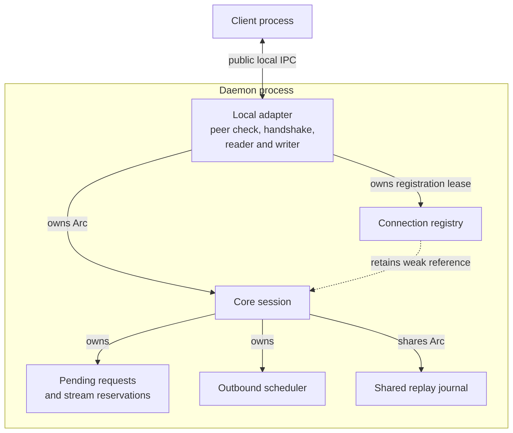

# Locate connection ownership and extension boundaries

Use this explanation before changing server admission or connection lifetime.
It describes the current internal Rust engine; readers need familiarity with
Rust `Arc`, mutexes, and the distinction between a physical connection and a
logical stream. Start from the [crate entry point](../../README.md).

A **physical connection** is one negotiated adapter connection. A **logical
client ID** is the replay/cache namespace that can survive replacement of that
connection; it is not proof of OS identity. A **logical stream** is one
subscription multiplexed over the connection. A core `ServerConnectionSession`
is a transport session, not a persisted product session or a process.

## Runtime ownership

This view answers which daemon component owns each resource. All boxes inside
the daemon boundary run in that process; process execution and private host IPC
belong beyond the application boundary.

*Connection resources: the adapter owns the strong session reference and the separate registration lease.*

Product dispatch uses `BoundedProductDispatcher` to execute application work,
settle responses and publish streams. It shares a separate
`BoundedRequestIdempotencyStore` across connections; see the
[daemon request flow](../../../undercurrent-daemon/docs/internals/requests/request-flow.md).
Core session state and mutation-result retention have separate lifetimes.

Teardown has two independent duties:

| Action | What it releases | What remains |
| --- | --- | --- |
| `session.close()` | Pending requests, request ledger, stream reservations and scheduler queues | Registry lease and shared result cache; retained replay becomes inactive until its deadline |
| Drop or release the registration lease | The client/connection identity pair and its registry slot | Session state, unless explicitly closed |

The adapter must perform both.
The registry retains only a `Weak` session reference: it cannot keep abandoned
queues or requests alive, but a retained lease still occupies registry capacity.

The [local server adapter](../../../undercurrent-transport-local/src/server.rs)
verifies the peer, builds `AuthenticatedRequestContext`, negotiates limits,
constructs the session, registers it, and then sends handshake acceptance.
Construction/registration do not establish that the client received acceptance.
Its teardown closes core state, dispatches product cleanup, drains ownership of
the writer worker, and releases the lease. Core neither starts nor joins those
workers. There is no session `Drop` implementation that calls `close`: owners
must close explicitly to deactivate active replay journals before releasing the
last session reference.

## Dependency boundary

The [workspace transport dependency view](../../../../docs/architecture/dependencies.md#dependency-direction)
owns the crate graph; [Cargo.toml](../../Cargo.toml) owns exact edges. Core depends on
protocol, multiplex, and wire, with no application, storage, process-runtime,
SDK, or daemon dependency.

Keep product decoding/authorization/execution in daemon, native authentication
in local transport, scheduling/credit/replay eviction in multiplex, and binary
framing/negotiation in wire. The local ownership diagram above shows how those
contracts meet at a connection without turning their implementations into core
dependencies.

## Code map

Modules are private and re-export their composition types at the crate root;
`pub` does not expand the supported external API policy. Use generated Rustdoc
for symbol lookup and this map to investigate behavior. Engine module links
below point into `src/engine/`.

- [lib.rs](../../src/lib.rs), [mod.rs](../../src/engine/mod.rs): Crate boundary and root re-exports; no startup or runtime loop.
- [admission.rs](../../src/admission.rs): Authenticated dispatcher port and payload-free overload correlation. See [admission](request-lifecycle.md#admission-and-response-settlement).
- [dispatch.rs](../../src/engine/dispatch.rs): Bounded product-work acceptance contract; error source retention with redacted presentation.
- [session.rs](../../src/engine/session.rs): Request ledger, pending map, stream reservations, codec/scheduler integration, writer handoff and teardown. See [requests](request-lifecycle.md) and [streams](streams-and-recovery.md).
- [connections.rs](../../src/engine/connections.rs): Atomic client/connection registration, drop leases, weak session references and seek-paginated diagnostics.
- [registry.rs](../../src/engine/registry.rs): Nonzero diagnostic page limits and stable diagnostic-name registry; see [observability](../reference/diagnostics.md).
- [error.rs](../../src/engine/error.rs): Stable category mapping for local state, wire and multiplex failures. See [error reference](../reference/errors.md).
- [idempotency.rs](../../src/engine/idempotency.rs): Bounded exact-byte request/result retention independent of connection teardown. See [cache lifecycle](idempotency.md).

## Composition prerequisites

The core manifest defines no features or platform-specific transport. Focused
in-memory checks need the workspace's [Rust 1.95.0 toolchain](../../../../rust-toolchain.toml)
and resolved dependencies; real adapter checks additionally need their owning
platform's local IPC support. Core alone establishes no claim about a new OS.
See the [local adapter](../../../undercurrent-transport-local/README.md) for that boundary.

The constructor consumes already validated inputs and additionally checks:

| Input | Requirement and reason |
| --- | --- |
| Connection agreement | `ConnectionAgreement` capabilities must include `MULTIPLEX`, `FLOW_CONTROL`, `TRACE_CONTEXT`: core assumes correlation, flow control and tracing. |
| Scheduler limits | `SchedulerLimits` must use exactly `agreement.limits()`, so advertised and enforced bounds agree. |
| Shared replay | `ReplayJournal` must match the agreement's server epoch. Its maximum retained item must be at least `max_frame_bytes` to fit a complete encoded frame. |
| Diagnostic limits | `ServerDiagnosticLimits` requires nonzero connection and stream page sizes to bound diagnostic work. |
| Connection registry | `ActiveConnectionRegistry` requires a nonzero maximum connection count. All registrations consume a slot, including those without live pressure. |
| Resumable stream | Negotiated `STREAM_RESUME` and `retain_for_resume = true` are required on resumed activation. Retention also requires the capability for a fresh stream. |

`WireCodec::new` also checks that the frame limit can support framing. Core does
not negotiate versions itself: the current Undercurrent connection protocol version is
[0.1.0-beta](../../../undercurrent-wire/src/version.rs), while the product boundary
[validates current 0.1.0-beta product metadata](../../../undercurrent-protocol/src/compatibility.rs).
Package version 0.1.0-beta does not select either wire or product semantics.

## Synchronization and lifetimes

A session mutex serializes local admission, settlement, activation, publication
and close. Scheduler and replay journal have their own synchronized bounded
state. Product work executes outside that session lock, and independent requests
may finish out of order. There is no transaction spanning the dispatcher,
application store, scheduler and socket.

The [writer handoff](streams-and-recovery.md#terminal-output-and-the-physical-write-boundary)
explains dequeue, staging bytes, callbacks and replay confirmation. A
`PendingServerWrite` retains an `Arc` to the replay journal and can outlive its
originating call.

`wait_for_write` is a blocking condition-variable boundary for that single
writer. Queue admission, credit grants and close increment a generation counter
under `write_wait` and notify the condition variable. The writer snapshots that
counter before checking for work, releases `write_wait` for the queue check,
then reacquires it and waits only while the counter is unchanged. The shared
mutex couples notification to wait enrollment; a signal during the queue check
is retained by the changed counter.

Producers can hold session state while acquiring `write_wait`. The writer must
therefore release `write_wait` before reading closure, accessing the scheduler,
or invoking callbacks. Its wait predicate reads only the generation counter;
after waking it releases the mutex and rechecks work and closure. The
[writer wakeup regressions](../../src/engine/session/wake_tests.rs) cover data,
credit and close after the queue check and just before parking.

Core has no background timer,
request execution deadline, periodic heartbeat sender, or journal-expiry task.
The local adapter owns handshake/write/idle timeouts; callers drive cache and
journal expiration.

Telemetry callbacks must remain non-blocking and avoid
synchronous session re-entry: observations can occur while the session lock is
held. Queue-drain callbacks must return promptly without IO or synchronous
session re-entry.

The installed queue-drain callback remains owned by the session after `close`;
replacement or session drop releases it. Avoid a strong ownership cycle back to
the session; the daemon's [pump callback](../../../undercurrent-daemon/src/stream/pump.rs)
uses weak shared-pump ownership.

Callbacks run synchronously and their panics are not caught here. A panic may
propagate after state or queue mutation; recovering mutex poisoning with
`into_inner` does not roll that mutation back. Nonblocking/no-IO behavior depends
on the supplied callback. The scheduler has the same [callback boundary](../../../undercurrent-multiplex/src/scheduler.rs).

For changes to any of these boundaries, continue with the
[extension and verification guide](../development/contributing.md#choose-the-owning-layer).

[Crate documentation](../README.md)
