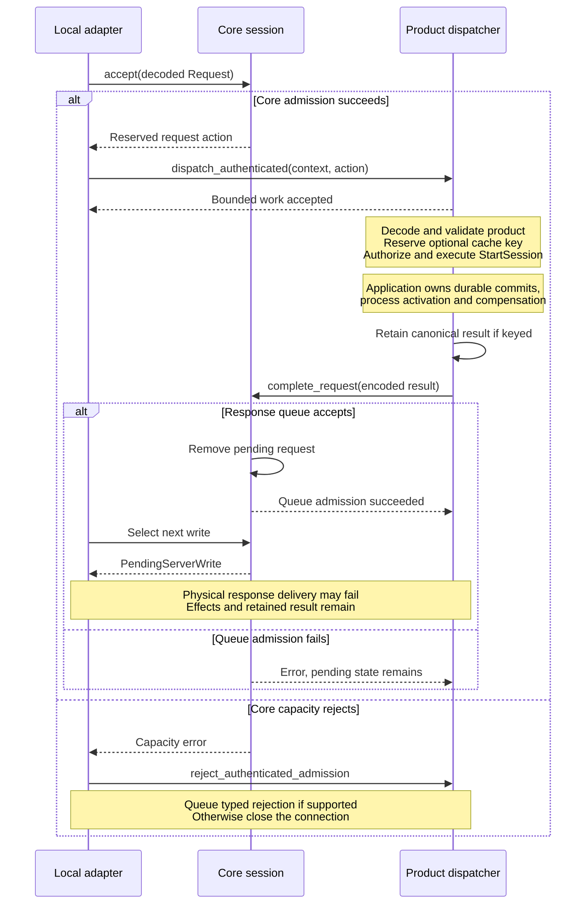

# Trace a request from admission to response

Use this explanation to investigate correlation, cancellation or a response
lost after execution. It covers the internal server path; start with the
[ownership map](ownership.md) for process and crate boundaries. The owning
state machine is [session.rs](../../src/engine/session.rs); product decisions live
in the daemon's [dispatcher](../../../undercurrent-daemon/src/dispatch.rs).

## Representative session creation

For `StartSession`, core owns two milestones: reserving a request and queueing
its response. This sequence shows the ordinary execution route for those
milestones. A dispatcher may instead replay a [retained result](idempotency.md).

*Request reservation, bounded dispatch acceptance and response queue admission
are separate steps. None proves that the caller received a result.* A dispatch
admission error is connection-fatal because work ownership is ambiguous.
A closed connection can also prevent response settlement.

The [daemon start adapter](../../../undercurrent-daemon/src/application_adapter/finite.rs)
authorizes and translates the request before calling
[`StartSessionService`](../../../undercurrent-application/src/commands/start.rs).
The shared [start walkthrough](../../../../docs/architecture/flows.md#start-a-session)
shows the creation/outbox, process-ownership and Running commits. The
[application lifecycle guide](../../../undercurrent-application/docs/internals/sessions/lifecycle.md#dispatched-creation-and-lost-responses)
owns durable attempt settlement, acknowledgement and compensation. These commits
precede a successful response but are not a transaction with the cache or socket.
Failures can follow committed state or process effects.

If cache completion fails or conflicts, the dispatcher closes the connection;
application effects can already exist. The dispatcher caches canonical results
before negotiated wire projection. A
finite response does not enter stream replay; the
[physical write boundary](streams-and-recovery.md#terminal-output-and-the-physical-write-boundary)
explains confirmation and response loss. Observed readiness, process exit and
application task completion remain separate facts from request acceptance.

## Admission and response settlement

`decode_client` decodes at most one bounded wire frame. It neither verifies
the peer nor interprets the product payload. The local adapter requires a
complete frame consuming the entire framed input before calling `accept`.
`accept` first checks that the session is open, then performs these transitions:

| Message | Local state change | Product action |
| --- | --- | --- |
| `Request` | Reserve request ID and pending finite slot. | `Request` |
| `OpenStream` | Reserve request ID, pending slot and provisional stream ID. | `OpenStream` |
| `ResumeStream` | Check resume capability. Reserve open resources with prior epoch and consumed sequence. | `ResumeStream` |
| `CancelRequest` | Remove pending state and any opening stream reservation. | Typed `CancelRequest` |
| `CloseStream` | Remove the stream and owned state, as detailed below. | `CloseStream`, plus cancellation if opening |
| `WindowUpdate` | Grant scheduler credit and signal the writer. | None |
| `Ping` | Queue `Pong` as control traffic. | None |
| `Close` | Close connection-local state. | `CloseConnection` |

Cancelling an unknown or already-settled request is a no-op. Closing an unknown
stream is an error. Closing an opening stream also removes its pending request
and returns cancellation before the close action. Closing an active stream
closes its scheduler state and removes its replay journal.

## Request IDs survive settlement

The request-ID ledger is distinct from the pending map. An ID is inserted
**before** pending-request and stream-capacity checks, and before checking an
open's stream-ID conflict. Those later failures still consume that ID. Completion,
rejection and cancellation do not make an ID reusable in the same connection.
This prevents a delayed response from settling a different request. The
non-evicting ledger is capped by `REQUEST_ID_EPOCH_LEDGER_LIMIT` (1,048,576);
exhaustion requires a replacement connection, even if pending work is empty.
It also has a 16 MiB UTF-8 payload budget (`REQUEST_ID_EPOCH_LEDGER_BYTES`).
The first exhausted bound rejects before retaining the new ID; existing IDs
remain reserved. The ledger and byte count clear only when that session closes.
The local adapter retires the exhausted connection because an unretained ID
cannot receive a correlated rejection. Reconnect for new work and reconcile
uncertain mutations; connection replacement does not authorize replay.

The 1,048,576 cap is a hard-coded engine policy, distinct from negotiated
pending-request capacity. It is not a universal wire-protocol lifetime limit
or a promise of a particular memory footprint. The 16 MiB identifier budget was
adopted on 2026-10-05 as fixed engine policy alongside that count cap. It permits
524,288 32-byte IDs or 65,536 maximum-sized IDs; long IDs can no longer retain
256 MiB of string payload before the count cap intervenes.

An isolated Linux x86_64/Rust 1.95.0 `BTreeSet<String>` allocation probe measured
59,717,952 live requested allocator bytes for 1,048,576 eight-byte IDs;
42,441,512 for 524,288 32-byte IDs; and 19,985,136 for 65,536 256-byte IDs.
The probe subtracted its starting allocation counter and counted retained string
capacities and tree-node requests. These are allocation measurements, not RSS,
allocator bookkeeping, or total connection memory; pending work has separate
bounds. This budget preserves many short-lived RPCs while reducing the worst
long-ID payload exposure. It is a present resource decision, not an inferred
historical target, and can be revisited using deployment lifetime/request rates.

## Dispatch acceptance and capacity rejection

The adapter supplies the immutable, credential-free authenticated context to
[`AuthenticatedActionDispatcher`](../../src/admission.rs). Its daemon implementation
admits into bounded execution resources, decodes the product, validates contract
and capability requirements, and delegates authorization and use cases. A
successful dispatcher return means acceptance of work, not execution success.
The parallel [`ServerActionDispatcher`](../../src/engine/dispatch.rs) port states
that ownership contract without the authentication argument; the current local
server uses the authenticated port.

When core rejects finite/open/resume capacity, the adapter preserves the request
ID and response codec family in `ServerAdmissionRejection`. The daemon can queue
a correlated product `CapacityRejected` payload via
`reject_authenticated_admission`. `Ok(true)` means it queued that payload.
The default `Ok(false)` leaves the local adapter to close using its typed
capacity fallback; dispatch errors are also fatal to the connection. Core does
not fabricate product error bytes.

`reject_unaccepted_request` permits settlement only when the ID is in the ledger
and absent from pending state. It also serves cancellation settlement. It does
not record a second “terminal already sent” flag, so the dispatcher must ensure
one terminal response per request. If the ledger itself was full, the incoming
ID was never retained and this response path cannot settle it; the adapter
falls back to connection failure. Generic overload guidance alone does not
capture this ledger-specific replacement requirement.

## Queue a terminal response

| Intent | Queue admission and failure behavior |
| --- | --- |
| Finite result | `complete_request` queues a reliable finite response, then removes pending finite state. Wrong kind, unknown request, encoding failure or saturation prevents completion. Queue failure preserves pending state. |
| Pending rejection | `reject_request` queues product error bytes, then removes pending state and any provisional stream. Queue failure preserves the reservation. The caller supplies the correct product codec. |
| Ledger-only response | `reject_unaccepted_request` queues a response for a ledger ID without changing pending state. A still-pending or unknown ID is rejected. |
| Stream activation | `activate_stream` queues the finite open result and activates the reserved stream, using the [activation rollback rules](streams-and-recovery.md#activation-and-publication). |

These methods use the wire response envelope. Successful settlement reports
queue admission; it does not mean the socket write completed or the client
received or decoded the response.

## Cancellation and deadlines

A request cancellation removes its correlation from the pending map immediately
and tells the dispatcher which product response family to use. The daemon marks
its cancellation token and queues a terminal cancellation result through the
ledger-only response path. Work may already have reached the executor; cancellation
is not rollback and does not prove an effect is absent. A later ordinary
completion of that removed request fails as unknown. If normal completion won
the mutex first, cancellation sees no pending request and returns no action.

These scopes must remain distinct:

| Scope | Meaning here |
| --- | --- |
| Cancel a finite request | Stop no-longer-useful execution when safe; preserve ambiguous effects for reconciliation. |
| Cancel an opening subscription | Remove provisional stream and pending open; dispatcher settles with the stream-open codec. |
| Close an active subscription | Remove only that stream's queues and replay; peers remain active. |
| Close the connection | Release all local requests/streams and wake writer; adapter separately requests product cleanup. |
| Cancel a runtime attempt | A product operation with durable authorization and attempt semantics, not a `CancelRequest` frame. |

Core has no per-request execution timer. The Rust SDK's
[finite request API](../../../undercurrent-sdk/src/client.rs) waits synchronously
with a timeout and sends best-effort cancellation. Python's
[async bridge transport](../../../../python/src/undercurrent/_transport.py) uses
asyncio timeouts and never automatically replays a timed-out mutation. Those are
client policies, not alternative execution modes inside core. Adapter heartbeat,
handshake and physical write deadlines are likewise outside this crate.

For an exact cancellation or request-correlation regression, begin with
[connection_contract.rs](../../tests/connection_contract.rs). Daemon product
admission, cancellation-token behavior and negotiated response shape are tested
in [product_dispatch.rs](../../../undercurrent-daemon/tests/product_dispatch.rs).
Use the [debugging guide](../development/contributing.md) to select focused checks.

[Crate documentation](../README.md)
