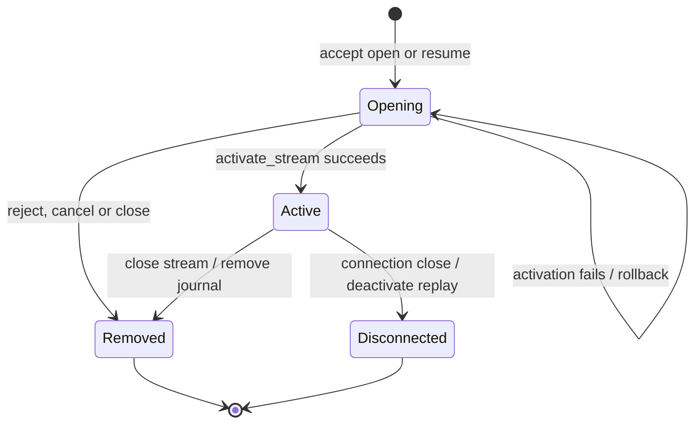
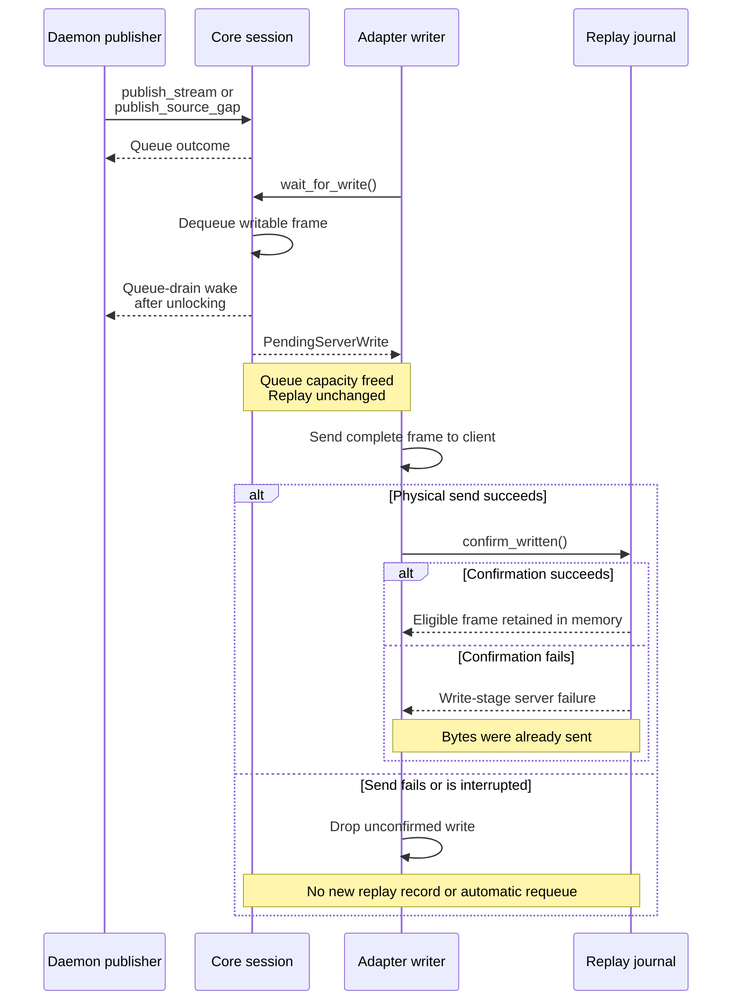
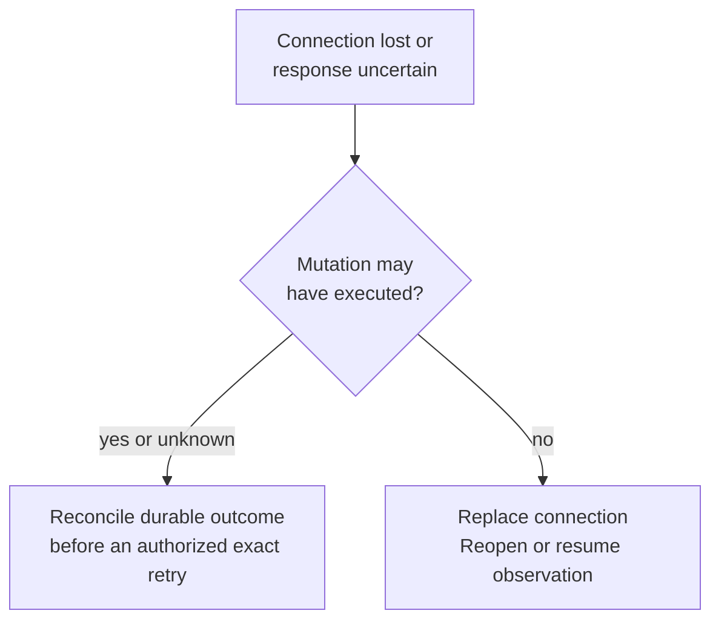

# Trace stream activation, delivery and recovery

Use this explanation to diagnose an opening stream, a stalled writer or a
reconnect gap. It covers connection-local stream state in
[session.rs](../../src/engine/session.rs), with scheduling and replay mechanics owned
by [multiplex](../../../undercurrent-multiplex/README.md). A stream sequence is an
ordered transport-item number; it is not a terminal byte offset, product revision
or durable event checkpoint.

For a stalled writer or missing history, start with [diagnosis](#diagnose-loss-before-retrying);
for a publisher change, start with [activation](#activation-and-publication).

## Activation and publication

`accept(OpenStream)` and `accept(ResumeStream)` reserve a pending finite request
and an `Opening` stream. Product dispatch must validate and prepare the
subscription before calling `activate_stream` with a response payload and
`ServerStreamConfiguration`. Configuration supplies stream kind, traffic class,
delivery policy, gap recovery action and whether writes enter reconnect replay.
Core trusts that product-selected policy; it does not derive it from opaque bytes.

This state view shows which connection-local reservations survive failed
activation and which teardown paths leave replay available:

*Failed activation preserves the opening reservation. Disconnect can retain a
replay journal for a new connection; the old connection's state is released.*
Here “reject” means `reject_request` successfully queued a response; “close”
includes stream or connection close.

A reconnect creates a new connection-local reservation; the old session never
returns from closed to open. Only streams configured for retention leave a
journal eligible for resume. Unlike the request-ID ledger, the stream registry
only rejects currently reserved IDs; removal permits a later reservation of that
stream ID. Owners must still respect replay ownership and subscription semantics.
Retained journals are deactivated until the agreement's retention deadline. Repeated physical close returns zero
release counts and does not extend those deadlines.

### Activation ordering and rollback

Activation checks pending kind and reserved stream identity, enforces resume
capability, and rejects a resumed stream with retention disabled. It opens the
scheduler stream after sequence zero for a fresh stream or after the client's
consumed sequence for a resume. While holding the session lock, it queues the
open response and schedules any gap followed by the retained frames, or registers
a new journal.
Only then does it remove the pending request and mark the stream active.

If admission fails after scheduler creation, it closes that scheduler stream,
removes response frames for the request, removes a newly created replay journal,
or restores the prior expiration of an existing resumed journal. The original
pending/opening state remains available for a typed rejection. This is in-memory
rollback of activation resources, not a rollback of product work. The writer
cannot select partially admitted activation frames through `next_write` while
that session lock is held. The finite open response is selected before its
stream's replay/data.

### Publish the next sequence

After activation, publication must continue from
`StreamActivationOutcome.last_sequence`, including any replayed frames or gap.
`publish_stream` requires an active stream, encodes the product bytes and asks the
scheduler to enforce monotonic order, capacity and delivery policy. A successful
call reports `EnqueueOutcome`; callers must distinguish queued data from
replacement/drop outcomes. `publish_source_gap` advances an active stream's
sequence for an item no longer retained by the application, with no placeholder
payload, and queues a typed gap ahead of later data.

For partial replay eviction, activation queues the missing-prefix gap followed
by all retained later frames. Its `last_sequence` is the final retained sequence,
so the next new item advances beyond the journal's latest sequence. For example,
if only frame 1 was evicted from confirmed frames 1–3, resume after zero queues
gap 1 and frames 2–3, returns `last_sequence = 3` and `replayed_items = 2`, and
allows new frame 4 to be written and confirmed. The existing-journal gap and
replayed frames are not recorded again. See the
[replay ordering diagram](../../../undercurrent-multiplex/docs/internals/replay.md#resume-decision-reference).

If the gap and full suffix cannot be queued, activation fails and rolls back as
described above. Successful transport continuation does not restore missing
product data; consumers must still apply the gap's recovery action.

## Terminal output and the physical write boundary

This sequence answers when a queued item becomes replayable. Application output
retention is a separate source. The reconnect journal records eligible selected
frames only after complete physical IO and confirmation.

*Queue space becomes available before send success. Neither send nor replay
confirmation establishes client consumption or durable history.* After
consumption, the client returns credit with `WindowUpdate`; the adapter passes
it to core, which grants credit and signals the writer.

`next_write` removes queued work before IO. Dropping `PendingServerWrite` does
not requeue it. `confirm_written` consumes the handle and records eligible stream
frames; finite responses, heartbeat frames and already replayed frames return
`None` without a new record. A synthesized gap for a newly created resume journal
is recordable after write. A replayed gap for an existing journal is not recorded
again. Confirmation can itself fail (for example ordering/capacity/invariant
failure); the adapter treats this as a write-stage server failure even if bytes
were sent. Neither an IO failure nor missing confirmation proves the client saw
no bytes.

Only one writer should select frames, and the adapter must preserve that order
through writes and confirmations. The local adapter uses a blocking writer
worker and a bounded async channel, then calls `local.send` under its write
timeout before confirmation. This staging queue can hold dequeued frames, so
scheduler pressure excludes some bytes awaiting IO. Core's wake callback fires
at **dequeue**, allowing a product pump to resume as soon as queue space opens.

The real terminal path is
[OutputProductStreamSource](../../../undercurrent-daemon/src/application_adapter/streams.rs)
→ [ProductStreamPublisher](../../../undercurrent-daemon/src/stream.rs) → core. The
source preserves its front item on backpressure. The publisher serializes sequence
assignment and advances only after accepted publication. Product output offsets
and integrity data remain inside terminal payloads; core does not interpret them.

### Product policy and scheduler behavior

[`ProductStreamPolicy`](../../../undercurrent-daemon/src/stream.rs) owns the current
product-to-scheduler mapping, documented in the
[daemon output and stream guide](../../../undercurrent-daemon/docs/internals/output-and-streams.md#keep-checkpoints-in-their-own-domains).
It covers replaceable session watches, reliable session/agent events, and reliable
terminal output with mode-specific gap recovery. All current daemon policies
retain reconnect replay.

Core contract tests deliberately use a **droppable** terminal configuration to
exercise saturation gaps, and a lifecycle fixture with restart-query recovery.
Those fixtures are not the daemon policy or mandatory core defaults.

The scheduler reserves class capacity and selects traffic with control priority
and weighted fairness. It enforces byte and message bounds independently. A
reliable stream can backpressure rather than lose data; a replaceable or droppable
policy can produce explicit gaps. Available queue capacity is different from
flow credit: queued data may wait until a `WindowUpdate`, while eligible control
traffic proceeds. Core handles `Ping` immediately but does not implement a
heartbeat timer. These mechanics are owned by
[scheduler.rs](../../../undercurrent-multiplex/src/scheduler.rs) and
[frame.rs](../../../undercurrent-multiplex/src/frame.rs).

### Replayed gaps and credit

Live source/overflow gaps and fresh synthesized resume gaps bypass data credit.
Write confirmation retains each frame's `StreamFrameKind` with its exact bytes,
including synthesized gaps that establish a new journal. On replay, encoded gaps
stay in the stream's configured class to preserve FIFO order with retained data,
but their explicit gap kind makes their flow-credit charge zero. Queue admission
still charges their full encoded size and one message.

Both server windows therefore remain unchanged for gaps, matching the SDK's zero
credit return on gap consumption. Ordinary retained data still consumes its full
encoded length. The core regressions cover source and synthesized gap replay,
exact byte/order preservation, and both credit windows; the scheduler regression
also verifies an encoded gap remains writable with both windows empty.

## Reconnect and resume

A client must release/lose its previous physical connection registration before
another can own the same `ClientId`. Resume uses a new finite request ID, the
prior logical stream ID, prior server epoch, last fully consumed sequence, and
subscription payload/trace context. Core checks capability and reserves state;
the daemon still decodes, authorizes and prepares the subscription. Transport
resume does not retry a mutation or establish the source's retained history.

`ReplayJournal::activate_resume` selects replay and activates ownership under the
journal lock, expiring due inactive journals first. This avoids an independent
expiry sweep removing the selected journal during activation. Its
[owning implementation](../../../undercurrent-multiplex/src/replay.rs) distinguishes:

| Condition | Result used by core |
| --- | --- |
| Same epoch, retained history after the supplied sequence | Requeue retained frames without recording them again. An up-to-date consumer may receive zero replay items. |
| Different server epoch | `ServerEpochChanged` gap. |
| No journal, including expired retention | `ReplayUnavailable` gap. |
| Requested history was evicted | `ReplayEvicted` gap followed by the retained suffix, selected together. If nothing remains, the gap reaches the journal latest sequence. |
| Client sequence is ahead of the known latest sequence in the same epoch | Typed future-sequence error, not successful replay. |
| Journal already active or journal capacity unavailable | Activation error; apply the rollback described above. |

Replay storage is bounded and in memory. A successful open response with a gap is
not continuity. The caller must perform the gap's product-specific recovery:
restart a query, request a snapshot, or restart terminal reading from an available
offset as appropriate. Source-retention gaps and replay-retention gaps occur at
different boundaries; reconnect cannot restore bytes the application no longer
has. A terminal screen snapshot restores a current view, not the missing transcript.

## Diagnose loss before retrying

Start with the evidence at the failing boundary:

| Known observation | Next investigation |
| --- | --- |
| Typed stream gap | Apply the gap's product recovery action. Reconnect cannot restore source history. |
| Correlated capacity rejection before product work | Resolve the named bound and use a fresh request ID. [Ledger exhaustion](request-lifecycle.md#request-ids-survive-settlement) requires a replacement connection. |
| Queued data lacks credit | Check consumer progress and `WindowUpdate` handling. |
| Queue stalled with credit available | Inspect admission, queue bounds and the adapter's writer error stage. |

If the connection was lost or the response is uncertain, use this decision tree
before repeating work:

*Reconnection restores a transport path. Operation-specific evidence determines
whether a mutation can be repeated.*

A capacity label from a failed physical connection is insufficient to prove that
all earlier work was rejected. Likewise, the overload hint to wait for queue
space does not authorize repeating an ambiguous mutation. Preserve request,
client, stream and durable operation identities at their proper boundaries.
Use [idempotency](idempotency.md) to understand cache evidence, the
[diagnostics reference](../reference/diagnostics.md) for payload-free pressure,
and the [maintainer guide](../development/contributing.md) for test selection.

Core [connection tests](../../tests/connection_contract.rs) exercise write
confirmation, unconfirmed-drop behavior, partial-eviction continuation and rollback,
missing replay gaps, source-gap ordering,
300-stream disconnect/expiry, control priority and writer wakeups. They simulate
IO confirmation in memory; native transport and daemon source-pump behavior need
[framing tests](../../../undercurrent-transport-local/tests/framing.rs),
[native endpoint tests](../../../undercurrent-transport-local/tests/endpoint.rs) and
[daemon tests](../../../undercurrent-daemon/tests/product_dispatch.rs).

[Crate documentation](../README.md)
