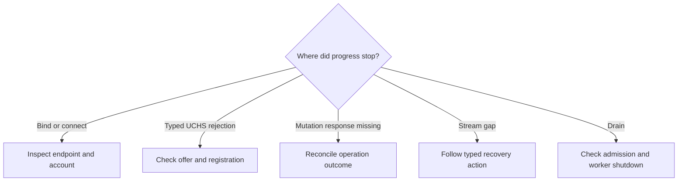

# Diagnose local connection failures and recover deliberately

Use this guide to investigate the local adapter as a maintainer. For normal
startup and configuration tasks, use [operator troubleshooting](../../../../docs/guides/troubleshooting.md).
You need the error stage/category, configured product home, daemon OS account,
and whether a request was submitted. Keep endpoint paths and concrete error
sources in trusted diagnostics.

## Choose the failed boundary

1. Record the failure stage and category using the
   [safe logging rules](../reference/diagnostics.md#safe-logging). Record any
   request/target identity already available; do not send a mutation as a probe.
2. Follow the matching branch below. Inspect configuration and filesystem
   metadata with read-only platform tools. Do not change a real endpoint's
   permissions or delete its socket or lock.
3. Verify the result using the relevant table or shutdown checks below.
   A restored connection proves access, not the outcome of earlier work.

*Choose the failed boundary before retrying. Missing responses and stream gaps
require evidence beyond successful reconnection.*

## Follow the matching path

| Observation | Next section |
| --- | --- |
| Native setup or UCHS rejection | [Native setup and negotiation](#native-setup-and-negotiation) |
| Lost mutation response or stream history | [Reconnection and outcome evidence](#reconnection-is-not-mutation-retry) |
| Listener does not finish | [Drain investigation](#a-drain-does-not-finish) |

## Native setup and negotiation

Use [endpoint protection](../internals/endpoints.md) for the exact native checks. For a
suspect product home, inspect its configuration and filesystem metadata with
your platform's normal read-only tools before making any changes. The following
actions need no synthetic request against a real managed process.

| Symptom | Investigation and recovery | Verification |
| --- | --- | --- |
| Invalid endpoint | For constructor `InvalidInput`, use an absolute endpoint with a file name, no `..`, and a shorter Unix path. Constructor success is only lexical validation. | Configuration validates; native setup must still pass. |
| Unix permission or symlink error | For `PermissionDenied` or a symlink-related OS error, check canonical ancestors, effective UID, exact parent/socket/lock modes, file type, and link count. Select a new correctly owned private runtime location if configuration points somewhere unsafe. Do not weaken modes to connect. | Retry normal startup/connect with the corrected configuration and same account. |
| Unix `AddrInUse` on bind | Another guard can retain the lock even after admission stops; a live socket probe also prevents replacement. Wait for the legitimate owner to finish and release ownership. | A subsequent normal bind succeeds; no forced unlink is required. |
| Missing endpoint | Confirm the daemon is running for the same home and account. Unix connect creates no directories; Windows maps the exact path spelling into a pipe name. | Normal SDK connection completes UCHS, rather than merely finding an entry. |
| Unix stale socket after shutdown | Let normal bind acquire the lock and run verified stale recovery. A foreign file or unsafe socket is an error to investigate, not removable transport debris. | The next bind and handshake succeed; see the endpoint test for an isolated reproduction. |
| Linux path validation succeeds but native I/O fails | Check availability of `/proc/self/fd`, existing ancestors, and safe modes. | Run the focused endpoint test in the affected environment. |
| Windows pipe remains busy | Only busy error 231 is retried by `connect_local`; caller must enforce a deadline. Check whether the expected daemon is accepting. After shutdown, outstanding pipe handles/completions can delay name release. | Connection or bounded eventual rebind succeeds; do not create a network fallback. |
| Peer account check fails | Ensure both ends run under the intended OS account. Metadata alone does not override kernel identity. | A same-account connection succeeds with verification enabled. |
| Version or capability mismatch | For `IncompatibleVersion` / `MissingCapability`, align client and server versions and requested capabilities. These setup rejections are non-retryable here. | A compatible offer negotiates successfully. |
| UCHS `Conflict` | Check duplicate logical client IDs and a still-registered old physical connection. | The old registration is released before the replacement registers. |
| Immediate EOF under connection load | Physical semaphore exhaustion drops the stream before UCHS; it need not produce a typed overload. Also investigate other native disconnect causes. | Server pressure and run counts distinguish capacity from later failures. |

Do not interpret all `PermissionDenied` values as evidence of a foreign peer:
Windows first-instance contention and Unix metadata checks can fail with that
class too. Likewise, server error category `Transport` can wrap an endpoint
security check; inspect the stage and available I/O kind.

## Reconnection is not mutation retry

The adapter retains only transport recovery state. Check which lifetime ended:

| Event | What remains and what to verify |
| --- | --- |
| Physical connection recycle | `recycle_connections` keeps the epoch and in-memory replay journal. A resilient Rust client can reconnect with its logical ID and attempt eligible resume after the old registration releases. |
| A replacement `LocalServer` | A fresh journal is created and the caller supplies an epoch. Daemon startup supplies its epoch; never promise replay across restart from adapter memory. |
| Retention expiry or unavailable sequence | Follow the returned recovery action, such as a new query or snapshot. The [maintenance sweep](../internals/server.md#replay-expiry-during-normal-operation) reclaims expired journals without extending retention. |
| Product output already evicted | Transport resume cannot recover the missing source bytes. Follow the product's source offset recovery, independently of UCMP sequence/epoch recovery. |

The [SDK boundary tests](../../../undercurrent-sdk/tests/local_boundary.rs) exercise
same-server recycle/resume and `ServerEpochChanged` after restart. Source offsets
and `RestartAtAvailableOffset` belong to
[terminal output](../../../undercurrent-application/src/terminal_output.rs);
stream sequences and replay gaps belong to
[multiplex replay](../../../undercurrent-multiplex/src/replay.rs).
A gap means missing history, not empty output, process exit, or completion.
Use the shared [stream baseline recovery](../../../../docs/sdk/recovery.md#restore-a-stream-baseline)
for the next read or fresh-state query.

**If a submitted mutation has no known result, preserve that uncertainty.**
Partial delivery or response loss may follow execution and durable commit.
UCLC backoff and a new connection agreement supply no operation-level
deduplication. Follow [mutation reconciliation](../../../../docs/sdk/recovery.md#reconcile-the-mutation)
with the original identity, preconditions, effect certainty, and revision
evidence before deciding whether retry is allowed.

The [daemon idempotency tests](../../../undercurrent-daemon/tests/product_dispatch.rs)
cover bounded retained response replay and response loss across capability
changes. The [idempotency implementation](../../../undercurrent-transport-core/src/engine/idempotency.rs)
lives outside this adapter; a fresh request ID is not a universal retry strategy.

For bridge failure, timeout, and cancellation, use
[Python recovery](../../../../docs/sdk/python/recovery.md). Its
[stream failure rules](../../../../docs/sdk/python/streams.md#backpressure-and-connection-recovery)
explain queued-observation invalidation. The
[Rust stream recovery guide](../../../../docs/sdk/rust/streams-and-recovery.md)
owns resilient client behavior.

## Error and diagnostic reference

Use [errors and diagnostics](../reference/diagnostics.md) to look up emitted
category/stage pairs, safe logging rules, pressure readings, and run counters.
In particular, a rejected peer leaves no retained issue, and a failed rejection
write counts as failure rather than rejection.

## A drain does not finish

1. Check whether the owner called `stop_accepting` or `shutdown`.
   `stop_accepting` allows healthy existing clients to remain; `shutdown` also
   signals their workers. Neither call waits for cleanup.
2. Check the daemon supervisor's deadline and
   [connection pressure](../reference/diagnostics.md#live-pressure-and-diagnostic-pages).
   Pressure is a concurrent sample, and a readiness flag does not prove shutdown.
3. If workers persist after shutdown, investigate synchronous dispatcher work
   and the writer join. Follow the [cleanup ordering](../internals/server.md#active-worker-cleanup)
   and reproduce with the [slow-reader or silent-handshake tests](../../../undercurrent-sdk/tests/local_boundary.rs).
4. Verify that the owning task awaited `run` successfully. For Unix rebind,
   the server object must also drop its ownership guard. For Windows, allow
   outstanding pipe handles/completions to release the name. See
   [endpoint lifetime](../internals/endpoints.md).

No procedures here start processes or create persistent state. The
[verification guide](contributing.md) supplies isolated reproductions and
cleanup details for maintainer testing.

[Crate entry point](../../README.md) · [Lifecycle details](../internals/server.md)

[Crate documentation](../README.md)
