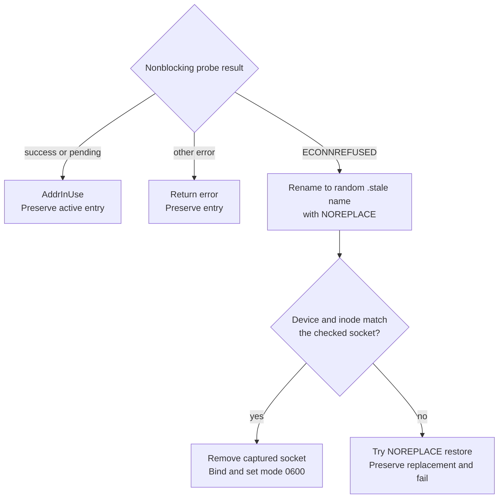
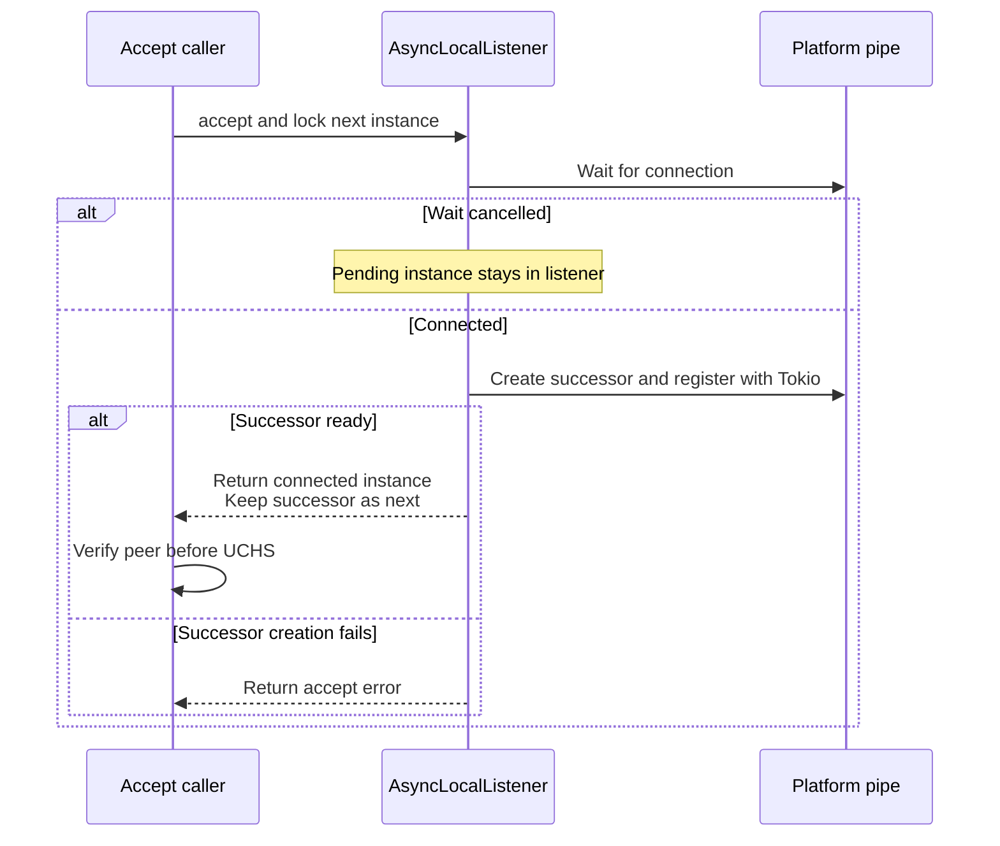

# Understand endpoint protection and lifetime

Use this explanation when changing bind/connect code or investigating an
endpoint rejection. Linux/macOS behavior is owned by [unix.rs](../../src/unix.rs);
Windows behavior is owned by [windows.rs](../../src/windows.rs) and
[platform pipe security](../../../undercurrent-platform-windows/src/pipe.rs).
Both adapters verify the peer's OS account independently of client messages.

Use [address validation](#address-validation-comes-before-native-validation)
for constructor errors, [Unix checks](#linux-and-macos-checks) and
[stale recovery](#unix-stale-recovery) for socket failures, or
[Windows named pipes](#windows-named-pipes) for pipe name and handle lifetime.

## Address validation comes before native validation

`LocalEndpoint::new` in [endpoint.rs](../../src/endpoint.rs) performs no filesystem
or connection I/O. It requires an absolute path with a file name and rejects
`..` components. It does not canonicalize the path, create directories, check
existence, or authenticate a peer. Its `Debug` output redacts the address;
`path()` deliberately returns it to the caller.

On Unix, the configured address must contain no NUL and be shorter than 108
bytes on Linux or 104 bytes on macOS, including its full directory path.
These are byte limits, not character counts. Native address construction can
still fail later. On Windows, the pipe-name function additionally rejects NUL
UTF-16 code units. Do not infer that constructor success proves native safety.

The daemon chooses the default `<product-home>/run/control.sock` in
[configuration](../../../undercurrent-daemon/src/config.rs); this crate has no
default discovery or daemon-launch behavior. On Unix, use a canonical existing
ancestor path. In particular, symlink aliases such as `/var` on macOS are
rejected during traversal. Bind may create only the final parent directory;
its ancestors must already exist. Connect creates nothing.

## Linux and macOS checks

The following table is the lookup reference for the checks in `private_parent`,
`check_socket`, `LocalListener::bind`, and `verify_local_peer`.

| Resource | Required condition | Why |
| --- | --- | --- |
| Traversed parent components | Opened with directory, no-follow, and close-on-exec flags; owned by effective UID or root. Group/other write is forbidden except for a root-owned sticky directory. | Allows standard temporary roots while refusing attacker-controlled ancestors and symlink traversal. |
| Immediate socket parent | Effective UID owns it; low nine permission bits are exactly `0700`. | Other accounts cannot insert endpoint entries there. A pre-existing directory is validated, not repaired. |
| Socket entry, on connect or stale recovery | Socket type, effective UID owner, low nine mode bits `0600`, one hard link. Metadata lookup does not follow symlinks. | A regular file, alias, foreign owner, or unsafe mode cannot stand in for the endpoint. |
| `<socket-name>.lock` on bind | Regular file, effective UID owner, low nine mode bits `0600`, one link; open with no-follow, close-on-exec, nonblocking flags, without truncation. | Lock acquisition coordinates exclusive ownership without overwriting existing content. |
| Lock after acquisition | Entry device/inode still match the opened file. | Refuses a replaced lock entry. Lock acquisition failures map to `AddrInUse`. |
| Connected peer | Kernel `peer_cred().uid()` equals effective UID. | Filesystem metadata alone cannot authenticate the process at the other end. |

Creation requests modes `0700` and `0600` subject to the process umask. A mode
made too restrictive by umask can fail subsequent exact-mode validation. The
newly bound socket is explicitly set to `0600` before use. The checks above
compare low nine mode bits, not a blanket assertion about every metadata bit.

Traversal retains directory descriptors. Linux constructs native socket paths
through `/proc/self/fd/<fd>/<name>`, so `/proc/self/fd` must be available. macOS
uses `F_GETPATH` on the retained directory and checks device/inode against the
resolved directory before using its path. These are different mechanisms; do
not describe macOS as a descriptor-addressed socket operation or promise
protection against an adversarial same-user process.

`connect_local` validates the parent and socket, connects, then checks the
daemon UID. `LocalServer` checks accepted peers before reading UCHS. A custom
native listener caller must call `verify_local_peer` itself; `accept` alone
does not perform that check.

## Unix stale recovery

Bind first validates the parent and acquires the verified exclusive lock. If
the socket entry is absent, it binds and sets mode `0600`. An existing entry
must pass the socket checks above before the probe shown here. Metadata errors
return without forced replacement.

This diagram isolates the deletion decision for an existing safe socket.

*A failed connect alone cannot authorize deletion. The exclusive owner must
capture the same refused socket that it checked.*

A successful probe, `EAGAIN`, or `EINPROGRESS` means the entry must be preserved
as active. The probe is nonblocking and close-on-exec. A 16-byte random suffix names the
quarantine entry. If the captured inode differs from the original, restoration
is attempted only into a vacant original name; failure can leave the captured
entry in quarantine for investigation. No unconditional cleanup follows.
Errors after a new bind may also leave an entry for the next verified owner.

### Ownership through shutdown

`LocalListener::take_listener` transfers the listening descriptor exactly once.
The Unix guard retains the directory and lock separately, including while
`LocalServer::run` drops the accepting descriptor and drains workers. The lock
persists until the guard (normally the server object) drops. Shutdown leaves
both socket and lock-file entries on disk; the next owner validates and
recovers them. Never delete them merely because admission stopped.

## Windows named pipes

Windows keeps the configured endpoint **path as an address key**. It does not
create `control.sock`, a parent directory, or a Unix-style lock file. The
platform crate hashes the domain separator `undercurrent.local-pipe.v0.1.0-beta`, the
current account SID, and the configured UTF-16 path into a
`\\.\pipe\undercurrent-<digest>` name. The code hashes path spelling; it does
not resolve aliases or case-fold equivalent filesystem paths. Client and
server must use the same spelling.

### Account protection

`PipeListenerHandle::create` creates a byte-mode, duplex, overlapped pipe with
remote clients rejected, a protected DACL granting the current account access,
and a non-inheritable handle. First-instance creation enforces exclusive
ownership. Kernel-supplied peer process IDs are looked up and their token SIDs
compared to the current account in both directions. Failure to inspect an
identity fails closed. A SID is an OS account identifier, not a product token.

### Listener handoff and accept

`LocalListener::bind` creates the first handle outside Tokio.
`take_listener` transfers it once to `RawLocalListener`;
`AsyncLocalListener::from_std` registers it with a running Tokio I/O reactor.
Unlike the Unix guard, the emptied Windows `LocalListener` does not retain a
separate ownership lock. The async listener and connected pipe handles keep
the kernel name alive.

The accept loop must keep a pipe instance alive while handing the connected
one to a worker. This sequence shows that local ownership rule.

*Creating the successor before returning the connected handle prevents a gap
in name ownership between normal accepts.* The Tokio mutex serializes accepts.
Dropping all pipe handles releases the name; overlapped completion cleanup may
delay when rebinding succeeds.

### Connect and deadlines

`connect_local` retries only `ERROR_PIPE_BUSY` (231), sleeping 10 ms between
attempts. It has no overall timeout; its caller must supply one. Missing
endpoints and other errors return immediately. There is no network fallback.

## Evidence and next steps

[Unix endpoint tests](../../tests/endpoint.rs) cover same-user connection, live
owner exclusion, stale recovery, modes, symlinks, preserved files, and invalid
addresses. [Linux cross-user tests](../../tests/cross_user.rs) independently check
filesystem denial and kernel credentials, including a foreign server with
otherwise trusted metadata. These tests are ignored outside their isolated
namespace runner. [Windows endpoint tests](../../tests/windows_endpoint.rs) cover
both peer directions, repeated accepts, cancelled accept, binary bytes,
exclusive ownership, eventual rebinding, and missing endpoints. The platform
crate separately tests pipe ACL and handle inheritance.

See [focused verification](../development/contributing.md) for prerequisites and
[troubleshooting](../development/troubleshooting.md) for safe next actions. These sources and tests
do not establish complete adversarial race coverage on all platforms.

[Crate entry point](../../README.md) · [Frame contract](../reference/framing.md)

[Crate documentation](../README.md)
