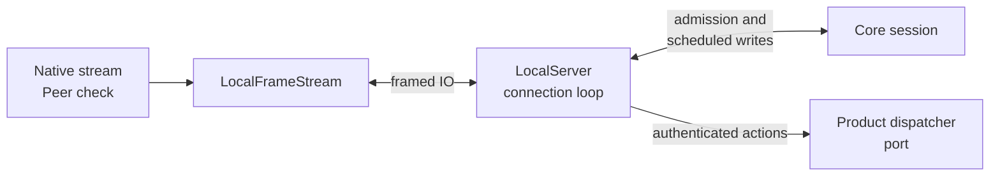

# Locate the public local transport boundary

Use this explanation to decide where a transport change belongs. It describes
the current 0.1.0-beta package on Linux, macOS, and Windows. It assumes familiarity
with Rust and the distinction between a process and a crate.

## Client boundaries

Use the [project architecture](../../../../docs/architecture/README.md#process-boundaries)
for client, bridge, daemon, and host placement. This internal crate owns native
public connection IO and peer verification. Its async APIs do not change the
[public SDK's calling model](../../../../docs/sdk/README.md).

*The adapter owns the connection's IO lifetime; product commits belong to the
dispatcher behind its port.* The [server guide](server.md) owns admission,
reader/writer ordering, deadlines, and teardown. [Endpoint protection](endpoints.md)
owns platform authentication details.

## Code dependencies and ownership

The [workspace dependency map](../../../../docs/architecture/dependencies.md#manifest-map)
owns first-party edges. [Cargo.toml](../../Cargo.toml) selects Tokio/futures IO,
Linux/macOS socket helpers, and Windows primitives by target. No native listener
is selected on other targets. Application, runtime, and storage remain behind
the dispatcher port rather than becoming dependencies of this crate.

- [lib.rs](../../src/lib.rs): OS selection and internal re-exports; begin here when an API is absent on a target.

- [endpoint.rs](../../src/endpoint.rs): Lexical absolute-path validation and redacted endpoint `Debug`; filesystem validation happens later.

- [unix.rs](../../src/unix.rs): Directory traversal, ownership/mode checks, endpoint lock, stale socket quarantine, and kernel peer UID checks.

- [windows.rs](../../src/windows.rs): Pipe stream adaptation, busy-open retry, listener handoff, and successor instance creation; security primitives live in the Windows platform crate.

- [framed.rs](../../src/framed.rs): Full-frame allocation bound, partial I/O state, EOF handling, and the local capacity control.

- [server.rs](../../src/server.rs): Limits, accept/connection workers, authentication context, negotiation, dispatch/write ordering, replay maintenance, diagnostics, and shutdown.

- [error.rs](../../src/error.rs): Redacted category/stage errors with an optional concrete source chain.

## Follow a product operation through the adapter

`serve_connection` in [server.rs](../../src/server.rs) passes a decoded UCMP request
through core admission and `dispatch_authenticated`. Dispatcher admission is
not product completion. Responses return through the scheduled writer, whose
[write-confirmation contract](server.md#write-ordering-and-terminal-output)
does not prove delivery to the caller.

The complete [start walkthrough](../../../../docs/architecture/flows.md#start-a-session)
owns application commits and process effects. The adapter neither rolls those
back after a disconnect nor interprets terminal data. For its part of streaming,
follow [write ordering](server.md#write-ordering-and-terminal-output) and
[connection recovery](../development/troubleshooting.md#reconnection-is-not-mutation-retry).

[Crate entry point](../../README.md) · [Endpoint security](endpoints.md)

[Crate documentation](../README.md)
