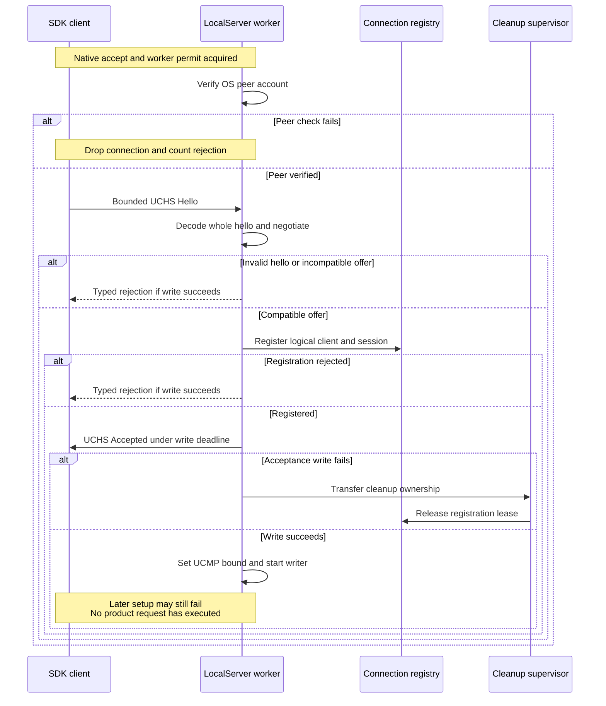
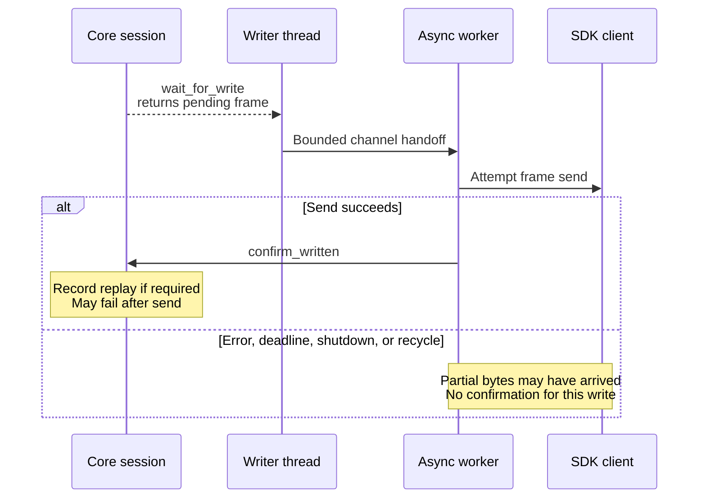
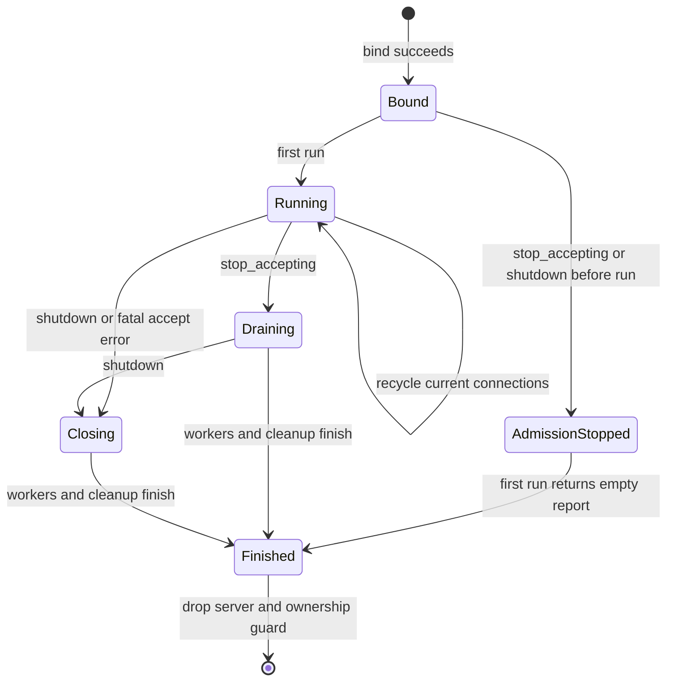
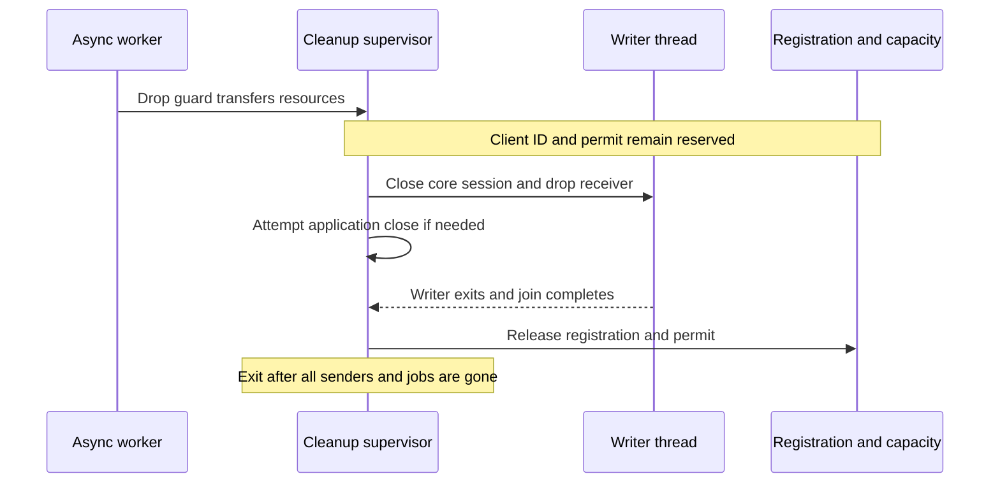

# Trace a local connection from bind to shutdown

Use this explanation to maintain the daemon adapter without changing product
semantics. The owning implementation is [server.rs](../../src/server.rs); it runs
on a caller-provided Tokio runtime with I/O and time enabled. The daemon's
[composition](../../../undercurrent-daemon/src/composition.rs) supplies the endpoint,
server epoch, policy, resource limits, dispatcher, and optional telemetry.
`LocalServer::bind` performs native bind work but starts no runtime or worker.

Follow [setup](#bind-admission-and-negotiation),
[dispatch](#dispatch-and-concurrency), [writes](#write-ordering-and-terminal-output),
or [shutdown](#shutdown-and-resource-release). Exact
[limits](../reference/server-limits.md) and
[error mappings](../reference/diagnostics.md) have separate lookup pages.

## Bind, admission, and negotiation

`bind_with_telemetry` first rejects a policy frame maximum exceeding the
adapter's message maximum, then binds the endpoint, builds a bounded
`ActiveConnectionRegistry`, and creates an in-memory `ReplayJournal` for the
supplied server epoch. Plain `bind` uses `NoopMultiplexTelemetry`.

`run` can be called only once, including after a failed first run. Its atomic
`started` flag is set before taking the listener and registering it with Tokio.
A second call returns `Internal` at `Listener`. `wait_until_running` observes
the running flag with a caller-supplied timeout; it proves only that the
listener entered its run path, not product readiness or successful negotiation.
It can briefly become true even if admission was stopped before `run`.

Before admitting connections, `run` starts one native cleanup supervisor. Its
queue and thread remain independent of the caller's Tokio runtime. Startup
failure returns before any writer exists.

The accept loop uses a semaphore to cap physical workers, including handshakes
and connections still being retired.
Each accepted native stream increments `accepted` and receives a monotonically
allocated ordinal before the semaphore check. If no permit is available, it
increments `rejected` and drops the stream immediately. This early rejection
has no authenticated handshake response. Worker permits and pressure counters
remain owned through writer retirement. Each admitted connection can transfer
one cleanup job while retaining its permit, bounding the cleanup queue by
`maximum_connections`.

This sequence shows setup ordering and where a peer can fail before UCMP is
active. All registration and agreement state shown here is in memory.

*Takeaway: a connected socket, a registered session, and a completed UCHS
exchange are different milestones. None means a product request executed.*

### Authentication and rejection rules

After the kernel check, the server constructs `AuthenticatedRequestContext`
with principal `local-undercurrent-user`, no tenant,
and authority `undercurrent.local`. These are server-supplied values;
the hello's logical client ID is not an authentication credential.

The hello must decode completely. A clean EOF or semantic invalidity attempts
`InvalidHandshake` rejection, while a framer/read failure returns a transport
error. Negotiation maps incompatible versions to `IncompatibleVersion` and
missing required capabilities to `MissingCapability`, both non-retryable here.
The connection ID is `local-<ordinal>` within the supplied server epoch.

Transport core composes a session with the negotiated agreement, scheduler,
shared replay, diagnostics, and telemetry. Registration rejects a concurrent
connection with the same logical client ID or physical connection ID. Registry
overload maps to retryable `CapacityExceeded`, protocol conflict to `Conflict`,
and other registry failures to `Unavailable`. A successful acceptance is
written before reducing the framer maximum to the negotiated UCMP limit and
starting the writer bridge. Failures in these later setup steps can therefore
disconnect a client that already saw `Accepted`.

## Resource limits and deadlines

Use the [server limit reference](../reference/server-limits.md) for constructor
constraints, scheduler budgets, and timer scopes. In particular, the handshake
read and response write have separate deadlines, and draining workers has no
aggregate adapter deadline.

## Dispatch and concurrency

One async worker owns a connection's `LocalFrameStream`, serializing frame
reads and writes. The main `select!` waits for shutdown, recycle, idle timeout,
queued writes, or incoming frames. A selected frame write suspends reads on
that connection until it completes, fails, or is interrupted. Other connection
workers continue independently.

For each incoming frame, the worker requires a complete UCMP decode, calls
`session.accept`, and synchronously passes each returned action to
`dispatch_authenticated` in order. This preserves adapter dispatch order,
not execution completion order across the daemon's product worker pool.
Dispatcher implementations must avoid long blocking work on this I/O path;
the daemon's bounded dispatcher delegates product execution to workers.

If `accept` rejects an overloaded `Request`, `OpenStream`, or `ResumeStream`,
the adapter preserves the request ID and response kind and calls
`reject_authenticated_admission`. `Ok(true)` means the dispatcher handled a
correlated typed rejection, so the connection continues. `Ok(false)` closes
with the original connection error; callback failure becomes `Capacity` at
`Dispatch`. Cancel, close-stream, window-update, ping, and close messages have
no such request-admission response path. Typed product errors remain encoded
payloads from the dispatcher, not `LocalServerError` values.

## Write ordering and terminal output

Transport core's `wait_for_write` is blocking. Each negotiated connection gets
one named OS thread, `undercurrent-local-writer-<ordinal>`, to wait on it and
forward `PendingServerWrite` values into a bounded Tokio channel. The thread
does not touch the socket. The async worker sends the shared bytes and calls
`confirm_written` only after `send` succeeds. This retains payload ownership
without an additional payload copy at the adapter handoff.

This sequence follows a selected replayable frame. The product publisher has
already activated its stream; product source offsets and retention stay with
the [terminal output store](../../../undercurrent-application/src/terminal_output.rs).

*Complete send precedes replay confirmation. Neither milestone acknowledges
client processing or commits product state.*

`PendingServerWrite::confirm_written` in
[transport core](../../../undercurrent-transport-core/src/engine/session.rs)
performs bounded in-memory replay retention, and may itself fail after bytes
were sent. It does not run a database transaction or prove peer receipt.
The adapter records elapsed write-attempt duration through the session's
telemetry after a send result; a shutdown/recycle branch breaking out of the
inner `select!` bypasses that duration recording.

Transport replay uses its own stream sequence/epoch model. A successful UCMP resume cannot recreate
output already lost from the source. See [recovery](../development/troubleshooting.md).

## Shutdown and resource release

This state diagram describes listener control while `run` is being polled.
A fatal accept error closes and drains connections before returning the error.
External task cancellation transfers cleanup ownership as described below.

*Takeaway: stopping admission does not itself terminate existing connections
or release the Unix ownership guard.*

`stop_accepting` clears the accepting flag and signals the admission watch
channel. The loop drops the native listener before awaiting all workers, and
continues replay maintenance while draining. A concurrent in-flight accept
may race the stop signal; this is not a transaction that rolls back accepted
work. `shutdown` also signals the shutdown watch channel.
`recycle_connections` broadcasts closure to current physical workers without
stopping admission or replacing the epoch/journal. It does not cancel managed
processes or guarantee that every stream is resumable.

### Active worker cleanup

A connection's cleanup owner is created before the async worker is spawned.
It takes ownership of registration before the acceptance write and of the
writer handle and channel before entering the active loop. Setup failures
therefore release the resources actually acquired, including a registration
whose acceptance write failed.

An active connection closes in this order:

1. Close the core session and drop the writer receiver. These release the
   writer's core wait and its possible blocked channel send, respectively.
2. Attempt application `CloseConnection` cleanup unless it was already
   dispatched. Mark the attempt before calling it; an error or panic does not
   establish that the callback had no effects.
3. On the normal async path, attempt the final capacity control or sink close
   under the existing write deadline. Interrupted writes are not resumed.
4. Transfer retirement to the native supervisor and await it. The supervisor
   joins the writer, drops its session reference, then releases registration,
   worker accounting and the admission permit.

The explicit path starts close and application cleanup in the async worker;
its fallback owner performs those steps on the supervisor when cancellation
skips them. Both paths use [the same cleanup implementation](../../src/server/cleanup.rs).
Registration remains held through application cleanup because the dispatcher
uses logical client IDs. Releasing it earlier could allow delayed cleanup to
act on a replacement connection with the same ID.

Closing the core session clears connection-local pending/stream/scheduler state
and deactivates eligible replay journals with their retention deadline. It uses
the [synchronized writer wakeup](../../../undercurrent-transport-core/docs/internals/ownership.md#synchronization-and-lifetimes)
before close telemetry callbacks, so a callback panic cannot skip that wake.
The adapter isolates close callback panics and still joins the writer. Returned
application-close errors and final socket-close errors remain best effort;
cleanup panics or writer join failures become internal failures when the normal
worker can report them. The earlier loop error takes precedence.

### Failure and external cancellation

On a fatal accept error, `run` stops admission, signals active workers, drains
its `JoinSet` and the cleanup supervisor, then returns the original listener
error. A worker panic also drops its cleanup guard; joining that async task
alone is insufficient, so normal `run` completion also waits for the supervisor.

Aborting or dropping `run`, including destruction of its Tokio runtime, cannot
await that drain. Each dropped connection guard transfers its resources to the
already-running native supervisor. Its destructor invokes no application
callbacks and creates or joins no threads. The supervisor drains queued jobs
and exits after the last sender disappears. Cancellation therefore initiates
cleanup; completion of the aborted task does not mean retirement has finished.
Use `shutdown` and await `run` when the caller needs a completed drain.

This sequence shows how an aborted worker retains cleanup ownership until
its writer and application cleanup are finished.

*Cancellation transfers responsibility; resources remain accounted for until
application cleanup and writer retirement finish.*

The supervisor serializes retirement jobs. Dispatcher and telemetry callbacks
must return promptly and follow the core's non-reentrancy contract; panic
isolation does not make a permanently blocked callback safe. No aggregate drain
deadline is introduced. The [daemon supervisor](../../../undercurrent-daemon/src/composition/lifecycle.rs)
continues to own its product shutdown deadline and physical shutdown requests.

The [cleanup regressions](../../src/server/cleanup_tests.rs) cover abort,
runtime destruction, accept failure, a full writer channel, cancellation during
retirement, callback panics, and client-ID reservation/reuse. The
[SDK boundary tests](../../../undercurrent-sdk/tests/local_boundary.rs) check
session release after abort and cooperative recycle over real local sockets.

### Replay expiry during normal operation

`ReplayMaintenance` sweeps every five seconds, starting after the first interval,
with missed ticks skipped. It calls `expire_before(Instant::now())` even with
no traffic and during graceful drain. It stops when `run` ends. This timer is
not durable storage and is separate from negotiated retention duration.

## Cancellation boundaries

| Action | Meaning |
| --- | --- |
| Cancel a framer polling future | Preserve partial I/O in the same framer; no product cancellation. |
| UCMP `CancelRequest` | Transport core/dispatcher act on one pending request; operation code determines whether effects already happened. |
| UCMP `CloseStream` | Release a subscription, not its underlying managed session or process. |
| `CloseConnection`, EOF, shutdown, or recycle | Release connection resources; daemon dispatcher closes client work and subscriptions. Does not roll back durable effects. |
| Runtime-attempt cancellation | A distinct product operation, with its own authorization and effect rules. |

For language-specific behavior, use the shared
[SDK cancellation comparison](../../../../docs/sdk/recovery.md#distinguish-cancellation-and-deadlines).
It covers Rust request cancellation and Python pending-future removal and
subscription cleanup.

Continue to [diagnostics and recovery](../development/troubleshooting.md), or
[verification and extension guidance](../development/contributing.md).

[Crate entry point](../../README.md)

[Crate documentation](../README.md)
