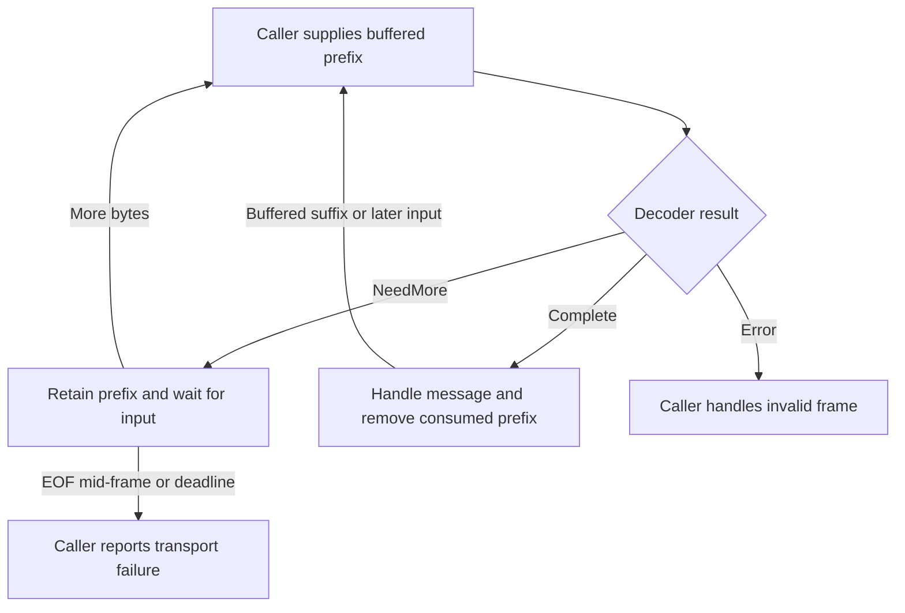

# Follow decoding and handoff to callers

Use this explanation to decide what a decoded frame proves and what its caller
must still do. Wire APIs are synchronous in-memory transformations. The
[supported SDK guides](../../../../docs/sdk/README.md) own the Rust blocking and
Python asynchronous client interfaces.

## Decode one frame from a caller buffer

Both codecs keep no partial state. A caller passes its buffered prefix to a
direction-specific decoder and acts on one of three results. This diagram shows
who advances the buffer; the exact validation stages are in the
[incremental decoding reference](../reference/wire-format.md#incremental-decoding).

*The codec consumes one frame at a time; the caller owns waiting and buffer
progress.* `minimum_total` is the required total length, not the number of bytes
to append. The codecs have no EOF or deadline signal. The transport distinguishes clean
EOF between frames from truncation inside a frame. If a complete declared body
lacks a required field, decoding fails instead of asking for another read.
An invalid frame has no byte-skipping or resynchronization contract.

The maintained [example](../../examples/inspect_frames.rs), run via the
[maintainer guide](../development/contributing.md#run-the-example), makes the
buffer rule concrete:

1. Seven request bytes produce `NeedMore { minimum_total: 12 }`.
2. Appending the rest of that request and a complete ping lets the next decode
   return the request alone. Its `consumed` value ends at the request boundary.
3. Decoding the suffix returns the ping. Together the consumed lengths equal
   the buffer length.

Decoded UCMP payloads are owned copies, so releasing or advancing the input
buffer does not invalidate a message. The actual local adapters already receive
one complete semantic frame per `LocalFrameStream` result and require `consumed`
to equal that frame's length. Their [framing mechanism](../../../undercurrent-transport-local/docs/reference/framing.md)
owns fragmented reads, EOF, and cancellation-safe I/O; the generic codec interface
also supports the coalesced buffer shown here.

## A finite request and session creation

For `StartSession`, the SDK's [product client](../../../undercurrent-sdk/src/product.rs)
encodes a product request, and its [connection client](../../../undercurrent-sdk/src/client.rs)
registers a request ID and queues `ClientMessage::Request` with trace context.
The local adapter encodes UCMP; decoding on the server recovers that identity,
context, and opaque payload. It neither parses the product operation nor executes it.

| Boundary to inspect next | What happens there |
| --- | --- |
| [Request admission and correlation](../../../undercurrent-transport-core/docs/internals/request-lifecycle.md) | Core reserves correlation before returning `ServerAction::Request`. Completion can be out of order because responses correlate by ID. |
| [Session creation walkthrough](../../../../docs/architecture/flows.md#start-a-session) | Daemon validation and application activation cross separate durable commits and runtime effects before response delivery. Post-spawn failures need compensation/reconciliation. |
| [Request cache and operation evidence](../../../undercurrent-transport-core/docs/internals/idempotency.md) | Deduplication and retained results have operation-specific scope. Constructing a wire ID does not provide this protection. |

A wire `Response` can contain empty bytes. The product codec must still decode
success, typed rejection, result shape, and effect certainty. Queueing or encoding
that response proves no delivery; losing it does not undo an earlier effect.
A successful start response also does not establish completion of a user task
inside the process. Follow the shared walkthrough's commit and response-loss
diagram when investigating these outcomes.

## Terminal output, credit, and replay

The [daemon publisher](../../../undercurrent-daemon/src/stream.rs) uses
`TerminalOutputCodec` for terminal chunks, assigns stream sequences, and publishes
through core. UCMP wraps those bytes in a stream ID and sequence without JSON
or base64 conversion. Terminal offsets, screen snapshots, and text encoding
remain product concerns.

For a received data item, wire recomputes credit from the complete encoded frame;
for a gap, the charge is zero. Use the [message accounting reference](../reference/wire-format.md#ucmp-messages)
for the exact encode/decode rules. `WindowUpdate` can represent any `u64`,
including zero; [scheduler credit validation](../../../undercurrent-multiplex/docs/internals/scheduling.md#credit-and-resource-release)
provides the stateful checks and queue policy.

The [physical-write sequence](../../../undercurrent-transport-core/docs/internals/streams-and-recovery.md#terminal-output-and-the-physical-write-boundary)
shows when a frame becomes replayable: eligible writes enter the in-memory
journal only after `confirm_written`. An unconfirmed write can have reached the
peer, and a successful local send does not acknowledge client consumption.
Client credit return and server write confirmation proceed independently.
Activation reply ordering, control priority, and queue behavior are owned by
that guide and the [scheduler explanation](../../../undercurrent-multiplex/docs/internals/scheduling.md).

For evidence, see `successful_physical_write_is_the_replay_commit_boundary` and
`dropping_unconfirmed_pending_write_does_not_commit_replay` in
[connection_contract.rs](../../../undercurrent-transport-core/tests/connection_contract.rs).
For the complete source-to-client path, follow the shared
[terminal output walkthrough](../../../../docs/architecture/flows.md#consume-terminal-bytes).

Wire decoding charges every gap zero. Server write confirmation preserves frame
kind, and [retained-gap replay](../../../undercurrent-transport-core/docs/internals/streams-and-recovery.md#replayed-gaps-and-credit)
also leaves both data-credit windows unchanged while keeping retained frame order.

## Recover after disconnection or a gap

First identify which evidence is missing. Use the
[recovery decision tree](../../../undercurrent-transport-core/docs/internals/streams-and-recovery.md#diagnose-loss-before-retrying)
and the [SDK recovery guide](../../../../docs/sdk/recovery.md) for the next action.

| Observation at the wire boundary | Where to continue |
| --- | --- |
| Finite mutation response is missing | [Reconcile the mutation](../../../../docs/sdk/recovery.md#reconcile-the-mutation). Keep its operation identity and effect evidence; reconnecting or receiving a pong does not authorize resubmission. Wire stores no request results. |
| A stream disconnected | [Reconnect and resume](../../../undercurrent-transport-core/docs/internals/streams-and-recovery.md#reconnect-and-resume). Resume requests items after the last consumed stream sequence using a new request ID, persistent stream ID, prior epoch, trace context, and product specification. |
| Resume returns a gap or fails | [Replay decision reference](../../../undercurrent-multiplex/docs/internals/replay.md#resume-decision-reference). Logical client/stream scope, epoch, expiration, eviction, and future-sequence checks determine the result; an up-to-date consumer may receive no items. |
| A live or resumed stream contains a gap | Read its [encoded reason and recovery action](../reference/wire-format.md#gap-codes), then [restore a product baseline](../../../../docs/sdk/recovery.md#restore-a-stream-baseline). Reconnect cannot recover evicted source data. Without a wire gap, use the product stream's recovery contract. |

Stream sequences and terminal byte offsets are different coordinates. A gap's
sequence range cannot provide `available_from`; obtain product output metadata
or a screen snapshot as appropriate. Missing transcript bytes remain missing.
Query recovery requires a new authoritative snapshot/revision when instructed
to restart. The SDK's [persistent subscription owner](../../../undercurrent-sdk/src/resilient.rs)
coordinates observation recovery separately from finite requests.

## Cancellation, shutdown, and observability

| Signal or value | Boundary meaning |
| --- | --- |
| `CancelRequest` | Best-effort cancellation by correlation ID; it cannot establish rollback, absence of effects, or process termination. |
| `CloseStream` | Independent subscription close. Core removes opening/active state and returns cleanup actions; the observed session and other streams continue independently. |
| Client/server `Close` | Terminal connection control; it does not prove task completion or that every queued response drained. |
| `Ping` / `Pong` | Heartbeat traffic handled outside the codec; it gives no result evidence for another request. |
| Trace context | Request/activation correlation labels. Authentication, telemetry export, and result evidence need their own owners. |

The [request lifecycle](../../../undercurrent-transport-core/docs/internals/request-lifecycle.md)
explains cancellation of known pending work and no-op cancellation of unknown
IDs. The SDK can enqueue cancellation after a finite response timeout; daemon
worker cancellation can race with execution. Runtime-attempt cancellation is a
separate product operation. See [SDK cancellation and deadlines](../../../../docs/sdk/recovery.md#distinguish-cancellation-and-deadlines)
for caller behavior.

Codec/value lifetimes are described under [resource ownership](ownership.md#lifetimes-concurrency-and-resource-limits).
For logs, use [safe codec diagnostics](../reference/wire-format.md#error-reference-and-safe-diagnostics);
message `Debug` output can expose request or terminal payloads.

[Crate documentation](../README.md) · [Maintainer tasks and checks](../development/contributing.md)
