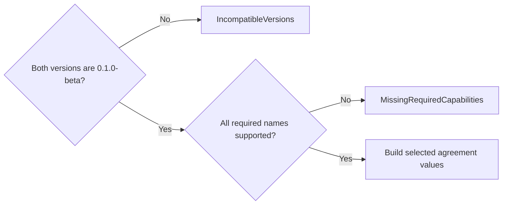

# Understand connection negotiation

Use this explanation to maintain the transition from a local connection to
UCMP traffic. It describes the current Rust implementation in
[connection.rs](../../src/connection.rs) and [handshake.rs](../../src/handshake.rs).
The [wire reference](../reference/wire-format.md) owns byte layouts; this page owns the
description of negotiation values and selection rules.

## Agreement selection and admission

`negotiate_connection` computes values without I/O or runtime-resource
registration. It may allocate capability sets and an error's missing-name
list. The transport supplies `ConnectionId` and `ServerEpoch`; this function
does not generate or authenticate them.

The selection function has two rejection gates. This view ends when it returns
an agreement; connection admission happens afterward.

*Selection produces connection terms without reserving runtime resources.* Equal
future versions still fail the first gate. Missing required names are returned
in deterministic sorted order. After both gates pass, the fields are selected as follows:

| Agreement field | Selection rule |
| --- | --- |
| `capabilities` | Server capabilities intersected with the union of required and optional client names. Unrequested server names and unsupported optional names are omitted. |
| `limits` | Component-wise minimum of client and server offers. |
| `heartbeat` | Server policy, unchanged. |
| `resume_retention_millis` | Server window only when `undercurrent.connection.stream_resume` is selected; otherwise absent. This describes in-memory replay, not durable recovery. |

For example, the [selection test](../../src/connection.rs) offers frame maxima
of 1,000,000 and 256,000 bytes and stream maxima of 500 and 300. The agreement
selects 256,000 bytes and 300 streams.

The [local setup sequence](../../../undercurrent-transport-local/docs/internals/server.md#bind-admission-and-negotiation)
owns peer verification, decoding, session composition, registration, writing
acceptance, and switching to UCMP. An agreement can still fail admission; a
registered connection can lose its acceptance response. No product commit
occurs in this exchange. Setup deadlines, shutdown, capacity/identity conflicts,
and registration cleanup belong to the adapter and transport-core. Wire cannot
tell a lost response from a hello that never reached the peer.

## Negotiation values

Fields below use the same names in Serde JSON. Constructors and `try_from`
deserialization reapply invariants for nested limits, heartbeat, hello, policy,
and agreement. `ProtocolVersion` itself can hold any pair of `u16` values;
only negotiation and `can_read` impose exact-current compatibility.

| Value | Fields and meaning |
| --- | --- |
| `ConnectionHello` | `client_id`: logical client identity; `protocol_version`: exact offer; `required_capabilities`, `optional_capabilities`: sorted sets of names; `limits`: client maxima. |
| `ConnectionPolicy` | `protocol_version`, `capabilities`, `limits`: server terms; `heartbeat`; `resume_retention_millis`: optional positive window. This is server configuration, not a fourth handshake message. |
| `ConnectionAgreement` | `connection_id`: physical connection identity; `server_epoch`: replay epoch; selected `protocol_version`, `capabilities`, `limits`, `heartbeat`, `resume_retention_millis`. |
| `HeartbeatPolicy` | `interval_millis` is positive and `timeout_millis` is strictly greater. It describes policy but sends no pings and runs no timer. |

The hello removes names from its optional set if they are already required.
The combined distinct count must be at most `MAX_CONNECTION_CAPABILITIES`
(128). Policy and agreement capability sets have the same bound. Names need
only satisfy [name syntax](../reference/scalars.md#names); construction does not require them
to be in the connection registry. This allows product capabilities without a
wire dependency on the product crate.

For policy and agreement, presence of `stream_resume` must exactly match
presence of a positive `resume_retention_millis`. `Some(0)` is always invalid.
Retention does not guarantee that every sequence remains available: bounded
replay and source retention can still produce [gaps](flows.md#recover-after-disconnection-or-a-gap).

### What an accepted response validates

Deserializing an agreement checks its internal invariants; it does **not**
compare it with an earlier hello, rerun negotiation, prove that limits were
minimized, or enforce exact-current protocol compatibility. A successful
`decode_response` therefore is not a general peer-policy verification routine.
Keep offer-relative checks in the owning client boundary. The local SDK path
also constructs `WireCodec` and checks its adapter message maximum; do not
attribute those checks to the handshake decoder.

The [SDK-owned agreement wrapper](../../../undercurrent-sdk/src/boundary.rs)
separately checks exact-current version in `try_from_raw`/`decode_accepted`.
That check is distinct from comparing a response with the original offer.

### Limits and their rationale

All six limits must be positive.

| Field | Type and constraint |
| --- | --- |
| `max_frame_bytes` | `u32`: full encoded frame bound; a codec also requires at least 12. |
| `max_logical_streams` | `u32`: active-stream admission maximum. |
| `max_pending_requests` | `u32`: pending-request admission maximum. |
| `connection_queue_bytes` | `u64`: total outbound queue budget. |
| `stream_queue_bytes` | `u64`: no greater than the connection queue. |
| `initial_stream_window_bytes` | `u64`: no greater than the stream queue. |

The nested inequalities prevent a child budget from promising more capacity
than its container. Component-wise minima preserve those inequalities, so
`minimum()` can return valid limits directly. There is no constructor rule that
a frame must fit a queue or initial window, and no built-in default maximum.
Callers must choose workable limits and account for
[envelope overhead](../reference/wire-format.md#envelope-reservation). The setup codec has a
separate bound because the peer agreement is not known yet.

### Undercurrent connection capabilities

The authoritative registry is `connection_capabilities` in
[connection.rs](../../src/connection.rs). Every string below has the prefix
`undercurrent.connection.`.

| Suffix | Advertised mechanism |
| --- | --- |
| `multiplex` | Share a connection among finite requests and logical streams. |
| `flow_control` | Support connection and per-stream byte credit. |
| `stream_resume` | Request replay of a logical stream after reconnect. |
| `binary_payloads` | Carry compact binary payloads. |
| `trace_context` | Carry distributed trace context on requests and stream activation. |

Negotiation intersects names; it does not enable an implementation by itself.
`WireCodec` receives only a frame maximum and enforces none of these capability
permissions. For example, transport-core checks the resume capability before
accepting a resume action.

## Rejections and invalid configuration

`ConnectionContractError` covers `ZeroLimit`, `InvalidLimitRelationship`,
`TooManyCapabilities`, `InvalidHeartbeat`, `ZeroResumeRetention`, and
`InconsistentResumeCapability`. These indicate invalid value construction or
deserialization. `ConnectionNegotiationError` has just `IncompatibleVersions`
and `MissingRequiredCapabilities`; it is not itself the rejection frame.

The adapter chooses a `HandshakeRejection` with only a category and boolean
`retryable`. The constructor accepts any combination; the codec does not infer
the flag from the category.

| Serialized category | Meaning |
| --- | --- |
| `invalid_handshake` | Frame or hello payload is invalid. |
| `incompatible_version` | Exact-current version rule failed. |
| `missing_capability` | Server lacks a required capability. |
| `capacity_exceeded` | Server cannot admit another connection. |
| `conflict` | Client or connection identity conflicts. |
| `unavailable` | Setup failed without a more specific client-actionable category. |

In the current local server, negotiation failures are nonretryable; admission
overload can be retryable. The flag guides **connection setup** policy, not
automatic replay of an earlier product mutation. Some failures return an I/O
error without a readable rejection frame. See [failure diagnosis](../development/contributing.md#diagnose-a-frame-or-negotiation-failure).

[Back to crate](../../README.md) · [Next: request and stream flows](flows.md)

[Crate documentation](../README.md)
