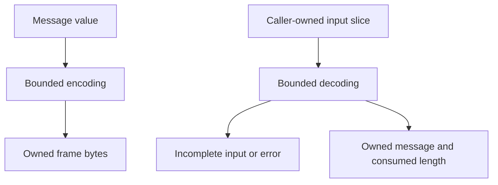

# Locate the wire boundary and its owners

Read this explanation before changing how frames are represented or transported.
It covers the current internal Rust crate, not a third-party transport API.
For field-level contracts use the [frame reference](../reference/wire-format.md); for a
complete local exercise use the [maintainer guide](../development/contributing.md).

## Runtime ownership

Wire is an in-process codec library. The
[project architecture](../../../../docs/architecture/README.md#process-boundaries)
locates its callers; this view explains the memory boundary it owns.

*The caller owns buffering and IO; the codec owns validation and representation.*
[LocalFrameStream](../../../undercurrent-transport-local/src/framed.rs) is one such
caller. Peer verification, queueing, and durable product state belong to other
owners. The [frame reference](../reference/wire-format.md) defines the exact byte layouts.

The name **UCHS** needs its boundary attached. This crate's
[HandshakeCodec](../../src/handshake.rs) uses a 22-byte header for client/daemon
negotiation. The runtime's
[private session-host protocol](../../../undercurrent-runtime/src/process_host_protocol.rs)
also starts with `UCHS` and the same release marker, but has a **20-byte header** and a
different message registry. They are not interchangeable. Neither that private
host channel nor the Python bridge's JSON channel is this crate's client
handshake. Do not identify a protocol by its four magic bytes alone.

## Compile-time dependencies

Wire has no first-party production dependency. The [workspace dependency map](../../../../docs/architecture/dependencies.md#manifest-map)
owns the caller graph, and [Cargo.toml](../../Cargo.toml) declares `serde` and
`serde_json` for production plus the operation registry for conformance tests.
Product DTOs and semantics belong to [protocol](../../../undercurrent-protocol/README.md).
For the supported external library boundary, use [SDK choices](../../../../docs/sdk/README.md).

## Code map

| Owning source | Responsibility and investigation path |
| --- | --- |
| [lib.rs](../../src/lib.rs) | Root exports plus `core`, `negotiation`, and `observability` convenience namespaces; these do not define new types or protocol layers. |
| [codec.rs](../../src/codec.rs) | UCMP header validation, per-kind bodies, bounded encoding, incremental decoding, gap codes, and envelope reservation. See [frame reference](../reference/wire-format.md). |
| [handshake.rs](../../src/handshake.rs) | UCHS framing of JSON hello/agreement/rejection values; bounded JSON writer and redacted parser failures. |
| [connection.rs](../../src/connection.rs) | Validated limits, capabilities, heartbeat and replay-retention terms, and pure agreement selection. See [negotiation](negotiation.md). |
| [message.rs](../../src/message.rs) | Semantic request/control/response/stream values; gaps and credit accounting. See [flows](flows.md). |
| [registry.rs](../../src/registry.rs) | Stable UCMP kind codes, diagnostic names, and direction filtering. |
| [error.rs](../../src/error.rs) | UCMP failures and category mapping; contains no I/O error or product-error model. |
| [identifiers.rs](../../src/identifiers.rs) | Distinct string ID types and shared constructor/Serde validation. |
| [name.rs](../../src/name.rs) | Validated names used for capabilities and other protocol concepts. |
| [ordering.rs](../../src/ordering.rs) | Nonwrapping counters, bounded page sizes and opaque cursors; no stream scheduler. |
| [trace.rs](../../src/trace.rs) | Trace/span/parent/correlation transport value; no tracer or exporter. |
| [version.rs](../../src/version.rs) | Exact-current protocol compatibility. See [scalar reference](../reference/scalars.md). |

## Why the codecs use these representations

The separation has practical tradeoffs. A JSON handshake keeps negotiation
values aligned with constructor/Serde validation, while binary UCMP avoids
base64 overhead for terminal bytes. Stateless codecs make fragmented reads
testable without threads or an I/O runtime, but require callers to own buffering,
timeouts, and delivery state. Independent product payload encoding lets product
contracts evolve without treating every schema change as a frame-version change.
These are explanations of the implemented structure, not new compatibility
promises or a substitute for a design decision when changing that structure.

## Lifetimes, concurrency, and resource limits

Both codecs are copyable values containing one `u32` maximum. Calls take
`&self`, keep no accumulated input, and create no locks, sockets, clocks, tasks,
or mutable sequence state. Separate callers can use the same codec with their
own buffers; the transport must serialize writes and preserve read order.
The [decoding walkthrough](flows.md#decode-one-frame-from-a-caller-buffer) shows
how to retain and advance input. Decoded payloads are owned `Arc<[u8]>` copies,
so they outlive the input buffer and can be shared without copying on each clone.

Encoding checks prospective **logical body length** before appending bytes.
Decoding checks declared full-frame size before parsing fields or copying a
payload. These checks bound accepted frame sizes; they do not establish an
exact allocator or process-memory ceiling. `Vec` may reserve extra capacity,
the encoder holds a body and final frame simultaneously, and JSON decoding has
semantic allocation overhead. The caller must also bound input buffers and
queues. A direct identifier constructor receives an already allocated `String`;
its validation cannot bound that caller allocation.

Dropping a codec releases only its numeric bound. Dropping decoded values
releases their owned references; payload storage remains while clones exist.

No deadline, retry, cancellation, shutdown, storage transaction, or durable
commit runs here. The values describe actions and policies for other owners to
enforce. A `Close` value is not a drained connection, a `CancelRequest` is not
rollback, and `StreamSequence::next()` is not a durable commit. See the
[ordered flow walkthroughs](flows.md) for their concrete boundaries.

[Back to crate](../../README.md) · [Next: negotiation](negotiation.md)

[Crate documentation](../README.md)
