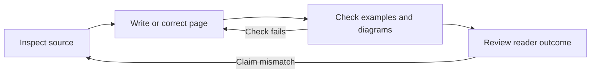

# Explain relationships with diagrams

A diagram should answer one clear question at one abstraction level. Introduce
its scope in a sentence. Keep the labels readable in the page's actual renderer.

## Choose the representation

| Question | Representation |
| --- | --- |
| What communicates with what? | Flowchart with process or service boundaries |
| What happens in order? | Sequence diagram |
| Which transitions are valid? | State diagram |
| How are records related? | Entity relationship diagram |
| What are the exact fields or differences? | Table |
| What does the reader execute? | Numbered steps and code |

Mermaid is the default for code-maintained technical diagrams. Use screenshots
or recordings for interactions where the interface itself matters. Keep their
source, reproduction steps, and accessible alternatives when practical.

## Draw clear boundaries

Name the owners of state, side effects, and messages. Label meaningful arrows.
Keep runtime communication separate from package-dependency views. Include
failure or recovery paths when they affect the claim. Identify simplified views
and link to the complete contract when needed.

Split a diagram when readers must zoom to read it. Avoid decorative icons,
color-only meaning, unexplained acronyms, and a single graph of the whole codebase.
Use syntax supported by the destination renderer; local CLI success does not
establish that a hosting platform supports the same Mermaid version.

## Add only useful prose

Explain constraints, guarantees, exceptions, and rationale that the diagram does
not express well. Do not describe each arrow again. Use `accTitle` and `accDescr`
for an accessible title and the essential relationships. Provide an additional
text alternative when the renderer does not expose those descriptions.

This example describes the documentation review process:

## Validate a diagram

1. Extract or locate the changed Mermaid source.
2. Render it with the locked tools, using the supported light and dark themes.
3. Inspect labels, arrow direction, clipping, contrast, and readable scale.
4. Preview it in the actual publishing renderer before publication.

Use the adopting project's validation guide for its renderer commands. In a
shared template checkout, start with the template README and checks guide. Keep
project-specific commands outside this copied standard.

Parsing and accessibility-keyword checks alone are incomplete. Record the
renderer version, inspected themes, and any unverified destination renderer.

[Style guide](style-guide.md) · [Required standard](standard.md)
