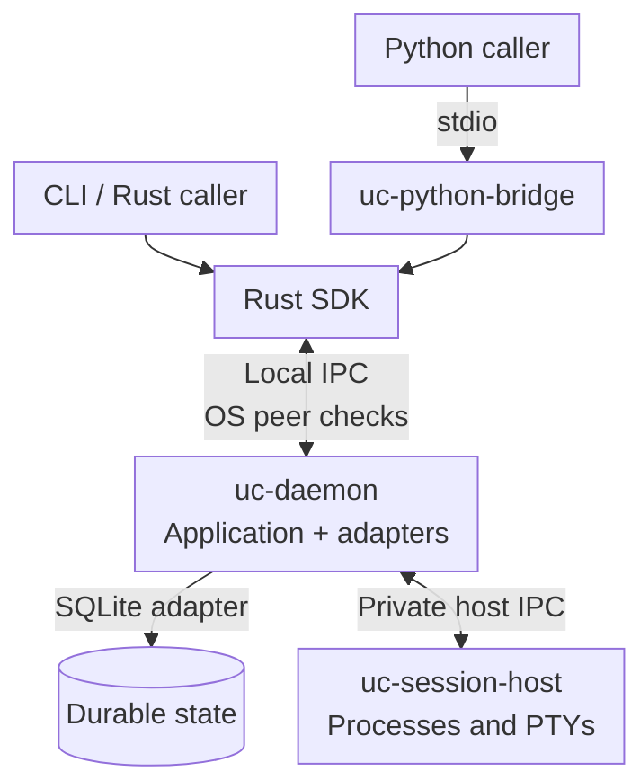
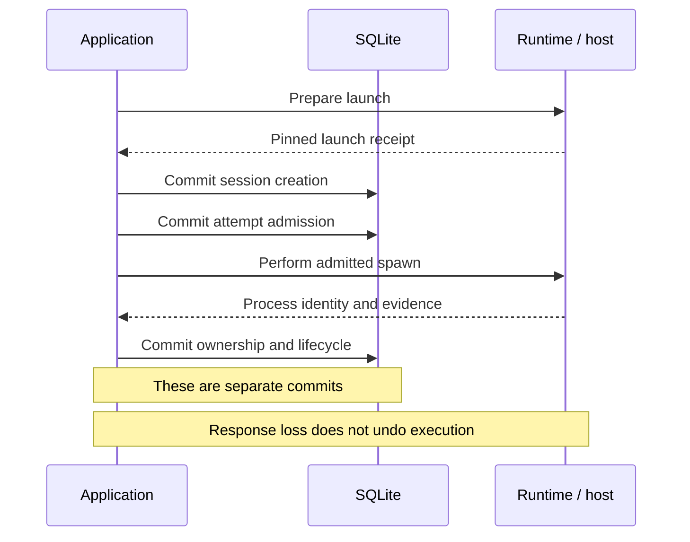

# Undercurrent architecture

Undercurrent supervises processes and terminal sessions through an external
daemon. This guide maps component ownership and the boundaries maintainers
must preserve. The **19-crate** [code map](dependencies.md) lists package roles;
the [architecture policy](../../tests/architecture/allowed-graph.json) enforces
allowed dependencies.

## Process boundaries

How clients reach execution and durable state:



*SQLite, daemon memory, and the private host are separate owners. A commit or
successful socket write cannot prove that another owner completed its work.*

The SDK owns its connector; `transport-local` supplies native client/server I/O
and peer checks. Implemented public adapters:

| Platform | Local transport | Peer identity |
| --- | --- | --- |
| Linux and macOS | Unix socket | Kernel-reported user ID |
| Windows | Named pipe | Kernel-reported process token |

Same-user processes are trusted. Private host IPC is not a public client API;
there is no public TCP/WebSocket listener or embedded runtime.
See [endpoint protection](../../crates/undercurrent-transport-local/docs/internals/endpoints.md)
and [native platform verification](../reference/platforms.md).

## Rules to preserve

| Boundary | Rule |
| --- | --- |
| Domain | Keep decisions free of I/O. Supply time, identities, and observations as values. |
| Application | Own required ports. Import domain, never concrete adapters or transport DTOs. |
| Adapters | Runtime and SQLite depend inward on application; neither depends on the other. Compose them in daemon. |
| Public requests | Daemon adapters validate, authorize, translate, and invoke application services. Rust consumers use only SDK/protocol. |
| Capacity | Bound queues, storage work, output, and replay. Surface rejection, retention gaps, and uncertain effects. |
| Authority | Transport identity alone cannot authorize exact runtime cancellation. Standalone secret resolution and semantic cancellation fail closed. |
| Workflow | External systems own plans and workflow retries. Process exit, observations, and opaque agent frames do not establish workflow success. |

Keep secret values ephemeral at launch; persist only opaque references.
See [credential resolution](credentials.md) and
[runtime cancellation authority](runtime-dispatch.md).

**Lifecycle ownership:** SDKs never launch the daemon. Selected CLI commands
start an absent daemon through the lifecycle adapter, as declared by package
metadata `implicit_daemon_launch: true`.
[CLI lifecycle](../guides/daemon/cli-lifecycle.md) documents that behavior.
The CLI's private reset probe checks host inactivity without sending host commands.

## State survives different failures

| State | Owner and persistence | Consequence |
| --- | --- | --- |
| Session, revision, process identity, restart intent | SQLite aggregate plus atomic outbox transaction | Survives daemon replacement, but must be reconciled with process truth |
| Operation attempts, fences, cancellation and agent evidence | Separate SQLite transactions | Admission, effects, settlement, and receipt acknowledgement have distinct failure windows |
| Live process binding and projections | Daemon memory | Rebuilt from durable sessions and exact runtime identity |
| Restart and observation queues | Daemon memory | Durable session intent and current revisions drive reconstruction |
| Semantic input delivery reservations/results | SQLite, with bounded record count | Survives daemon replacement until session deletion; unresolved writes remain indeterminate |
| Agent events and replies | SQLite canonical records | Payload-free wakes prompt reads; agent payloads remain opaque. [Agent channel](../../crates/undercurrent-application/docs/internals/execution/agent-channel.md). |
| Published session-event journal | Bounded daemon memory fed by durable outbox | Publication can lag commits and history can disappear on restart |
| Terminal bytes, screen projection, host receipts | Runtime/host and bounded stores/files | Each has its own retention and recovery rules, not one database transaction |
| Request cache, logical stream replay, diagnostic cursors | Transport/daemon memory with identity and capacity limits | Reconnect does not provide universal durable mutation replay |

The detailed owners are [application architecture](../../crates/undercurrent-application/docs/internals/ownership.md),
[SQLite lifetime](../../crates/undercurrent-store-sqlite/docs/internals/ownership.md),
[runtime host](../../crates/undercurrent-runtime/docs/internals/host/session-host.md), and
[output concepts](observations-and-output.md).

## Ordering and lifetime

For a new start, durable acceptance precedes the process effect:



*SQLite and process I/O cannot share a transaction. Preserve unknown outcomes;
reconcile evidence before deciding whether another effect is safe.* This sketch
groups activation commits; the [start walkthrough](flows.md#start-a-session)
shows binding, compensation, and dispatched settlement.

| Boundary to investigate | Authoritative local explanation |
| --- | --- |
| Shared adapter instances, strong/weak owners, instance-lock lifetime | [Daemon composition](../../crates/undercurrent-daemon/docs/internals/composition.md#composition-entry-points-and-lifetime) |
| Admission to the connection-owning SQLite worker, dropped callers, concurrent handles | [Repository lifetime](../../crates/undercurrent-store-sqlite/docs/internals/ownership.md#open-share-and-close-a-repository) |
| Session mutation leases, revisions, activation and compensation | [Application lifecycle](../../crates/undercurrent-application/docs/internals/sessions/lifecycle.md) |
| Outbox publication, restart and observation scheduling, worker supervision | [Background workers](../../crates/undercurrent-daemon/docs/internals/lifecycle/background-work.md) |
| Private host request bounds, receipts and response loss | [Host protocol](../../crates/undercurrent-runtime/docs/reference/host-protocol.md), [host recovery](../../crates/undercurrent-runtime/docs/internals/host/recovery.md) |
| Startup reconciliation precedes public IPC; unresolved attempts separately gate mutations; a new daemon epoch changes replay identity | [Startup and readiness](../../crates/undercurrent-daemon/docs/internals/lifecycle/startup-and-shutdown.md) |
| Shutdown closes admission, coordinates draining and teardown, then releases instance ownership | [Daemon lifecycle](../../crates/undercurrent-daemon/docs/internals/lifecycle/startup-and-shutdown.md) |

## Diagnose by boundary

Keep payloads out of logs: command arguments, environment, terminal bytes, and
raw error strings can contain private data. Use stage, operation, exact session
or attempt identity, bounded counters, and typed failure category. Foundation's
[privacy detector](../../crates/undercurrent-foundation/docs/internals/privacy.md) is not
an automatic redactor. Daemon diagnostics are sampled views, not an atomic
snapshot across all subsystems.

## Explore the system model

| Question | Explanation |
| --- | --- |
| Which package owns a component? | [Dependencies and code map](dependencies.md) |
| How do session and attempt identities change? | [Lifecycle](lifecycle.md) |
| How do terminal output and observations differ? | [Output and observations](observations-and-output.md) |
| Where do commits, side effects, and recovery meet? | [Cross-boundary flows](flows.md) |
| How do clients reach the daemon? | [Local IPC](local-ipc.md) |
| Who resolves credentials and selects dispatch behavior? | [Credentials](credentials.md), [runtime dispatch](runtime-dispatch.md) |
| Why were these boundaries chosen? | [Design decisions](decisions/README.md) |

## Verify a change

From the repository root:

```sh
./scripts/check-architecture.py --positive
# For dependency or public-boundary changes:
./scripts/check-architecture.py --all
```

Update policy, the code map, and architecture fixtures together when changing a
boundary. Run relevant behavioral tests; the graph gate does not prove runtime
correctness. Product, wire, storage, and SDK versions have
[compatibility rules](../reference/compatibility.md#development-version).

[Extension guide](../development/extending.md) ·
[Architecture gate](../../tests/architecture/README.md)

[Documentation index](../README.md)
