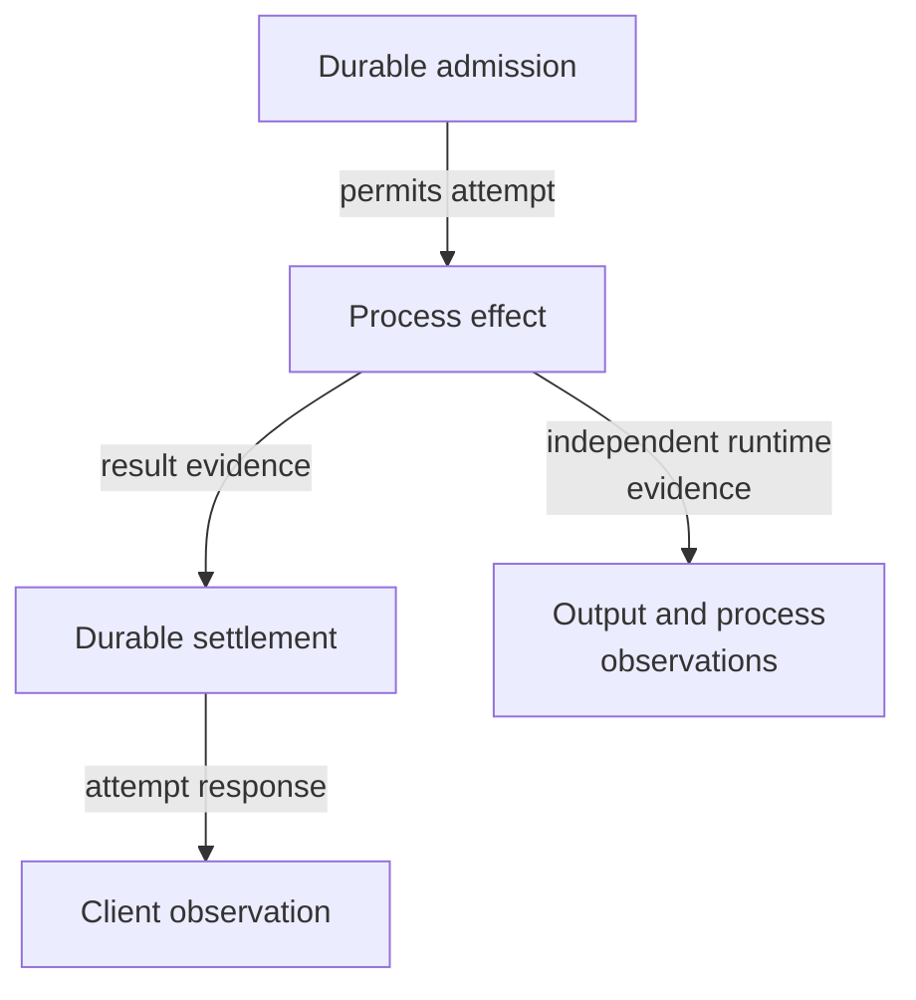

# Keep process effects outside the aggregate transaction

Status: **Implemented**, retrospectively documented from current source on
2026-10-01. This record explains the boundary; it does not establish new guarantees.

## Context and decision

SQLite can atomically commit a session revision and its outbox events. It cannot
atomically spawn or terminate an OS process and deliver a client response in
that transaction. Daemon replacement and response loss can happen between those
steps. Treating every error as absence would risk duplicate effects or destroying
a replacement process.

The implementation uses application ports, session-local mutation leases,
expected revisions, exact process identities, durable operation evidence and
separate host receipts. It records intent and ownership around process effects,
then reconciles uncertainty. Output and foreground/health observations are
separate evidence, not substitutes for an application-level result.

*Takeaway: losing the last arrow does not undo the earlier effect. Recovery needs
the original identity and evidence, not a new unqualified retry.* The focused
[flow diagrams](../flows.md) show the concrete commit points.

## Consequences and limits

Controlled ports make failure-window tests possible without an OS process, but
native adapters still need target-specific verification. More explicit states
and typed partial failures make callers' recovery work visible. A simpler single
success/failure bit would hide uncertainty; a global transaction cannot provide
atomicity across these owners.

At the time of the 2026-10-01 review, input delivery records and restart queues
were in memory despite durability wording in their ports. Durable session intent
reconstructed scheduled restarts, while input deduplication did not survive daemon
replacement.

**Follow-up, 2026-10-05:** Semantic delivery records now persist in SQLite until
session deletion; unresolved effects remain indeterminate. The restart port now
explicitly requires aggregate-backed queue reconstruction before readiness. See
[the current ownership contracts](../../../crates/undercurrent-application/docs/internals/ownership.md#port-contracts-versus-the-current-composition).
These changes preserve this decision's separation between database commits and
process effects.

Evidence: [application ports](../../../crates/undercurrent-application/src/ports.rs),
[activation](../../../crates/undercurrent-application/src/commands/activation.rs),
[SQLite transactions](../../../crates/undercurrent-store-sqlite/docs/internals/transactions/sessions-and-outbox.md),
and [attempt tests and recovery](../../../crates/undercurrent-application/docs/internals/execution/attempts.md).

[Decision index](README.md)
