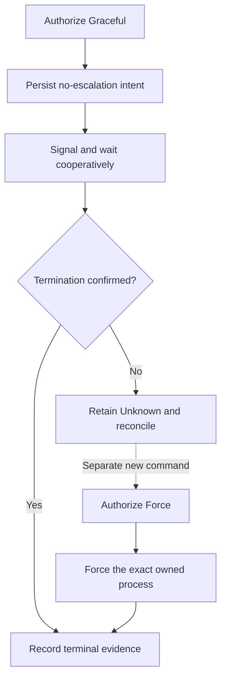

# Define authority for graceful runtime cancellation

Status: **Accepted, 2026-10-05.** Runtime-attempt Graceful cancellation is
cooperative-only. This records the current policy; it does not attribute that
intent to the earlier implementation.

## Decision

Permission to cancel with `Graceful` permits cooperative stopping only. Timeout
never grants force authority. A distinct `Force` command requires its own
control identity, digest, and authorization decision.

The application maps Graceful to `GracefulOnly`. That stop path durably commits
`no_escalation` before process IO. Retained cancellation mode supplies the same
constraint during recovery if a crash precedes that configuration commit.
Ambiguous effects remain Unknown and are not automatically repeated. An explicitly
accepted Force control can resume independently of an earlier no-escalation flag;
ordinary stopping without such authority preserves that flag.

*Timeout changes the observed result, not the caller's authority. Retrying the
original control cannot silently become a Force command.* See the
[durable cancellation workflow](../../reference/protocol/cancellation.md#durable-ordering-and-returned-states)
for acceptance and effect-marker ordering.

## Reason and compatibility

The protocol already distinguished cooperative Graceful from independently
authorized Force. The former mapping to escalatable `StopMode::Graceful` violated
that distinction. Explicit authority is now preserved through both live execution
and startup recovery.

Existing Graceful controls that have not crossed the effect boundary resume under
the cooperative-only policy. Unknown/settled controls retain their evidence and
are not redriven. This change cannot undo force IO already performed by an older
runtime. The ordinary `stop_session` operation retains its own explicit stop modes.

## Verification

Composed service/SQLite coverage allows Graceful while denying Force, supplies an
unresponsive stop adapter, checks the no-escalation policy, reopens retained state,
and verifies replay without another effect. Startup tests cover cooperative
recovery and independent Force with an existing no-escalation flag. Native runtime
coverage checks that graceful-only timeout leaves a real child alive until force.

[Design decisions](README.md) · [Application control guide](../../../crates/undercurrent-application/docs/internals/execution/runtime-controls.md#mark-the-effect-before-entering-stop-mechanics)
