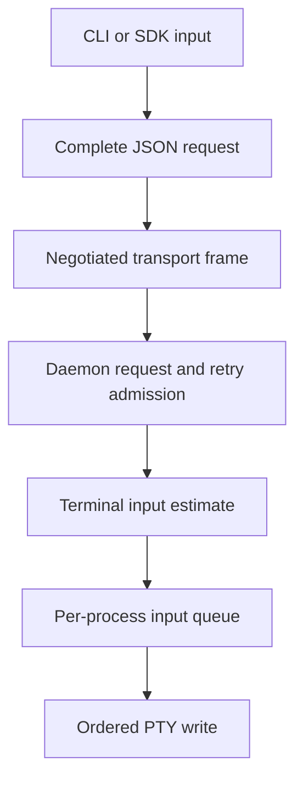

# Configure finite input independently from resource budgets

Status: **Accepted and implemented**, 2026-10-06. This records the change in
the working source, not a released version.

Scope: complete finite terminal-input requests through the CLI, Rust SDK and
Python bridge. Input streaming, scheduling changes and retry-cache isolation
are separate work.

## Context and evidence

The previous 64 KiB input allowance rejected useful pastes, including a roughly
110 KiB send. Raising that setting alone did not enable larger requests: the
SDK profile still limited complete JSON requests to 128 KiB and transport frames
to 256 KiB, the process input queue held 1 MiB, and Python imposed a separate
4 MiB JSON-line ceiling.

The workload described for this decision is typically about 12 KiB, with most
large sends below 5 MiB. The 5 MiB default is a provisional workload choice,
not an intrinsic terminal maximum or a measured optimal cutoff.

Local Linux release-build experiments on 2026-10-06 raised the experimental
limits and compared ready, paused and rate-limited PTY readers. The larger
sweep covered 5, 10, 20 and 50 MiB with one, four and eight concurrent sends;
the main ready-reader cases used three fresh instances and five batches each.
Independent-client, keyed-retry and expiry cases supplemented that matrix.
The relevant observations were:

| Observation | Decision implication |
| --- | --- |
| Ready readers completed unkeyed sends through 50 MiB without the two-second peer deadline expiring. Eight independent 5 MiB senders produced a measured 32 ms maximum for ordinary 12 KiB peer input. | 64 KiB was not an observed capability boundary. This does not establish a latency guarantee for 5 MiB. |
| Eight paused 5 MiB writers caused ordinary input and inspection to hit that deadline. Earlier blocked 64 KiB writes also delayed peers. | A size cap cannot replace write scheduling and isolation. |
| Repeated keyed 5 MiB sends exhausted the default shared retry budget after 50 successes under the tested background load; the next send was rejected. Other keyed mutations could also be rejected. | Retained request bytes are a separate aggregate resource. |
| A filled retry cache first accepted the recovery probe about 300.4 seconds after the first large acknowledgment, consistent with the configured five-minute retention. | Increasing input capacity does not shorten retention or guarantee capacity for unrelated mutations. |
| Eight independent 5 MiB senders increased combined client/daemon/host RSS by approximately 611–626 MiB over the warmed baseline across the measured batches. | Payload size is not total memory cost; complete requests and concurrent copies matter. |

These are observations from one environment and the then-current working tree,
using increased experimental bounds. They are not cross-platform guarantees,
heap-allocation attribution, or proof of a memory leak. The original local
benchmark artifacts were retained under `target/input-limit-bench/`; published
documentation and builds do not depend on those ignored artifacts. The maintained
[input-limit check](../../../tests/e2e/cli/input-limits.py) verifies the behavior
introduced by this decision, rather than reproducing the performance study.

## Decision

Keep `services.max_input_bytes` configurable and set its default to 5,242,880
bytes (5 MiB). Preserve its existing meaning: the sum of conservative terminal
encoding estimates across one complete sequence. It is not a character count,
file-size promise or JSON-size limit.

Literal text/raw bytes count their byte length. Automatic text and paste reserve
12 additional bytes per item; each named key reserves 16 bytes. Therefore an
automatic-text or paste item followed by Enter can contain at most 5,242,852
text bytes at the default. UTF-8 multibyte characters count all their bytes.

Keep the complete sequence in one finite request, with its existing ordering,
delivery identity, revision checks, paste framing and optional trailing Enter.
An oversized request is rejected; it is not truncated or automatically divided
into independently interleavable requests.

The defaults are coordinated across the existing layers:

| Setting | New default | Reason |
| --- | --- | --- |
| `services.max_input_bytes` | 5,242,880 | Provisional workload allowance, using existing encoding estimates |
| `process.input_queue_bytes_per_process` | 8,388,608 | Room for a full admitted delivery while retaining a finite per-process budget |
| `requests.request_bytes` | 33,552,604 | Space for sixfold JSON escaping of default-sized text, item metadata and request metadata |
| `transport.max_frame_bytes` | 33,554,432 | 32 MiB, including the 1,838-byte maximum client envelope reservation |
| `transport.connection_queue_bytes` | 134,217,728 | The transport reserves one maximum frame in each of four traffic classes |
| `transport.stream_queue_bytes` | 33,554,432 | A maximum frame must fit a stream queue |
| `transport.replay_item_bytes` and `replay_bytes_per_stream` | 33,554,432 each | Existing validation requires a maximum frame to fit a replay item and stream journal |

The 64 MiB replay connection budget, 256 MiB retry budget, 1,024 retry records
and five-minute completed-record retention remain unchanged. Capacities are
ceilings, not eager allocations; larger ceilings still permit higher memory
use under concurrency. The finite-request byte ceiling applies to other request
types too; their service-specific limits continue to apply.

This diagram shows why the input allowance and serialized request bound are
distinct. Every stage must admit the request before a complete write succeeds.



Caption: raising the terminal-input allowance alone does not raise the other
admission budgets. Completion confirms terminal writes, not application acceptance.

## Configuration and client behavior

No configuration schema generation changes. Existing explicit values stay
explicit; omitted fields receive the new defaults. Limits are not automatically
scaled together when a user changes the input allowance. Shared validation now
requires input to fit the process queue and leave space in the JSON request
bound, and checks the four transport-class reservations before daemon startup.
Existing request/frame and replay relationships remain enforced. Escaped input
can still exceed an independently configured request bound even when its
terminal estimate fits; callers receive a rejection rather than truncated data.

The CLI uses `requests.request_bytes` when constructing its SDK profile. Rust
consumers can use `StandaloneClientProfile::with_request_limit`; Python exposes
`Client(request_bytes=...)`. Neither SDK reads the daemon's configuration file.
The daemon remains authoritative for input admission. Changing a home config
requires restarting the daemon; `uc config show` describes the file snapshot,
not the already-running daemon.

The SDK grows its offered frame and transport queues around the requested JSON
bound. After negotiation it reduces physical payload and mailbox ceilings to
fit a smaller peer. Normal standalone frames reserve the maximum client envelope;
very small manually constructed frames still require caller-managed overhead.
Oversized calls fail locally while small calls can continue on the same
connection. Negotiation does not advertise the daemon's service input limit or
JSON codec limit, so a smaller server can also reject a request at those layers.

Python and its Rust bridge use an inclusive line ceiling of
`max(4 MiB, request_bytes + 65,536)`, allowing the private command envelope beyond
the product request. Python emits UTF-8 JSON without unnecessary ASCII escaping.
The Rust reader still reads at most one extra byte to detect overflow. Matching
Python package and bridge binaries are required.

See [input configuration](../../guides/configuration/README.md#configure-terminal-input-size),
[Rust limits](../../sdk/rust/limits-and-diagnostics.md#profile-variants-and-custom-limits)
and [Python options](../../sdk/python/operations.md#request-size).

## Consequences and deferred work

Complete JSON serialization, input encoding and retry retention still retain
whole buffers. This decision does not bound total process RSS, guarantee peer
latency under blocked writers, or reserve retry capacity for control operations.
A timeout or lost response does not undo bytes already queued or written.

Do not replace exact retained request bytes with a digest without changing the
retry contract. A future bulk-input protocol must preserve one logical delivery,
ordering, framing, final Enter, retry identity and explicit partial/uncertain
outcomes. Simply looping over ordinary send requests would change those guarantees.

Removing every cap would leave allocation and queue growth uncontrolled. Keeping
64 KiB would preserve the observed restriction without solving blocked-write
starvation. Introducing streaming now would expand this change into a public
protocol and recovery redesign. We chose a configurable finite allowance first.

Revisit the default when representative workloads or latency/memory targets
change. Evaluate scheduling, retry-budget isolation and streaming independently;
do not describe this default as their substitute.

## Implementation and verification

The owning implementations are [configuration](../../../crates/undercurrent-config/src/document.rs),
[shared validation](../../../crates/undercurrent-config/src/validate.rs),
[SDK profiles](../../../crates/undercurrent-sdk/src/profile.rs),
[negotiated client limits](../../../crates/undercurrent-sdk/src/client.rs),
[CLI connection setup](../../../crates/undercurrent-cli/src/client.rs), and
[Python transport](../../../python/src/undercurrent/_transport.py).

Focused tests cover zero/overflow and incompatible settings, escaped JSON,
client options, and small requests after an oversized rejection against a
256 KiB-frame peer. The real-daemon check exercises below/at/above input limits,
paste plus Enter, UTF-8, sixfold escaping, rejected-input zero effects, and
lowered/raised settings through CLI and Python. Run from the repository root:

```sh
cargo build --locked -p undercurrent-cli -p undercurrent-daemon -p undercurrent-python-bridge --bins
python3 tests/e2e/cli/input-limits.py --artifact-dir target/debug
```

The check creates and cleans up isolated temporary installations and writes its
result to `target/input-limits-e2e.json`. It requires a Unix PTY and Python 3.11+.
It does not measure sustained throughput or make cross-platform performance claims.

[Decision index](README.md)
