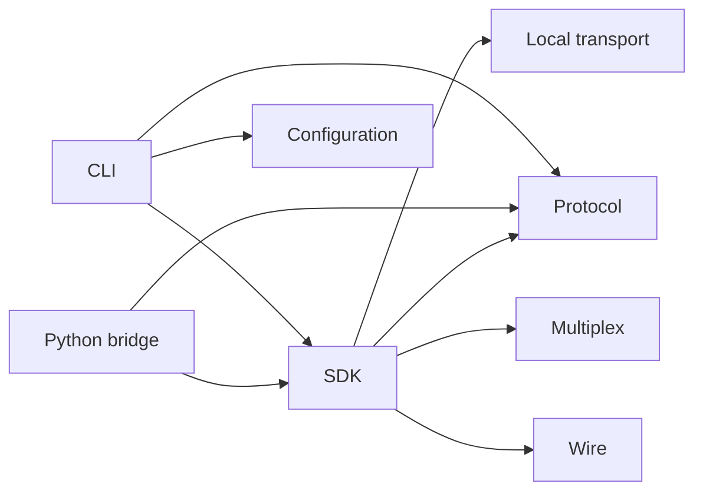
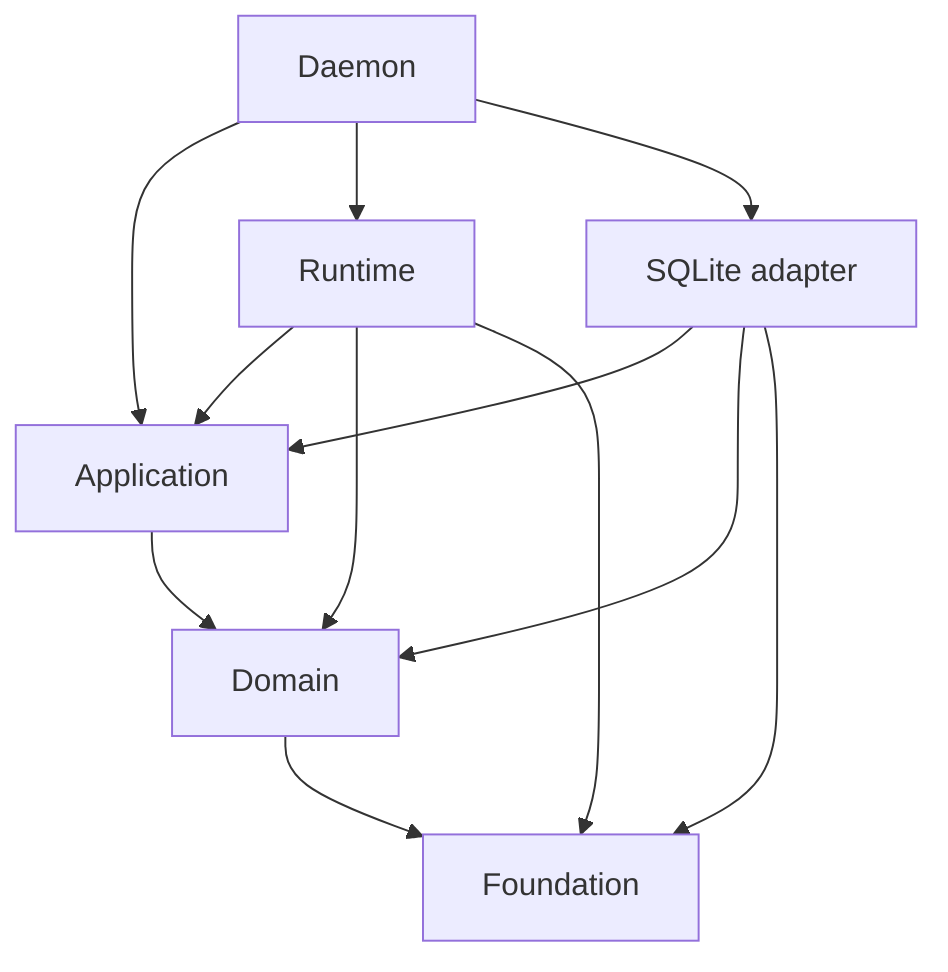
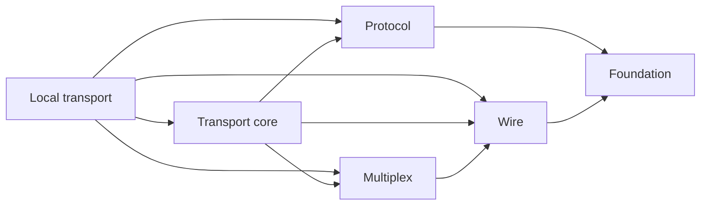

# Find the owner of a change

Use this map to move from a task to its first-party crate and detailed local
explanation. The root [workspace manifest](../../Cargo.toml) contains 19 crates;
[architecture policy](../../tests/architecture/allowed-graph.json) permits only
SDK and protocol as direct external Rust consumer dependencies. Python is a
separate package. Vendored parsers, PTY code and test consumers
are dependencies or fixtures, not additional first-party SDK surfaces.

Product registry values and contract metadata live in `aixand-undercurrent-protocol`.
Framing and handshake definitions live in `aixand-undercurrent-wire`. Each crate's
compatibility tests compare its implementation against checked-in fixtures.

## Dependency direction

These focused views show selected production dependencies. They describe Rust
imports, not processes or communication. The manifest table below lists all
first-party production dependencies, including target conditions.

*Client dependencies stay on the public contract side. Windows-specific CLI
primitives are listed in the table rather than crowding this view.*

*Policy stays inward. Application code does not import SQLite or the native
runtime, allowing failure-window tests to substitute controlled ports.*

*Framing, scheduling, product DTOs and dispatch are distinct owners. Adding a
product operation usually does not require changing the frame format.*

## Manifest map

Names in the last column omit the `undercurrent-` prefix. Development dependencies
are intentionally excluded; consult each manifest for its test fixtures.

| Package | Responsibility | First-party production dependencies |
| --- | --- | --- |
| [undercurrent-application](../../crates/undercurrent-application/README.md), [manifest](../../crates/undercurrent-application/Cargo.toml) | Orchestrates use cases through inward-facing ports; owns commit/effect ordering. | domain |
| [undercurrent-cli](../../crates/undercurrent-cli/README.md), [manifest](../../crates/undercurrent-cli/Cargo.toml) | Owns commands, presentation, interactive UI, groups, shell hooks, and local daemon lifecycle. | config, diagnostics, protocol, sdk, platform-windows (Windows) |
| [undercurrent-config](../../crates/undercurrent-config/README.md), [manifest](../../crates/undercurrent-config/Cargo.toml) | Owns current-release discovery, path policy, typed configuration and coupled validation. | foundation |
| [undercurrent-daemon](../../crates/undercurrent-daemon/README.md), [manifest](../../crates/undercurrent-daemon/Cargo.toml) | Composes adapters, authorizes and dispatches public requests, owns readiness and worker teardown. | config, diagnostics, application, domain, multiplex, protocol, runtime, sdk, store-sqlite, transport-local, transport-core, wire, platform-windows (Windows) |
| [undercurrent-diagnostics](../../crates/undercurrent-diagnostics/README.md), [manifest](../../crates/undercurrent-diagnostics/Cargo.toml) | Owns bounded executable failure records and private backtrace retention. | platform-windows (Windows) |
| [undercurrent-domain](../../crates/undercurrent-domain/README.md), [manifest](../../crates/undercurrent-domain/Cargo.toml) | Owns pure session, lifecycle, observation, restart, attempt, and policy invariants. | foundation |
| [undercurrent-foundation](../../crates/undercurrent-foundation/README.md), [manifest](../../crates/undercurrent-foundation/Cargo.toml) | Owns the shared release identity, bounded values, digests, URI/text checks and privacy classification. | None |
| [undercurrent-mcp](../../crates/undercurrent-mcp/README.md), [manifest](../../crates/undercurrent-mcp/Cargo.toml) | Adapts local MCP tools to the public SDK; owns bounded observation and no runtime effects itself. | config, protocol, sdk |
| [undercurrent-multiplex](../../crates/undercurrent-multiplex/README.md), [manifest](../../crates/undercurrent-multiplex/Cargo.toml) | Owns frame scheduling, routing, credit and bounded stream replay mechanisms. | wire |
| [undercurrent-platform-macos](../../crates/undercurrent-platform-macos/README.md), [manifest](../../crates/undercurrent-platform-macos/Cargo.toml) | Owns private macOS kernel process and listener observation primitives. | None |
| [undercurrent-platform-windows](../../crates/undercurrent-platform-windows/README.md), [manifest](../../crates/undercurrent-platform-windows/Cargo.toml) | Owns Windows pipes, file security, processes, jobs, identity and listener primitives. | None |
| [undercurrent-protocol](../../crates/undercurrent-protocol/README.md), [manifest](../../crates/undercurrent-protocol/Cargo.toml) | Owns supported product DTOs, operation/error/stream registries and product encoding. | foundation |
| [undercurrent-python-bridge](../../crates/undercurrent-python-bridge/README.md), [manifest](../../crates/undercurrent-python-bridge/Cargo.toml) | Adapts Python stdio requests and stream ACKs to the blocking public Rust SDK. | sdk, protocol |
| [undercurrent-runtime](../../crates/undercurrent-runtime/README.md), [manifest](../../crates/undercurrent-runtime/Cargo.toml) | Implements application ports for process hosting, terminal IO, observations and live state. | application, domain, foundation, platform-macos (macOS), platform-windows (Windows) |
| [undercurrent-sdk](../../crates/undercurrent-sdk/README.md), [manifest](../../crates/undercurrent-sdk/Cargo.toml) | Owns the supported blocking typed Rust client, physical recovery and resilient subscriptions. | transport-local, multiplex, protocol, wire |
| [undercurrent-store-sqlite](../../crates/undercurrent-store-sqlite/README.md), [manifest](../../crates/undercurrent-store-sqlite/Cargo.toml) | Owns database worker, transactions, record codecs and offline maintenance. | foundation, application, domain, platform-windows (Windows) |
| [undercurrent-transport-core](../../crates/undercurrent-transport-core/README.md), [manifest](../../crates/undercurrent-transport-core/Cargo.toml) | Owns request/stream lifecycle and in-memory idempotency around product dispatch. | multiplex, protocol, wire |
| [undercurrent-transport-local](../../crates/undercurrent-transport-local/README.md), [manifest](../../crates/undercurrent-transport-local/Cargo.toml) | Owns protected local endpoints, negotiation and connection service loops. | transport-core, multiplex, protocol, wire, platform-windows (Windows) |
| [undercurrent-wire](../../crates/undercurrent-wire/README.md), [manifest](../../crates/undercurrent-wire/Cargo.toml) | Owns UCMP framing and client/daemon UCHS negotiation, separate from private host framing. | foundation |

## Detailed local guides

Follow the package links in the manifest map to each crate's maintained reading
path. Those READMEs index local explanations, examples, and verification; this
page owns the workspace map rather than a second catalog of every crate page.

The [Python package guide](../../python/README.md) indexes Python usage and
implementation. Use [project architecture](README.md) for process/state
ownership and [cross-crate flows](flows.md) to trace an operation between owners.

[Documentation index](../README.md)
