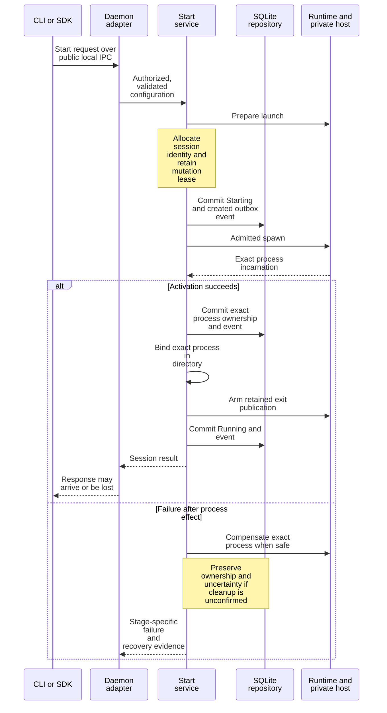
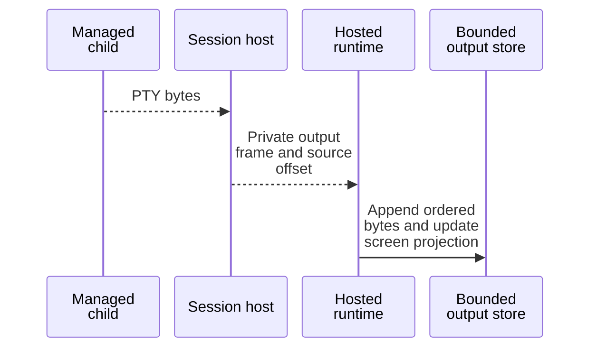
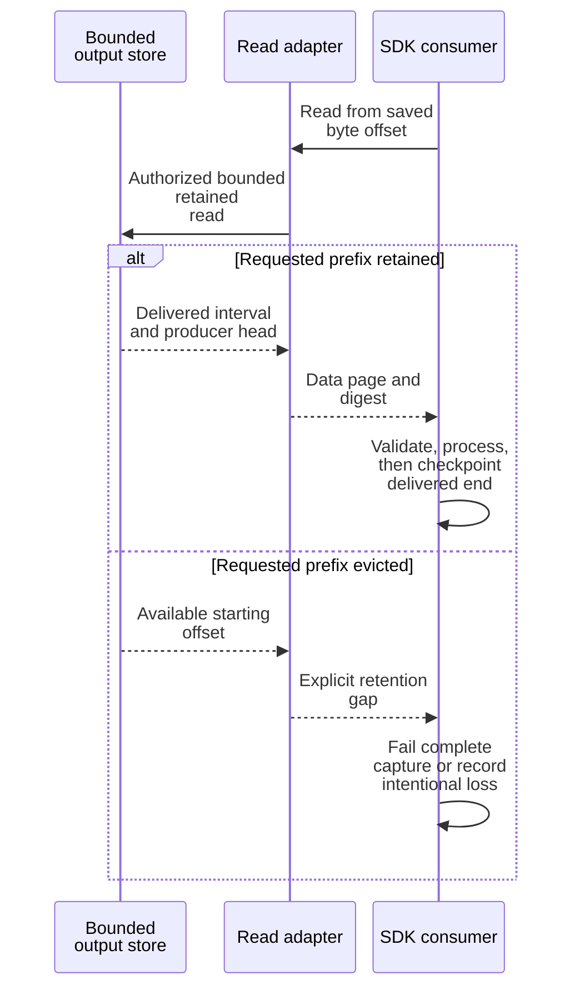
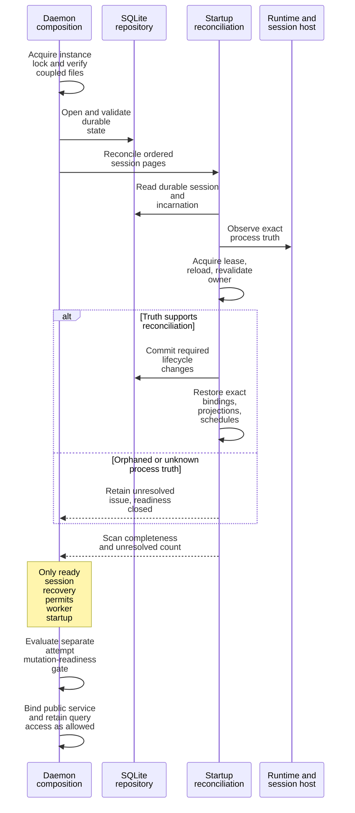

# Trace creation, output, and recovery

Use these focused walkthroughs to follow an externally visible operation across
its owners. Read [process ownership](README.md) first. These diagrams
describe representative paths, not a universal transaction or retry mechanism.

## Start a session

The [finite adapter](../../crates/undercurrent-daemon/src/application_adapter/finite.rs)
converts and authorizes a request. The application start service expects that
trusted boundary; it does not independently provide a general authorization
port. Public transport admission precedes this application sequence and can
reject before dispatch.

*Takeaway: the child can have effects before the Running commit and before the
caller receives a response.* The diagram abbreviates separate durable attempt
admission/settlement around runtime effects. Dispatched starts additionally
settle their semantic result after activation, and ambiguous final settlement
preserves the live process. Ordinary Python start does not expose that complete
dispatch replay contract.

[start.rs](../../crates/undercurrent-application/src/commands/start.rs) and
[activation.rs](../../crates/undercurrent-application/src/commands/activation.rs)
own ordering. [Session transactions](../../crates/undercurrent-store-sqlite/docs/internals/transactions/sessions-and-outbox.md)
couple each aggregate mutation and its events, not the whole OS sequence.
Binding before exit arming prevents a fast exit from being published without
an identifiable owner. Projection failure after commit is diagnosed without
turning durable success into a false failure. Failure details and dispatched
replay branches belong to [session lifecycle](../../crates/undercurrent-application/docs/internals/sessions/lifecycle.md).

Investigate [command tests](../../crates/undercurrent-application/src/commands/command_tests.rs)
for `start_commits_running_session_binds_process_and_projects_summary`,
`projection_failure_does_not_report_false_failure_after_durable_start`, and
`dispatched_start_recovers_response_loss_after_settlement_commit_without_cleanup_or_respawn`.
The last test does not establish generic retry safety for every SDK start.

## Consume terminal bytes

Terminal byte offsets identify intervals within a session's output source.
They are distinct from stream frame sequences and session-event cursors.
The next diagram focuses on finite reads so the delivered interval is explicit.

*Production: private host output is distinct from the public read boundary.*

*Finite read: processing the returned interval and recording loss are consumer responsibilities.*

*Takeaway: a producer head can be beyond the returned page. Advancing directly
to it can skip bytes that are still available.* The authoritative implementation
is [terminal_output.rs](../../crates/undercurrent-application/src/terminal_output.rs),
with DTO mapping in [feed.rs](../../crates/undercurrent-daemon/src/presentation/feed.rs).
Rust product pages expose `to_offset`; Python currently omits it, so the
maintained [copy example](../../python/examples/read_output.py) validates and
uses `from_offset + len(data)`. The [acknowledgment example](../../python/examples/input_roundtrip.py)
uses the same interval validator and retains only the suffix needed to match
across contiguous pages. Neither joins across a gap silently.

Live output adds bounded stream admission, credit, scheduling, write-confirmed
replay and consumer checkpoints. See [daemon streams](../../crates/undercurrent-daemon/docs/internals/output-and-streams.md),
[transport delivery](../../crates/undercurrent-transport-core/docs/internals/streams-and-recovery.md),
and [multiplex replay](../../crates/undercurrent-multiplex/docs/internals/replay.md).
A socket write is not application consumption; an output digest verifies a
payload, not completeness of the transcript. The CLI's current `logs --follow`
seed limitation is recorded in [output tasks](../guides/cli/status-and-output.md).

## Recover after daemon replacement

The instance lock and coupled-file checks precede recovery. Durable sessions
are scanned in stable-ID pages. Runtime truth is observed outside the session
lease and revalidated after acquiring it, so recovery cannot overwrite a newer
incarnation merely because it observed an older process first.

*Takeaway: recovery reconstructs from evidence. It neither infers identity from
a PID alone nor retries every uncertain process action.* Terminal sessions can
re-enqueue durable restart intent. Stopping with no-escalation or a claimed
Unknown cancellation can be preserved without repeating termination. A ready
session scan does not mean every cancellation result is known.

The exact decision branches and bounded revalidation are in
[startup recovery](../../crates/undercurrent-application/docs/internals/recovery/startup.md).
[Host recovery](../../crates/undercurrent-runtime/docs/internals/host/recovery.md) owns receipts,
epochs, replay files, and missing-proof interpretation. A replacement host in
one adapter can reuse its configured epoch; do not infer a fresh epoch from
every host restart. Current background replay failures are not a promise of
perpetual retry.

Relevant evidence includes [startup tests](../../crates/undercurrent-daemon/tests/startup_recovery.rs),
[host recovery tests](../../crates/undercurrent-daemon/tests/hosted_process_recovery.rs),
and application tests that a second startup never redrives a previously claimed
force cancellation. [SDK recovery](../sdk/recovery.md) explains what callers can
actually reconcile after response loss.

[Extension guide](../development/extending.md) · [Documentation index](../README.md)
