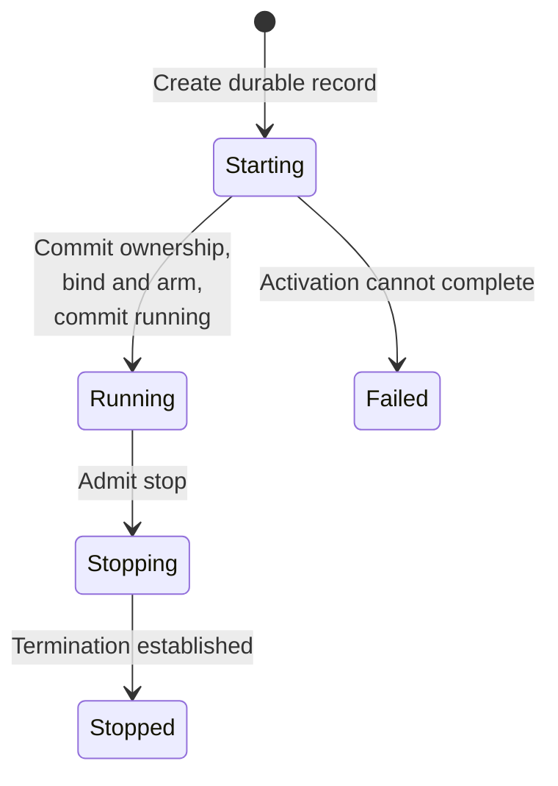
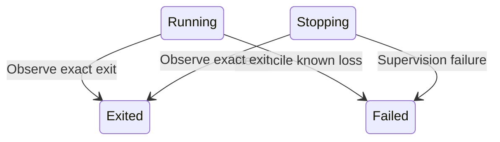
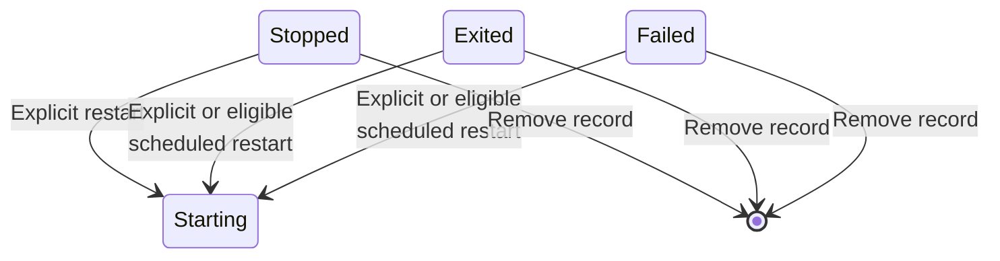

# Understand session identity and process lifecycle

A session is a durable record for supervised work. A process incarnation is
one particular runtime execution belonging to that session. Keeping those
identities separate lets callers reconnect, inspect results, restart work,
and reject stale process observations without silently changing targets.
This explanation applies to product contract 0.1.0-beta.

## Know which identity you hold

| Value | Meaning and lifetime |
| --- | --- |
| Session ID | Stable identity until record removal. Its unique name is mutable and may later be reused. |
| Process identity | Exact incarnation plus observed start time; a recyclable OS PID alone is insufficient. Cleared when the incarnation becomes terminal. |
| Session revision | Advances on actual aggregate changes, including non-lifecycle changes. Used for guarded mutations. |
| Lifecycle revision | Advances on lifecycle transitions, separately from metadata or observation changes. |
| Catalog/snapshot revision | Position in a prepared query projection, not an individual session revision. |
| Effective-profile epoch | Rebuildable selection context for the current process, distinct from durable revisions. |
| Operation attempt | Durable admission and effect evidence for one mutation, with its own ID, fence, and semantic digest. |

Current state is a snapshot, not a future promise. Retain the session ID after
lookup. A new process under the same session ID does not make old process evidence
or a stale revision safe for another action.

## Read lifecycle together with restart intent

| Lifecycle | What the record says |
| --- | --- |
| `starting` | Activation is in progress; ownership may not yet be committed. |
| `running` | The aggregate owns a supervised process incarnation. |
| `stopping` | Termination is in progress with retained ownership. |
| `stopped` | No running process is expected; the session record remains. |
| `exited` | Process exit with an observed code is recorded. |
| `failed` | Creation or supervision failed; inspect evidence before treating this as an application result. |

These focused views show representative paths through the same lifecycle. The
[complete transition contract](../../crates/undercurrent-domain/docs/internals/session-lifecycle.md#session-identity-outlives-process-ownership)
also includes recovery transitions and exact-repeat rules.

*Activation and stop: the durable session survives the end of its current process incarnation.*

*Terminal evidence: an observed exit and supervision failure have different meanings.*

*Record lifetime: terminal records can start another incarnation or be removed explicitly.*

*Takeaway: terminal lifecycle ends an incarnation, not necessarily the session's
useful lifetime.* Removal is a separate application/repository operation, not a
`LifecycleState` variant. Automatic restart adds retained policy, count, and
scheduled time. A terminal-looking session can have another start pending.
The scheduler rechecks revision and due time; explicit stop cancels pending
automatic restart intent.

The domain prohibits running-to-stopped directly, requires ownership for
running/stopping, and clears ownership in terminal states. It validates state
but does not inspect the OS. Application and runtime owners must establish process
truth. See [lifecycle rules](../../crates/undercurrent-domain/src/lifecycle.rs),
[session aggregate](../../crates/undercurrent-domain/src/session.rs), and
[domain tests](../../crates/undercurrent-domain/tests/domain_contract.rs).

## Distinguish start, readiness, and success

Starting crosses initial record/outbox commit, admitted process effect,
ownership commit, binding and exit arming, then running commit. A response can
disappear after those effects. A process can exit before its start reply arrives.
[Maintainer flows](flows.md) trace the windows;
[SDK recovery](../sdk/recovery.md) explains caller decisions.

Readiness may mean a daemon accepts connections, mutations are admitted, a shell
is at a prompt, or a health check passes. Those are different claims. Define a
task-specific acknowledgment or result protocol, as the
[Python round-trip example](../../python/examples/input_roundtrip.py) does.

Stopping a session, cancelling a request, closing a subscription, and closing a
client have distinct lifetimes. A terminal view can end while the session
continues. A timed-out stop can already have delivered its signal. Intentional
daemon shutdown includes private host shutdown and differs from recovery after
a daemon crash with a surviving host.

## Keep declared work independent

WorkContext records an identified owner's declarations about related, delegated,
waiting, blocked, or completed work. Entries are keyed by owner plus item ID.
Targets reference sessions, label selections, or external entities; they do not
transfer workflow ownership to Undercurrent. Exiting a target does not complete
its declaration. Inspect exact owned items rather than inferring their result
from counts. The [work model](../../crates/undercurrent-domain/docs/internals/work-and-queries.md)
owns status, expiry, and summary rules, separately from
[foreground and output observations](observations-and-output.md).

[Manage sessions](../guides/cli/sessions.md) · [Documentation index](../README.md)
