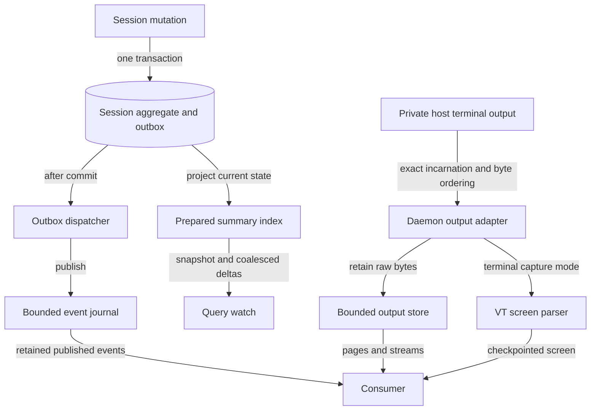

# Interpret observations and output continuity

Choose between current session state, health, terminal bytes, screens, query
updates, and events. Each is evidence with a particular scope and retention
limit. None is a universal application-completion protocol.

## Separate state dimensions

| Dimension | Values | Question answered |
| --- | --- | --- |
| Lifecycle | Starting, running, stopping, stopped, exited, failed | What has supervision recorded about this incarnation? |
| Foreground execution | Active, quiescent, unknown | What activity does foreground evidence support? |
| Interaction | None, available, requested | Is input possible or affirmatively requested, with what modality/meaning? |
| Constraint | Clear, present | Does evidence indicate a runtime constraint? |
| Health | No check, unknown, healthy, unhealthy | What do configured checks establish? |
| WorkContext | Owner-scoped declarations | What related work does its owner claim? |

Public spellings belong to [protocol DTOs](../../crates/undercurrent-protocol/src/dto.rs).
CLI options use `no-check`; Python predicates use `no_check`. Do not substitute
display labels for another interface's values.

Foreground evidence carries origin, disposition, confidence, and times. Missing,
stale, incomplete, future, or weak evidence is handled conservatively. Profiles
describe matching and interpretation, not arbitrary application truth. Adaptive
selection can follow an interactive shell's foreground program without rewriting
durable launch configuration.

Health is independent: any explicit failed rule makes the result unhealthy;
complete all-pass evidence makes it healthy; partial all-pass evidence remains
unknown. No configured checks means no-check. A listener alone is not application
readiness. The [domain guide](../../crates/undercurrent-domain/docs/internals/observations-and-profiles.md)
owns evidence precedence; [daemon profiles](../guides/configuration/profiles.md)
explains selection and tuning.

## Choose a data product

This view separates durable event commits, publication, prepared queries,
raw output retention, and screen rendering. They have different clocks and bounds.

*Takeaway: durable outbox identity does not make a subscription a complete
synchronous database history; a screen is not a raw-output archive.* Publication
can lag; the current event journal is bounded and in memory. Query watches can
coalesce intermediate revisions. Event observation payloads help investigate
transitions snapshots omit, but missing history still limits what is provable.

## Preserve the right cursor

| Position | Scope and continuation |
| --- | --- |
| Output `from_offset` / `to_offset` | Start and exclusive end of returned bytes. Page at `to_offset`. |
| Output `next_offset` | Producer head at the read; can exceed a short page's end. |
| Output `available_from` | Earliest retained byte; older bytes were evicted. |
| Outer stream sequence | Transport delivery position used for SDK reconnect/resume. |
| Durable session event sequence | Global event position; filtering one session can skip numbers. |
| Query cursor/revision | Opaque traversal and projection baseline; restart on expiry. |
| Screen checkpoint | Server-issued screen baseline; obtain a replacement if unavailable. |

Validate byte intervals and save progress after consuming them. Digests protect
integrity, not completeness or application truth. Python omits `to_offset`;
its maintained examples derive `from_offset + len(data)`. Follow
[user output tasks](../guides/cli/status-and-output.md) or
[Python streams](../sdk/python/streams.md) for pagination.

Host replay, daemon raw-output retention, transport replay, client mailboxes,
attachment scrollback, and application transcripts are separate resources.
Increasing one does not reconstruct another's missing history. Terminal capture
maintains a VT screen/checkpoint; opaque capture retains bytes without that
interpretation. A replacement screen restores the viewport, possibly resetting
local history, without recovering missing bytes.

## Interpret gaps and silence

A gap is an explicit discontinuity with a recovery action, not an empty update.
Mark dependent state incomplete, obtain a fresh baseline, and retain the missing
interval when history matters. [SDK recovery](../sdk/recovery.md) maps the actions
to each interest. Transport and Python bridge ACKs happen before application
processing is durably committed.

A quiet stream can reflect no new data, coalescing, deferred credit, recovery,
or a slow consumer. Use bounded receives and diagnostics instead of inferring
readiness from silence. A dwell-based wait remains an observation predicate,
not proof of unobserved physical continuity or successful work.

Implementation and regression entry points:
[output retention](../../crates/undercurrent-application/src/terminal_output.rs),
[outbox dispatch](../../crates/undercurrent-application/src/outbox_dispatch.rs),
[event publication](../../crates/undercurrent-runtime/src/events.rs),
[query subscriptions](../../crates/undercurrent-application/src/subscriptions.rs), and
[event journal tests](../../crates/undercurrent-runtime/tests/event_journal.rs).

[Lifecycle](lifecycle.md) · [Documentation index](../README.md)
