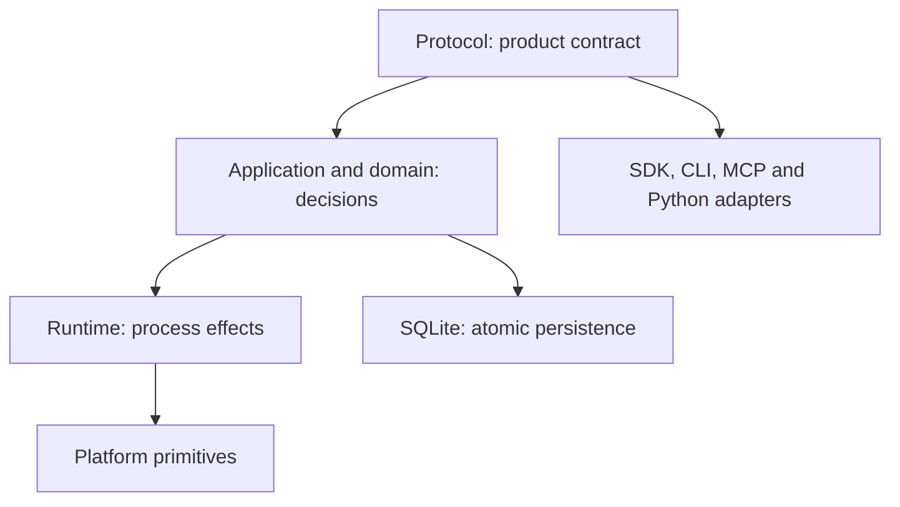

# Trace a change across the workspace

Find the owner of a behavior before editing its implementation. Undercurrent has
19 first-party Rust crates and a separate Python SDK package. This map describes
the current development checkout; it does not widen the supported external API.

## Choose the semantic owner

The graph shows change direction, not runtime communication. Follow the
[dependency map](../architecture/dependencies.md) for exact Cargo edges.

| Change | Start here | Verify the boundary |
| --- | --- | --- |
| Product DTO, operation or error | [Protocol extension](../../crates/undercurrent-protocol/docs/development/extend-contract.md) | Encoding, registry, contracts, daemon projection and each affected SDK |
| Session invariant or effect ordering | [Domain](../../crates/undercurrent-domain/docs/README.md) and [Application](../../crates/undercurrent-application/docs/README.md) | Pure decision tests and port failure-window tests |
| Native execution, output or host recovery | [Runtime](../../crates/undercurrent-runtime/docs/README.md) | Terminal bytes, receipt reconciliation and native process tests |
| Durable revision, attempt or event record | [SQLite](../../crates/undercurrent-store-sqlite/docs/README.md) | Rollback, stale fence, crash boundary and outbox tests |
| Frame, stream, credit or connection | [Wire](../../crates/undercurrent-wire/docs/README.md), [Multiplex](../../crates/undercurrent-multiplex/docs/README.md), [Core](../../crates/undercurrent-transport-core/docs/README.md), [Local transport](../../crates/undercurrent-transport-local/docs/README.md) | Codec bounds, admission, writer confirmation and replay gaps |
| Client behavior or tool presentation | [Rust SDK](../../crates/undercurrent-sdk/docs/README.md), [Python](../../python/docs/README.md), [CLI](../../crates/undercurrent-cli/docs/README.md), [MCP](../../crates/undercurrent-mcp/README.md) | Public surface and adapter-specific correlation, limits and failure handling |
| Startup, composition or worker lifetime | [Daemon](../../crates/undercurrent-daemon/docs/README.md) | Shared owner identity, readiness gates and interruption/teardown |

## Keep four kinds of evidence separate

| Evidence | What it establishes | What still needs checking |
| --- | --- | --- |
| Transport accepted a request | A boundary admitted or queued bytes | The operation's effect and durable outcome |
| Repository committed | Defined records changed atomically | Process effect, receipt acknowledgement and response delivery |
| Runtime observed a process | A bounded observation of native state | Application readiness and successful work |
| Application artifact passes checks | The example's business result | Any broader durability or platform claim |

The [session creation flow](../architecture/flows.md#start-a-session) traces these
boundaries. Keep original operation identities when a result is uncertain; a new
request identity cannot repair missing evidence.

## Select an exercise

Start with the [crate exercises](../examples/crates/README.md) for codecs, pure
policy, bounded delivery and transactions. Use [runtime workflows](../examples/runtime/README.md)
for real workers, output checkpoints, daemon reconnection and an MCP observer.
These examples show concrete assertions and failure behavior, not just launch receipts.

Only the Rust SDK and Protocol are supported direct external Rust dependencies.
Publishing an internal dependency or exposing a `pub` item does not change that
policy. Native macOS and Windows tests require their own platform; Linux checks
cannot qualify those adapters.

[Development setup](setup.md) · [Extension procedure](extending.md) · [Verification](verification.md)
