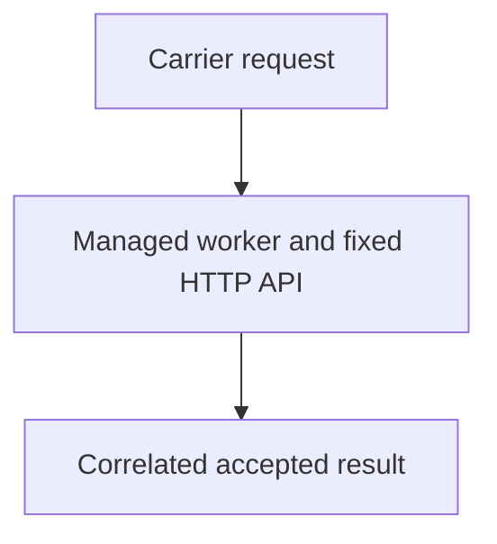

# Trigger an HTTP service through Carrier

A dashboard or agent sends a build request to a durable inbox. The worker calls a fixed HTTP endpoint and replies with the accepted job ID. Undercurrent keeps both processes available after terminal detachment.




## Prerequisites

Complete [connected setup](https://projects.aixand.org/undercurrent/docs/guides/connected-examples/) and [start Carrier](https://projects.aixand.org/carrier/examples/persistent-service/). Copy [api-fixture.py](integrations/api-fixture.py) and [carrier-api.py](integrations/carrier-api.py) into `connected-demo`. Use its `requester.json` and `api-worker.json` credentials, port 8877 for Carrier, and free port 9090 for the fixture API.

The fixture stores jobs in `builds.db`; it queues a demonstration job and does not execute a build. The maintained scripts use current SDKs. This fixture queues demonstration jobs; it does not execute builds.

## Start the API and worker

```sh
uc start build-api -- python "$PWD/api-fixture.py"
uc start api-worker -- python "$PWD/carrier-api.py" worker \
  --credentials "$PWD/api-worker.json" --endpoint http://127.0.0.1:9090/builds
uc logs api-worker --max-bytes 4096
```

Wait until the API and worker report ready in their logs. `carrier-api.py` only dispatches the named build operation to its configured endpoint; message content cannot choose an arbitrary URL.

## Request a job and inspect the result

```sh
python carrier-api.py request --credentials requester.json --task-id build-001
uc logs build-api --max-bytes 4096
uc logs api-worker --max-bytes 4096
```

Expect `status: accepted`, `task_id: build-001`, and `job_id: job-build-001`. The API log reports one created job. The worker replies before acknowledging the request. Acceptance means queued by this fixture, not completed.

The current SDK calls inside the worker are:

```python
await message.reply_json(result, idempotency_key=f"api-result:{message.id}")
await message.ack()
```

## Retry the same request

Run the identical requester command again. It reuses `build:build-001`, recovers the original numeric message ID, and reads correlated history including an already acknowledged reply. It should return the same job ID without creating a second job.

Carrier deduplicates stored sends. The destination API separately deduplicates side effects using the task ID as its `Idempotency-Key`. Reuse a task ID only for the same operation and payload.

## Recover after a failure

Stop the API, submit a new task, and let the worker's HTTP call fail:

```sh
uc stop build-api --graceful
python carrier-api.py request --credentials requester.json --task-id build-002 --timeout 2
uc logs api-worker --max-bytes 4096
```

The requester reports that its request remains stored. An API failure stops the worker without acknowledging that request. Restore the API, then restart the same worker with the same identity:

```sh
uc restart build-api
uc restart api-worker
python carrier-api.py request --credentials requester.json --task-id build-002
```

Retry if the processes are still starting. The request must return `job-build-002`. A requester timeout does not cancel a stored request. On an uncertain HTTP response, the API's durable key also protects against repeating its side effect.

## Stop and keep the evidence

```sh
uc stop api-worker --graceful
uc stop build-api --graceful
```

Stop Carrier when no other walkthrough needs it. Retain credentials, `carrier.db`, and `builds.db` for recovery. Continue with a [managed Codex caller](https://projects.aixand.org/carrier/examples/managed-api-caller/) or the [resource-driven CSV audit](https://projects.aixand.org/manager-suite/examples/audit-to-inbox/).
