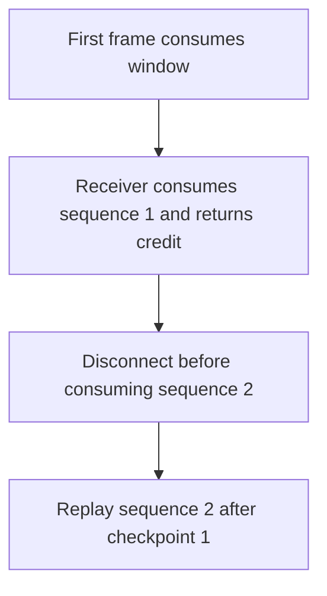

# Resume bounded delivery from consumed credit

Observe a second reliable frame wait for credit, then resume after the last consumed stream sequence. A local buffer simulates a successful transport write.

This offline contributor exercise follows the development workspace at `0.1.0-beta`.



Excerpt from lines 68–84 of the [example source](../../../crates/undercurrent-multiplex/examples/bounded_delivery.rs#L68).

```rust
    // In a real adapter, record only after a complete successful transport write.
    let first = take_data(&scheduler)?;
    let written = first.bytes().to_vec();
    journal.record(
        &key,
        first.sequence().expect("stream sequence"),
        Arc::from(written.clone()),
    )?;
    route_encoded(&codec, &router, &written)?;
    assert_eq!(stream.last_sequence(), StreamSequence::INITIAL);
    assert_eq!(scheduler.dequeue()?, None);
    println!("second frame waits for consumed credit");

    let consumed = stream.recv_timeout(Duration::from_secs(1))?;
    assert_eq!(consumed.sequence(), StreamSequence::new(1));
    scheduler.grant_consumed_credit(&stream_id, consumed.encoded_len())?;
    println!("consuming sequence 1 returns credit");
```

Excerpt from lines 94–115 of the [example source](../../../crates/undercurrent-multiplex/examples/bounded_delivery.rs#L94).

```rust
    // Disconnect before the consumer receives sequence 2.
    router.close();
    scheduler.close();
    assert_eq!(stream.last_sequence(), StreamSequence::new(1));
    let now = Instant::now();
    assert!(journal.deactivate_stream(&key, now + Duration::from_secs(60)));
    let activation =
        journal.activate_resume(&epoch, key.clone(), stream.last_sequence(), recovery, now)?;
    let ReplayResult::Items(items) = activation.replay else {
        panic!("this retained in-memory example must replay");
    };
    assert_eq!(items.len(), 1);
    assert_eq!(items[0].sequence, StreamSequence::new(2));

    let replacement = ConnectionRouter::new(negotiated);
    let resumed = replacement.open_stream_after(stream_id, 4, 1024, stream.last_sequence())?;
    route_encoded(&codec, &replacement, &items[0].bytes)?;
    assert_eq!(
        resumed.recv_timeout(Duration::from_secs(1))?.sequence(),
        StreamSequence::new(2)
    );
    println!("resume after consumed sequence 1 delivers sequence 2");
```

## Run the example

Run from the repository root with the [pinned Rust toolchain](../../../rust-toolchain.toml)
and the locked dependencies available offline.

```sh
cargo +1.95.0 run --locked --offline -p aixand-undercurrent-multiplex --example bounded_delivery
```

Observed stdout from the verified Linux execution:

```text
second frame waits for consumed credit
consuming sequence 1 returns credit
resume after consumed sequence 1 delivers sequence 2
all connection and journal entries released
```

After routing the first frame, the consumed checkpoint is still initial and the second dequeue yields no frame. Grant credit for the consumed item’s full encoded length. Record only after a complete successful write in a real adapter. At disconnect the replay journal has both frames, while the consumed checkpoint remains 1. If replay cannot supply a retained item, follow the stream’s recovery action. This terminal-output stream selects `RestartFromAvailableOffset`. The example closes the connections and removes the journal entry.

[Complete source](../../../crates/undercurrent-multiplex/examples/bounded_delivery.rs) · [Crate documentation](../../../crates/undercurrent-multiplex/docs/README.md) · [Offline examples](README.md)
