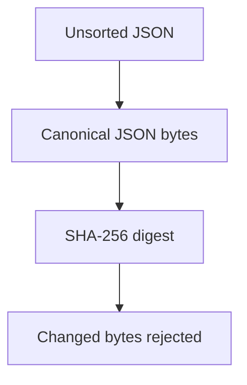

# Canonicalize and validate shared values

Canonicalize a synthetic JSON value and verify a digest over the resulting bytes. This exercise also checks bounded strings, opaque URIs, and sensitive-material detection.

This offline contributor exercise follows the development workspace at `0.1.0-beta`.



Excerpt from lines 12–24 of the [example source](../../../crates/undercurrent-foundation/examples/foundation_values.rs#L12).

```rust
    let value = json!({"b": 2, "a": 1});
    let canonical = canonicalize_json_value_with_limits(&value, CanonicalJsonLimits::DEFAULT)?;
    assert_eq!(canonical, br#"{"a":1,"b":2}"#);
    let digest = Digest::sha256(&canonical);
    assert_eq!(
        digest.to_string(),
        "sha256:43258cff783fe7036d8a43033f830adfc60ec037382473548ac742b888292777"
    );
    let decoded_digest: Digest = serde_json::from_str(&serde_json::to_string(&digest)?)?;
    decoded_digest.verify(&canonical)?;
    assert!(decoded_digest.verify(b"changed content").is_err());
    println!("canonical: {}", std::str::from_utf8(&canonical)?);
    println!("digest: {digest}");
```

## Run the example

Run from the repository root with the [pinned Rust toolchain](../../../rust-toolchain.toml)
and the locked dependencies available offline.

```sh
cargo +1.95.0 run --locked --offline -p aixand-undercurrent-foundation --example foundation_values
```

Observed stdout from the verified Linux execution:

```text
canonical: {"a":1,"b":2}
digest: sha256:43258cff783fe7036d8a43033f830adfc60ec037382473548ac742b888292777
bounded string: ready
opaque URI: trust://passport/subjects/sub_01
privacy: safe value accepted; sensitive value rejected
```

The fixed digest checks the exact canonical bytes. The example also rejects a string longer than the five-byte bound, an opaque URI containing credential material, and the synthetic secret field in the sample object. If digest verification fails, compare the exact canonical bytes before comparing the digest. All values are in memory.

[Complete source](../../../crates/undercurrent-foundation/examples/foundation_values.rs) · [Crate documentation](../../../crates/undercurrent-foundation/docs/README.md) · [Offline examples](README.md)
