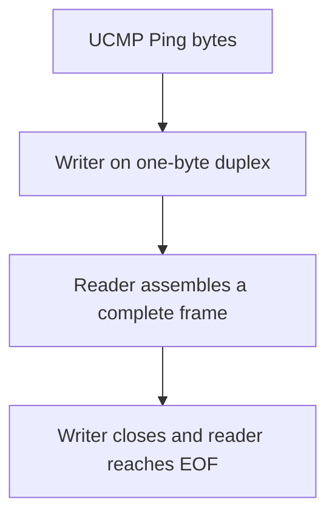

# Read a complete frame over partial I/O

Send one encoded UCMP Ping through a one-byte-capacity in-memory duplex stream. This exercises internal framing across partial I/O without an endpoint or peer authentication.

This offline contributor exercise follows the development workspace at `0.1.0-beta`.



Excerpt from lines 19–38 of the [example source](../../../crates/undercurrent-transport-local/examples/framing_roundtrip.rs#L19).

```rust
    let send = async move {
        writer.send(sent).await?;
        writer.close().await
    };
    let receive = async move {
        let actual = reader
            .next()
            .await
            .ok_or_else(|| io::Error::new(io::ErrorKind::UnexpectedEof, "missing frame"))??;
        if actual != expected {
            return Err(io::Error::new(io::ErrorKind::InvalidData, "frame mismatch"));
        }
        if reader.next().await.is_some() {
            return Err(io::Error::new(
                io::ErrorKind::InvalidData,
                "expected clean EOF",
            ));
        }
        Ok::<(), io::Error>(())
    };
```

## Run the example

Run from the repository root with the [pinned Rust toolchain](../../../rust-toolchain.toml)
and the locked dependencies available offline.

```sh
cargo +1.95.0 run --locked --offline -p aixand-undercurrent-transport-local --example framing_roundtrip
```

Observed stdout from the verified Linux execution:

```text
verified one complete UCMP Ping and clean EOF
```

The reader checks byte equality and then expects clean EOF. The sender and receiver run together under a five-second deadline. On failure, distinguish a missing or mismatched frame from a timeout waiting for the writer to close. The duplex endpoints close locally and there are no socket files to remove.

[Complete source](../../../crates/undercurrent-transport-local/examples/framing_roundtrip.rs) · [Crate documentation](../../../crates/undercurrent-transport-local/docs/README.md) · [Offline examples](README.md)
