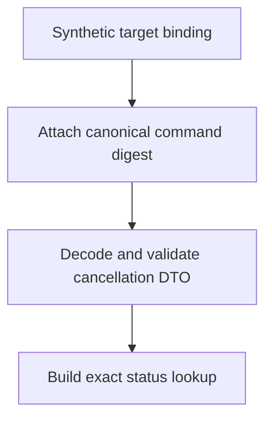

# Validate synthetic cancellation material

Build a cancellation DTO and its corresponding status lookup using synthetic identities. This exercise checks local protocol validation only. It sends no command and grants no authority.

This offline contributor exercise follows the development workspace at `0.1.0-beta`.



Excerpt from lines 40–59 of the [example source](../../../crates/undercurrent-protocol/examples/inspect_cancellation.rs#L40).

```rust
    let digest = material.canonical_digest_sha256()?;
    let request = CancelRuntimeAttemptRequest::attached(material, digest)?;
    let bytes = serde_json::to_vec(&request)?;
    let decoded: CancelRuntimeAttemptRequest = serde_json::from_slice(&bytes)?;
    decoded.validate()?;
    assert_eq!(decoded, request);
    assert_ne!(
        decoded.command_digest_sha256(),
        decoded.product_request_fingerprint_sha256()?
    );
    println!("cancellation: valid round trip; command and product digests differ");

    let mut changed: serde_json::Value = serde_json::from_slice(&bytes)?;
    changed["reason"] = serde_json::json!("changed reason");
    let changed: CancelRuntimeAttemptRequest = serde_json::from_value(changed)?;
    assert_eq!(
        changed.validate(),
        Err(RuntimeCancellationDtoError::CommandDigestMismatch)
    );
    println!("changed reason: decoded shape, rejected semantic digest");
```

Excerpt from lines 61–75 of the [example source](../../../crates/undercurrent-protocol/examples/inspect_cancellation.rs#L61).

```rust
    let status = GetRuntimeCancellationStatusRequest::attached(
        decoded.control_id().to_owned(),
        decoded.command_digest_sha256().to_owned(),
        decoded.target_attempt_id().to_owned(),
        decoded.target_request_digest_sha256().to_owned(),
        decoded.session_id().to_owned(),
        decoded.expected_provider_id().to_owned(),
        decoded.expected_provider_generation(),
        decoded.source_product().to_owned(),
        decoded.tenant_id().to_owned(),
        decoded.actor_context_ref().to_owned(),
        "authority://status/1".to_owned(),
    )?;
    status.validate()?;
    println!("status: exact lookup constructed; no command was sent");
```

## Run the example

Run from the repository root with the [pinned Rust toolchain](../../../rust-toolchain.toml)
and the locked dependencies available offline.

```sh
cargo +1.95.0 run --locked --offline -p aixand-undercurrent-protocol --example inspect_cancellation
```

Observed stdout from the verified Linux execution:

```text
cancellation: valid round trip; command and product digests differ
changed reason: decoded shape, rejected semantic digest
status: exact lookup constructed; no command was sent
```

The canonical command digest and the product request fingerprint serve different checks and differ for this fixture. Successful JSON decoding still requires semantic validation. Changing the reason without updating the bound digest yields `CommandDigestMismatch`. Inspect the original bound material and use its exact identity for a status lookup. The status DTO uses its own authority reference. All fixture state is in memory.

[Complete source](../../../crates/undercurrent-protocol/examples/inspect_cancellation.rs) · [Crate documentation](../../../crates/undercurrent-protocol/docs/README.md) · [Offline examples](README.md)
