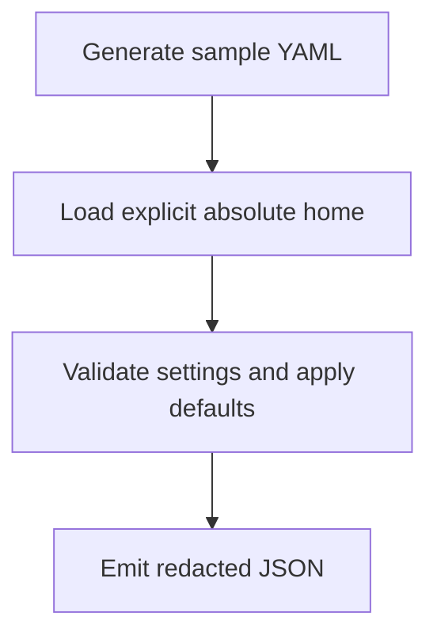

# Inspect effective configuration in a temporary home

Load the maintained YAML sample and inspect selected settings in the redacted JSON report. The report describes on-disk effective settings.

This offline contributor exercise follows the development workspace at `0.1.0-beta`.



Excerpt from lines 36–48 of the [example source](../../../crates/undercurrent-config/examples/inspect_config.rs#L36).

```rust
    if home.to_str() == Some("--sample") {
        print!("{SAMPLE_CONFIG}");
        return ExitCode::SUCCESS;
    }
    let discovery = ConfigDiscovery::from_path_env(
        PathEnvironment::default().with_undercurrent_home(PathBuf::from(home)),
    );
    match load_config(&discovery) {
        Ok(loaded) => match serde_json::to_string_pretty(&loaded.redacted_report()) {
            Ok(report) => {
                println!("{report}");
                ExitCode::SUCCESS
            }
```

## Run the example

Run from the repository root with the [pinned Rust toolchain](../../../rust-toolchain.toml)
and the locked dependencies available offline. Use Bash or Zsh on Linux/macOS and an absolute `TMPDIR` if you set it.

```sh
(
  set -eu
  unset UNDERCURRENT_CONFIG UNDERCURRENT_DATABASE_PATH
  unset UNDERCURRENT_INSTANCE_LOCK_PATH UNDERCURRENT_LOCAL_ENDPOINT
  config_home=$(mktemp -d "${TMPDIR:-/tmp}/uc-config-example.XXXXXX")
  trap 'rm -f "$config_home/config.yaml"; rmdir "$config_home"' EXIT
  cargo +1.95.0 run --locked --offline -p undercurrent-config --example inspect_config -- \
    --sample > "$config_home/config.yaml"
  cargo +1.95.0 run --locked --offline -p undercurrent-config --example inspect_config -- \
    "$config_home"
  test ! -e "$config_home/state"
  test ! -e "$config_home/run"
)
```

JSON fields checked during the verified Linux execution:

| Field | Value |
| --- | --- |
| `scope` | `on_disk_effective_configuration` |
| `cli_connection_profile` | `compiled_standard` |
| `prefix_source` | `main_config_or_default` |
| `settings.cli.command_timeout_millis` | `45000` |
| `settings.cli.list_page_size` | `17` |
| `settings.shortcuts.prefix` | `ctrl-a` |
| `settings.terminal.scrollback.memory_lines` | `0` |
| `settings.terminal.replay_bytes` | `1048576` |

The report should omit the temporary home path. The two filesystem checks confirm the loader left `state` and `run` absent. The shell removes its sample file and directory on exit. Exit 2 means incorrect argument count. For exit 1, inspect the diagnostic and confirm the home is absolute, only one active configuration exists, and the YAML uses current fields. See the [configuration diagnostic guide](../../guides/configuration/diagnose.md).

[Complete source](../../../crates/undercurrent-config/examples/inspect_config.rs) · [Crate documentation](../../../crates/undercurrent-config/docs/README.md) · [Offline examples](README.md)
