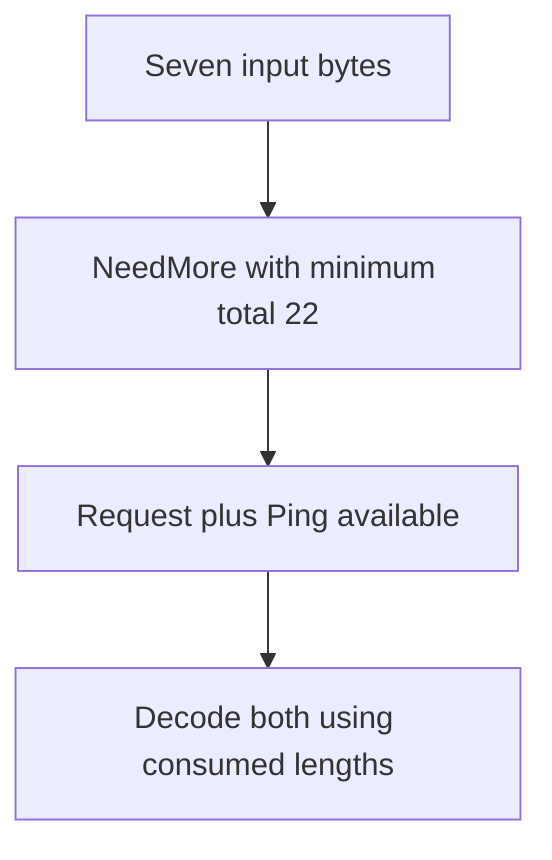

# Decode fragmented frames and account for credit

Negotiate a UCMP connection agreement in memory, then decode fragmented and adjacent frames under its maximum frame size. Request bytes are opaque codec samples.

This offline contributor exercise follows the development workspace at `0.1.0-beta`.



Excerpt from lines 70–87 of the [example source](../../../crates/undercurrent-wire/examples/inspect_frames.rs#L70).

```rust
    let encoded = codec.encode_client(&request)?;
    let mut input = encoded[..7].to_vec();
    assert_eq!(
        codec.decode_client(&input)?,
        DecodeStatus::NeedMore { minimum_total: 22 }
    );
    input.extend_from_slice(&encoded[7..]);
    input.extend_from_slice(&codec.encode_client(&ClientMessage::Ping)?);
    let DecodeStatus::Complete(first) = codec.decode_client(&input)? else {
        return Err("complete request expected".into());
    };
    assert_eq!(first.message, request);
    let DecodeStatus::Complete(second) = codec.decode_client(&input[first.consumed..])? else {
        return Err("complete ping expected".into());
    };
    assert_eq!(second.message, ClientMessage::Ping);
    assert_eq!(first.consumed + second.consumed, input.len());
    println!("decoded fragmented request and following ping");
```

Excerpt from lines 99–111 of the [example source](../../../crates/undercurrent-wire/examples/inspect_frames.rs#L99).

```rust
    let encoded = codec.encode_server(&message)?;
    let DecodeStatus::Complete(decoded) = codec.decode_server(&encoded)? else {
        return Err("complete data frame expected".into());
    };
    let ServerMessage::StreamItem { item, .. } = decoded.message else {
        return Err("stream item expected".into());
    };
    assert_eq!(item.encoded_len(), encoded.len() as u64);
    let InboundStreamItem::Data { bytes, .. } = item else {
        return Err("data expected".into());
    };
    assert_eq!(bytes, binary);
    println!("binary payload preserved; credit includes the full frame");
```

## Run the example

Run from the repository root with the [pinned Rust toolchain](../../../rust-toolchain.toml)
and the locked dependencies available offline.

```sh
cargo +1.95.0 run --locked --offline -p aixand-undercurrent-wire --example inspect_frames
```

Observed stdout from the verified Linux execution:

```text
negotiated protocol 0.1.0-beta; maximum frame 4096 bytes
decoded fragmented request and following ping
binary payload preserved; credit includes the full frame
```

The seven-byte prefix needs at least 22 bytes total before decoding can proceed. Keep that prefix and append new bytes. After a complete decode, advance by its consumed length so the following Ping remains available. The binary data check preserves all four bytes and charges the complete encoded frame to credit. No connection or persistent state needs cleanup.

[Complete source](../../../crates/undercurrent-wire/examples/inspect_frames.rs) · [Crate documentation](../../../crates/undercurrent-wire/docs/README.md) · [Offline examples](README.md)
